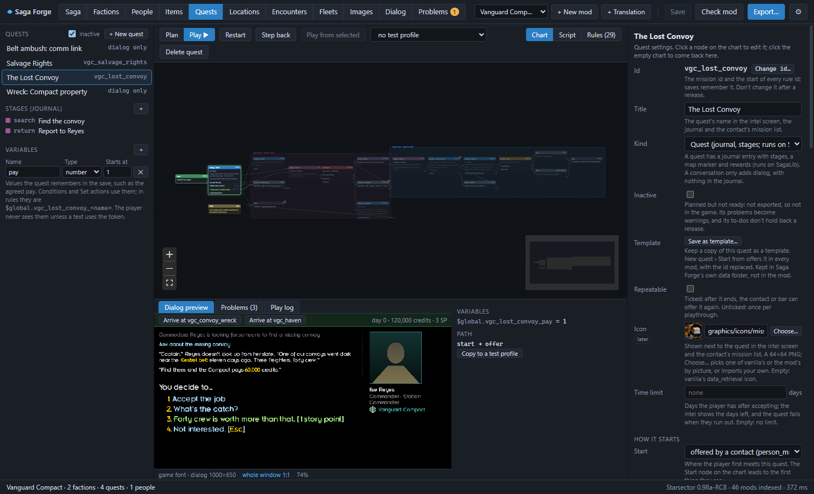
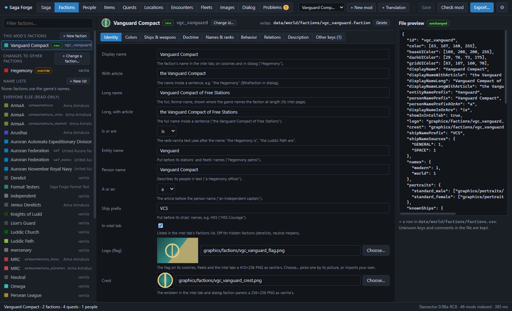

# Saga Forge

A desktop editor (Electron + Svelte, Windows and Linux) for the campaign side of Starsector mods:
factions, people, items, branching quests and dialog, star systems and encounters. It works the
way vanilla does, so mods made with it stay compatible with other mods:

- factions are `.faction` files and patches the game merges;
- dialog is `rules.csv`;
- items are CSV rows.

Quests, people, systems and encounters are exported as JSON that the companion library
**SagaLib** ([Starsector-SagaLib](https://github.com/LastAi/Starsector-SagaLib), MIT) runs
in game, so content mods ship no code. Saga Forge's own license is MIT (see `LICENSE`). Mods made
with it belong to their authors.

**Status: 1.1** (2026-11-17), for Starsector **0.98a and 0.98.5a**; needs **SagaLib 1.2** in game.
Milestones M0–M8 of [docs/PLAN.md](docs/PLAN.md) and the workflow phases of
[docs/WORK-ORDER.md](docs/WORK-ORDER.md) are built, the automated tests pass, and each step was
checked in game ([docs/INGAME-CHECKS.md](docs/INGAME-CHECKS.md)). Changes:
[CHANGELOG.md](CHANGELOG.md).

> **Linux: available but untested.** Saga Forge supports Linux (`./run.sh` from source, or
> `npm run dist:linux` for an AppImage), but it has only been tested on Windows so far. If you try
> it on Linux, reports in [Issues](https://github.com/LastAi/Starsector-SagaForge/issues) are very
> welcome.

> **Work in progress: the workflows.** Every form field now has a visible label and a short help
> line saying what it is and where it shows in game, and the editor offers one-click versions of
> the vanilla-safe patterns (a protected quest wreck, "back to the menu" endings, placing a
> quest's fleet where the quest sends the player). The full first-launch-to-release walkthrough is
> still being tested by hand and in game. Feedback and ideas are welcome in
> [Issues](https://github.com/LastAi/Starsector-SagaForge/issues).

## Running it

- Windows, ready-made: download `saga-forge-<version>-win-x64.zip` from Releases, unzip it
  anywhere and run `Saga Forge.exe`. It is not code-signed, so Windows may warn the first time.
  Settings are kept in a `data` folder next to it.
- From source (needs Node.js 22+):
  - Windows: double-click `run.cmd` (dev mode), or `run.cmd start` to build and run.
  - Linux: `./run.sh`, or `./run.sh start`.

The first run from source installs the npm packages and downloads Electron into a `.cache`
folder (the workspace's `.cache` when it is inside one, else next to the program).

On first start, pick the Starsector folder, then your mods folder in ⚙ Settings (the workspace,
e.g. `D:\ModTools\mods`, or "work directly in the game's mods folder"). Then pick or create the
**active mod** in the header. It asks for the mod's **id prefix** once (e.g. `vgc_`); every id the
editor creates starts with it.

**Moving a mod to a new game version** (e.g. 0.98a → 0.98.5a): add the other install as the
**Migration install** in ⚙ Settings. A pill in the header then picks which version the active
mod targets (remembered per mod). Id fields show what only one version has, and Problems blocks
an export that uses something the target lacks. A mod made for the older version gets a
**migration** dialog: a snapshot, what must change (with one-click safe fixes), what to check, and
**Export for …**. Neither install is ever written to.

Saga Forge reads the base game and **every installed mod** (enabled or not) read-only. It only
writes into the active mod, through a write guard copied from Ship Editor:

- never the Starsector folder, other mods or `enabled_mods.json`;
- never code;
- never a file that changed on disk since it was read.

## Pages

| Page | What |
|---|---|
| **Saga** | Every quest as a card, with prerequisite and flag arrows; a timeline; the **flags registry** (who sets and reads every memory key, "did you mean" for typos, one-click fix); **test profiles**; mod-wide **phrases**; **Pools**: named random pools (weighted, with conditions and limits) that Random branches roll, **loot tables** (the mod's own drop groups) and **random encounters** at vanilla's encounter points; **Scatter**: objects placed at new game in places picked like a random target (SagaLib 1.2). |
| **Factions** | This mod's factions (full editor) and **changes to other factions** (only a patch is written, at the original's path; the effective faction shows vanilla's values, other mods' additions and yours). Starting relations and scripted removals go to SagaLib. **Name lists** for the mod's own people's and ship names; fleet type names; pirate bases, bounties and punitive expeditions; Other keys with recommendations from vanilla's factions. |
| **People** | The mod's characters: portrait, rank, post, placement at a market, contact settings, and **phrases**, wording that changes with the situation (e.g. "Commander Varga" once commissioned). Characters (and quests) not ready yet can be marked **Inactive**: kept in the plans, left out of Export. Existing characters are read-only. ⓘ buttons explain the lists. A field that waits for a later step can be marked **later** (a To do in Problems). |
| **Items** | New commodities and special items with presets (*Quest item*: not traded, not lost, hidden in the Codex), icon and description. Existing items are read-only. |
| **Quests** | The flow chart: Start, Dialog (text plus its options, one output each), Branch (by conditions, or **at random** by weight with limits: SagaLib 1.2), quest variables that are **random targets** (a planet, place, system or market picked with vanilla's own mission search when the quest is offered, with what it is like, a person there, and things or fleets spawned there; SagaLib 1.2), Action, Stage, Encounter, Wait/Arrive, **Raid** (a ground raid the way vanilla's story raids work), End, Link (back to the menu, which also closes the dialog at a wreck; back to the bar; or into existing dialog), Note. Quests start from a contact, a bar event, an option in a menu, a trigger, an interjection or **a bar scene** without a mission. Inspector forms for visuals, displays, show-once and story-point options, phrases; the stage outline (journal text, next-step line, map marker picked from the mod's and the game's places). The **dialog preview** draws the selected node with the game's own bitmap fonts and colors. **Play ▶** runs the exported rules with the Test context (who the player is, who they talk to, and the **place**: a colony, its bar, a planet with ruins, a decivilised world, a derelict) or a test profile. **Rules** shows the `rules.csv` rows the quest exports. **Script** shows the whole quest as a screenplay, with Copy as Markdown for a proofreader. New quests can **start from a template** (delivery, bounty, investigate, rescue, talk-to-someone) or from one of your own (**Save as template…**); what the template leaves open shows up as to-dos. Text fields are spellchecked, with a per-mod word list (right-click a word). |
| **Locations** | New star systems on a hyperspace map with the real vanilla systems; planets, stations, belts, jump points, relays; markets with conditions, industries and people; additions to existing systems. Vanilla systems are shown read-only from the game's own source, so additions can be placed around their bodies. Types are chosen by picture, with "fits here" recommendations, and the mod can have its own station, planet and star types. With SagaLib 1.1: systems without a star, uncolonised planets with conditions, and objects that appear or are removed when a quest reaches a stage. Salvage objects can have **loot** (drop groups) and **defenders**, and colonies can be protected from decivilisation (SagaLib 1.2). A wreck a quest needs gets **Protect this wreck**: a short conversation that keeps vanilla's salvage away until the quest is done. |
| **Encounters** | Fleets (doctrine points or exact variants), spawn (with the places the spawning quest sends the player as one-click choices), behavior, flags, a comm-link dialog scoped to that fleet, and the quest outcomes (defeated / avoided). |
| **Fleets** | **Named fleets** (ships with their own names, a flagship and a captain) that encounters reuse, fleet type names for every faction, and a preview of what each of the mod's factions' doctrine builds. |
| **Images** | The mod's flags, crests, portraits, item icons, mission icons and illustrations with thumbnails and sizes. **Import…** takes files or a folder, crops and resizes each to vanilla's size, and saves it as a PNG with the mod's prefix in the right folder. Every image field's **Choose…** opens a picker with previews of the mod's, vanilla's and other mods' images. |
| **Dialog** | A browser for every `rules.csv` row of the game and the installed mods, drawn as a chart per conversation, with the preview and a live play-through. |
| **Problems** | Live problems by level (Error, Warning, Save warning, To do, Style, Info), with fixes and "ignore with a reason". **Check mod** adds the cross-mod checks: id collisions with every installed mod, FireBest takeovers of vanilla dialog. |

## Save, Export, release

- **Save** (Ctrl+S) writes the plans (`<mod>/sagaforge/`, ignored by the game) and the mod's
  faction files. Undo/redo with Ctrl+Z / Ctrl+Y covers the whole mod.
- **Export…** shows every file it would write, and whether it is new, changed, unchanged or an
  **owned block**. Generated `rules.csv`, CSV and description rows go between
  `# sagaforge:begin/end` marker rows, and hand-written rows outside them are never touched. A
  block edited by hand stops the export and offers *Show diff*, *Overwrite* or *Detach*. The
  previous versions go to `sagaforge/backups/` (last 10). It also writes:
  - SagaLib's JSON and its `content.csv` index;
  - `person_missions.csv` / `bar_events.csv` rows;
  - the mod's illustrations in `settings.json`;
  - the SagaLib dependency in `mod_info.json` (asked once), and the mod's version when you change
    it in the dialog's **Mod version** field (raise it for each update).
- **Mark as released** (in the Export dialog) stores every id saves depend on. From then on,
  **save warnings** say which changes would break a player's save. **Change id…** on a stage
  offers to keep the old id as an alias: SagaLib moves players in that stage to the new id when
  they load. It also packs the release: **`[0.98a] Mod name 1.1.0.zip`** (one folder named after
  the mod, ready to unzip into `Starsector/mods`; without `sagaforge/` and the dev-mode test
  profiles) in the **releases folder** (Saga
  Forge's data folder › `releases`, or one chosen in Settings; never inside a mod or the game).
- **Release details** (Export dialog, optional): the address of the mod's **Version Checker** file
  online, the download link and the forum thread. (A forum post draft is coming later, as post
  templates you make.) With a version file address, Export writes
  `<mod id>.version` and lists it in `data/config/version/version_files.csv`; upload the file to
  that address after each release.

The game files and their merge rules Saga Forge relies on were read from the engine and are
documented in [docs/FORMATS.md](docs/FORMATS.md). SagaLib's format is its
[docs/FORMAT.md](https://github.com/LastAi/Starsector-SagaLib/blob/main/docs/FORMAT.md).

## Translations

Anyone can translate a mod made with Saga Forge without copying it: **+ Translation** (in the
header) picks an installed mod and a language and creates a small **translation mod**
(`<mod id>_<language>`): one CSV of texts, applied by SagaLib in game next to the original. Its
**Translation** page shows every text the player reads, where it shows, and its translation; a
text whose original changed since is marked until you check it (until then the game shows the
original). Only text the player reads is translated. For that, Export writes a mod's dialog as
tokens with its texts in `data/sagaforge/text.json` (**Translatable texts** in the Export dialog,
on by default; needs SagaLib 1.2). Languages with other letters (Chinese, Japanese, Korean,
Cyrillic) also need a font mod.

## Bringing an existing mod into Saga Forge

[docs/AI-CONVERSION.md](docs/AI-CONVERSION.md) is a guide for an AI assistant (for example a
Claude Code session) that converts an existing mod (its Java code and hand-written data) into
Saga Forge's plans, on a copy of the mod, keeping the ids saves depend on, and lists what has to
stay in code. Only for mods you made or may change.

## The example mod

**Vanguard Compact** (`example/VanguardCompact` in this repo, MIT; `mods/VanguardCompact` in the
author's workspace) is the PITCH.md walkthrough built with the app's own code:
`npx jiti scripts/build-example.ts`. Install it next to SagaLib to play it: a new faction, a
star system near Duzahk, a contact with two quests, an ambush fleet with its own comm dialog, and
a protected wreck. Its `sagaforge/` folder is the editor project, so you can open it in Saga
Forge as the active mod. It is also the acceptance test: `test/example.test.ts` checks it against
the real game index, plays the whole quest, and compares its export with `test/expected/vanguard`.

## Development

- `npm test` runs the unit tests, the real-install tests (`STARSECTOR_DIR`, or `D:\Starsector`
  when it exists; read-only), and the golden cases shared with SagaLib (SagaLib's `test/golden`;
  the published repo carries a copy in `test/golden`).
- `npm run check` type-checks.
- `npm run build`, then `node scripts/smoke.mjs <page>[:<id>[:<arg>]] --mod <mod folder>` writes a
  screenshot of a page (arg: a tab, `node=<id>`, `play=1,2` to play options, or `entity=<id>` on
  Locations; a fourth part opens a dialog or panel, e.g. `factions:::new`, `quests:<id>::stages`,
  `quests:<id>:node=<n>:opt=<option>`).
- `node scripts/walk.mjs start [--fresh]` runs the built app with its own settings
  (`.userdata/walk`) and DevTools on port 9333; `node scripts/walk.mjs run <steps file>` then
  clicks, types, drags and takes screenshots on the real UI (the step list is at the top of the
  script); `stop` closes it. Used for the workflow walk (`docs/INGAME-CHECKS.md`).
- `npm run dist:win` / `npm run dist:linux` build the portable zip / AppImage into `dist/`. Settings
  live in a `data` folder next to the program.
- Definitions for the game version (rule commands, tokens, memory keys, ranks, item presets, …)
  are data: `src/shared/defs/0.98a.json`. User patches go in `<data>/definitions/*.json`.
- Extensions for other mods' formats: [docs/extensions.md](docs/extensions.md).

Planning documents: [docs/PLAN.md](docs/PLAN.md), [docs/PITCH.md](docs/PITCH.md),
[docs/mockups/](docs/mockups/index.html). A checklist for a test mod that uses every workflow:
[docs/TEST-MOD-CHECKLIST.md](docs/TEST-MOD-CHECKLIST.md).
