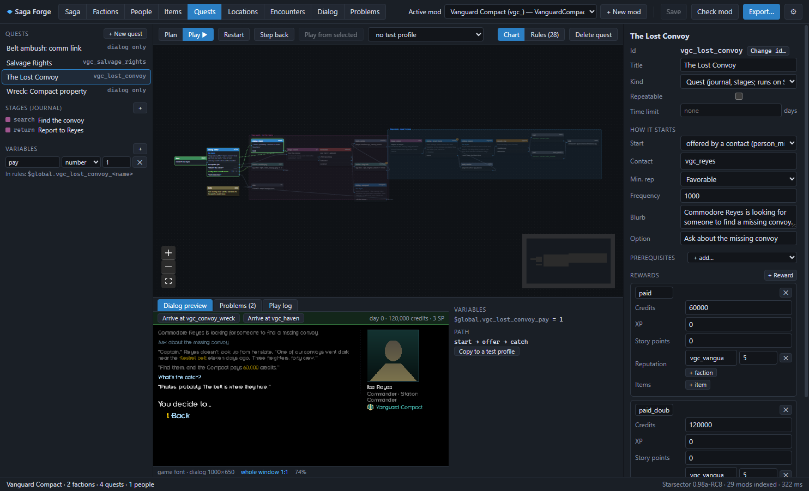
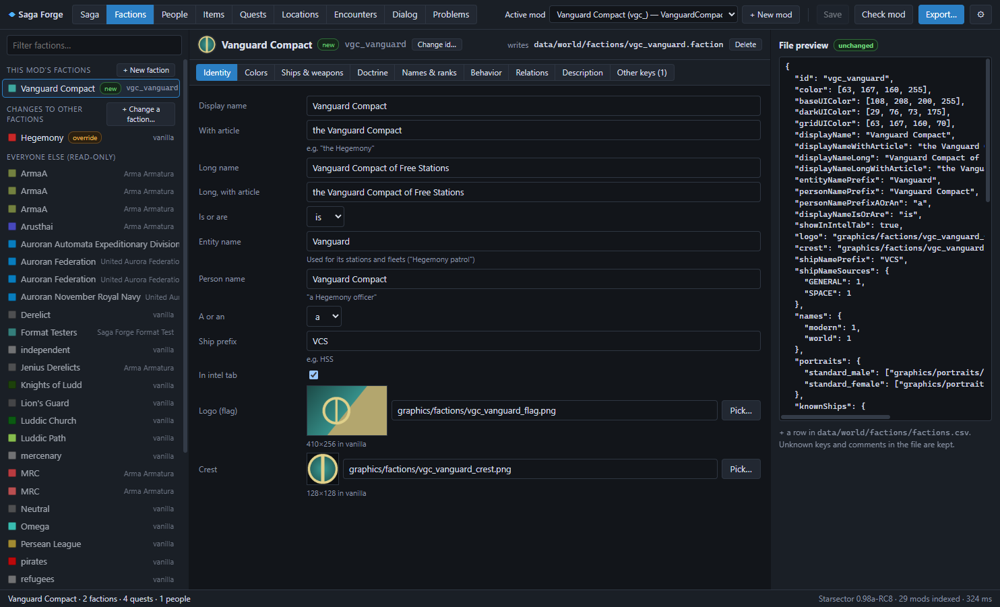

# Saga Forge

A desktop editor (Electron + Svelte, Windows and Linux) for the campaign side of Starsector mods:
factions, people, items, branching quests and dialog, star systems and encounters. It works the
way vanilla does, so mods made with it stay compatible with other mods:

- factions are `.faction` files and patches the game merges;
- dialog is `rules.csv`;
- items are CSV rows.

Quests, people, systems and encounters are exported as JSON that the companion library
**SagaLib** ([Starsector-SagaLib](https://github.com/LastAi/Starsector-SagaLib), MIT) runs
in game, so content mods ship no code. Saga Forge's own license is MIT (see `LICENSE`). Mods made
with it belong to their authors.

**Status: 1.0** (2026-11-11), for Starsector 0.98a. Milestones M0–M8 of
[docs/PLAN.md](docs/PLAN.md) are built, the automated tests pass, and the full example walkthrough
passed in game ([docs/INGAME-CHECKS.md](docs/INGAME-CHECKS.md)). Changes:
[CHANGELOG.md](CHANGELOG.md).

> **Linux: available but untested.** Saga Forge supports Linux (`./run.sh` from source, or
> `npm run dist:linux` for an AppImage), but it has only been tested on Windows so far. If you try
> it on Linux, reports in [Issues](https://github.com/LastAi/Starsector-SagaForge/issues) are very
> welcome.

> **Work in progress: the workflows.** Everything listed below works, but the way you move
> through the editor (creating a quest, wiring dialog, exporting) is still being refined. Over the
> next few days it will be updated to be clearer and easier to use, including labels and short
> help on every field. Feedback and ideas are welcome in
> [Issues](https://github.com/LastAi/Starsector-SagaForge/issues).

## Running it

- Windows, ready-made: download `saga-forge-<version>-win-x64.zip` from Releases, unzip it
  anywhere and run `Saga Forge.exe`. It is not code-signed, so Windows may warn the first time.
  Settings are kept in a `data` folder next to it.
- From source (needs Node.js 22+):
  - Windows: double-click `run.cmd` (dev mode), or `run.cmd start` to build and run.
  - Linux: `./run.sh`, or `./run.sh start`.

The first run from source installs the npm packages and downloads Electron into a `.cache`
folder (the workspace's `.cache` when it is inside one, else next to the program).

On first start, pick the Starsector folder, then your mods folder in ⚙ Settings (the workspace,
e.g. `D:\ModTools\mods`, or "work directly in the game's mods folder"). Then pick or create the
**active mod** in the header. It asks for the mod's **id prefix** once (e.g. `vgc_`); every id the
editor creates starts with it.

Saga Forge reads the base game and **every installed mod** (enabled or not) read-only. It only
writes into the active mod, through a write guard copied from Ship Editor:

- never the Starsector folder, other mods or `enabled_mods.json`;
- never code;
- never a file that changed on disk since it was read.

## Pages

| Page | What |
|---|---|
| **Saga** | Every quest as a card, with prerequisite and flag arrows; a timeline; the **flags registry** (who sets and reads every memory key, "did you mean" for typos, one-click fix); **test profiles**; mod-wide **phrases**. |
| **Factions** | This mod's factions (full editor) and **changes to other factions** (only a patch is written, at the original's path; the effective faction shows vanilla's values, other mods' additions and yours). Starting relations and scripted removals go to SagaLib. |
| **People** | The mod's characters: portrait, rank, post, placement at a market, contact settings, and **phrases**, wording that changes with the situation (e.g. "Commander Varga" once commissioned). Existing characters are read-only. |
| **Items** | New commodities and special items with presets (*Quest item*: not traded, not lost, hidden in the Codex), icon and description. Existing items are read-only. |
| **Quests** | The flow chart: Start, Dialog (text plus its options, one output each), Branch, Action, Stage, Encounter, Wait/Arrive, End, Link (into existing dialog), Note. Inspector forms for visuals, displays, show-once and story-point options, phrases. The **dialog preview** draws the selected node with the game's own bitmap fonts and colors. **Play ▶** runs the exported rules with the Test context or a test profile. **Rules** shows the `rules.csv` rows the quest exports. |
| **Locations** | New star systems on a hyperspace map with the real vanilla systems; planets, stations, belts, jump points, relays; markets with conditions, industries and people; additions to existing systems. |
| **Encounters** | Fleets (doctrine points or exact variants), spawn, behavior, flags, a comm-link dialog scoped to that fleet, and the quest outcomes (defeated / avoided). |
| **Dialog** | A browser for every `rules.csv` row of the game and the installed mods, drawn as a chart per conversation, with the preview and a live play-through. |
| **Problems** | Live problems by level (Error, Warning, Save warning, Style, Info), with fixes and "ignore with a reason". **Check mod** adds the cross-mod checks: id collisions with every installed mod, FireBest takeovers of vanilla dialog. |

## Save, Export, release

- **Save** (Ctrl+S) writes the plans (`<mod>/sagaforge/`, ignored by the game) and the mod's
  faction files. Undo/redo with Ctrl+Z / Ctrl+Y covers the whole mod.
- **Export…** shows every file it would write, and whether it is new, changed, unchanged or an
  **owned block**. Generated `rules.csv`, CSV and description rows go between
  `# sagaforge:begin/end` marker rows, and hand-written rows outside them are never touched. A
  block edited by hand stops the export and offers *Show diff*, *Overwrite* or *Detach*. The
  previous versions go to `sagaforge/backups/` (last 10). It also writes:
  - SagaLib's JSON and its `content.csv` index;
  - `person_missions.csv` / `bar_events.csv` rows;
  - the mod's illustrations in `settings.json`;
  - the SagaLib dependency in `mod_info.json` (asked once).
- **Mark as released** (in the Export dialog) stores every id saves depend on. From then on,
  **save warnings** say which changes would break a player's save. **Change id…** on a stage
  offers to keep the old id as an alias: SagaLib moves players in that stage to the new id when
  they load.

The game files and their merge rules Saga Forge relies on were read from the engine and are
documented in [docs/FORMATS.md](docs/FORMATS.md). SagaLib's format is its
[docs/FORMAT.md](https://github.com/LastAi/Starsector-SagaLib/blob/main/docs/FORMAT.md).

## The example mod

**Vanguard Compact** (`example/VanguardCompact` in this repo, MIT; `mods/VanguardCompact` in the
author's workspace) is the PITCH.md walkthrough built with the app's own code:
`npx jiti scripts/build-example.ts`. Install it next to SagaLib to play it: a new faction, a
star system near Duzahk, a contact with two quests, an ambush fleet with its own comm dialog, and
a protected wreck. Its `sagaforge/` folder is the editor project, so you can open it in Saga
Forge as the active mod. It is also the acceptance test: `test/example.test.ts` checks it against
the real game index, plays the whole quest, and compares its export with `test/expected/vanguard`.

## Development

- `npm test` runs the unit tests, the real-install tests (`STARSECTOR_DIR`, or `D:\Starsector`
  when it exists; read-only), and the golden cases shared with SagaLib (SagaLib's `test/golden`;
  the published repo carries a copy in `test/golden`).
- `npm run check` type-checks.
- `npm run build`, then `node scripts/smoke.mjs <page>[:<id>[:<arg>]] --mod <mod folder>` writes a
  screenshot of a page (arg: a tab, `node=<id>`, or `play=1,2` to play options).
- `npm run dist:win` / `npm run dist:linux` build the portable zip / AppImage into `dist/`. Settings
  live in a `data` folder next to the program.
- Definitions for the game version (rule commands, tokens, memory keys, ranks, item presets, …)
  are data: `src/shared/defs/0.98a.json`. User patches go in `<data>/definitions/*.json`.
- Extensions for other mods' formats: [docs/extensions.md](docs/extensions.md).

Planning documents: [docs/PLAN.md](docs/PLAN.md), [docs/PITCH.md](docs/PITCH.md),
[docs/mockups/](docs/mockups/index.html).
