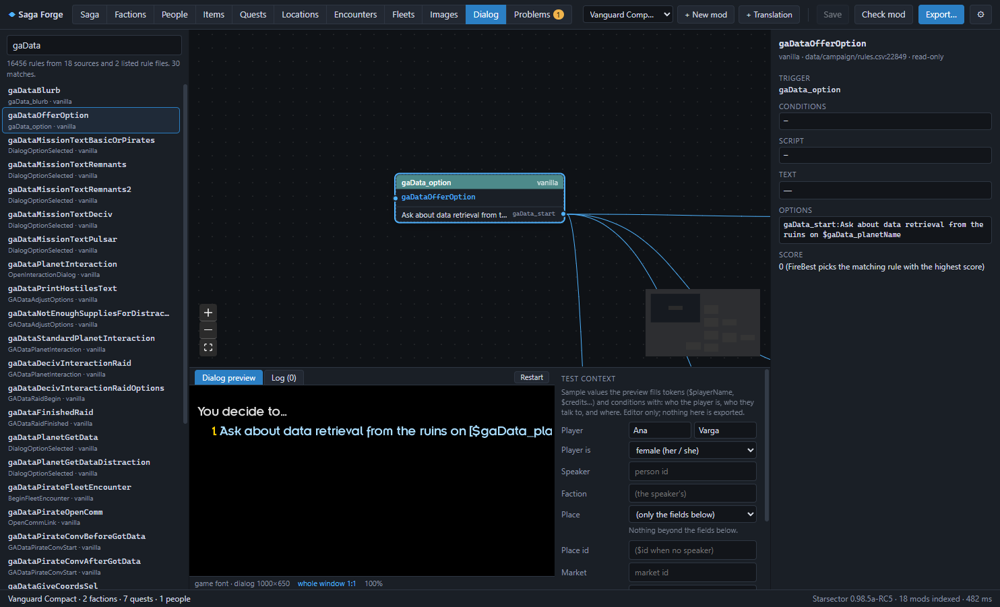
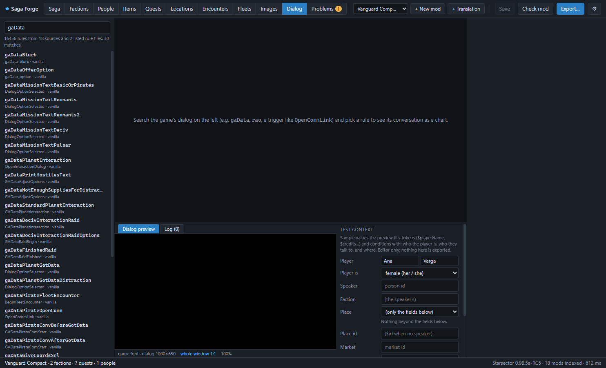
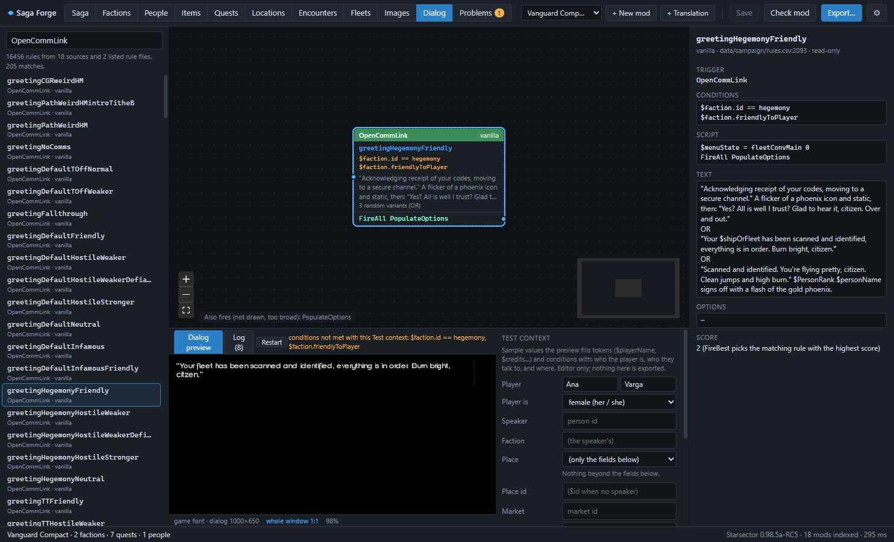

# Dialog

A browser for every dialog rule of the game and the installed mods: search them, see a
conversation as a chart, read a rule's conditions and script, and click through it in the dialog
preview. It is read-only: you look things up here, and build your own dialog on the Quests tab.

## How it works

Starsector's campaign dialog is made of **rules** (rows of `data/campaign/rules.csv`). Each rule
has a **trigger** (when it is checked: `OpenInteractionDialog`, `OpenCommLink`,
`PopulateOptions`, `DialogOptionSelected` …), **conditions**, a **script** (what it does), the
**text** it shows and the **options** it adds. When a trigger fires, the game picks the matching
rule with the highest **score**. Saga Forge reads all of them, from the game and every installed
mod, including mods that list extra rule files.

### Search

The box at the top left searches rule ids, triggers, option ids and text (`gaData`, `rao`, a
trigger like `OpenCommLink`). Under it: how many rules were read from how many sources, and how
many match (the first 300 are listed). Each result shows the rule id, its trigger and the mod it
comes from (`vanilla` for the base game).

### The chart

Picking a rule draws its conversation: the rule, the rules its options lead to and the rules that
lead to it, as cards joined by lines. Each card shows the trigger, the rule id, its conditions, the
start of its text and its options. Click a card to pick that rule. Triggers that would fire far too
many rules to draw (such as `PopulateOptions`) are named under the chart instead
(*Also fires: …*).

### The rule

The panel on the right shows the picked rule exactly as written: where it comes from (mod, file
and line), **Trigger**, **Conditions**, **Script**, **Text**, **Options** and its **Score**. This
is what you copy when your own dialog has to fit in next to it.

### Dialog preview and Test context

Under the chart, **Dialog preview** draws the rule the way the game shows it, with the game's own
fonts and colors. Click an option in the preview to play on; **Restart** starts over; **Log** lists
what happened (which rules fired, what was set).

**Test context** on the right fills in what the preview needs: the player's name and gender, who
they talk to (a person id), the faction, the place (a colony, its bar, a planet with ruins, a
derelict …), credits, story points, and values for memory keys the rule checks. It is only for
the preview and is never exported. When a rule's conditions don't hold with the current Test
context, the preview says which ones (*conditions not met with this Test context*).

The same preview and Test context are on the Quests tab, where they play your own quests (see
[Quests › Test a quest in Play mode](quests.md#test-a-quest-in-play-mode)). Rules your own mod
exported with translatable texts show their text as tokens (`$sft-…`) here, because SagaLib fills
them in only in game; play your own quests on the Quests tab instead.

## How to set up the basics

### Find a vanilla dialog rule

For example, how the Hegemony greets a friendly player over the comm link:

1. Open **Dialog** and type in the search box: a trigger (`OpenCommLink`), part of a rule id
   (`greetingHegemony`), an option id, or words from the text.
2. Pick a rule in the list: here `greetingHegemonyFriendly`.
3. Read the panel on the right: it fires on `OpenCommLink` when `$faction.id == hegemony` and
   `$faction.friendlyToPlayer`; its text has three variants (`OR`), one picked at random; its
   script sets `$menuState` and fires `PopulateOptions` to add the comm menu's options.
4. Look at the chart to see what leads to it and where its options go. Click a card to follow the
   conversation.
5. In **Dialog preview**, click the options to play through. If the preview says conditions are
   not met, set the missing values in **Test context** (here the speaker's faction).

### Hook into vanilla dialog

Your mod adds to vanilla's dialog; it doesn't edit vanilla's rules. Use the Dialog browser to find
the place you want to join, then build the hook on the Quests tab:

1. Find the vanilla rule where your content should appear (see
   [Find a vanilla dialog rule](#find-a-vanilla-dialog-rule)). Note its **trigger** and the
   **conditions** that make it fire there. For example a planet's or station's main menu is built
   on `PopulateOptions`, with conditions on `$id` (which place) or `$market.id`.
2. On the Quests tab, start your quest or conversation from that place: an option in that menu,
   a trigger, or an interjection, with the same kind of conditions (see
   [Quests › Start a quest from a dialog option](quests.md#start-a-quest-from-a-dialog-option)).
   Use your own place's or market's id in the conditions so your option only shows up there.
3. To go back into vanilla's dialog at the end of your conversation (back to the menu, or into a
   vanilla option), use a Link node on your quest's chart (see
   [Quests › Write a conversation](quests.md#write-a-conversation)).
4. When you export, the **Export…** dialog warns if one of your rules would take over vanilla's
   dialog everywhere: a rule on a trigger where the game picks one rule (`FireBest`), with
   vanilla's conditions plus more, but nothing about your own content. Add a condition with your
   prefix (your person, place or flag) and it only fires where you meant (see
   [Export and Release › Export the mod](export.md#export-the-mod)).

