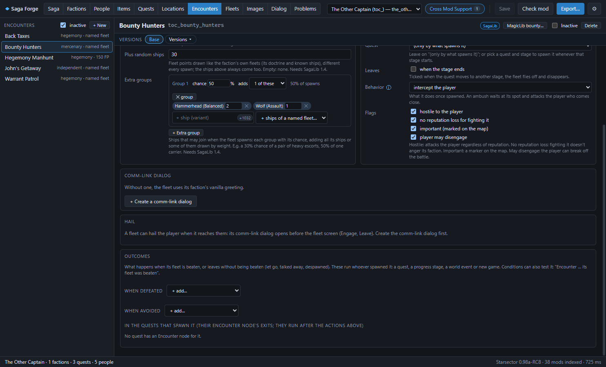
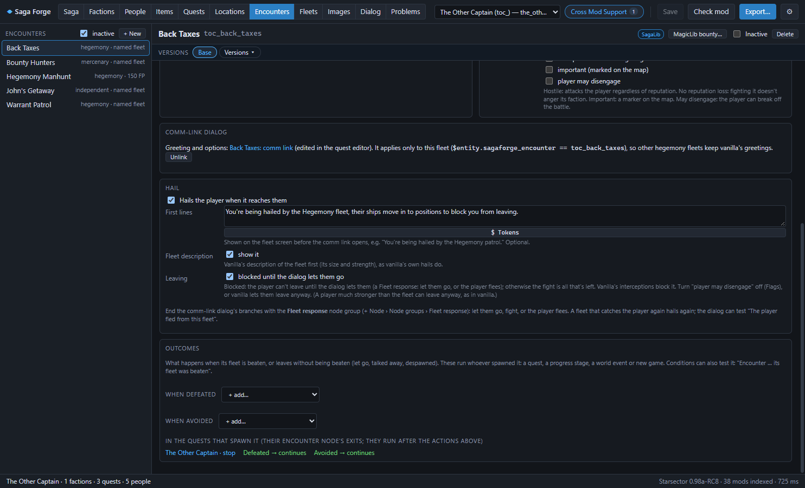
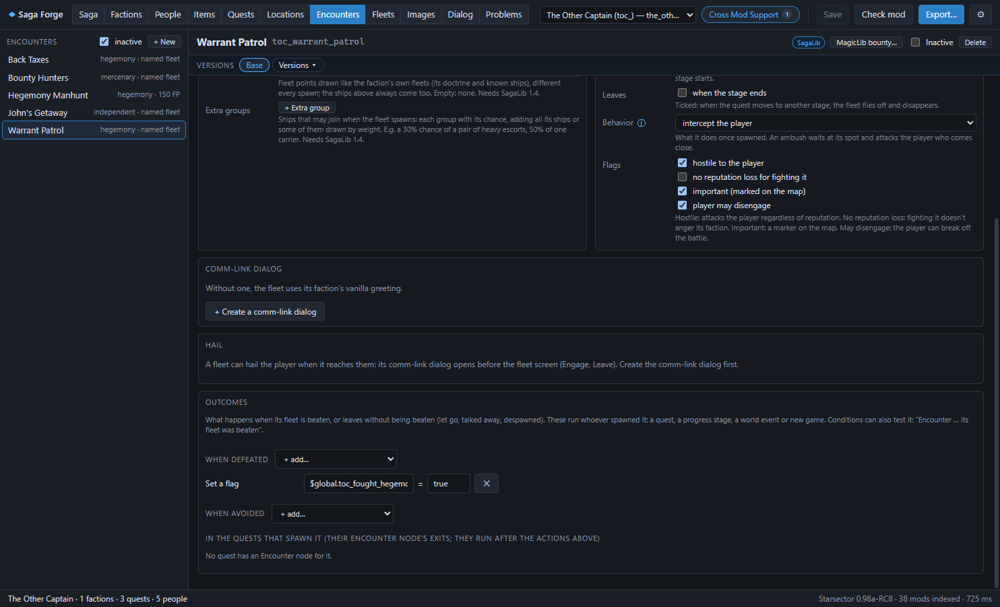
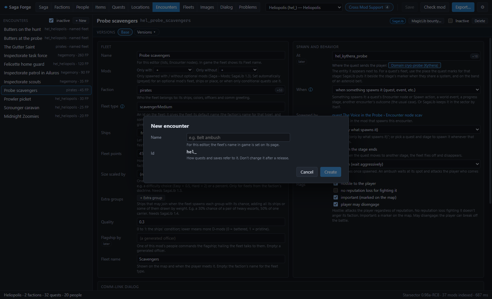
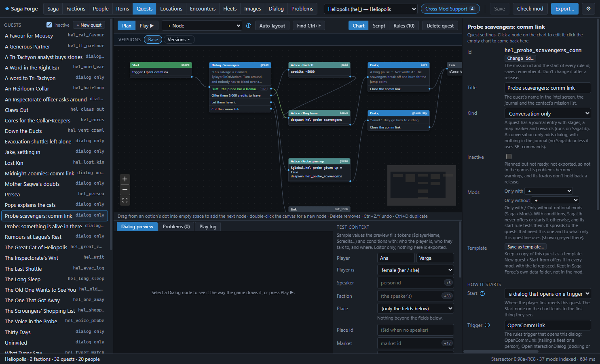
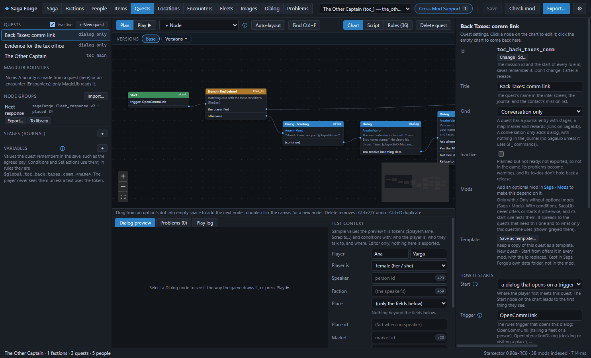
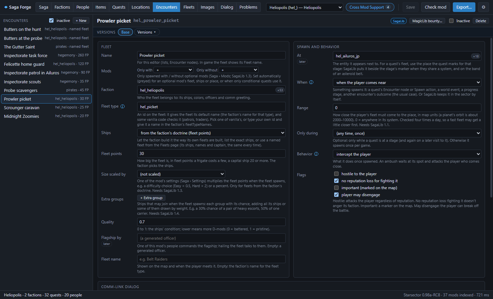
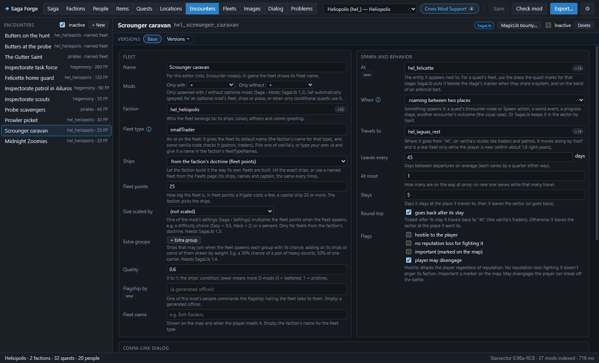
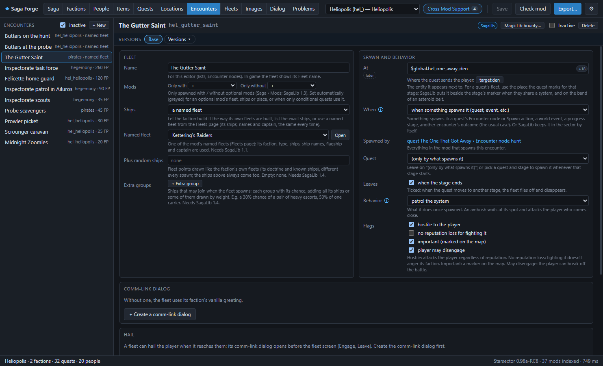

# Encounters

Fleets your mod puts in the sector: the scavengers waiting for the player in a quest, a patrol that
is there from the start, a fleet that turns up when the player comes near, a fleet that stops the
player and talks first, or traders that travel between two places by themselves.

## How it works

On the left is the list of the mod's encounters (with their faction and size); **+ New** makes
one, and the **inactive** box shows or hides encounters marked Inactive. The selected encounter's
form is on the right, in boxes. The header has its name and id, **Inactive** and **Delete**. Every
encounter is run by SagaLib in the game (the **SagaLib** badge in the header).

**Inactive** keeps an encounter in the editor without exporting it, for a draft. An encounter whose
named fleet is inactive isn't exported either, and pools leave both out. Problems lists what still
uses it: an Encounter node, a Spawn or Leaves action, a Fight node or a bounty is an error, a pool
entry a warning.

### Fleet

What the fleet is:

- **Name**: for the editor only (lists, Encounter nodes). The player sees the **Fleet name**.
- **Faction**: whose fleet it is: its ships, colours, officers and comm greeting.
- **Fleet type**: an id such as `patrolMedium` or `smallTrader`. It gives the fleet its default
  name (the faction's name for that type), and some vanilla code checks it. You can type your own
  id and name it (see [Fleets › Name fleet types](fleets.md#name-fleet-types)). The ⓘ opens the
  reference of fleet types.
- **Ships**, one of three ways:
  - **from the faction's doctrine (fleet points)**: the faction builds it the way it builds its own
    fleets; **Fleet points** sets how big (a frigate costs a few, a capital ship 20 or more).
    **Size scaled by** lets one of the mod's settings, such as a difficulty, multiply the points
    when the fleet spawns (see [Saga › Settings](saga.md#settings)).
  - **exact variants**: a list of variant ids; the first is the flagship.
  - **a named fleet**: one of the mod's named fleets from the Fleets page, with the same ships,
    names and captain every time (see [Use a named fleet](#use-a-named-fleet)).
- **Plus random ships** (with exact variants or a named fleet): fleet points drawn the way the
  faction builds its own fleets, different every spawn; the ships above always come too.
- **Extra groups**: ships that may join when the fleet spawns. Each group has a **chance** and adds
  **all** its ships or **1 of these** (or more), drawn by weight. **+ ships of a named fleet…** adds
  a named fleet's ships to a group (a copy you can then edit). Every spawn rolls them again: a 30%
  chance of two heavy escorts, always one of a Condor or a Drover.
- **Quality**: 0 to 1, the ships' condition (lower means more D-mods). Empty: the faction's own.
- **Flagship by**: one of the mod's people commands the flagship, so hailing the fleet talks to
  them. Empty: a generated officer.
- **Fleet name**: shown on the map and when the player meets it. Empty: the faction's name for the
  fleet type.

Only the fields of the **Ships** choice you picked count: switch from fleet points to a named
fleet and the old faction, type and points are kept for switching back, but Problems, Export and
the lists use the named fleet's. Plus random ships and extra groups need SagaLib 1.4.

The small **later** button under some field names (**At**, **Flagship by**) marks the field "Set
later" when you don't know the answer yet: it shows **✎ to do** and is listed under To do on the
Problems page until you fill it in (see
[Problems › Mark a field Set later](problems.md#mark-a-field-set-later)).

### Spawn and behavior

Where and when it appears, and what it does:

- **At**: the object it appears next to. The list has your systems' objects, the game's markets,
  and the random targets of your quests. Under the field, **Where the quest sends the player**
  offers the places the quests that spawn it mark on the map: one click sets it. SagaLib puts the
  fleet beside the stage's marker when they share a system, and on the band of an asteroid belt
  (not at the star in its middle).
- **When**:
  - **when something spawns it (quest, event, etc.)**: an Encounter node, a Spawn action in a quest,
    a world event or a progress stage, or another encounter's outcome. **Spawned by** lists them
    all, each a link. Or pick a **Quest** and **At stage** to spawn it whenever that stage starts
    (leave it on "(only by what spawns it)" otherwise). **Leaves when the stage ends**: the fleet
    flies off and disappears when the quest moves on.
  - **once, on a new game**.
  - **kept alive, respawning**: a new one appears **Respawn after** so many days once it is gone.
  - **when the player comes near**: once the player's fleet is within **Range** of the place (0 =
    anywhere in its system). **Only during** limits it to a quest stage.
  - **roaming between two places**: see [Add a roaming fleet](#add-a-roaming-fleet).
- **Behavior**: **ambush** (waits at its spot and attacks the player who comes close), **guard the
  place**, **patrol the system**, **intercept the player**, or **travel somewhere** (then
  disappears). The ⓘ opens the reference of spawn modes and behaviours.
- **Flags**: **hostile to the player** (attacks regardless of reputation), **no reputation loss for
  fighting it**, **important** (a marker on the map), **player may disengage**.

### Comm-link dialog

What the player hears when hailing the fleet. Without one, the fleet uses its faction's vanilla
greeting. **+ Create a comm-link dialog** makes a conversation for this fleet only and opens it on
the Quests page; other fleets of the same faction keep vanilla's greetings. **Unlink** drops it
(the conversation stays on the Quests page). If the conversation was deleted on the Quests page,
the box says so in red, with **Unlink** and **Create a new one**.

### Hail

**Hails the player when it reaches them**: the fleet stops the player and its comm-link dialog
opens before the fleet screen (Engage, Leave), the way vanilla's interceptions do (the Knights of
Ludd's stop, a customs patrol). Create the comm-link dialog first.

- **First lines**: shown on the fleet screen before the comm link opens ("You're being hailed by the
  Hegemony patrol."). **$ Tokens** helps with the names (see [Quests ›
  Tokens](quests.md#tokens)).
- **Fleet description**: vanilla's description of the fleet first (its size and strength), as
  vanilla's own hails do.
- **Leaving**: **blocked until the dialog lets them go**: the player can't leave until the comm-link
  dialog ends with the **Fleet response** node group's *let them go* or *player flees*; otherwise
  the fight is all that's left. Turn **player may disengage** off under Flags, or vanilla lets them
  leave anyway (a player much stronger than the fleet still can, as in vanilla).

End the comm-link dialog's branches with **Fleet response** (see [Quests › Node
groups](quests.md#node-groups)): let them go (the fleet leaves; avoided), fight, or the player
flees (the fleet chases, and its next hail can test "The player fled from this fleet"). The hail is
exported as vanilla's interception, once per meeting; Problems warns about a hail without a
comm-link dialog, a blocking hail with **player may disengage** on, and a "cut the comm link"
outside a fleet's comm-link dialog.

### Outcomes

What happens when its fleet is **beaten**, or **leaves without being beaten** (let go, talked
away, despawned):

- **When defeated** and **When avoided**: actions, the same as a progress stage's (flags, progress,
  credits, reputation, spawn another encounter …). They run whoever spawned the fleet: a quest, a
  progress stage, a world event or a new game. In The Other Captain, the Warrant Patrol and the
  Hegemony Manhunt set `toc_fought_hegemony` when beaten, which the Hegemony Warrant counts.
- **In the quests that spawn it**: the quests with an Encounter node for it, and whether each goes
  on when the fleet is **Defeated** and when it is **Avoided** (green "→ continues", or red "(not
  set)"). Click the quest to open the node. They run after the actions above.

Conditions can test how it went: **Encounter … its fleet was beaten** / **left unbeaten**, and
**Named fleet … beaten at least once**. Problems points to **When defeated** when a flag that
sounds like a fight is read but never set. In Play mode, picking an outcome runs these actions.
Needs SagaLib 1.4.

### What it writes into the mod

- `data/sagaforge/encounters/<id>.json`: the fleet, where and when it spawns, its behaviour, flags
  and outcome actions. SagaLib spawns it in the game.
- The comm-link dialog (and the hail) is a conversation of the mod, written into
  `data/campaign/rules.csv` with the mod's other dialog.

The plan is kept in `sagaforge/encounters/<id>.encounter.json`. Details:
[SagaLib's format notes](https://github.com/LastAi/Starsector-SagaLib/blob/main/docs/FORMAT.md).

## How to set up the basics

### Add a fleet for a quest

The usual way is from the quest itself: on the quest's flow chart, add an **Encounter** node and
press **+ New…** next to its **Encounter** field. It makes an encounter at the place the quest
marks for its current stage. (See [Quests › Add a fight](quests.md#add-a-fight) for the quest's
side.) Then come here to set the fleet up:

1. Select the encounter in the list (here **Probe scavengers**).
2. In **Fleet**, pick the **Faction** (`pirates`) and a **Fleet type** (`scavengerMedium`), keep **from the faction's doctrine** and set
   **Fleet points**; give it a **Fleet name**.
3. In **Spawn and behavior**, check **At**: click one of the **Where the quest sends the player**
   buttons (here the cryo-probe). Keep **when something spawns it (quest, event, etc.)**.
4. Tick **Leaves when the stage ends** if the fleet should give up once the quest moves on.
5. Choose **ambush (wait aggressively)** and the flags: hostile, important, player may disengage.
6. Look at **Outcomes**: both **Defeated** and **Avoided** should say "→ continues".

In game: when the quest reaches the Encounter node, the scavengers appear at the probe with a
marker on the map. Beating them, or making them leave, moves the quest on.

To make one without a quest first: **+ New** at the top of the list, type a **Name**, **Create**,
and fill in the form as above.

### Give a fleet a comm dialog

1. Select the encounter and press **+ Create a comm-link dialog** (in the **Comm-link dialog**
   box).
2. Saga Forge makes a conversation called "<encounter>: comm link" and opens it on the Quests page.
   It starts on the trigger `OpenCommLink`, with a condition that it only answers this fleet.
3. Write the greeting and the options as for any conversation (see
   [Quests › Write a conversation](quests.md#write-a-conversation)). To let the player talk the
   fleet away, end the option with the **Fleet response** group's *let them go*, or an **Action**
   with **Encounter leaves**: the fleet flies off, and the quest that spawned it takes its
   **Avoided** exit. End a branch that just finishes the talk with a **Link** › *close the dialog*.

In game: hailing the scavengers shows your greeting instead of the pirates' usual one.

### Make a fleet stop the player

A fleet that intercepts the player and talks before anything else: a customs stop, a tax collector,
bounty hunters with a message. Example: *Back Taxes* in The Other Captain, where a Hegemony tax
collector stops the player over taxes owed under their name.

1. Make the encounter with **intercept the player** as its **Behavior** (or ambush), and untick
   **player may disengage** under Flags.
2. **+ Create a comm-link dialog**, then in **Hail** tick **Hails the player when it reaches
   them**. Write the **First lines**, keep **Fleet description**, and keep **Leaving: blocked until
   the dialog lets them go**.
3. On the Quests page, write the dialog. End each branch with **+ Node › Node groups › Fleet
   response** and pick its **Response**: *let them go* (paid, talked down), *fight*, or *player
   flees*.
4. In the quest that spawns it, connect the Encounter node's **Avoided** (let go) and **Defeated**
   exits. A Branch on a flag the dialog set (paid, bluffed, fought) tells the ways apart.
5. Test it in Play mode: once the fleet is spawned and the dialog closes, out in space offers
   **Let <fleet> catch you**, which opens its hail.

In game: the fleet comes for the player, the fleet screen shows the first lines, and the comm link
opens by itself; the player can only leave once the dialog lets them. Needs SagaLib 1.4.

### Spawn a fleet at new game

1. **+ New**, name the encounter (e.g. `Felicette home guard`), **Create**.
2. Set up its ships (fleet points, exact variants or a named fleet) and **Faction**.
3. Set **At** to the place it starts at (e.g. Research Station Felicette) and **When** to **once,
   on a new game**.
4. Choose **patrol the system** or **guard the place**, and untick **hostile** for a friendly
   fleet.

In game: the fleet is there from the start of a new game. Pick **kept alive, respawning** instead
if a new one should come back some days after it is destroyed.

A fleet that only turns up when the player comes near works the same way with **When: when the
player comes near** (Heliopolis's Prowler picket waits at the Ailuros jump-point and intercepts
the player anywhere in the system).

### Add a roaming fleet

1. **+ New**, name it (e.g. `Scrounger caravan`), **Create**.
2. Set the **Faction**, a **Fleet type** such as `smallTrader`, and its ships.
3. Set **At** to where it leaves from (Research Station Felicette) and **When** to **roaming between
   two places**.
4. Fill in **Travels to** (Lagua's Rest), **Leaves every** (days between departures on average),
   **At most** (how many are on the way at once), **Stays** (days at the destination) and **Round
   trip** (comes back afterwards, like vanilla's traders).

In game: the fleets travel on vanilla's routes like traders and patrols. A route moves along by
itself and is a real fleet only while the player is near (within about 1.6 light-years), so many
roaming fleets cost little. Behaviour and outcomes don't apply to roaming fleets. Needs SagaLib
1.2.

### Use a named fleet

A named fleet has the same ships, ship names and captain every time (made on the Fleets page, see
[Fleets › Make a named fleet](fleets.md#make-a-named-fleet)).

1. Select or make the encounter.
2. Set **Ships** to **a named fleet** and pick it under **Named fleet**. Faction, fleet type,
   quality, flagship and fleet name now come from the named fleet, so those fields disappear;
   **Open** jumps to it.
3. Optional: add **Plus random ships** or **Extra groups**, so the fleet isn't the same every time.
4. Set **At**, **When** and **Behavior** as for any encounter.

Problems reports a named fleet that is missing, has no ships, or has no fleet type. In game: the
fleet appears at full strength with its own ship names and its captain in command of the
flagship. Needs SagaLib 1.1 (1.4 with random ships or extra groups).
