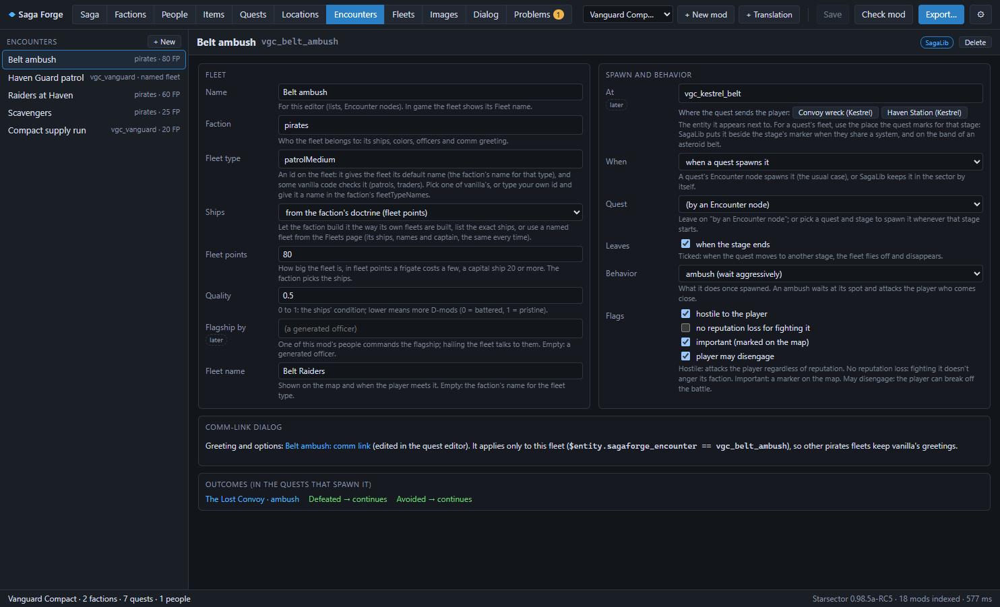
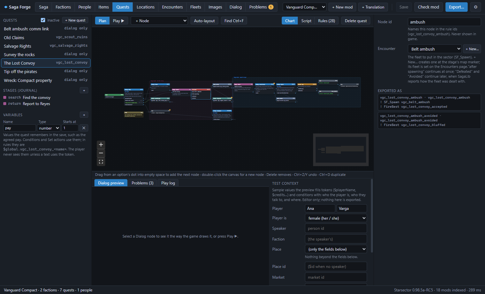
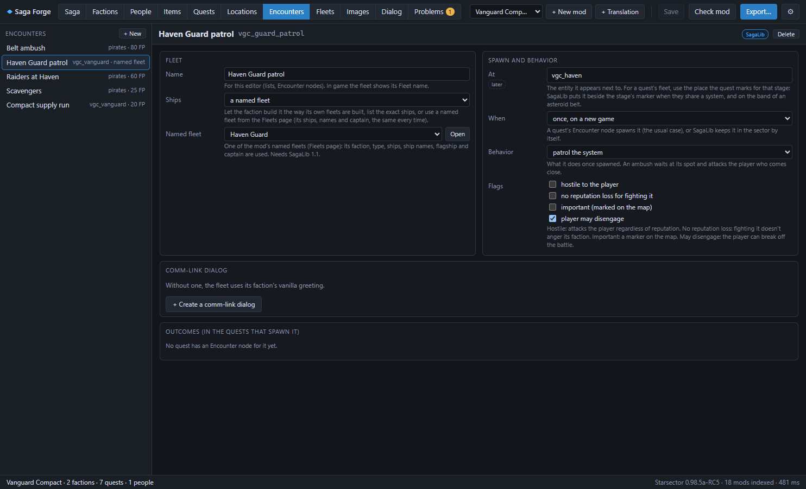

# Encounters

Fleets your mod puts in the sector: the pirates waiting for the player in a quest, a patrol that is
there from the start, a fleet that turns up when the player comes near, or traders that travel
between two places by themselves.

## How it works

On the left is the list of the mod's encounters (with their faction and size); **+ New** makes
one. The selected encounter's form is on the right, in four boxes. Every encounter is run by
SagaLib in the game (the **SagaLib** badge in the header).

### Fleet

What the fleet is:

- **Name**: for the editor only (lists, Encounter nodes). The player sees the **Fleet name**.
- **Faction**: whose fleet it is: its ships, colours, officers and comm greeting.
- **Fleet type**: an id such as `patrolMedium` or `smallTrader`. It gives the fleet its default
  name (the faction's name for that type), and some vanilla code checks it. You can type your own
  id and name it (see [Fleets › Name fleet types](fleets.md#name-fleet-types)).
- **Ships**, one of three ways:
  - **from the faction's doctrine (fleet points)**: the faction builds it the way it builds its own
    fleets; **Fleet points** sets how big (a frigate costs a few, a capital ship 20 or more).
  - **exact variants**: a list of variant ids; the first is the flagship.
  - **a named fleet**: one of the mod's named fleets from the Fleets page, with the same ships,
    names and captain every time (see [Use a named fleet](#use-a-named-fleet)).
- **Quality**: 0 to 1, the ships' condition (lower means more D-mods).
- **Flagship by**: one of the mod's people commands the flagship, so hailing the fleet talks to
  them. Empty: a generated officer.
- **Fleet name**: shown on the map and when the player meets it. Empty: the faction's name for the
  fleet type.

The small **later** button under some field names (**At**, **Flagship by**) marks the field "Set
later" when you don't know the answer yet: it shows **✎ to do** and is listed under To do on the
Problems page until you fill it in (see
[Problems › Mark a field Set later](problems.md#mark-a-field-set-later)).

### Spawn and behavior

Where and when it appears, and what it does:

- **At**: the object it appears next to. The list has your systems' objects, the game's markets,
  and the random targets of your quests. Under the field, **Where the quest sends the player**
  offers the places the quests that spawn it mark on the map: one click sets it. SagaLib puts the
  fleet beside the stage's marker when they share a system, and on the band of an asteroid belt
  (not at the star in its middle).
- **When**:
  - **when a quest spawns it**: a quest's Encounter node (or an Action) spawns it; the usual case.
    Or pick a **Quest** and **At stage** to spawn it whenever that stage starts. **Leaves when the
    stage ends**: the fleet flies off and disappears when the quest moves on.
  - **once, on a new game**.
  - **kept alive, respawning**: a new one appears **Respawn after** so many days once it is gone.
  - **when the player comes near**: once the player's fleet is within **Range** of the place (0 =
    anywhere in its system). **Only during** limits it to a quest stage.
  - **roaming between two places**: see [Add a roaming fleet](#add-a-roaming-fleet).
- **Behavior**: **ambush** (waits at its spot and attacks the player who comes close), **guard the
  place**, **patrol the system**, **intercept the player**, or **travel somewhere** (then
  disappears).
- **Flags**: **hostile to the player** (attacks regardless of reputation), **no reputation loss for
  fighting it**, **important** (a marker on the map), **player may disengage**.

### Comm-link dialog

What the player hears when hailing the fleet. Without one, the fleet uses its faction's vanilla
greeting. **+ Create a comm-link dialog** makes a conversation for this fleet only and opens it on
the Quests page; other fleets of the same faction keep vanilla's greetings.

### Outcomes

The quests that spawn this encounter with an Encounter node, and whether each one goes on when the
fleet is **Defeated** (beaten in battle) and when it is **Avoided** (it left without being beaten,
for example after a bluff in its comm dialog). Green "→ continues" means the quest has a path for
that outcome; red "(not set)" means it doesn't yet. Click the quest to open the node.

### What it writes into the mod

- `data/sagaforge/encounters/<id>.json`: the fleet, where and when it spawns, its behaviour and
  flags. SagaLib spawns it in the game.
- The comm-link dialog is a conversation of the mod, written into `data/campaign/rules.csv` with
  the mod's other dialog.

The plan is kept in `sagaforge/encounters/<id>.encounter.json`. Details:
[SagaLib's format notes](https://github.com/LastAi/Starsector-SagaLib/blob/main/docs/FORMAT.md).

## How to set up the basics

### Add a fleet for a quest

The usual way is from the quest itself: on the quest's flow chart, add an **Encounter** node and
press **+ New…** next to its **Encounter** field. It makes an encounter at the place the quest
marks for its current stage. (See [Quests › Add a fight](quests.md#add-a-fight) for the quest's
side.) Then come here to set the fleet up:

1. Select the encounter in the list (here **Belt ambush**).
2. In **Fleet**, pick the **Faction** (`pirates`), keep **from the faction's doctrine** and set
   **Fleet points** (here 80); give it a **Fleet name** such as
   `Belt Raiders`.
3. In **Spawn and behavior**, check **At**: click one of the **Where the quest sends the player**
   buttons (e.g. the belt). Keep **when a quest spawns it** and **(by an Encounter node)**.
4. Tick **Leaves when the stage ends** if the fleet should give up once the quest moves on.
5. Choose **ambush (wait aggressively)** and the flags: hostile, important, player may disengage.
6. Look at **Outcomes**: both **Defeated** and **Avoided** should say "→ continues".

In game: when the quest reaches the Encounter node, the Belt Raiders appear in the Kestrel belt
with a marker on the map. Beating them, or making them leave, moves the quest on.

To make one without a quest first: **+ New** at the top of the list, type a **Name**, **Create**,
and fill in the form as above.

### Give a fleet a comm dialog

1. Select the encounter and press **+ Create a comm-link dialog** (in the **Comm-link dialog**
   box).
2. Saga Forge makes a conversation called "<encounter>: comm link" and opens it on the Quests page.
   It starts on the trigger `OpenCommLink`, with a condition that it only answers this fleet.
3. Write the greeting and the options as for any conversation (see
   [Quests › Write a conversation](quests.md#write-a-conversation)). To let the player talk the
   fleet away, add an **Action** node with **Encounter leaves** after the option: the fleet
   flies off, and the quest that spawned it takes its **Avoided** exit.

In game: hailing the Belt Raiders shows your greeting instead of the pirates' usual one; the bluff
option costs a story point and makes them turn away.

### Spawn a fleet at new game

1. **+ New**, name the encounter (e.g. `Haven Guard patrol`), **Create**.
2. Set up its ships (fleet points, exact variants or a named fleet) and **Faction**.
3. Set **At** to the place it starts at (e.g. Haven Station) and **When** to **once, on a new
   game**.
4. Choose **patrol the system** or **guard the place**, and untick **hostile** for a friendly
   fleet.

In game: the fleet is there from the start of a new game. Pick **kept alive, respawning** instead
if a new one should come back some days after it is destroyed.

### Add a roaming fleet

1. **+ New**, name it (e.g. `Compact supply run`), **Create**.
2. Set the **Faction**, a **Fleet type** such as `smallTrader`, and its ships.
3. Set **At** to where it leaves from (Haven Station) and **When** to **roaming between two
   places**.
4. Fill in **Travels to** (Kestrel Depot), **Leaves every** (days between departures on average),
   **At most** (how many are on the way at once), **Stays** (days at the destination) and **Round
   trip** (comes back afterwards, like vanilla's traders).

In game: the fleets travel on vanilla's routes like traders and patrols. A route moves along by
itself and is a real fleet only while the player is near (within about 1.6 light-years), so many
roaming fleets cost little. Behaviour and outcomes don't apply to roaming fleets. Needs SagaLib
1.2.

### Use a named fleet

A named fleet has the same ships, ship names and captain every time (made on the Fleets page, see
[Fleets › Make a named fleet](fleets.md#make-a-named-fleet)).

1. Select or make the encounter.
2. Set **Ships** to **a named fleet** and pick it under **Named fleet**. Faction, fleet type,
   quality, flagship and fleet name now come from the named fleet, so those fields disappear;
   **Open** jumps to it.
3. Set **At**, **When** and **Behavior** as for any encounter.

The Haven Guard patrol in the picture of [Spawn a fleet at new game](#spawn-a-fleet-at-new-game) is
set up this way.

In game: the fleet appears at full strength with its own ship names and Commodore Reyes in command
of the flagship. Needs SagaLib 1.1.
