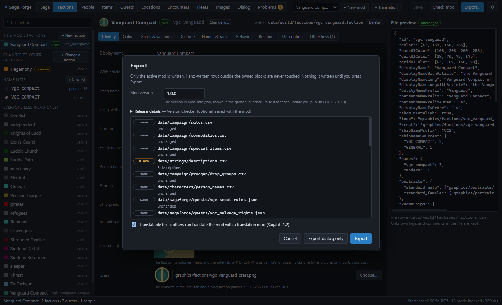
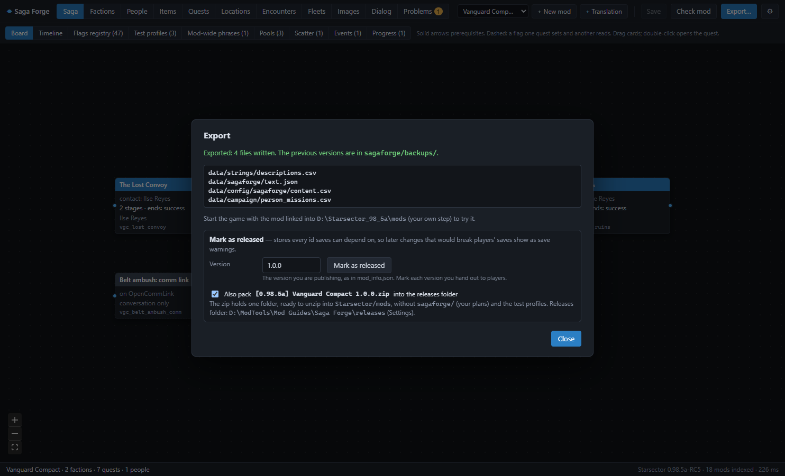
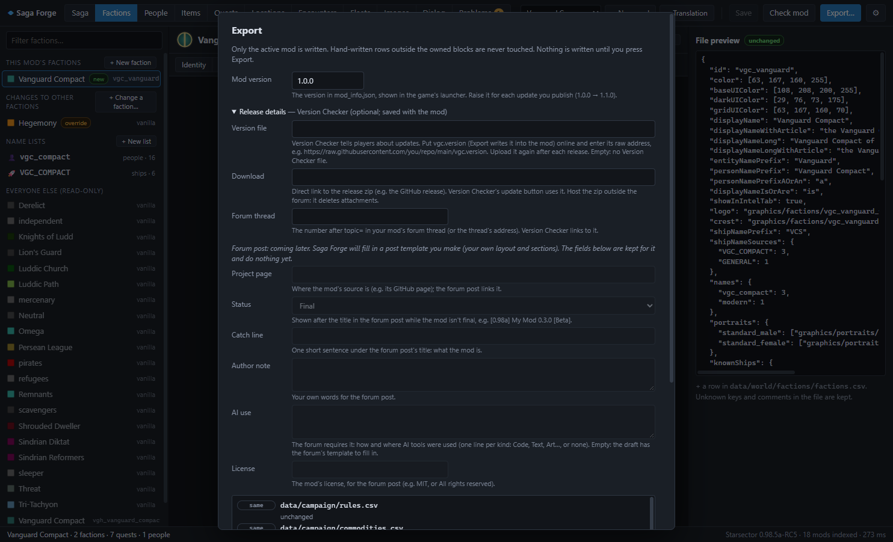
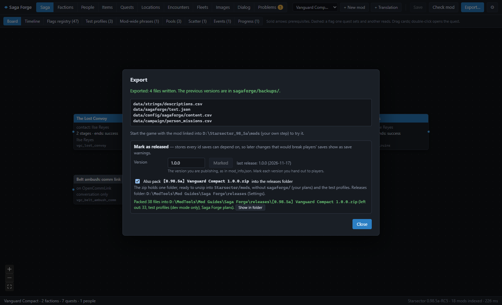

# Export and Release

**Export…** turns your plans into the files the game and SagaLib read. **Mark as released**
then records what saves depend on and packs the release zip, and the optional release details
add a Version Checker file.

## How it works

Saga Forge keeps two kinds of files in a mod:

- **Your plans**, in the mod's `sagaforge/` folder (written by **Save**). The game ignores this
  folder, and it is left out of release zips.
- **The game files**, written by **Export**: `rules.csv` rows, CSV rows (items, descriptions,
  missions, bar events, loot), faction files, SagaLib's JSON in `data/sagaforge/` and its index
  `data/config/sagaforge/content.csv`, the illustrations in `data/config/settings.json`, and
  `mod_info.json`. Faction files are also written on Save.

Export works from the saved plans, so it saves first if there are unsaved changes. Nothing is
written until you press **Export**.

### The Export dialog

- **Mod version**: the version in `mod_info.json`, shown in the game's launcher. Raise it for each
  update you publish (1.0.0 → 1.1.0). If that version is already marked as released, a note says
  so.
- **Release details** (folded): the Version Checker fields, see
  [Version Checker](#version-checker).
- **The file list**: every file Export would write, each with its state: **new**, **changed**,
  **same** (unchanged) or **removed**, and a short summary of what is in it. A shared file whose
  Saga Forge rows change is marked **block** (see [Owned blocks](#owned-blocks)): in the picture,
  an item description was edited, so `descriptions.csv` gets its 3 descriptions written again.
  Content you marked inactive is not exported, and its files from an earlier export are removed.
- **Translatable texts** (on by default, for mods that use SagaLib): the dialog goes into
  `rules.csv` as tokens and its texts into `data/sagaforge/text.json`, so others can translate
  the mod without copying it (see [Translation mods](translation.md)). It needs SagaLib 1.2.
- **Add SagaLib to mod_info.json dependencies**, shown when the dependency is missing. Keep it
  ticked: the game then refuses to start the mod without SagaLib instead of failing later. Export
  also raises the SagaLib version the dependency asks for when the mod uses newer SagaLib features.
- **Errors** that block the export, and **warnings** worth reading. One warning to know: a rule
  of yours that would replace vanilla's dialog everywhere (it fires on the same trigger with
  vanilla's conditions and nothing about your own content); add a condition with your prefix.
- **Export dialog only** writes only the `rules.csv` blocks: quick while you test conversations.
  **Export** writes everything.

### Owned blocks

Files other mods and hand-written work also use, such as `rules.csv` or `descriptions.csv`, are
shared: Saga Forge writes its rows between marker rows (`# sagaforge:begin …` and
`# sagaforge:end`) and never touches rows outside them. So you can keep hand-written rules next to
generated ones.

If you edit rows **inside** a block by hand, Export notices and stops. For each such block it
offers **Show diff** (yours against what Saga Forge would write), **Overwrite** (Saga Forge's rows
win) or **Detach** (the block becomes hand-written, and Saga Forge stops exporting it).

Every export first copies the files it replaces into `sagaforge/backups/<date and time>/` (the
last 10 are kept).

### Releases and save warnings

After an export the dialog shows the files written, and **Mark as released**:

- It stores a snapshot of every id saves can depend on (quests and their stages and variables,
  flags, people, markets, systems and their objects, factions, items, encounters) in
  `sagaforge/releases/`.
- From then on, changes that would break a player's save when they update show as **save
  warnings** in [Problems](problems.md): a stage that is gone, a person renamed, a new system
  that would only appear in new games. Each says what happens to players and, where it can, how to
  avoid it.
- It also packs the **release zip**: `[0.98.5a] Vanguard Compact 1.0.0.zip` (the game version first,
  as the forum's titles do), with one folder named after the mod, ready to unzip into
  `Starsector/mods`. It leaves out `sagaforge/` (your plans), the dev-mode test profiles, hidden
  and temporary files. It goes into the **releases folder** (Settings › Releases folder), never
  into a mod or the game.

Mark as released refuses while fields marked **Set later** are still open in active content (see
[Problems › Mark a field Set later](problems.md#mark-a-field-set-later)), and when the version
you mark isn't the one you just exported.

### Version Checker

Version Checker is a popular mod that tells players when one of their mods has an update. Under
**Release details**:

- **Version file**: the web address where you will put the mod's `.version` file (for
  Vanguard Compact `vgc.version`). Use the raw file's address, e.g.
  `https://raw.githubusercontent.com/you/repo/main/vgc.version`. Empty: no Version Checker file.
- **Download**: a direct link to the release zip (for example the GitHub release). Host it
  outside the forum, which deletes attachments.
- **Forum thread**: the number after `topic=` in your mod's thread, or the thread's address.

With a version file address, Export writes `<mod id>.version` into the mod and lists it in
`data/config/version/version_files.csv`. After each release, upload the new `.version` file to that
address too. The fields below (project page, status, catch line, author note, AI use, license)
are kept for a forum post draft that is coming later; they do nothing yet.

## How to set up the basics

### Export the mod

1. **Save** (Ctrl+S). Then **Export…** in the header.
2. Check **Mod version** (1.0.0 for a first release; raise it for an update).
3. Read the file list: what is new or changed is what you edited. Leave **Translatable texts** and
   **Add SagaLib to mod_info.json dependencies** ticked.
4. If errors are listed, Export is blocked: fix them first (see
   [Problems › Fix a problem](problems.md#fix-a-problem)). Read the warnings.
5. **Export**. The dialog lists the files it wrote (here 4: the changed descriptions, the dialog
   texts, SagaLib's index and the contact's mission row) and where the old versions went.

To try it, link the mod into the game's mods folder (see
[Getting started and Settings › Choose your mods folder](settings.md#choose-your-mods-folder)),
enable it and SagaLib in the launcher, and start the game. Test profiles take you straight to the
part you want to test (see
[Saga › Start the game with a test profile](saga.md#start-the-game-with-a-test-profile)).

While you work on a conversation, **Export dialog only** is enough; restart the game to see the
new dialog.

### Make a release zip

1. Export the mod with the version you are publishing in **Mod version** (see
   [Export the mod](#export-the-mod)).
2. In the dialog that follows, **Mark as released**: check **Version** (it is the exported one),
   keep **Also pack … .zip into the releases folder** ticked.
3. **Mark as released**. The button turns into **Marked**, *last release* shows the version and
   date, and a green line says how many files it packed into which zip and what it left out (here
   38 files into `[0.98.5a] Vanguard Compact 1.0.0.zip`, leaving out 33: the test profiles and
   Saga Forge's plans). **Show in folder** opens it.

4. Test the zip once: unzip it into a game's `mods` folder (not over your working copy) and start
   a new game with it.
5. Upload the zip where players download it. If you use Version Checker, upload the new
   `.version` file to its address as well.

If the version is already marked, Saga Forge asks before replacing its snapshot and zip. If
Mark as released refuses, the reason is shown in red under it (to-dos left, or the exported
version is a different one).

### Release an update

Players will load their old saves with your new version, so an update must keep what their saves
depend on.

1. Make your changes. Watch **Save warnings** in [Problems](problems.md): each one is something
   that would break or change an old save, with what to do. The common ones:
   - a quest stage renamed or removed: rename stages with **Change id…** and keep the old id as
     an alias (see [Quests › Rename a stage after a release](quests.md#rename-a-stage-after-a-release));
   - a new star system: tick **Existing saves** for it (the warning's **Add it to existing
     saves** does it), or it only appears in new games;
   - a person, item, faction or market removed or renamed: avoid it; old saves still have the
     old one.
2. **Export…** with a higher **Mod version** (1.0.0 → 1.1.0). The dialog warns if the version is
   already marked as released; after the export, *last release* next to Mark as released shows
   the version players have now.

3. **Mark as released** with the new version, and publish the new zip (see
   [Make a release zip](#make-a-release-zip)).
4. Test it in game with a save from the old version as well as a new game.
