# Factions

The Factions tab is where your mod adds new factions and changes existing ones (vanilla's or
another mod's), and where it keeps name lists for generated people and ships.

## How it works

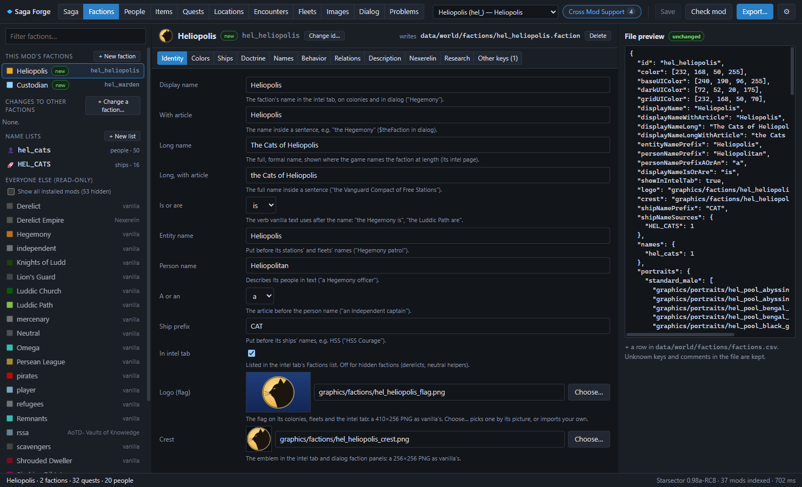

The tab has three columns:

- **On the left**, the faction list.
- **In the middle**, the selected faction's form, split into tabs.
- **On the right**, the file as Saga Forge will write it: **File preview** for a new faction,
  **Patch file** for a change to an existing one. The badge says whether the file on disk is
  **unchanged**, **changed** or a **new file**.

The bar above the form shows the faction's name, its id, the file it writes, and **Delete**. For
a new faction it also has **Change id…**.

### The faction list

The list has four groups:

- **This mod's factions**: the factions your mod adds, marked **new**. **+ New faction** adds one.
- **Changes to other factions**: the existing factions your mod changes, marked **override**,
  each with the mod that defines it (vanilla, or another mod's name). **+ Change a faction…** adds
  one.
- **Name lists**: the mod's own lists of person names and ship names, or "None: factions use the
  game's names". **+ New list** adds one.
- **Everyone else (read-only)**: every other faction of the game and of the mods your mod lists in
  [Saga › Mods](saga.md#mods); **Show all installed mods** adds the others (the count says how many
  are hidden). Click one to see its flag and where it comes from. **Change this faction…** starts a
  change to it. Colours, flags and names show as vanilla, your mod and its listed mods leave them.

The filter box at the top searches all four groups by name and id.

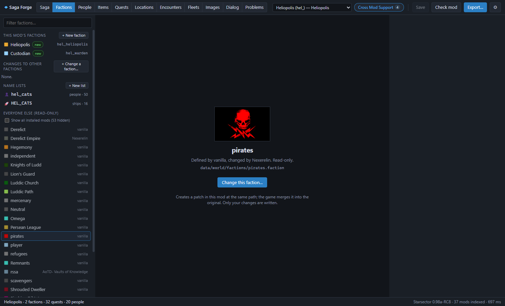

### New factions and changes to existing ones

Saga Forge keeps these two apart, because the game loads them differently:

- **A new faction** is a complete `.faction` file of your mod,
  `data/world/factions/<id>.faction`, plus a row in your mod's `data/world/factions/factions.csv`
  so the game loads it. Saving the mod writes both. Keys the form doesn't know and comments in
  the file are kept.
- **A change to an existing faction** is a small file at the **same path** as the original (for
  the Hegemony, `data/world/factions/hegemony.faction`). It holds **only your changes**, and the
  game merges it into the original when it loads. Other mods that change the same faction keep
  their changes too.

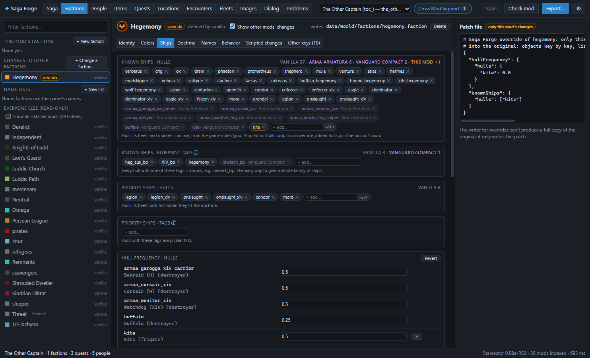

In a change, the form shows the faction as the game will see it, with a count over each list:
**VANILLA 37 · ARMA ARMATURA 6 · VANGUARD COMPACT 2 · THIS MOD +1**. Your additions are orange. With **Show other
mods' changes** ticked, what other installed mods add shows in grey with the mod's name. A field
you changed has a **Revert** button.

The game's merge can only **add** to a list, never take something out. If you click ✕ on an
entry that isn't yours (say, the Onslaught in the Hegemony's hulls), Saga Forge explains this and
offers to **remove it at game start with SagaLib (scripted change)**. Such removals are listed
on the **Scripted changes** tab (a change to an existing faction) or the **Relations** tab
(your own faction), and they need SagaLib in game.

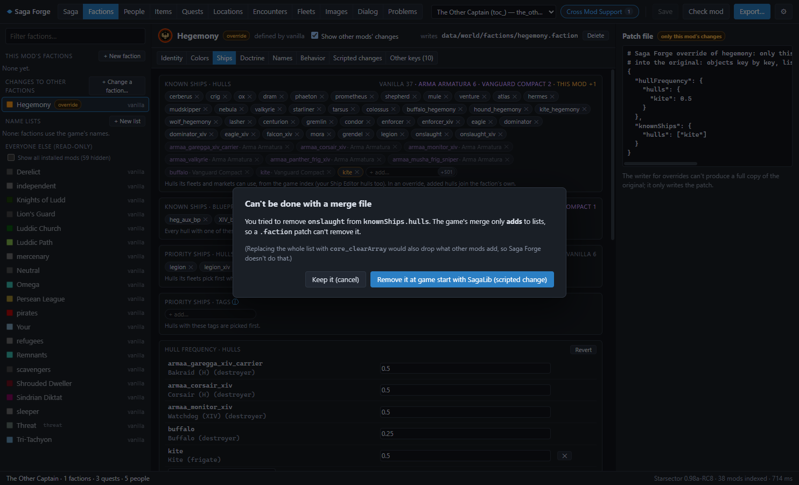

### The faction tabs

Every field has its help text under it, and the **ⓘ** next to some field names opens the app's
reference page for that key. The tab names are short (**Ships**, **Names**, **Relations**), so the
row fits a normal window.

| Tab | What it holds | Where it shows in game |
|---|---|---|
| **Identity** | Display name and its forms ("the Cats of Heliopolis", the long name), entity and person names ("Heliopolis patrol", "a Heliopolitan officer"), ship prefix, In intel tab, the **Logo (flag)** (410×256) and **Crest** (256×256) | Intel tab, dialog text, fleet and ship names, colony flags |
| **Colors** | Main color and the docked-interface colors (Base, Dark, Grid, Bright UI, Secondary), each with an opacity | The faction's name in text, its fleets on the map, the screens when docked at its colonies |
| **Ships** | Known hulls and blueprint tags, priority ships, hull frequencies, known fighters, weapons and hullmods. The tag fields suggest the blueprint tags of the game and your listed mods, with how many hulls, fighters, weapons and hullmods carry each | Which ships its fleets use and its markets sell |
| **Doctrine** | Fleet make-up (warships, carriers, phase ships), officer and ship quality, ship size, aggression, officer and commander skills (suggested from the game's skills), illegal goods | Its fleets in battle; customs scans at its markets |
| **Names** | Person name sets and ship name sources (with weights), portrait lists for men and women, rank and post titles, fleet type names, music | Generated officers, administrators and contacts; ship names; music in its systems |
| **Behavior** | Switches such as Offers commissions, Wars and hostilities, Buys AI cores, Makes pirate bases, Punitive expeditions | How vanilla's campaign systems treat the faction |
| **Relations** | Starting relations with other factions, hidden from the intel tab, and **scripted changes** (new factions; changes to existing factions have a **Scripted changes** tab instead) | The intel tab's relations from a new game; the scripted changes on every load |
| **Description** | The text of its intel page (new factions only) | Intel tab › the faction |
| **Nexerelin** | The faction's Nexerelin config (new factions only, when the mod lists Nexerelin in [Saga › Mods](saga.md#mods)): new-game list and ready-made fleets, war and invasions, diplomacy, fleet names, economy | Only with Nexerelin: its new-game faction list, invasions, diplomacy events, starting relations |
| **Research** | The faction's attitude to research with AoTD Vaults of Knowledge (new factions only, when the mod lists Vaults of Knowledge in [Saga › Mods](saga.md#mods)): its stance, what it pays for research databanks (credits and reputation), the four lines of that conversation, techs it won't research | Only with Vaults of Knowledge: selling research databanks at its markets |
| **Other keys** | Every key the tabs don't show, as editable loose JSON, and **Add a key** with the keys vanilla's factions use | Depends on the key |

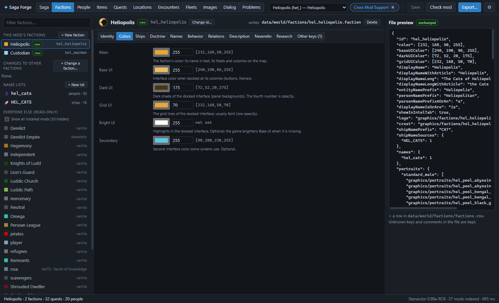
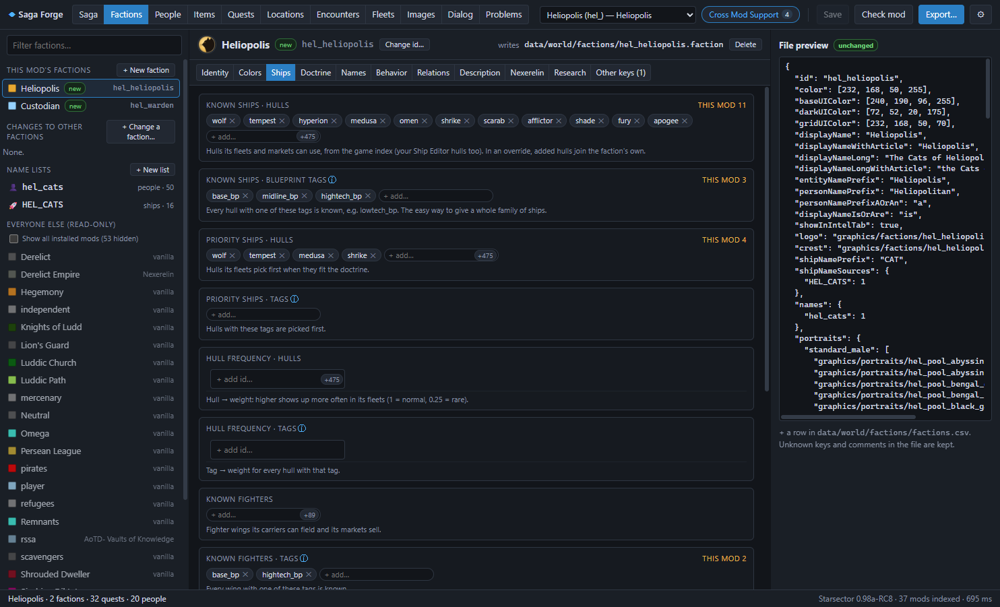
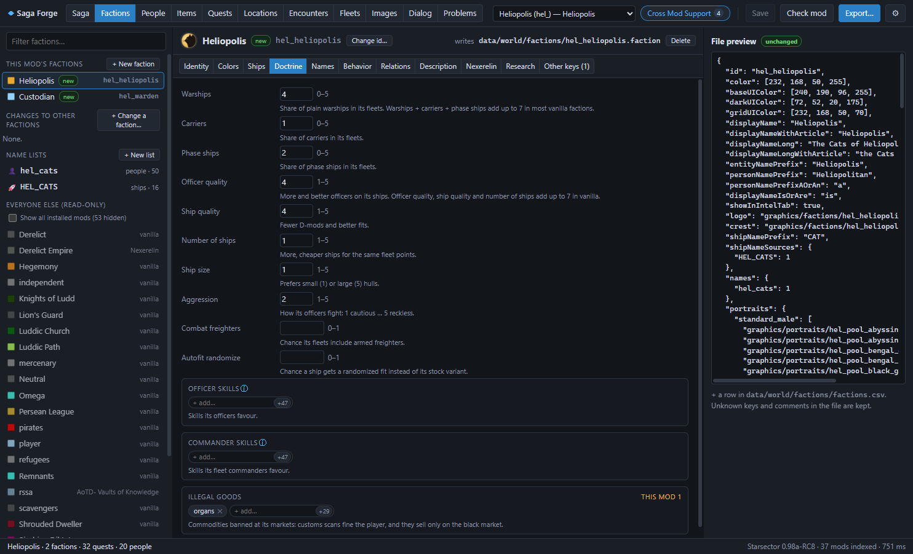
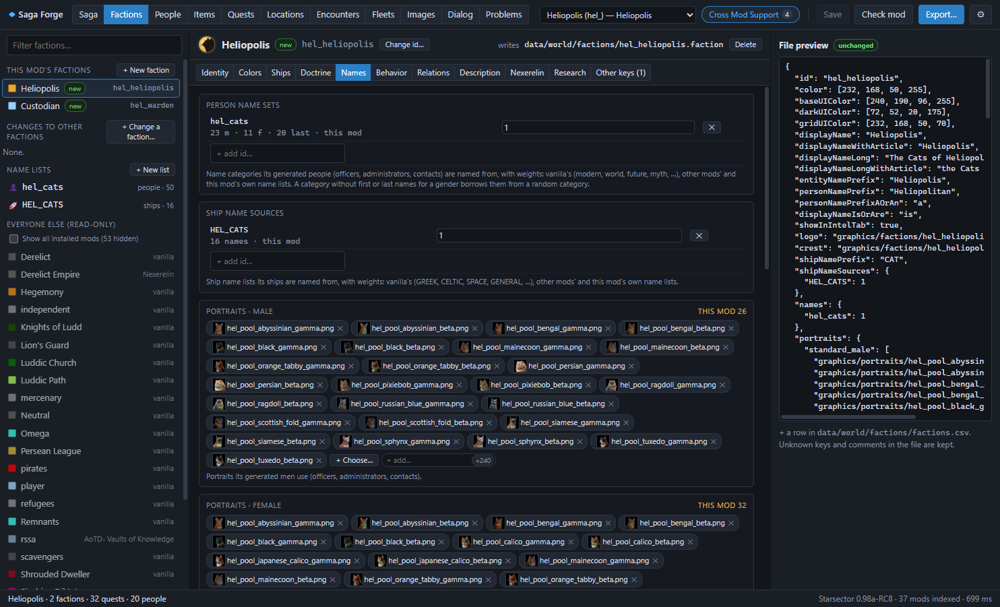
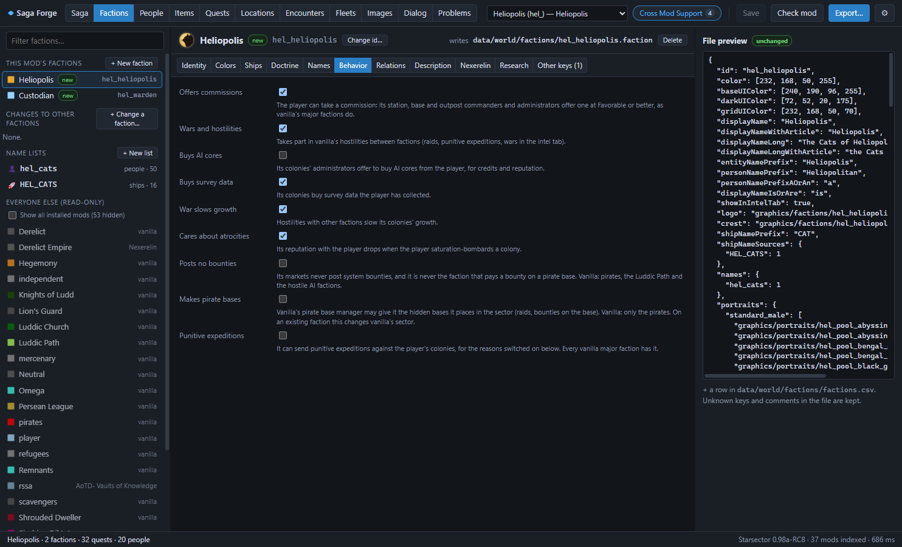
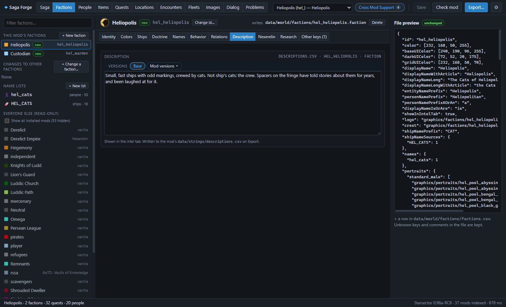
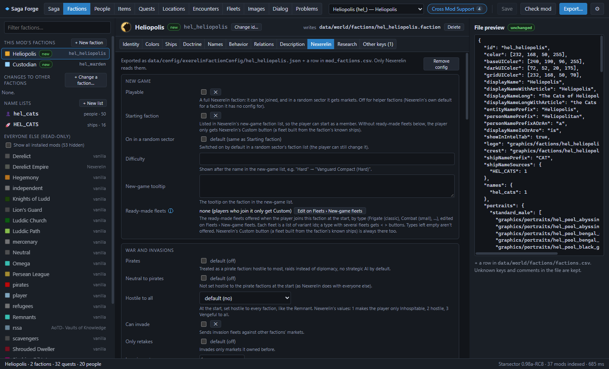
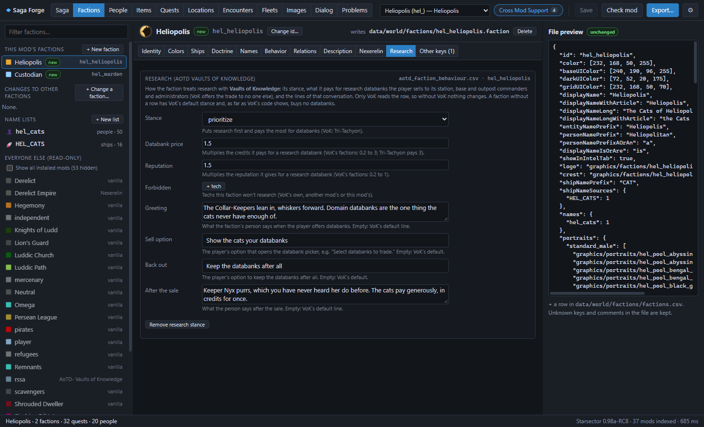
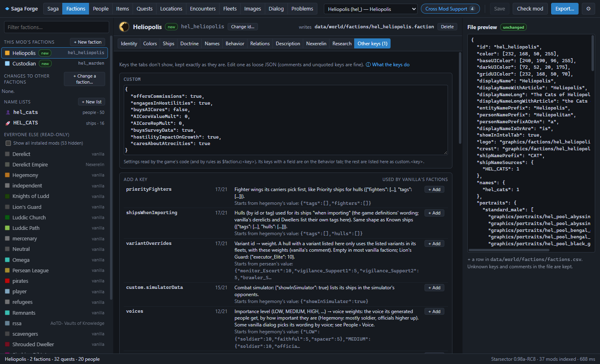

Two tabs write elsewhere than the `.faction` file, because they aren't `.faction` keys:

- **Relations** (with the scripted changes) go into `data/sagaforge/factions.json`, and SagaLib sets the relations
  when a new game starts and applies the scripted changes on every load, so the mod needs SagaLib.
  A scripted change sets at runtime what the `.faction` file can't do per mod: the display name
  (and with "the"), logo, crest, secondary color, a known ship added or removed, a commodity made
  illegal or legal, a doctrine value, and shown in or hidden from the intel tab. With optional
  mods, the tab has a **Versions** strip (see [Saga › Mods](saga.md#mods)): each combination can
  have its own relations and changes.
- **Description** goes into the mod's `data/strings/descriptions.csv` when you export.
- **Nexerelin** goes into `data/config/exerelinFactionConfig/<id>.json` plus a row in that
  folder's `mod_factions.csv`. Only Nexerelin reads these files, so Nexerelin stays optional: your
  mod doesn't depend on it.

### Nexerelin

Without a config, Nexerelin treats your faction as a bystander with neutral defaults: it can't be
picked when starting a new game, never invades, has no diplomatic personality, and its starting
relations follow whatever mode Nexerelin is in. The **Nexerelin** tab gives it a config, so it
takes part like Nexerelin's own factions. The tab shows on your mod's own factions once Nexerelin
is in [Saga › Mods](saga.md#mods) (optional is right: the files do nothing without it).

- **New game**: *Playable*, *Starting faction* (in the new-game list), *On in a random sector*, the
  *Difficulty* shown after its name, the *New-game tooltip*, and a count of its **Ready-made
  fleets**: the preset fleets a player who joins the faction at the start can pick. You edit them on
  [Fleets › New-game fleets](fleets.md#new-game-fleets-nexerelin). Nexerelin's **Custom** button (a
  fleet built from the faction's known ships) is always there too, so without ready-made fleets the
  player only gets Custom; Problems notes it.
- **War and invasions**: pirates, hostile to all, can invade, how often and how big its invasions
  and response fleets are, ground bonuses, special forces.
- **Diplomacy**: morality, alignments, traits (hover one for what it does), liked and disliked
  factions, and **Keep relations when randomized**.
- **Fleet names**, **Economy** (free market, tariffs).
- **Starting relations** aren't edited here: the tab shows the faction's relations from
  **Relations**, and Export writes them into the config. With Nexerelin, Nexerelin then sets them, in
  the hand-made and in a random sector, and randomizes them only when the player picks random
  relations (unless *Keep relations when randomized* is on); SagaLib leaves them alone. Without
  Nexerelin, SagaLib sets them as always. A relation that only applies with or without some mod
  can't be in the config: it stays SagaLib's.
- **Other keys**: anything the tab has no field for is kept as it is, and can be edited as JSON.
  A mod that already has config files for its own factions has them read in when you first open it.

### Name lists

A name list is one of two things:

- **People's names**: a name category for generated officers, administrators and contacts, with
  first names for men, for women and for anyone, plus last names. Export writes them as rows in
  the mod's `data/characters/person_names.csv`, and the game adds them to its own names.
- **Ship names**: a list of names, written to the mod's `data/strings/ship_names.json`. The game
  appends it to any list with the same id.

A faction uses a list from **Names › Person name sets** or **Ship name sources**. On the
list's own page, **Used by** lists the factions that use it (an unused list offers **Use in a
faction…** instead), the counts at the top show how many names each gender gets, and the right
column shows the rows as they will be exported.

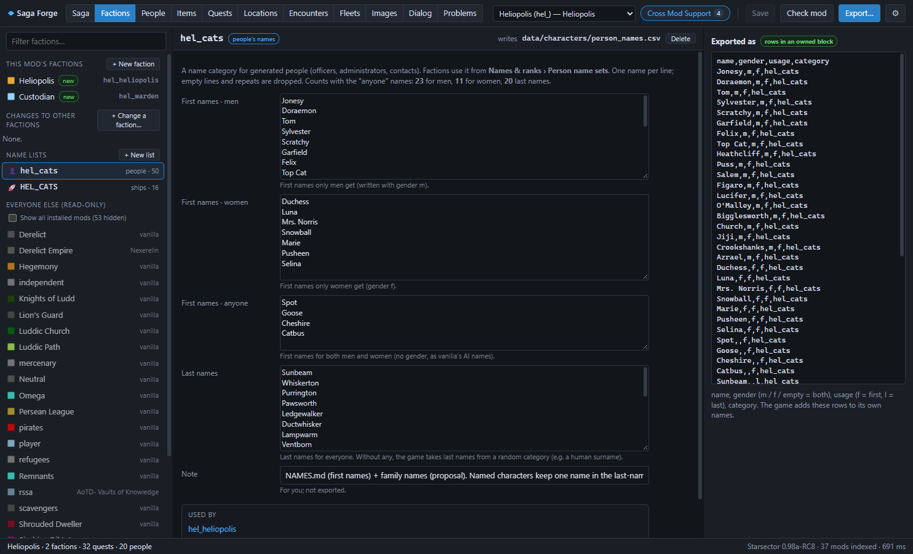
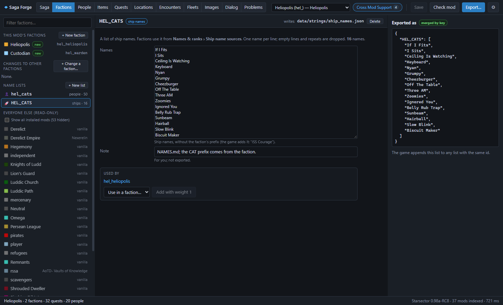

## How to set up the basics

### Add a new faction

1. Click **+ New faction** (top left).
2. Type the **Name**, e.g. *Heliopolis*. The **Id** below it is made from the name with
   your mod's prefix (`hel_heliopolis`). You can change it later with **Change id…** until
   the mod is released. Saga Forge then moves the file and updates the relations, description and
   people that use it.
3. Click **Create**. The new faction starts with the keys vanilla factions have.
4. Go through the tabs from left to right. On **Identity**, set the names and the ship prefix
   (*CAT*), then pick the flag and crest with **Choose…** (see
   [Images › Pick an image for a field](images.md#pick-an-image-for-a-field)).
5. Pick its ships (see [Set the ships a faction uses](#set-the-ships-a-faction-uses)), its
   relations (see [Set starting relations](#set-starting-relations)), and write its
   **Description**.
6. Save (**Ctrl+S**).

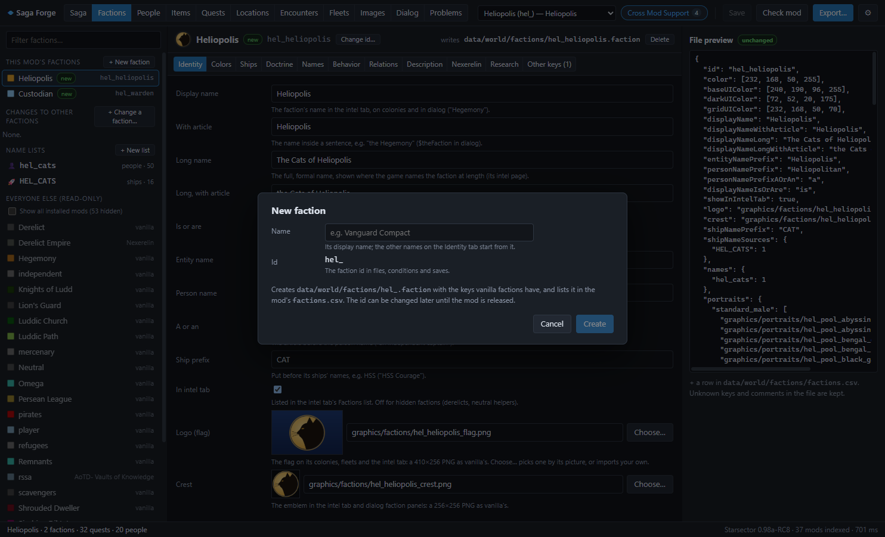

**In game:** the faction is in the intel tab's Factions list (unless **In intel tab** is off) with
its flag, crest and description. Markets and fleets only exist once you give it some: see
[Locations › Add a station with a market](locations.md#add-a-station-with-a-market) and
[Encounters › Add a fleet for a quest](encounters.md#add-a-fleet-for-a-quest).

### Change an existing faction

1. Click **+ Change a faction…**, type the faction's id (the list shows each faction with its
   name, e.g. `hegemony`) and click **Change it**. You can also click the faction under **Everyone
   else** and then **Change this faction…**.
2. It appears under **Changes to other factions** with an **override** badge, open on **Ships**.
3. Change what you need. Lists only grow: type in **+ add…** to add an entry. To change a number
   or text, edit the field; **Revert** puts back the original value.
4. Watch the **Patch file** on the right: it holds only your changes.
5. Save.

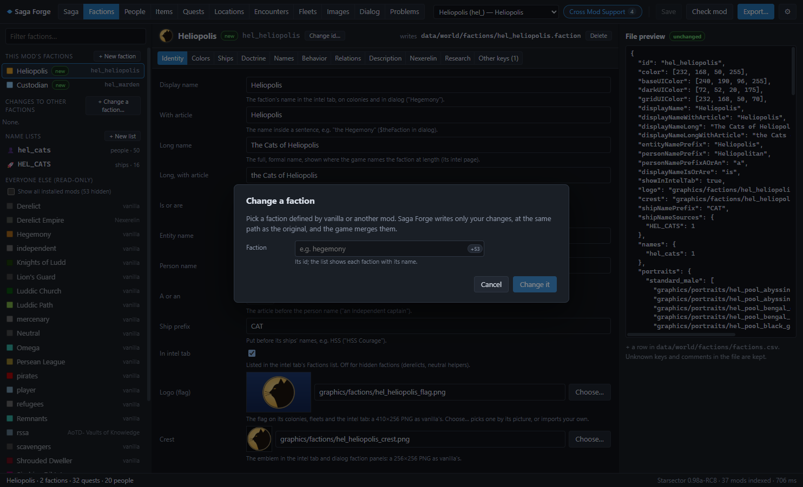

**In game:** the game merges your file into the original at load, so the faction has your
changes plus everything vanilla and other mods give it. To take something *out* of a list, use the
SagaLib scripted change (see [New factions and changes to existing ones](#new-factions-and-changes-to-existing-ones)).

### Set the ships a faction uses

1. Open the faction and its **Ships** tab.
2. Under **Known ships · Blueprint tags**, add tags such as `lowtech_bp` or `base_bp`. Each tag
   gives the faction a whole family of hulls, which is the easy way. The suggestions list every tag
   with how many hulls, fighters, weapons and hullmods carry it, and the ⓘ opens the reference of
   blueprint tags.
3. Under **Known ships · Hulls**, add single hulls. Type in **+ add…** to search the game's hulls
   (your Ship Editor hulls are listed too). An id the game doesn't know is marked, because the
   game won't start with it.
4. Optional: **Priority ships** are picked first when they fit the doctrine, and **Hull
   frequency** makes a hull rarer (0.25) or more common (2).
5. On the **Doctrine** tab, set how its fleets are built: the share of warships, carriers and
   phase ships, ship size and aggression.

**In game:** its fleets are built from these hulls following the doctrine, and its markets sell
them. For a fixed fleet with exact ships, see [Fleets › Make a named fleet](fleets.md#make-a-named-fleet).

### Set starting relations

This works for your mod's **new** factions only: the Relations tab isn't there for a change to
an existing faction.

1. Open your faction and its **Relations** tab.
2. In **+ faction…**, pick another faction (or *Player*). It is added at 0, neutral.
3. Drag the slider or type an exact value from -1 to 1. **Level** shows the name the game uses
   (Vengeful, Hostile, … Friendly, Cooperative).
4. ✕ removes a row; that faction then starts neutral, as in vanilla.

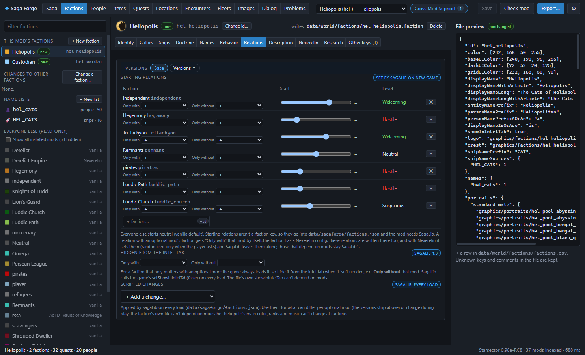

**In game:** SagaLib sets these relations when a **new game** starts. They are not applied to
existing saves, and the mod needs SagaLib. If the faction has a Nexerelin config, Nexerelin sets
them instead whenever it is enabled (see [Nexerelin](#nexerelin)).

### Make a faction playable in Nexerelin

1. In [Saga › Mods](saga.md#mods), set **Nexerelin** to *Optional*.
2. Open your faction and its **Nexerelin** tab, and click **Add a Nexerelin config**.
3. Under **New game**, tick **Starting faction**, type a **Difficulty** (e.g. *Medium*) and a
   **New-game tooltip**.
4. Click **Edit on Fleets › New-game fleets** next to **Ready-made fleets** and add the fleets (see
   [Add new-game fleets](fleets.md#add-new-game-fleets-nexerelin)).
5. Set its **Diplomacy** (morality, alignments, traits, liked and disliked factions) and anything
   else you want; empty fields keep Nexerelin's defaults.
6. Set its starting relations on **Relations** as usual, and export.

**In game:** with Nexerelin, the faction is in the new-game list as "<name> (<difficulty>)" with
your tooltip, and starting as a member offers your fleets. Without Nexerelin nothing changes.

### Add a name list

1. Click **+ New list** under **Name lists**.
2. Pick **For**: *people's names* or *ship names*, and type a **Name** (e.g. *cats*). The id
   gets your prefix (`hel_cats`; ship lists are in capitals, like vanilla's `SPACE`).
3. Click **Create** and fill in the names, one per line: first names for men, for women and for
   anyone, and last names (or just the ship names, without the prefix: the game adds "CAT").
   Empty lines and repeats are dropped. A **Note** is for you; it isn't exported.
4. Click **Use in a faction…** on the list's page, or add the list on the faction's **Names** tab
   under **Person name sets** or **Ship name sources**, with a weight. The weights say how often
   each list is picked: with your list at 3 and vanilla's `modern` at 1, about three of four names
   come from your own list. Heliopolis uses only its own lists (`hel_cats` and `HEL_CATS` at 1):
   remove vanilla's sets if only your names should be used.

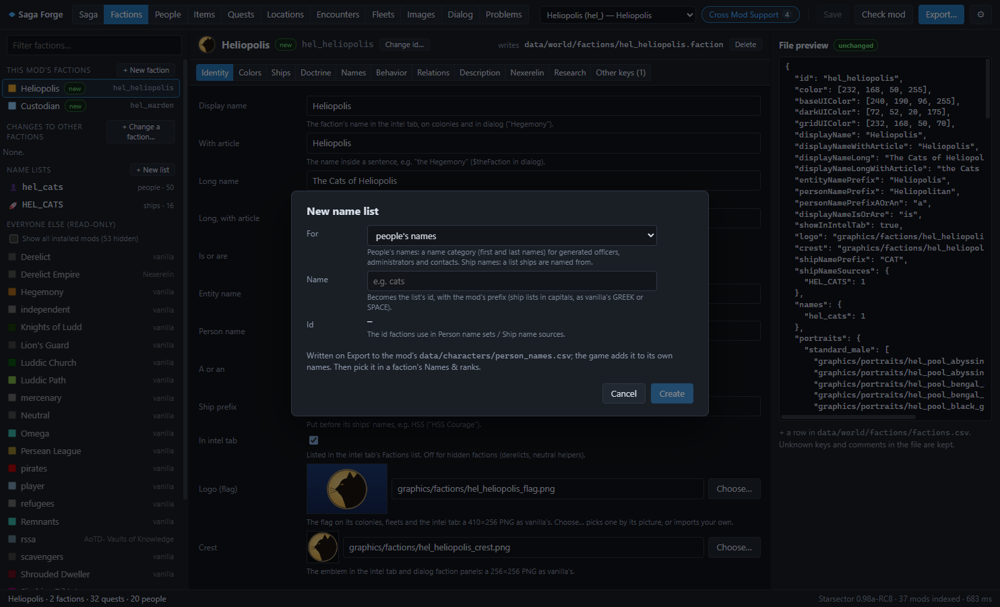

**In game:** people the game generates for the faction (officers, administrators, contacts) get
names from your list, and its ships get names from your ship list. A people list without last
names borrows them from a random category.
