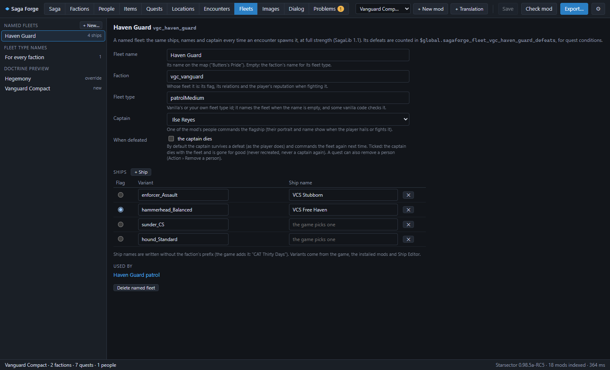
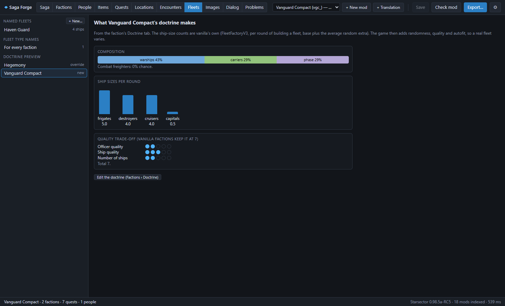
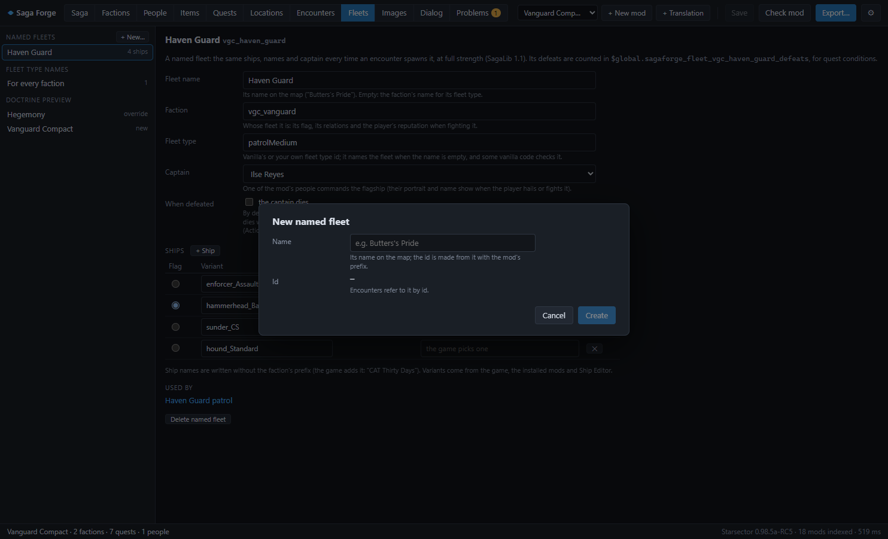
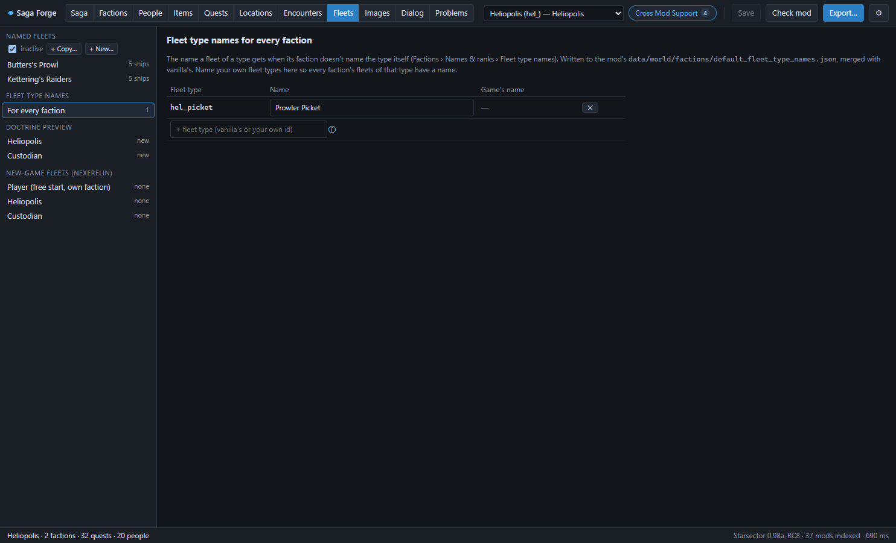

# Fleets

Named fleets (the same ships, ship names and captain every time they appear), the names of fleet
types, a preview of what a faction's doctrine builds, and Nexerelin's new-game fleets.

## How it works

The left column has three lists, four with Nexerelin: **Named fleets** (**+ New…** makes one),
**Fleet type names**, **Doctrine preview** (one entry per faction your mod adds or changes) and
**New-game fleets (Nexerelin)**. The middle shows the one you picked.

### Named fleets

A named fleet is a fixed fleet: a story fleet the player meets again and again, always at full
strength. On its own it does nothing in the game: an encounter brings it into the sector (see
[Encounters › Use a named fleet](encounters.md#use-a-named-fleet)).

- **Fleet name**: its name on the map ("Haven Guard"). Empty: the faction's name for its fleet
  type.
- **Faction**: whose fleet it is: its flag, its relations and the player's reputation when
  fighting it.
- **Fleet type**: vanilla's or your own fleet type id. It names the fleet when the name is empty,
  and some vanilla code checks it.
- **Captain**: one of the mod's people commands the flagship; their portrait and name show when the
  player hails or fights it. **When defeated › the captain dies**: by default the captain survives
  a defeat and commands the fleet again next time; ticked, the captain dies with the fleet and is
  gone for good.
- **Ships**: one row per ship, with its **Variant** (from the game, the installed mods and Ship
  Editor), an optional **Ship name** (written without the faction's prefix; the game adds it,
  "VCS Stubborn") and the **Flag** button for the flagship, which the captain commands.
- **Used by**: the encounters that spawn it.

Every defeat of the fleet is counted in the game (`$global.sagaforge_fleet_<id>_defeats`, shown at
the top of the form), so a quest can check how often the player has beaten it.

### Fleet type names

**For every faction** lists fleet types and the name a fleet of that type gets when its faction
doesn't name the type itself. Use it for your own fleet type ids, so every faction's fleets of that
type have a name. (A single faction's own names are on its **Names & ranks** tab, see
[Factions › The faction tabs](factions.md#the-faction-tabs).)

### Doctrine preview

Pick a faction to see what its doctrine (Factions › Doctrine) builds: the share of warships,
carriers and phase ships, the chance of combat freighters, how many frigates, destroyers, cruisers
and capitals one round of building a fleet makes, and the officer, ship quality and number of ships
trade-off (vanilla's factions keep the total at 7). It uses vanilla's own numbers; the game adds
randomness on top, so a real fleet varies. **Edit the doctrine (Factions › Doctrine)** jumps to the
faction.

### New-game fleets (Nexerelin)

Shown when your mod lists Nexerelin in [Saga › Mods](saga.md#mods). These are the **ready-made
fleets** on Nexerelin's new-game fleet choice (Frigate (classic), Combat (small), …, Super ship),
where the player picks what to start with. The list has:

- **Player (free start, own faction)**: Nexerelin's player faction, used by free start and own
  faction. Your fleets are **added after Nexerelin's own** (Frigate 1/5 becomes 1/6). Nexerelin's
  can't be removed, and yours show for every player of your mod, whether or not they join one of
  your factions.
- **Each of your factions with a Nexerelin config** (Factions › Nexerelin): the fleets offered when
  the player joins it at the start.

For each type, a fleet is a list of ship variants; a type with several fleets gets **< >** in game,
and a type with none isn't offered. Nexerelin's **Custom** button (a fleet built from the faction's
known ships) is always there too.

### What it writes into the mod

- A named fleet is written into each encounter that uses it, in
  `data/sagaforge/encounters/<encounter id>.json` (its variants, ship names, flagship and captain).
  Needs SagaLib 1.1.
- Fleet type names go into `data/world/factions/default_fleet_type_names.json`, merged with
  vanilla's by key.
- New-game fleets go into the Nexerelin configs: a faction's into its
  `data/config/exerelinFactionConfig/<id>.json`, the player faction's into
  `data/config/exerelinFactionConfig/player.json` (only the fleet lists; the game merges it into
  Nexerelin's own). Only Nexerelin reads them.

The plan is kept in `sagaforge/fleets.json` (new-game fleets: `sagaforge/nexerelin.json`).

## How to set up the basics

### Make a named fleet

1. In **Named fleets**, press **+ New…**, type the **Name** (e.g. `Haven Guard`) and press
   **Create**. The id gets your prefix (`vgc_haven_guard`).
2. Pick the **Faction** and a **Fleet type** (`patrolMedium`).
3. Pick a **Captain** if one of your characters commands it (see
   [People › Add a character](people.md#add-a-character)), and decide whether **the captain dies**
   when the fleet is beaten.
4. Press **+ Ship** for each ship and type or pick its **Variant** (`enforcer_Assault`,
   `hammerhead_Balanced`…). Give the important ones a **Ship name**, and click **Flag** on the
   flagship.
5. Bring it into the game with an encounter: see
   [Encounters › Use a named fleet](encounters.md#use-a-named-fleet). **Used by** then lists it.

In game: wherever its encounter spawns it, the player meets the Haven Guard with the same four
ships, the VCS Free Haven as flagship and Commodore Reyes in command.

### Name fleet types

1. In **Fleet type names**, click **For every faction**.
2. In the last row, type or pick a fleet type id: one of vanilla's, or your own (e.g. an id you
   typed as **Fleet type** of an encounter).
3. Type its **Name** (e.g. `Compact Patrol`). **Game's name** shows the name the game already has
   for it, if any. ✕ removes a row.

In game: fleets of that type that have no name of their own, and whose faction doesn't name the
type, are called by this name on the map.

### Add new-game fleets (Nexerelin)

1. In **New-game fleets (Nexerelin)**, click **Player (free start, own faction)** or one of your
   factions.
2. In the last row, pick a type (e.g. *Frigate (classic)*) and type or pick the first ship's
   variant. That makes a new fleet of that type.
3. **+ variant…** adds ships to a fleet, **+ another … fleet** adds a second choice of that type,
   ✕ removes a ship and **✕ fleet** a whole fleet.
4. Export.

In game: with Nexerelin, the fleet choice of a new game offers your fleets: for free start and own
faction after Nexerelin's own, and for your faction when the player joins it.
