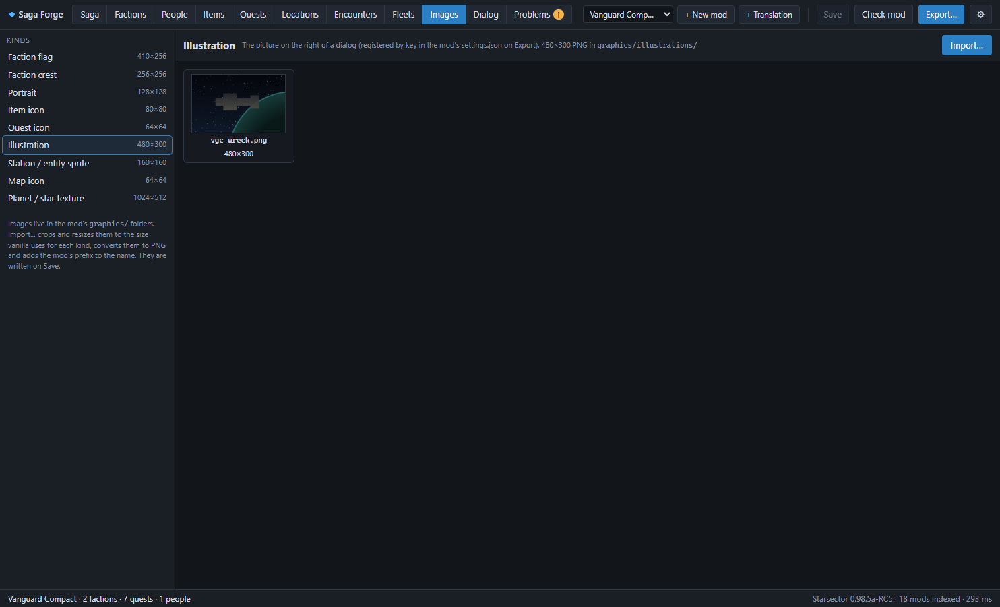
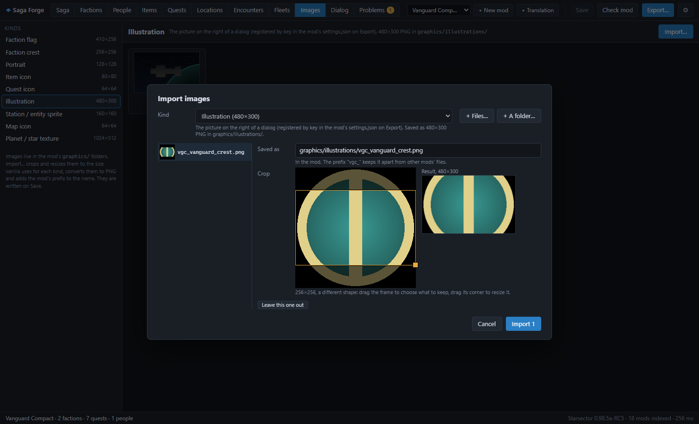

# Images

The mod's own pictures: faction flags and crests, portraits, item and quest icons, dialog
illustrations, and the sprites and textures of the mod's own station and planet types. Images are
brought in here (or from any image field) at the size vanilla uses, and picked by their picture.

## How it works

Images live in the mod's `graphics/` folders, as vanilla's do. Saga Forge doesn't keep a list of
them: what is in the folder is what the mod has. New images are only written into the mod when
you **Save**.

### The kinds

The list on the left is the kinds of image a mod uses, each with vanilla's size:

| Kind | Size | Folder | Used for |
|---|---|---|---|
| Faction flag | 410×256 | `graphics/factions` | The flag on the faction's colonies, fleets and intel page |
| Faction crest | 256×256 | `graphics/factions` | The emblem in the intel tab and dialog faction panels |
| Portrait | 128×128 | `graphics/portraits` | A person in dialog and the comm directory; a faction's portrait pool |
| Item icon | 80×80 | `graphics/icons/cargo` | An item in the cargo grid and its tooltip |
| Quest icon | 64×64 | `graphics/icons/missions` | A quest in the intel screen and the contact's mission list |
| Illustration | 480×300 | `graphics/illustrations` | The picture on the right of a dialog |
| Station / entity sprite | 160×160 | `graphics/stations` | A station or object of the mod's own entity types, on the campaign map |
| Map icon | 64×64 | `graphics/icons/map` | The small map icon of the mod's own entity type (optional) |
| Planet / star texture | 1024×512 | `graphics/planets` | The surface of the mod's own planet or star type |

Flags and crests share one folder: a file whose name contains `crest` counts as a crest.

### The image grid

Picking a kind shows the mod's images of that kind as thumbnails, with each file's name and size.
An image waiting for Save says so. When images aren't at vanilla's size, a note above the grid
says how many (the game shows them scaled); import them again to fix it.

Illustrations are used by a **key**, not by their path: on Export, Saga Forge registers each of
the mod's illustrations under its file name in the mod's `data/config/settings.json`
(`vgc_wreck` for `graphics/illustrations/vgc_wreck.png`), which is how vanilla's dialog finds
them.

### Import

**Import…** (top right) brings your own pictures into the mod. It takes single files or a whole
folder, and for each one:

- names it with the mod's prefix (`vgc_` …), in the kind's folder (flags get `_flag` and crests
  `_crest` at the end if their names don't say so);
- lets you crop it to the kind's shape: drag the frame to choose what to keep, drag its corner to
  resize it. An image that already has the right shape is only resized;
- resizes it to vanilla's size and saves it as a PNG.

If a file with that name is in the mod already, it is marked **exists** and you can tick
**replace the file already in the mod** (the old one goes to `sagaforge/backups`).

### The image picker

Every image field on the other tabs (a faction's logo, a person's portrait, an item's icon …) has
**Choose…**. It opens a picker with the pictures of that kind: the mod's own first (marked *this
mod*), then vanilla's and other installed mods' (marked with where they come from). Type in
**Filter by name or source…** to narrow the list, click one to use it, or press **Import…** to
bring in a new one (it goes straight to the file dialog and then the crop step).

Picking another mod's image only writes its path into your mod; nothing is copied. The game finds
that picture only while the other mod is enabled too, so use vanilla's images or your own unless
your mod needs that mod anyway.

## How to set up the basics

### Import images

Make the pictures first, in any size: Saga Forge crops and resizes them.

1. Open **Images** and pick the kind on the left (for example **Portrait**).
2. **Import…**. Check the **Kind** (it says the size and folder), then **+ Files…** to pick one or
   more files, or **+ A folder…** for every image in a folder.

   

3. For each file in the list on the left: check **Saved as** (change the name if you like), and
   drag the crop frame if the picture has another shape. **Result** shows what the game will
   show. **Leave this one out** drops a file.
4. **Import** (the button counts the files). The new images show in the grid as *waiting for
   Save*.
5. **Save** (Ctrl+S) copies them into the mod.

You can also import straight from a field: **Choose…** › **Import…** does the same and fills in
the field with the new image.

### Pick an image for a field

1. On the tab you are editing, find the image field (Factions › Identity › **Logo (flag)** or
   **Crest**, People › portrait, Items › **Icon**, a Dialog node's illustration, and so on).
2. **Choose…** opens the picker for that kind, with its size in the title.
3. Click the picture you want. The field shows its path and a preview.
4. Not there yet? **Import…** in the picker, pick your file, crop it, **Import**: it is used at
   once.
5. **Save**. An image from outside the mod is copied in now.

For a portrait the People tab also has its own way to pick one (see
[People › Use your own portrait](people.md#use-your-own-portrait)).
