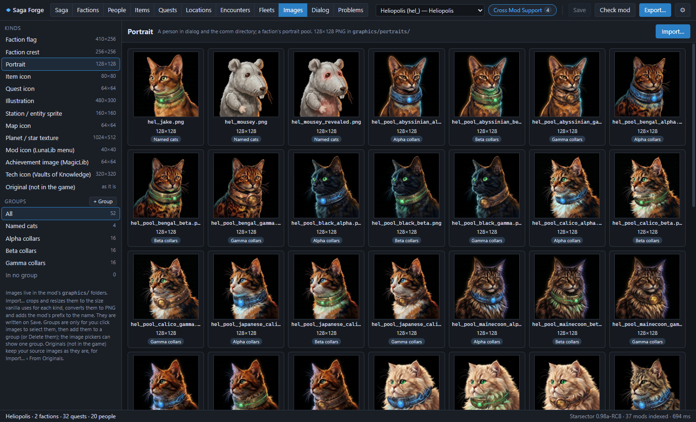
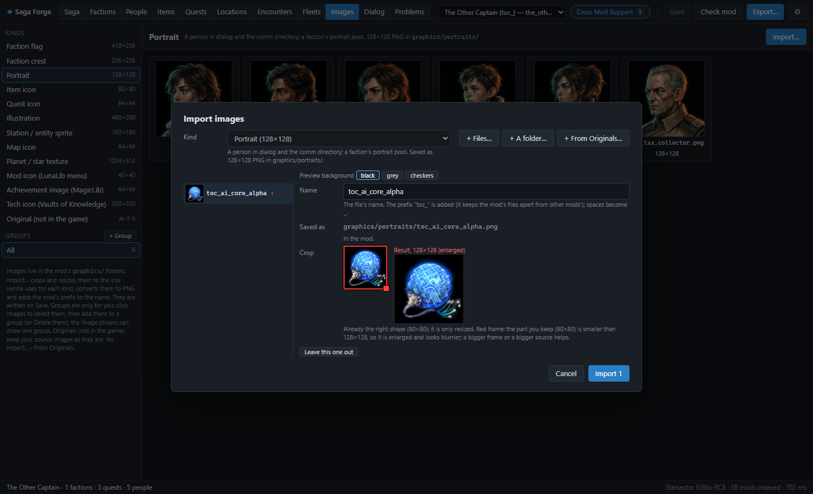
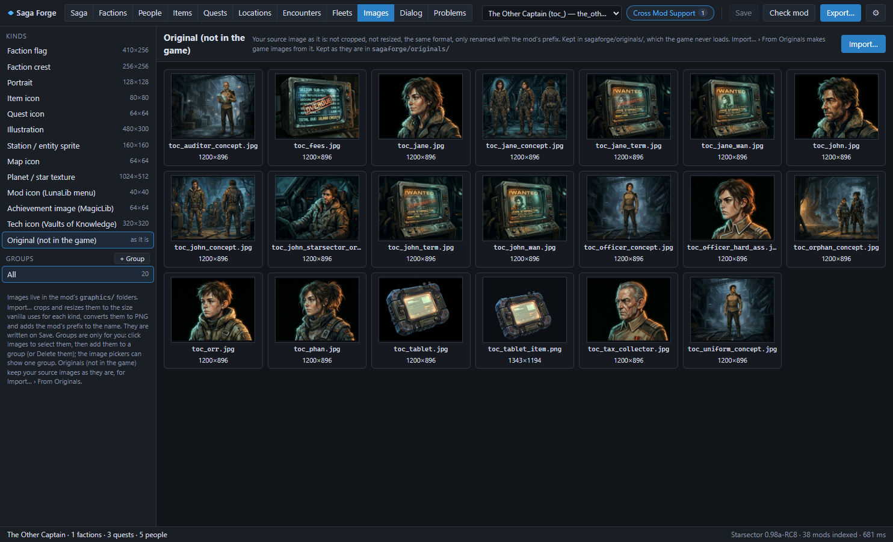
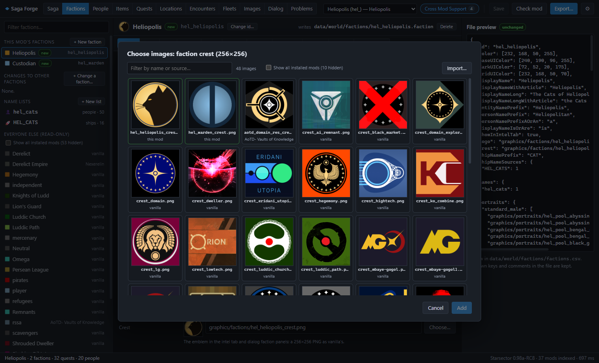
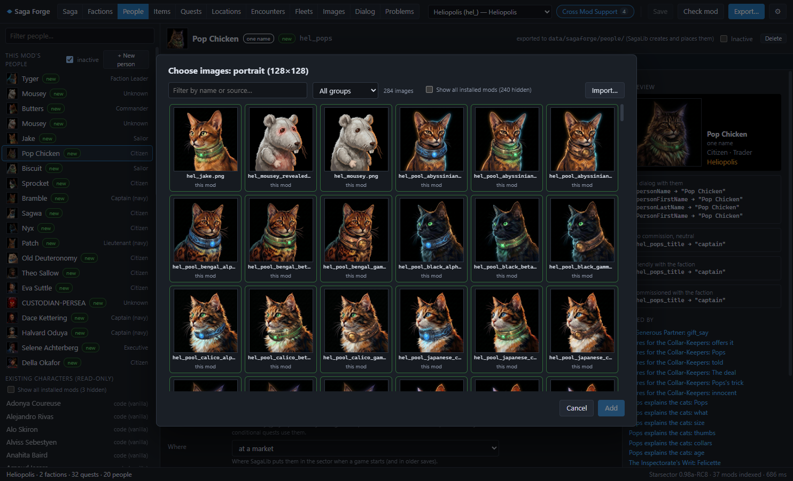
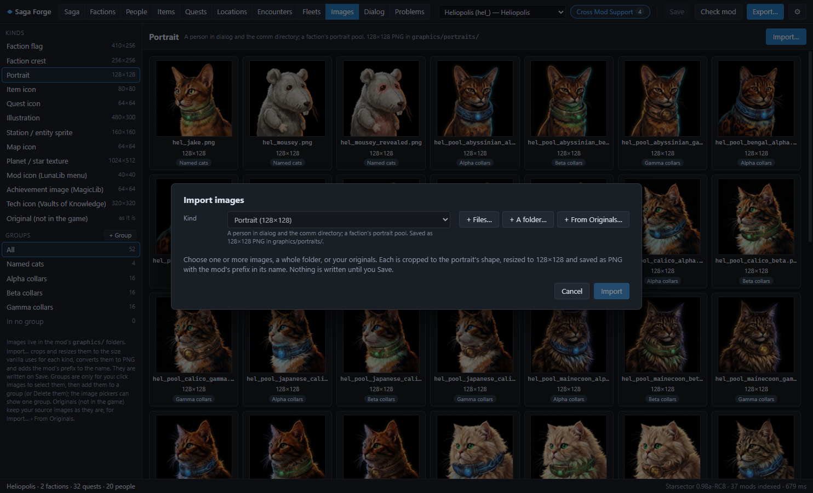

# Images

The mod's own pictures: faction flags and crests, portraits, item and quest icons, dialog
illustrations, and the sprites and textures of the mod's own station and planet types. Images are
brought in here (or from any image field) at the size vanilla uses, and picked by their picture.

## How it works

Images live in the mod's `graphics/` folders, as vanilla's do. Saga Forge doesn't keep a list of
them: what is in the folder is what the mod has. New images are only written into the mod when
you **Save**.

### The kinds

The list on the left is the kinds of image a mod uses, each with vanilla's size:

| Kind | Size | Folder | Used for |
|---|---|---|---|
| Faction flag | 410×256 | `graphics/factions` | The flag on the faction's colonies, fleets and intel page |
| Faction crest | 256×256 | `graphics/factions` | The emblem in the intel tab and dialog faction panels |
| Portrait | 128×128 | `graphics/portraits` | A person in dialog and the comm directory; a faction's portrait pool |
| Item icon | 80×80 | `graphics/icons/cargo` | An item in the cargo grid and its tooltip |
| Quest icon | 64×64 | `graphics/icons/missions` | A quest in the intel screen and the contact's mission list |
| Illustration | 480×300 | `graphics/illustrations` | The picture on the right of a dialog |
| Station / entity sprite | 160×160 | `graphics/stations` | A station or object of the mod's own entity types, on the campaign map |
| Map icon | 64×64 | `graphics/icons/map` | The small map icon of the mod's own entity type (optional) |
| Planet / star texture | 1024×512 | `graphics/planets` | The surface of the mod's own planet or star type |
| Mod icon (LunaLib menu) | 40×40 | `graphics/icons/mod` | The mod's icon in LunaLib's settings menu ([Saga › Settings](saga.md#settings)) |
| Achievement image (MagicLib) | 64×64 | `graphics/icons/achievements` | An unlocked achievement ([Saga › Achievements](saga.md#achievements)) |
| Tech icon (Vaults of Knowledge) | 320×320 | `graphics/icons/tech` | A research tech ([Saga › Research](saga.md#research)) |
| Original (not in the game) | as it is | `sagaforge/originals` | Your source pictures, kept as they are (see [Originals](#originals)) |

Flags and crests share one folder: a file whose name contains `crest` counts as a crest.

### The image grid

Picking a kind shows the mod's images of that kind as thumbnails, with each file's name and size.
An image waiting for Save says so. When images aren't at vanilla's size, a note above the grid
says how many (the game shows them scaled); import them again to fix it.

**Groups** (under the kinds) sort a kind's images for you: **+ Group** makes one (rename or delete it
there), **All** and **In no group** show the rest, each with a count. Click thumbnails to select
them (**Select all shown**, **Clear**), then **Add to group…** or **Remove from group**; each
thumbnail shows its groups. The image pickers on the other tabs can show one group. Groups are only
for you: they are kept in `sagaforge/project.json` and never exported.

**Delete…** deletes the selected images. It asks first and lists where each one is used; the
files are removed (and backed up to `sagaforge/backups`) when you **Save**.

Illustrations are used by a **key**, not by their path: on Export, Saga Forge registers each of
the mod's illustrations under its file name in the mod's `data/config/settings.json`
(`hel_probe_cryo` for `graphics/illustrations/hel_probe_cryo.png`), which is how vanilla's dialog
finds them. A Dialog node's illustration can have a second picture for a female player (see
[Quests › Node types](quests.md#node-types), Dialog › Visual).

**Pictures of another Saga Forge mod.** Illustration keys are global, as vanilla's are, so your mod
can use another mod's pictures (an image library mod, listed as required). The other mod must have
exported them: until then the game doesn't know the keys, and the warning names the mod and says to
export it.

### Import

**Import…** (top right) brings your own pictures into the mod. It takes single files or a whole
folder, and for each one:

- names it from its **Name** with the mod's prefix (`hel_` …) in the kind's folder (flags get
  `_flag` and crests `_crest` at the end if their names don't say so); **Saved as** shows the
  path;
- lets you crop it to the kind's shape: drag the frame to choose what to keep, drag its corner to
  resize it. An image that already has the right shape is only resized. When the part you keep is
  smaller than the kind's size, the frame turns **red** and the result says **(enlarged)**: it will
  look blurrier, so use a bigger frame or a bigger source;
- resizes it to vanilla's size and saves it as a PNG.

**Preview background** (black, grey or checkers) is only for looking: transparent parts stay
transparent in the file. A click outside the dialog doesn't close it; **Cancel** or Esc does.

If a file with that name is in the mod already, it is marked **exists** and you can tick
**replace the file already in the mod** (the old one goes to `sagaforge/backups`).

### Originals

The kind **Original (not in the game)** keeps your source pictures as they are: not cropped, not
resized, in their own format (a JPG stays a JPG), only renamed with your prefix, in
`sagaforge/originals/`, which the game never loads. **+ From Originals…** in the import dialog (for
any kind) picks one of them and makes a cropped, resized copy for that kind; the original stays.
Export can put the originals into the release zip (**with the original images**, off by default; see
[Export and Release](export.md)).

### The image picker

Every image field on the other tabs (a faction's logo, a person's portrait, an item's icon …) has
**Choose…**. It opens a picker with the pictures of that kind: the mod's own first (marked *this
mod*), then vanilla's and those of the mods your mod lists (marked with where they come from).
Type in **Filter by name or source…** to narrow the list, pick one of your **groups**, click one to
use it, or press **Import…** to bring in a new one (it goes straight to the file dialog and then the
crop step).

Picking another mod's image only writes its path into your mod; nothing is copied. The game finds
that picture only while the other mod is enabled too, so use vanilla's images or your own unless
your mod needs that mod anyway.

## How to set up the basics

### Import images

Make the pictures first, in any size: Saga Forge crops and resizes them.

1. Open **Images** and pick the kind on the left (for example **Portrait**).
2. **Import…**. Check the **Kind** (it says the size and folder), then **+ Files…** to pick one or
   more files, **+ A folder…** for every image in a folder, or **+ From Originals…** for your
   originals. To keep the source pictures themselves, import them first with the kind **Original
   (not in the game)**.

   

3. For each file in the list on the left: check its **Name** (change it if you like; **Saved as**
   shows the path), and drag the crop frame if the picture has another shape. **Result** shows what
   the game will show; a red frame means it will be enlarged. **Leave this one out** drops a file.
4. **Import** (the button counts the files). The new images show in the grid as *waiting for
   Save*.
5. **Save** (Ctrl+S) copies them into the mod.
6. Optional: select them in the grid and **Add to group…**, to find them again in the pickers.

You can also import straight from a field: **Choose…** › **Import…** does the same and fills in
the field with the new image.

### Pick an image for a field

1. On the tab you are editing, find the image field (Factions › Identity › **Logo (flag)** or
   **Crest**, People › portrait, Items › **Icon**, a Dialog node's illustration, and so on).
2. **Choose…** opens the picker for that kind, with its size in the title.
3. Click the picture you want. The field shows its path and a preview.
4. Not there yet? **Import…** in the picker, pick your file, crop it, **Import**: it is used at
   once.
5. **Save**. An image from outside the mod is copied in now.

For a portrait the People tab also has its own way to pick one (see
[People › Use your own portrait](people.md#use-your-own-portrait)).
