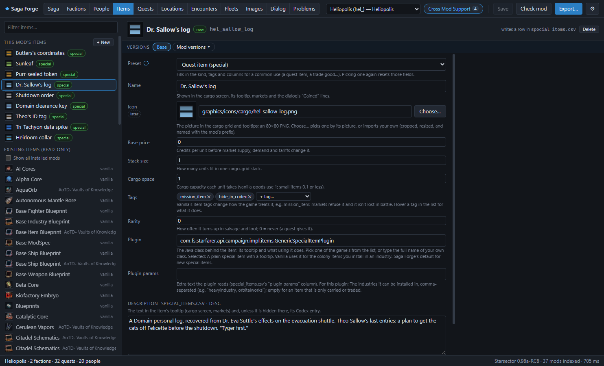
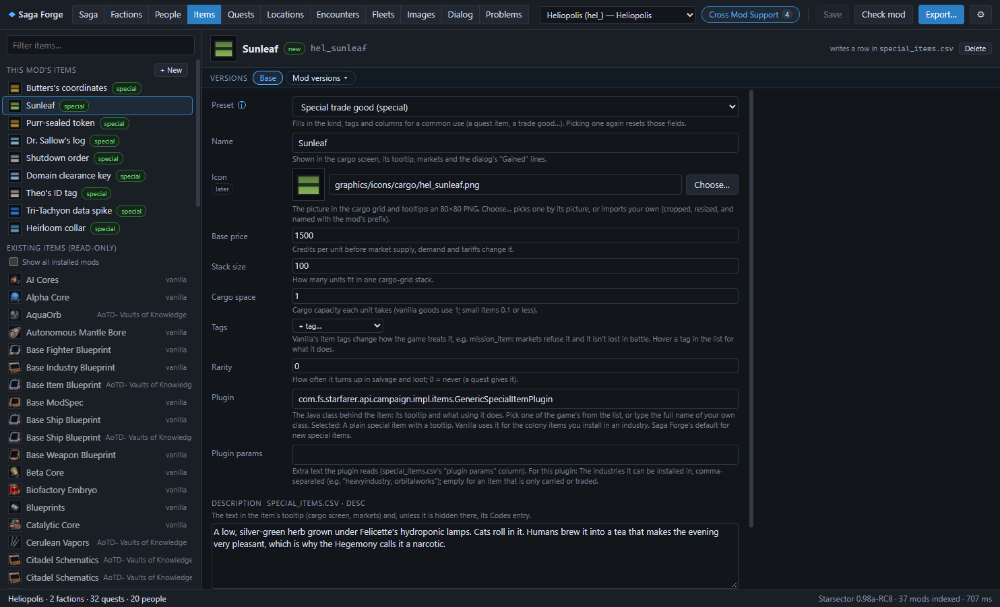
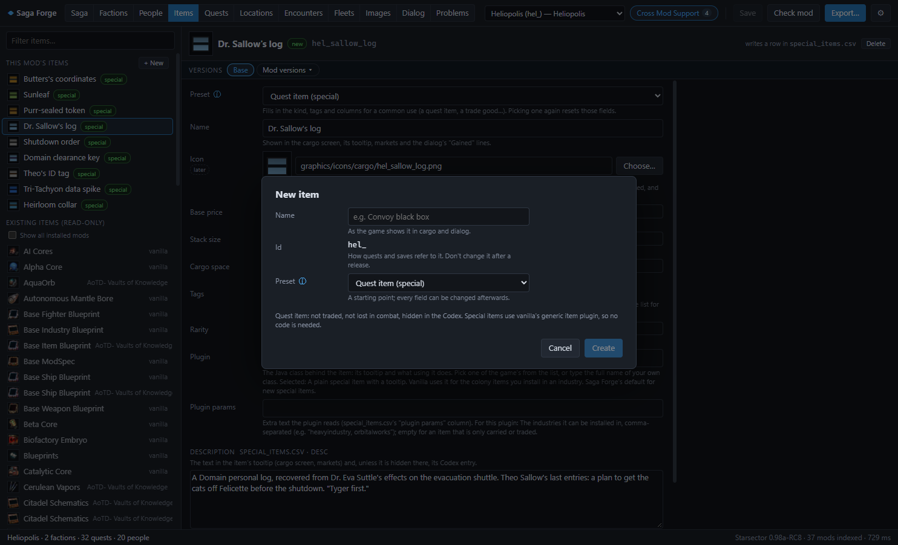
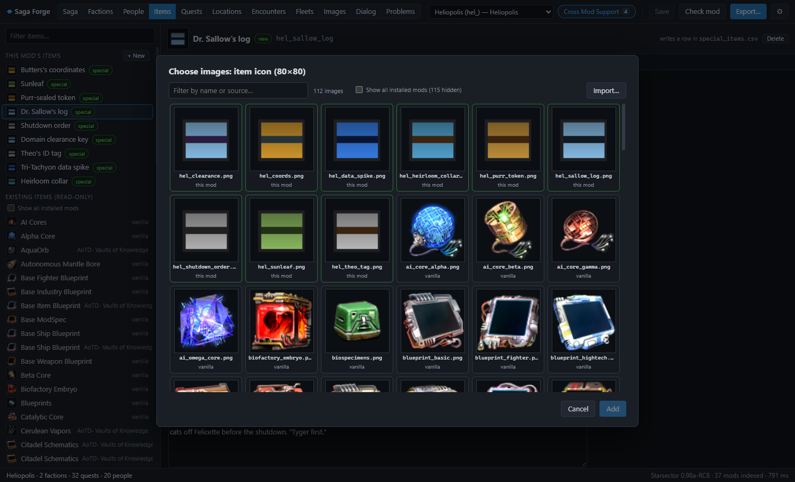

# Items

The Items tab is where your mod adds its own cargo items: quest items the player carries, trade
goods and rare valuables.

## How it works

### The item list

- **This mod's items**: the items your mod adds, each marked **special** or **commodity**. **+
  New** adds one.
- **Existing items (read-only)**: every commodity and special item of the game and of the mods
  your mod lists in [Saga › Mods](saga.md#mods) (**Show all installed mods** adds the others). Click one to see its icon and description. You can't change them here (a row with the same
  id in your mod would replace the whole row), but your quests can give, take and test them by
  their id.

### Commodities and special items

The game has two kinds of cargo item, and Saga Forge makes both:

- **Special items** (`special_items.csv`): single things with their own tooltip, like vanilla's
  AI cores, blueprints or the Janus Device. **Quest items are special items** with the tag
  `mission_item`: markets refuse to buy them and they aren't lost in battle.
- **Commodities** (`commodities.csv`): goods counted in units, like supplies or drugs, with a
  price that markets trade at.

You rarely pick the kind yourself. Each new item starts from a **preset**:

| Preset | Kind | What it is for |
|---|---|---|
| **Quest item** | special | Something a quest gives and takes back: not traded, not lost in combat, hidden in the Codex, price 0. |
| **Trade good** | commodity | Something markets buy and sell, with a base price. |
| **Rare valuable** | special | A valuable find worth 50,000 credits, with a Codex entry. |
| **Special trade good** | special | Something to buy and sell outside the economy: a stack of up to 100, base price 1,500, no rarity (it doesn't turn up in salvage by itself). Markets don't produce or need it. |

Special items use vanilla's generic item plugin, so they need no code.

Heliopolis has quest items (**Dr. Sallow's log**, **Butters's coordinates**), rare valuables
(**Purr-sealed token**) and a special trade good, **Sunleaf**, the catnip the Midnight Zoomies
smuggle. A commodity's description goes into `descriptions.csv` (the bar above the form says so),
and its **Other columns** hold the economy values of the Trade good preset.

### The item form

- **Preset**: picking one again resets the kind, tags and columns to that preset. **(custom)**
  means the item no longer matches a preset; picking it changes nothing.
- **Name** and **Icon**: shown in the cargo screen, tooltips, markets and the dialog's "Gained"
  lines. The icon is an 80×80 PNG.
- **Base price**, **Stack size**, **Cargo space**: the price before markets change it, how many
  fit in one cargo-grid stack, and how much room each unit takes.
- **Tags**: vanilla's item tags. Hover a tag in the **+ tag…** list for what it does.
- For special items: **Rarity** (how often it turns up in salvage and loot; 0 = never, only a quest
  gives it), **Plugin** (the Java class behind it; the default works for plain items) and
  **Plugin params**.
- **Description**: the text in the item's tooltip and its Codex entry.
- **Other columns** (folded): the rest of the CSV row, written as it is, and the row as it will be
  written.
- **Used by**: the quests that give, take or test it. Click one to open it.

### What it writes into the mod

Export writes one row per item into the mod's own `data/campaign/special_items.csv` or
`data/campaign/commodities.csv`. A commodity's description goes into
`data/strings/descriptions.csv`; a special item's goes into its own row. The bar above the form
says which file the item writes to. Items don't need SagaLib.

## How to set up the basics

### Add a quest item

1. Click **+ New**.
2. Type the **Name**, e.g. *Dr. Sallow's log*. The **Id** is made from it with your prefix
   (`hel_sallow_log`); quests and saves refer to it, so don't change it after a release.
3. Leave **Preset** on **Quest item** and click **Create**.
4. Write the **Description**: the text the player reads in the tooltip.
5. Give it an icon (see [Give an item an icon](#give-an-item-an-icon)).
6. Save (**Ctrl+S**).

To hand it to the player, show it in a dialog or give it in a reward (see
[Quests › Give a reward](quests.md#give-a-reward)). To check whether the player still carries it,
test it in a condition; the item's **Used by** list then shows that quest.

**In game:** the item shows in the player's cargo with its icon and description. Markets won't
buy it, and it isn't lost when ships are.

### Add a special item

A special item the player can find, sell or install, rather than one a quest hands out:

1. Click **+ New**, type the name, and pick the **Rare valuable** preset. Click **Create**.
2. Set **Base price** (what markets pay before their own changes).
3. Set **Rarity** above 0 if it should turn up in salvage and loot.
4. Leave **Plugin** on the game's generic plugin. Its **Plugin params** are the industries the item
   can be installed in, comma-separated (e.g. `heavyindustry, orbitalworks`); leave them empty for
   an item that is only carried or traded. The list has the game's other plugins, each with a short
   summary, and your own Java class works too: type its full name.
5. Write the **Description** and pick an icon.

**In game:** it shows in cargo and markets like vanilla's special items, with a Codex entry. To put
it in salvage on purpose, add it to a loot table (see
[Saga › Make a loot table](saga.md#make-a-loot-table)).

### Give an item an icon

1. Make an 80×80 PNG (vanilla's size). A bigger picture is fine: Saga Forge crops and resizes it.
2. Click **Choose…** next to **Icon**. The picker shows your mod's icons first, then the game's.
3. Pick one, or click **Import…** to bring your own file in: choose it, crop it, and Saga Forge
   saves it to the mod's `graphics/icons/cargo/` with your prefix in the name. For more on
   importing, see [Images › Import images](images.md#import-images).
4. Or type a path in the box, e.g. `graphics/icons/cargo/hel_sallow_log.png`.

A new item starts with a placeholder icon (a plain chip for special items). If you don't have the
picture yet, click **later** under **Icon** to mark it *Set later* (see
[Problems › Mark a field Set later](problems.md#mark-a-field-set-later)). **Check mod** reports an
icon whose file doesn't exist.

**In game:** the icon shows in the cargo grid, tooltips and markets.
