# Locations

The places of your mod: new star systems on the hyperspace map, the planets, stations, wrecks and
other objects in them, colonies (markets) the player can dock at, and objects you add to systems
that already exist (vanilla's or another mod's).

## How it works

The page has three columns: the lists on the left, a map in the middle and the selected thing's
form on the right. Everything you make here is built in the game by SagaLib when a new game
starts (and, if you want, in saves that already exist).

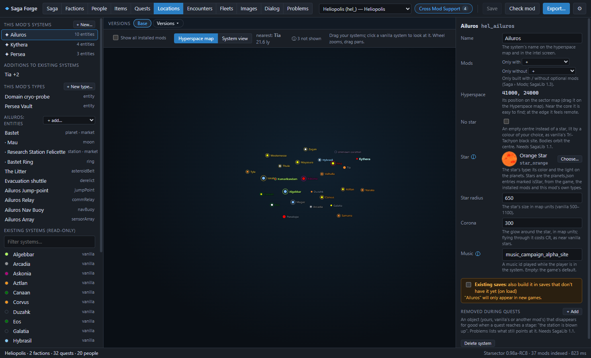

### The lists

- **This mod's systems**: the new star systems of the mod (**+ New…** makes one). The number is how
  many objects it has.
- **Additions to existing systems**: systems that are not yours (Askonia, Corvus, another mod's)
  where your mod adds objects (Heliopolis adds Lagua's Rest to Tia). Their own planets and
  stations are never changed.
- **This mod's types**: your own kinds of station, planet or star, with your own pictures
  (**+ New type…**, see [Make your own entity type](#make-your-own-entity-type)).
- **Ailuros: entities** (the selected system's name): the objects in that system. **+ add…** adds
  one. A dot in front of a name means it orbits something other than the star (Research Station
  Felicette orbits Bastet); the grey text says what kind it is and whether it has a market.
- **Existing systems (read-only)**: the systems of the game and of the mods your mod lists in [Saga
  › Mods](saga.md#mods), each with a dot in the colour of the faction that owns the most there.
  Click one to look at it. **Show all installed mods** (above the map) adds the other mods' systems,
  and the map, the markets and the type chooser follow the same switch.

### The hyperspace map

**Hyperspace map** shows the whole sector: each system's star as in game (colour and size by type;
a black hole black, no star or a nebula an empty circle), a ring in the colour of the faction that
owns the most there. Drag your system to place it; the toolbar shows
the nearest system and how far it is in light-years ("nearest: Tia 21.6 ly"). Near the core the
player finds it easily, at the edge it feels remote. The wheel zooms (labels grow as you zoom in)
and dragging the background pans. A dashed outline marks the edge of normal hyperspace.

- **Hover** a system (anywhere inside its ring): an info box in the corner shows its markets, each
  in its faction's colour with its size, and stays a few seconds after you move on. Click a market
  there to open the System view centred on its planet or station.
- Places the game makes in code at a fixed spot are shown too: Limbo and the Tri-Tachyon black
  site ("Unknown Location"). Places the game puts somewhere new in every game can't be: **ⓘ 3 not
  shown** in the toolbar names them.

Click a vanilla system to look inside it. Saga Forge reads how the game builds it and shows its
planets and stations, read-only, with **Add to this system…** on the right (see
[Add to an existing system](#add-to-an-existing-system)). Click one of its planets or stations for
its details: its type, what it orbits, and its market with faction, size, industries and
conditions. Some vanilla systems are partly made by random generation in the game's code; those
parts can't be shown.

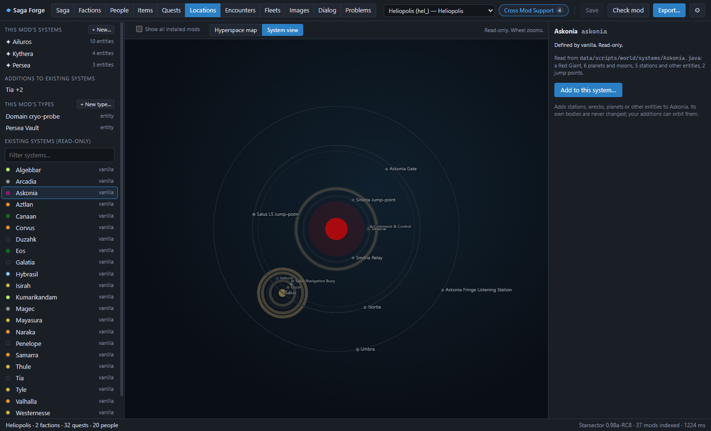

### The system view

**System view** draws the selected system from above: the star, the orbits (dashed circles), belts
and rings as wide bands, and every object with its name.

- Drag an object to move it along its orbit; hold **Shift** to change its distance too.
- With the star selected (nothing else picked), round handles on the star change its size and its
  corona. With a planet selected, a handle changes its size; with a belt or ring, its width.
- Objects that only appear later in a quest are drawn faded.
- Drag empty space to pan; the wheel zooms. Every label has a dark outline, so a name stays readable
  over a light planet.

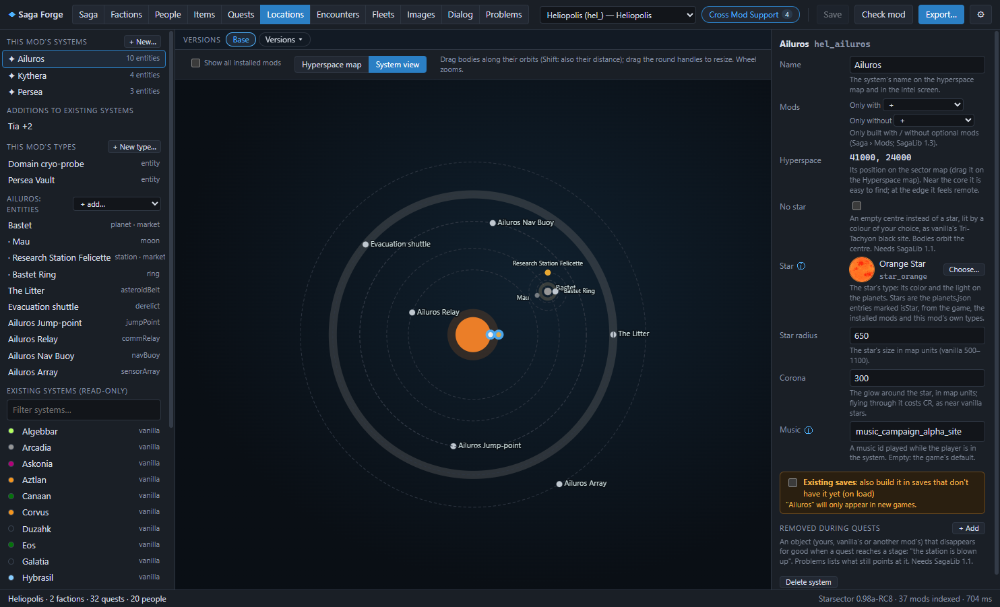

### The system form

With a system selected (and no object), the right column shows the system itself:

- **Name** and **Hyperspace** (its place on the sector map).
- **Star**: its type (**Choose…** shows every star type with its picture), **Star radius** and
  **Corona** (flying through the corona costs combat readiness, as near vanilla's stars). **No
  star** makes an empty centre lit by a colour of your choice, like vanilla's Tri-Tachyon black
  site.
- **Music**: a music id played in the system; empty is the game's default. The ⓘ opens the
  reference of music and sounds.
- **Existing saves**: ticked, SagaLib also builds the system when a player loads a save that
  doesn't have it yet. Unticked, it only appears in new games (the box turns yellow to remind
  you).
- **Removed during quests**: objects (yours, vanilla's or another mod's) that disappear for good
  when a quest reaches a stage: "the station is blown up". An object with a colony is only removed
  when you choose **decivilize** for its market, which destroys the colony for good.

### The object form

Click an object (in the list or the map) and the right column shows its form. At the top is a
picture of its type ("an example of the type; the game may tint or light it differently").

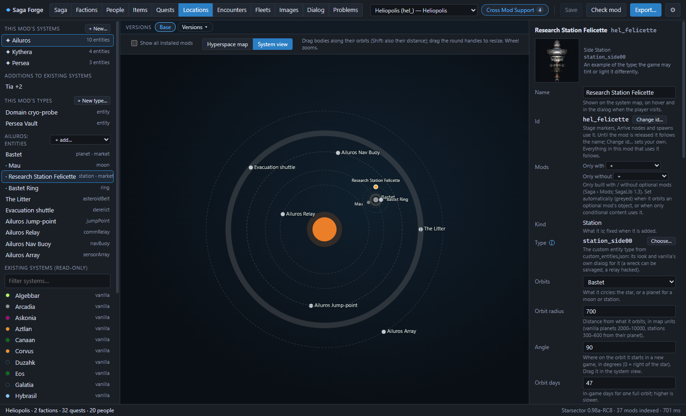

- **Name**: shown on the map, on hover and in the dialog when the player visits.
- **Id**: what quests use to point at it (stage markers, Arrive nodes, where fleets spawn). Until
  the mod is released the id follows the name; **Change id…** sets your own, and everything in the
  mod that uses it follows. After a release, change it only if you must: saves remember it.
- **Kind** (fixed when you add it) and **Type**: the planet type, or the entity type from the
  game's `custom_entities.json`. The type sets its look and vanilla's own dialog for it: a wreck
  can be salvaged, a relay hacked. **Choose…** opens a picker with pictures and filters, and the ⓘ
  the reference of entity types (their dialog, salvage, defenders and description) or planet types.
  A derelict's type is the ship it is the wreck of: a variant id (picked from the variant list) or
  `wreck` for a random hull.
- **Orbits**, **Orbit radius**, **Angle**, **Orbit days**: what it circles and how. The help under
  each field gives vanilla's usual values (planets 2000–10000 from the star, stations 300–600 from
  their planet).
- **Size** (planets, moons) or **Width** (belts, rings).
- **Appears**: from the start, when a quest reaches a stage, or only when a quest's Action node
  places it ("Place an object"). It always shows the choice that is stored, even when the quest
  isn't picked yet. Until then it isn't in the game at all, so the player can't find
  it early. **Replaces** makes it take another object's place: a station that becomes a wreck.
- Planets and moons without a market: **Conditions** (resources, hazards, ruins; the chips show
  their names, and the ⓘ opens the reference of colony conditions with the planet types that can
  roll each) and **Surveyed** (how much the player knows at the start). With ruins, **ruins stay unexplored**
  keeps "Explore the ruins" available even in a system with a colony.
- **Salvage**: **+ Loot** and **+ Defenders** for objects that can be salvaged (see
  [Add a cache with loot and defenders](#add-a-cache-with-loot-and-defenders)).
- **Protection** (wrecks only): see [Add a derelict or wreck](#add-a-derelict-or-wreck).
- **Market** (planets, moons, stations): **+ Add a market** makes it a colony (see
  [Add a station with a market](#add-a-station-with-a-market)).
- **Description**: the text shown when the player visits it and in its info panel.

### What it writes into the mod

- `data/sagaforge/systems/<system id>.json`: the system and its objects, which SagaLib builds in
  the game (so the mod needs SagaLib).
- `data/strings/descriptions.csv`: the descriptions of the objects.
- `data/config/custom_entities.json` and `data/config/planets.json`: your own types, added to the
  game's lists by key (nothing of vanilla's is replaced).

The plan itself is kept in `sagaforge/locations/<system id>.system.json` in the mod folder. For the
exact format, see SagaLib's
[format notes](https://github.com/LastAi/Starsector-SagaLib/blob/main/docs/FORMAT.md).

## How to set up the basics

### Add a star system

1. In **This mod's systems**, press **+ New…**.
2. Keep **A new star system**, type the **Name** (e.g. `Ailuros`). The id is made from it with
   your mod's prefix (`hel_ailuros`).
3. Press **Create**. The system appears in the middle of the hyperspace map: drag it where you
   want it, watching the "nearest" hint in the toolbar.
4. On the right, pick the star with **Choose…** and set its radius and corona.
5. Tick **Existing saves** if players should get the system in a game they already started.

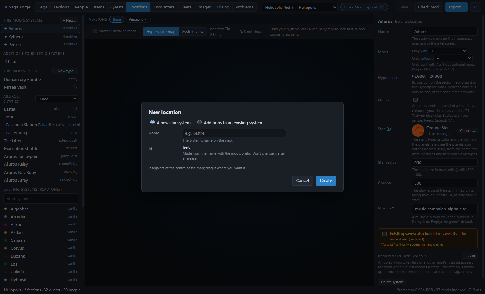
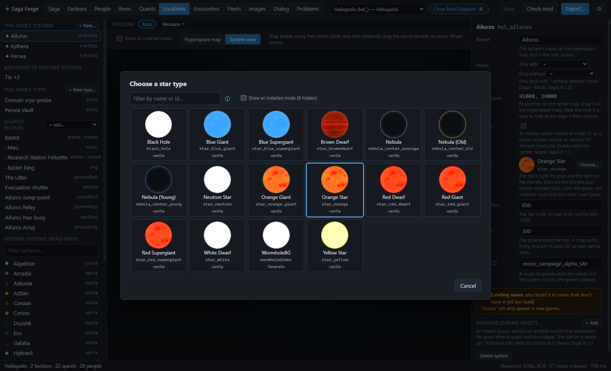

In game: the system is on the hyperspace map of every new game (and of loaded saves, with
**Existing saves**), with jump points made automatically.

### Add a station with a market

1. Select the system, then in the entities list pick **+ add…** › **Station**. If a planet is
   selected (or the system has one), the station orbits it; otherwise it orbits the star.
2. Give it a **Name** (e.g. `Research Station Felicette`) and, if you like, a different look with **Type ›
   Choose…** (the **Stations** filter shows vanilla's station pictures).
3. Scroll down to **Market** and press **+ Add a market**.
4. Fill in the market: **Name**, **Faction** (who owns it: its flag, patrols, prices and who may
   dock), **Size** (population 1–10; vanilla colonies are 3–8), **Free port**, **Never
   decivilises** for a colony a quest needs to keep, and **Protect from invasion** for a place the
   story can't lose (Nexerelin never invades it, the player's invasions included; without
   Nexerelin it does nothing).
5. Add **Conditions**, **Industries** (population, spaceport, military base, orbital station…)
   and **Submarkets** (open market, black market, military market, storage) with the **+ add**
   boxes. The chips show names; the ⓘ next to each opens its reference.
6. Under **People at this market**, add the characters who live there (see
   [People › Place a character at a market](people.md#place-a-character-at-a-market)). The list
   and the person's placement on the People page stay in step.
7. Write a **Description** at the bottom: the text the player reads when docking.

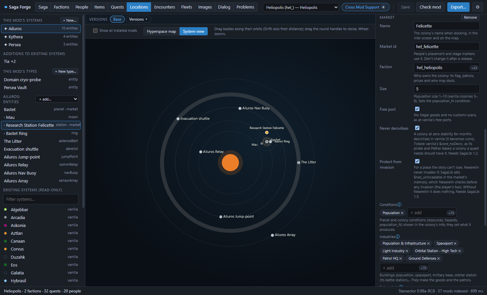

In game: a colony the player can dock at and trade with, listed in the intel screen, with its
people in the comm directory.

### Add a planet

1. Select the system, then **+ add…** › **Planet** (or **Moon**, which orbits the selected or
   first planet).
2. Name it and press **Type › Choose…**. The picker sorts the planet types by how likely vanilla's
   random generation puts each one at this orbit and marks those as "fits here"; **Fits here only**
   hides the others. Any type can be used.
3. Drag it on its orbit in the system view, or type the **Orbit radius**, **Angle** and **Size**.
4. For an uncolonised planet, add **Conditions** (ore, ruins, hazards) and choose **Surveyed**.
   For a colony, add a market as in [Add a station with a market](#add-a-station-with-a-market).

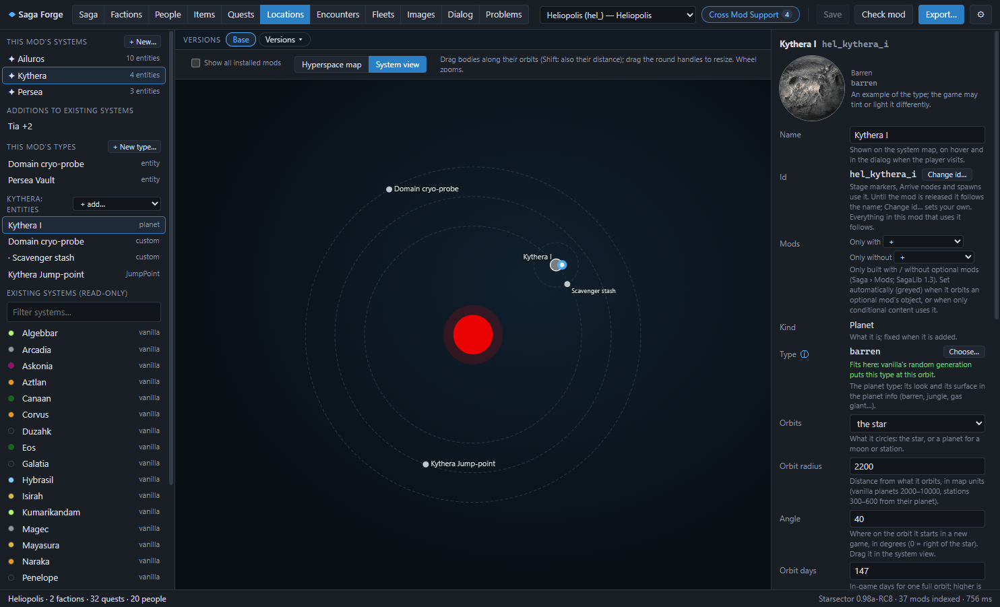
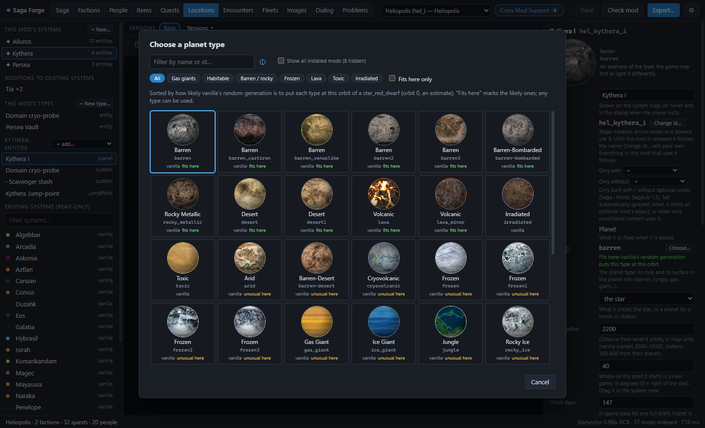

In game: the planet orbits the star with its conditions in the planet info; an uncolonised one
can be surveyed as usual.

### Add a derelict or wreck

1. Select the system, then **+ add…** › **Derelict / wreck**.
2. Name it (e.g. `Evacuation shuttle`) and place it. Its **Type** is the ship it is the wreck of:
   pick a variant (here `mudskipper_Standard`), or keep `wreck` for a random hull. Either way it
   gets vanilla's derelict ship dialog (salvage, ship recovery).
3. If a quest sends the player to it, look at **Protection** further down the form: salvaging or
   recovering a wreck removes it, and then the quest can't go on. Pick **until** "<quest>
   succeeds" and press **Protect this wreck**. Saga Forge adds a short conversation at the wreck
   (just "Leave") and opens it on the Quests page; the quest's Arrive nodes there take over the
   arrival by themselves, and once the quest succeeds vanilla's wreck dialog is back (see
   [Quests › Write a conversation](quests.md#write-a-conversation)).

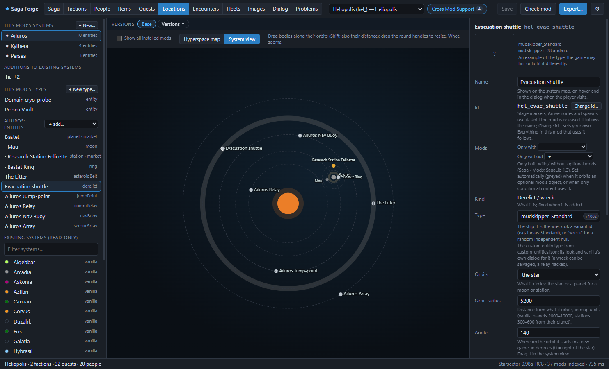
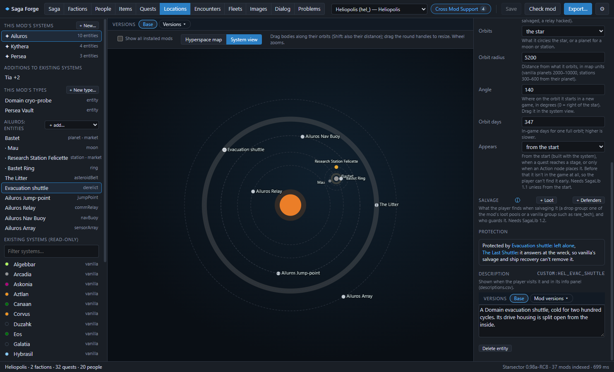

In game: a derelict on the map. Vanilla's own wreck dialog handles it unless your quests answer
first.

### Add a cache with loot and defenders

1. Select the system, then **+ add…** › **Other custom entity**.
2. **Type › Choose…** and pick a salvageable type, e.g. **Supply Cache** (`supply_cache`); the
   **Salvageable** filter shows them.
3. In **Salvage**, press **+ Loot**. Pick a drop group: one of your mod's loot tables (see
   [Saga › Make a loot table](saga.md#make-a-loot-table)) or a vanilla group such as `rare_tech`.
   Set **rolls** (random picks from the group) or **value** (credits' worth of the group's items).
   You can add several lines.
4. Press **+ Defenders**, pick the faction that guards it, the fleet **strength** range (a
   derelict usually 10–30) and the **chance** that there are defenders at all.

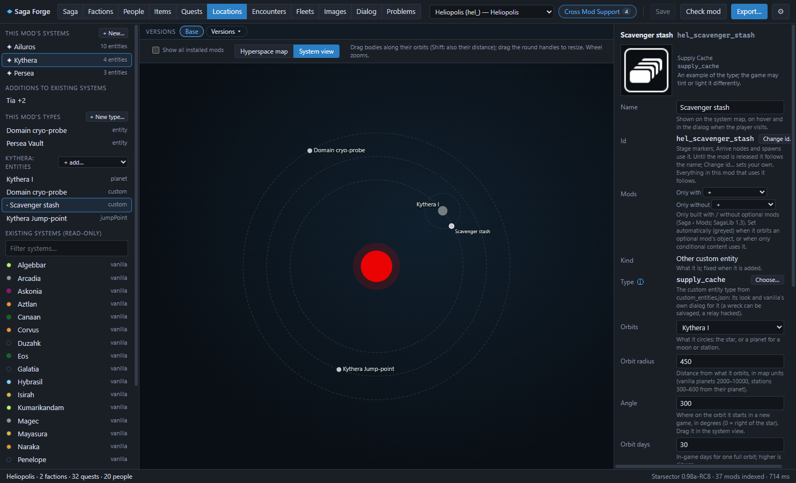
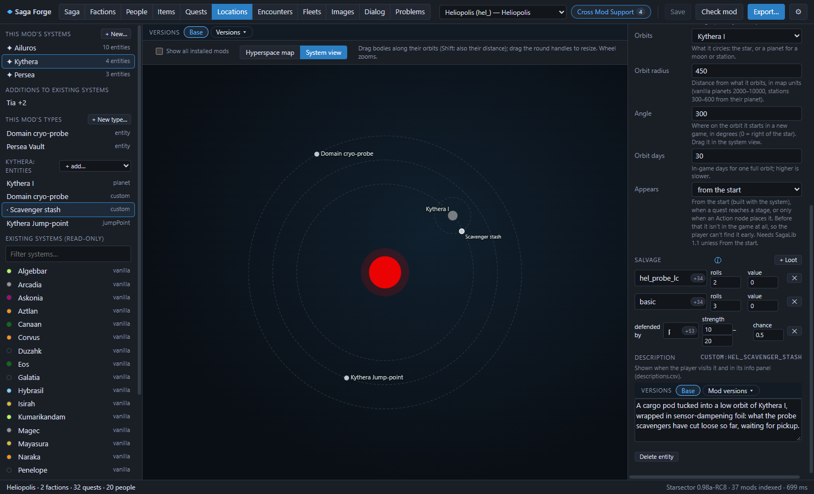
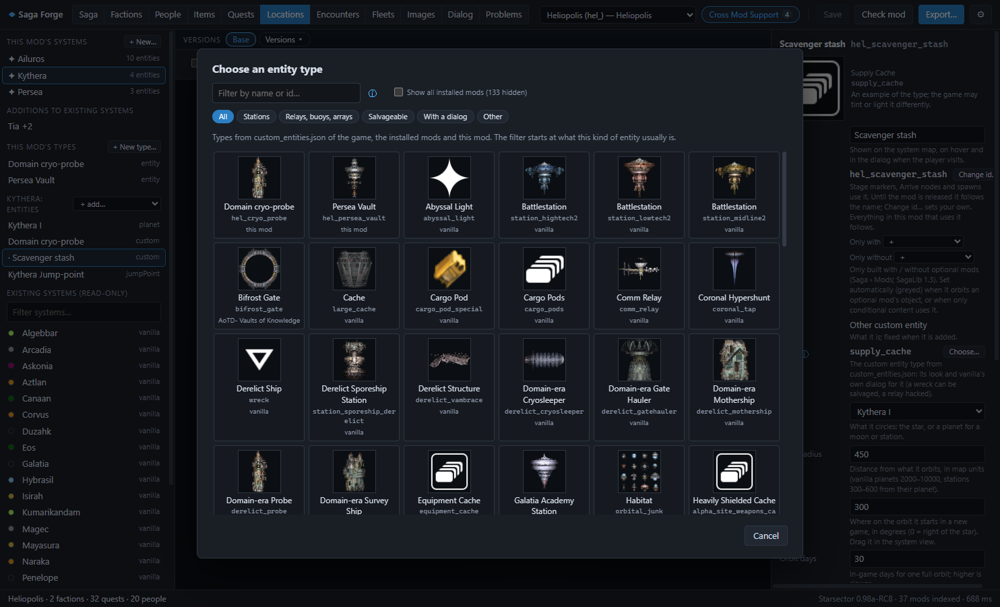

In game: when the player salvages it, a guard fleet may have to be beaten first, and the loot is
rolled from the groups you chose. Needs SagaLib 1.2. To scatter many such caches across the
sector instead of placing one, see [Saga › Scatter objects across the
sector](saga.md#scatter-objects-across-the-sector).

### Add to an existing system

1. On the **Hyperspace map**, click the system (e.g. Askonia) to look at it, then press **Add to
   this system…**. Or press **+ New…**, choose **Additions to an existing system** and pick the
   system.
2. The system appears under **Additions to existing systems**. Add objects with **+ add…** as in
   your own systems. In **Orbits** you can also pick the system's own planets and stations, under
   "<system>'s own bodies (vanilla)".

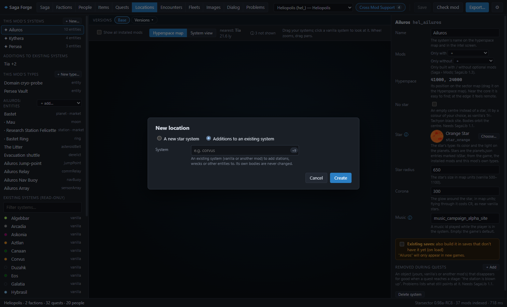
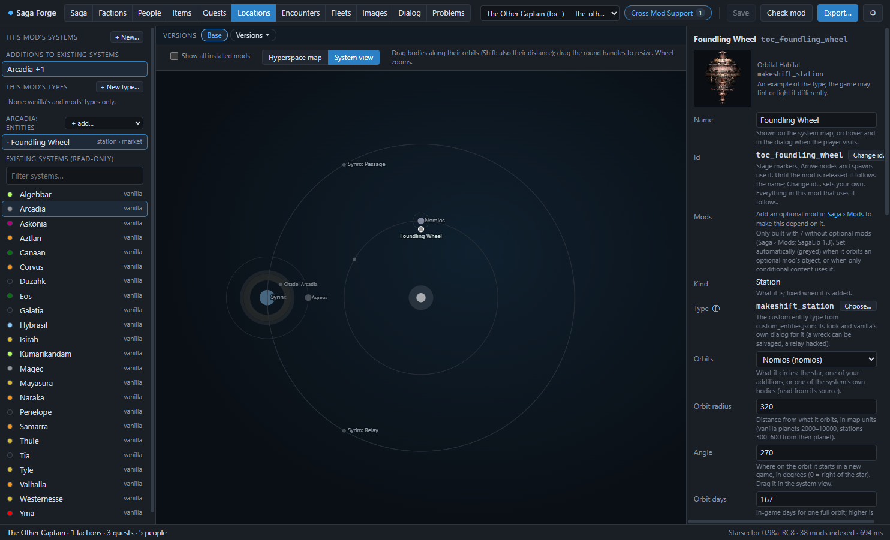

In game: your objects appear in that system in new games and, on load, in saves that don't have
them yet. SagaLib adds each one only if it isn't there already and never changes what the system
already has.

### Make your own entity type

1. In **This mod's types**, press **+ New type…**.
2. Choose **A station or other object**, **A planet type** or **A star type**, and type a
   **Name**. The id gets your prefix.
3. Press **Create**. The type's form opens on the right:
   - A station or object starts as a copy of vanilla's side station. Set **Behaves like** (the
     vanilla type it inherits everything else from, e.g. a derelict so it can be salvaged), its
     **Sprite** (cropped to 160×160 like vanilla's stations), **Drawn size**, **Radius**, and
     optionally a **Map icon** and an interaction **Picture**.
   - A planet or star type starts as a copy of vanilla's barren planet or yellow star. Set
     **Based on** (whose tilt, atmosphere and colours it copies) and its **Texture** (1024×512).
   Pictures are picked or imported as in [Images › Pick an image for a
   field](images.md#pick-an-image-for-a-field).
4. Use it: pick it in an object's **Type › Choose…**; your own types are listed there with the
   game's.

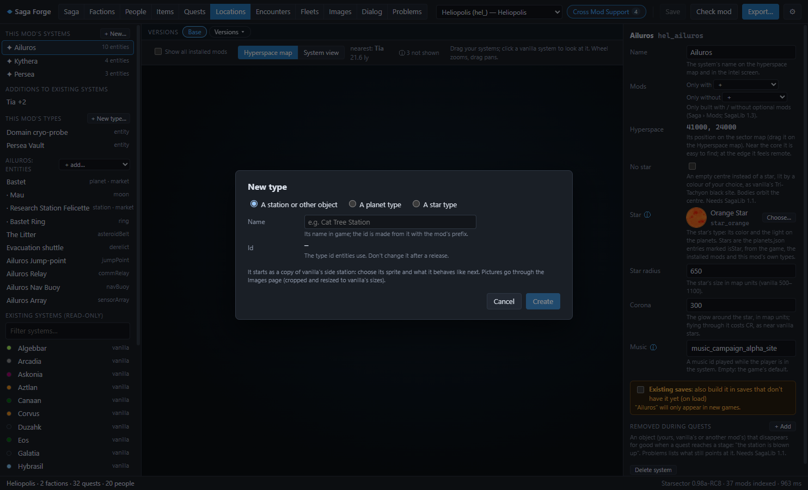
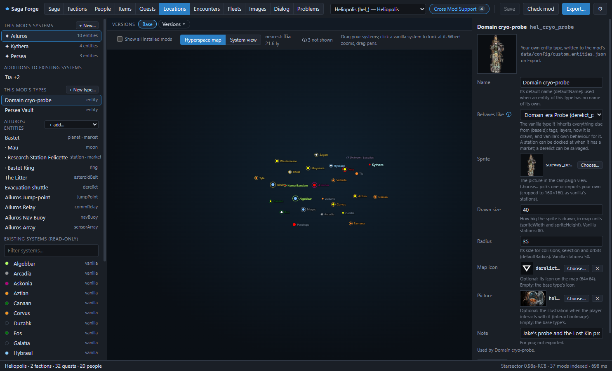

In game: your type is added to the game's `custom_entities.json` or `planets.json`, so it works
like a vanilla type (and other mods can use it too).
