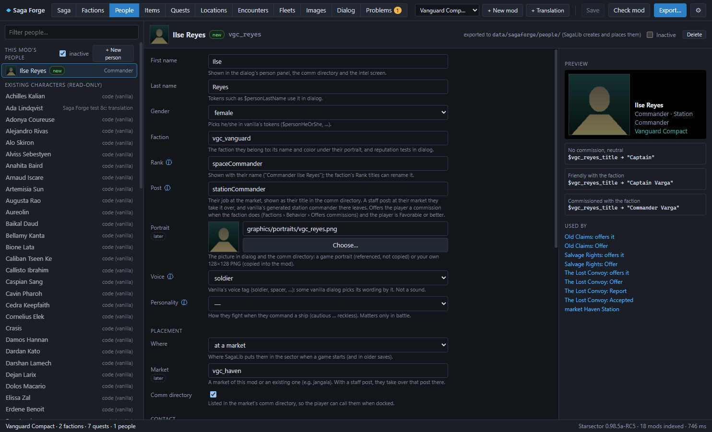
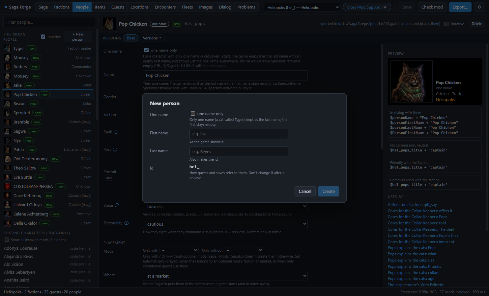
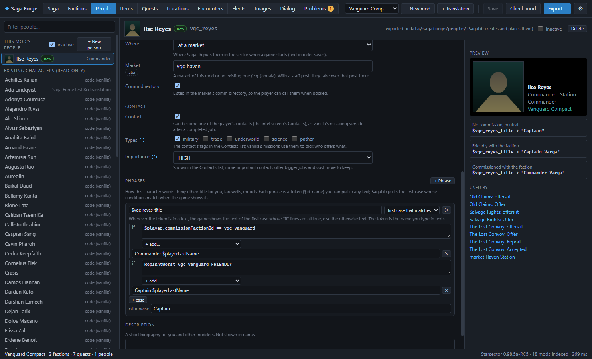
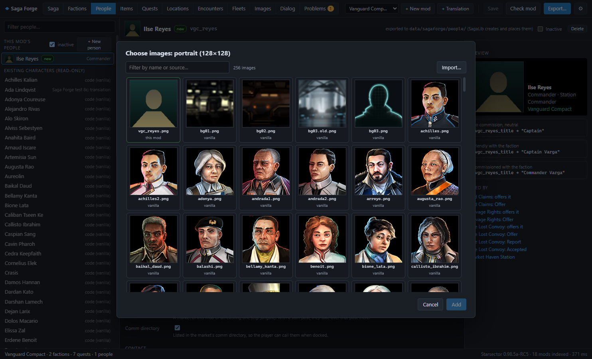
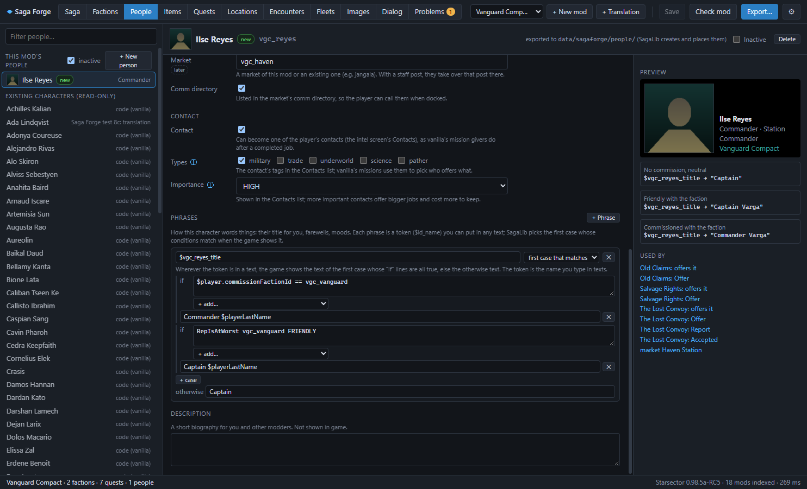

# People

The People tab is where your mod's named characters live: who they are, where they are in the
sector, whether they can become the player's contact, and how they word things.

## How it works

The tab has three columns:

- **On the left**, the people list.
- **In the middle**, the selected person's form.
- **On the right**, a **Preview** of how they look in dialog, and a **Used by** list.

### The people list

- **This mod's people**: the characters your mod adds, marked **new**, with their rank. **+ New
  person** adds one. The **inactive** box shows or hides people marked *Inactive* (see below).
- **Existing characters (read-only)**: the named people of the game and your other mods (vanilla's
  are made in code, shown as "code (vanilla)"). Your mod never changes them, but your quests can
  talk to them: use their id in a quest (see
  [Quests › Write a conversation](quests.md#write-a-conversation)).

The filter box searches both lists by name and id.

### The person form

From top to bottom:

- **First name, Last name, Gender**: shown in dialog, the comm directory and the intel screen.
  Gender picks he/she in vanilla's tokens such as `$personHeOrShe`.
- **Faction**: their name and color under the portrait, and the reputation tests in dialog.
- **Rank** and **Post**: "Commander Ilse Reyes", and their job at the market. A **staff post**
  (station commander, portmaster, administrator, …) at a market takes over that post from the
  person vanilla generates there. A commander or administrator also offers the player a
  commission when the faction does (see
  [Factions › The faction tabs](factions.md#the-faction-tabs), Behavior). With Nexerelin in
  [Saga › Mods](saga.md#mods), a warning shows when a quest contact is an administrator,
  portmaster, supply officer or station, base or outpost commander at a market that can be
  invaded: when Nexerelin captures the market, the new owner's faction takes the post over, and the
  contact changes faction with it. Give them another post, protect the market from invasion (one
  click for your own markets), or set the quest's **If a market of this quest changes owner**.
- **Portrait**: a game portrait (referenced, not copied) or your own 128×128 PNG (copied into the
  mod).
- **Voice** and **Personality**: vanilla's voice tag (soldier, spacer, …; some vanilla dialog
  picks its wording by it, it is not a sound), and how they fight when they command a ship.
- **Placement**: where SagaLib puts them in the sector: *at a market*, *commanding a fleet
  (encounter)*, or *nowhere until a quest needs them*.
- **Presence** (someone at a market): *always present*, or *only while the market's owner gets on
  with a faction*: the owner must be **at least** some level (Vengeful … Cooperative, or *not
  hostile*) **with** a faction, by default their own. A Hegemony loyalist at a station, say, leaves
  when the station is held by someone worse than Neutral toward the Hegemony. SagaLib checks once
  a day and when a game loads, so a new owner, a war breaking out and peace all count. While they
  are away they are hidden from the comm directory, quests with them as contact aren't offered,
  and `$global.sagaforge_away_<id>` is true for dialog and Branch cases to test (the condition
  picker has "<name> is away"). **Elsewhere**: a market where they're listed while away (their
  quests still aren't offered); empty = nowhere. The line under it says whether they'd be present
  at the start; vanilla sets most relations in code, so for those it can only tell in game. A quest
  they offer gets an info line in Problems: decide what happens to it when they leave, with the
  quest's **If a market of this quest changes owner** or a test of the away flag in its dialog.
  Play mode and the Test context have a "<name> is away" switch.
- **Contact**: whether they can become one of the player's contacts, with their types (military,
  trade, …) and importance.
- **Phrases**: the character's own words, tokens you can put in any dialog text (see
  [Give a character phrases](#give-a-character-phrases)).
- **Description**: a short biography for you and other modders. Not shown in game.

Some fields have a small **later** mark under their name: click it to mark the field *Set later*
when you don't know the value yet; it then shows **✎ to do** and is listed under To do in Problems (see
[Problems › Mark a field Set later](problems.md#mark-a-field-set-later)).

The bar at the top has **Inactive**: an inactive person is planned but not ready. They are not
exported, so they aren't in the game, and their problems show as warnings instead of errors.

### Preview and Used by

The **Preview** shows the dialog's person panel: portrait, name, rank and post, faction. If they
have phrases, it shows what each phrase becomes in three situations (no commission, friendly with
the faction, commissioned).

**Used by** lists the quests that use them (the contact who offers a quest, the speaker of a
dialog) and the market they are placed at. Click a line to open that quest.

### What it writes into the mod

Export writes your people to `data/sagaforge/people/<mod id>_people.json`. **SagaLib** creates
them when a new game starts and when a save is loaded, so a mod with people needs SagaLib. An
existing save gets new people on its next load; a person already in the save is updated, not
duplicated.

## How to set up the basics

### Add a character

1. Click **+ New person**.
2. Type a **First name** and a **Last name**. The **Id** is made from the last name with your
   mod's prefix (`vgc_reyes`). Quests and saves refer to them by it, so don't change it after a
   release.
3. Click **Create**. The new person belongs to your mod's first new faction (or the independents)
   and isn't placed anywhere yet.
4. Set **Gender**, **Faction**, **Rank** and **Post**. Type in the Rank and Post boxes to search
   the game's ranks and posts; the **ⓘ** next to them opens the app's reference page about them.
5. Pick a **Portrait** (see [Use your own portrait](#use-your-own-portrait)).
6. Choose the **Placement** (see [Place a character at a market](#place-a-character-at-a-market)).
7. Save (**Ctrl+S**).

**In game:** the person exists from a new game (or the next load of a save), at their placement.
To have them commanding a fleet, set Placement to *commanding a fleet (encounter)* and pick the
encounter (see [Encounters › Add a fleet for a quest](encounters.md#add-a-fleet-for-a-quest)).

### Make a character a contact

1. Open the person and tick **Contact** (under the Contact heading, below Placement).
2. Tick their **Types**: the tags in the intel screen's Contacts list (military, trade,
   underworld, …). Vanilla's missions use them to pick who offers what.
3. Pick their **Importance**. More important contacts offer bigger jobs and cost more to keep.
4. Give them a quest to offer: a quest that starts *offered by a contact (person_missions.csv)*,
   with this person (see [Quests › Make a contact quest with stages](quests.md#make-a-contact-quest-with-stages)).

**In game:** SagaLib makes them a potential contact the vanilla way. Like vanilla's mission givers,
they can become one of the player's contacts (the intel screen's Contacts), and the quests they
offer show in their dialog.

### Place a character at a market

1. Set **Placement › Where** to *at a market*.
2. In **Market**, pick a market of your mod (shown as "(this mod)") or an existing one, e.g.
   `jangala`. For a market of your own, see
   [Locations › Add a station with a market](locations.md#add-a-station-with-a-market).
3. Leave **Comm directory** ticked so the player can call them when docked.
4. For a station commander, portmaster or administrator, set **Post** to that post: they take it
   over from the person vanilla generates there.

The market's page on the Locations tab lists them under its people too; changing either place
changes both.

**In game:** they are at that market and in its comm directory. If the market is in a star system
your mod adds, SagaLib places them once the system exists.

### Use your own portrait

1. Make a 128×128 PNG (vanilla's size). A bigger picture is fine: Saga Forge crops and resizes it.
2. On the person, click **Choose…** next to **Portrait**. The picker shows your mod's portraits
   first, then the game's and other mods' ones.
3. Pick one, or click **Import…** to bring your own file into the mod: choose the file, crop it,
   and Saga Forge saves it to the mod's `graphics/portraits/` with your prefix in the name. For
   more on importing, see [Images › Import images](images.md#import-images).
4. You can also type a path in the box, e.g. `graphics/portraits/portrait_mercenary02.png`.

**In game:** the portrait shows in dialog, in the comm directory and in the intel screen. A game
portrait is only referenced; your own is copied into the mod and goes with it.

### Give a character phrases

A phrase is a token, such as `$vgc_reyes_title`, that you put in any dialog text. When the game
shows the text, SagaLib replaces it with the character's own wording for the moment. Reyes calls
the player "Commander Varga" once they hold a Vanguard commission, "Captain Varga" when they are
friendly, and plain "Captain" otherwise.

1. Open the person and scroll to **Phrases**. Click **+ Phrase**.
2. Name the token: it always starts with the person's id (`$vgc_reyes_`), you type the rest
   (`title`).
3. Pick how it chooses: **first case that matches**, or **random**.
4. For *first case that matches*, give each case its **if** lines (conditions, one per line, as in
   rules.csv; **+ add…** under the box offers common ones such as a reputation or commission test)
   and its text. **+ case** adds one. The **otherwise** text is used when no
   case matches. For *random*, every case is one possible text.
5. Put the token in a dialog text, e.g. `"$vgc_reyes_title." Reyes doesn't look up from her slate.`
6. Check the **Preview** on the right: it shows what the phrase becomes in three situations.

**In game:** SagaLib replaces the token wherever it appears in dialog text. Phrases that belong
to the whole mod rather than one person are on the Saga tab (see
[Saga › Add a phrase](saga.md#add-a-phrase)).
