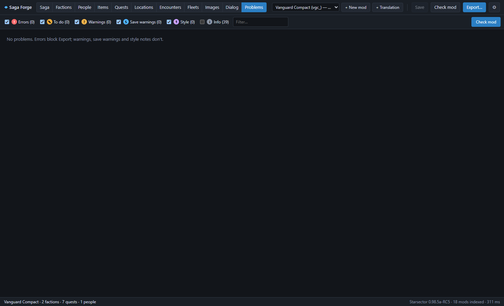
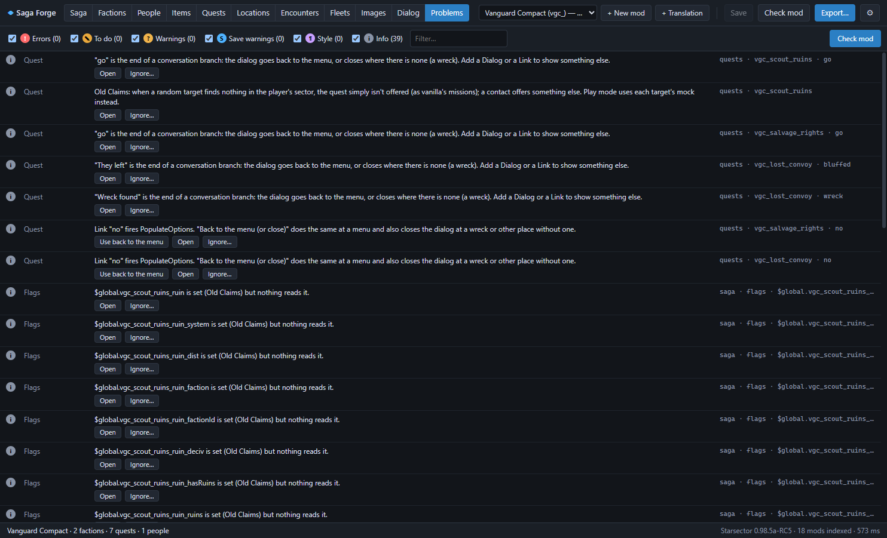
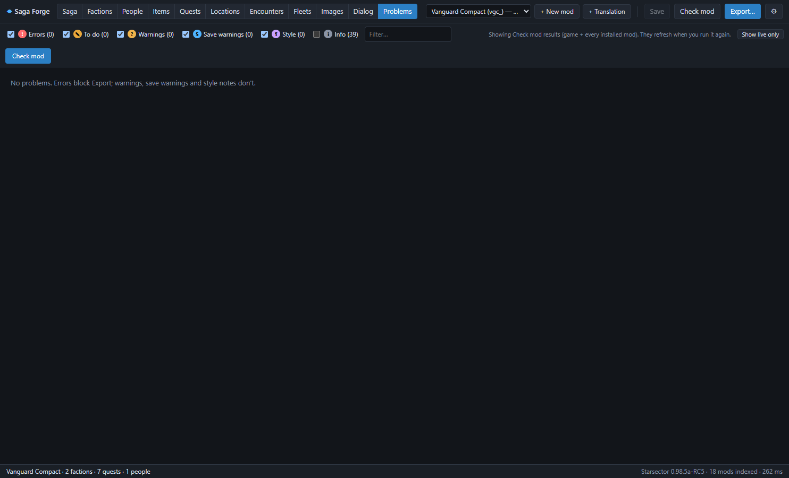
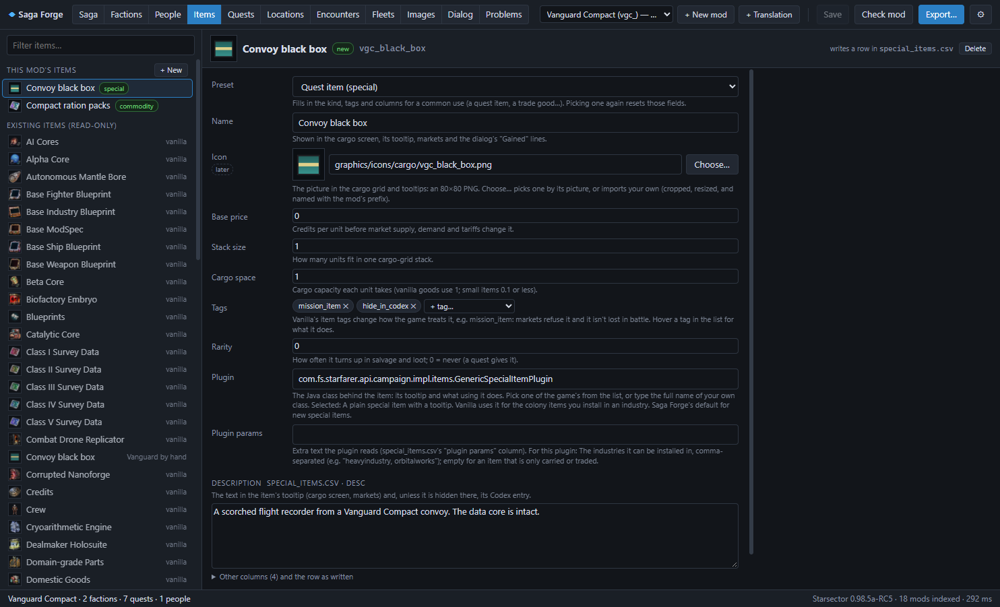

# Problems

Everything in the mod that is wrong, risky or not finished yet, in one list, with a fix button
where Saga Forge knows the fix. Errors block Export; everything else is advice.

## How it works

Saga Forge checks the active mod all the time while you edit: a missing link on a quest's chart, a
condition that reads a flag nothing sets, an id without the mod's prefix, a person placed at a
market that doesn't exist. The **Problems** tab in the header shows how many errors there are, a
✎ count of to-dos, and, when there are no errors, how many warnings.

### The levels

The checkboxes across the top show or hide each level, with how many there are:

| Level | What it means |
|---|---|
| **! Errors** | Something the game would trip over: a missing target, a broken reference, an id another mod uses. **Export is blocked** until they are fixed. |
| **✎ To do** | Fields you marked **Set later** (see [Mark a field Set later](#mark-a-field-set-later)). Export works; **Mark as released** waits for them. |
| **? Warnings** | Probably not what you meant, or something that works differently in game than it looks (for example a system placed too close to a vanilla one on the map). |
| **S Save warnings** | Only after a release: changes since the last version you marked as released that would affect players who update mid-game (a stage removed, a person renamed). See [Export and Release › Release an update](export.md#release-an-update). |
| **¶ Style** | Vanilla's writing conventions, only when **Style checks** is on in Settings. Never block anything. |
| **i Info** | Notes about how something will behave, hidden by default. Worth reading once. |

The most severe come first. **Filter…** narrows the list by text.

### A problem row

Each row has its area (Quest, Location, Flags …), the message, and on the right where it is (tab,
object and part, or a file). Under the message:

- **fix buttons** for the problems Saga Forge can fix itself (for example *Use back to the menu*
  on a Link node, *Add it to existing saves* on a new system);
- **Open** jumps to the place on its tab (the quest node, the flag, the pool …);
- **Ignore…** hides a problem you have checked and decided is fine. Errors can't be ignored.

Ignored problems are listed at the bottom (*N ignored*), each with its reason and **Stop
ignoring**. The reasons are kept in `sagaforge/project.json`, so they travel with the mod.

### Check mod

The live checks only look at your mod. **Check mod** (in the header and on the Problems tab)
also compares it with the game and **every installed mod**:

- rule ids your quests export that another mod also uses (a shared rule id replaces the other
  mod's row);
- rules that would take over the game's or another mod's dialog everywhere (a rule on a trigger
  where the game picks one rule, `FireBest`, with nothing about your own content in its
  conditions); the **Export…** dialog warns about these too;
- image files that don't exist in the mod, the game or an installed mod (an item or quest icon
  that would show as a missing texture);
- images that aren't at vanilla's size for their kind.

The Problems tab then shows the Check mod results, with a note at the top; they stay as they were
until you run it again. **Show live only** goes back to the live checks. Run Check mod before
each release, and after installing or updating other mods you play with.

Problems the game index found in the mod's own files (a JSON file that doesn't parse, a CSV with a
broken row) are listed here too.

## How to set up the basics

### Fix a problem

1. Open **Problems** (or click its count in the header).
2. Start at the top: errors first. Read the message: it says what is wrong and usually what to do.
3. If the row has a fix button (for example **Use back to the menu**), press it. The change goes
   through undo like any edit (Ctrl+Z takes it back).
4. Otherwise press **Open**: Saga Forge goes to the tab and selects the object (on the Quests tab,
   the node), and you fix it there.
5. The row disappears as soon as the problem is gone.

Before a release, press **Check mod** as well and work through its results the same way. A fix
button there switches the tab back to the live checks, since the old results no longer match the
mod: press **Check mod** again when you are done.

For example, a new star system less than 3,000 units from a vanilla one on the hyperspace map gets
a warning. **Open** goes to it on the Locations tab, where you drag it a little further away (see
[Locations › Add a star system](locations.md#add-a-star-system)).

### Ignore a problem

For a warning or note you have checked and that is fine as it is (for example a flag your mod
sets on purpose for another mod to read):

1. **Ignore…** under the row.
2. Type why it is fine (*Read by our companion mod*). The reason is kept in the mod.
3. **Ignore**. The row is gone; the count at the bottom (*N ignored*) shows it.

To bring it back: open *N ignored* at the bottom and press **Stop ignoring**.

### Mark a field Set later

When you build a quest before everything it needs exists (the item isn't drawn yet, the
character's portrait comes later), mark the field instead of leaving it wrong or empty:

1. Next to the field's label, press **later** (on People, Items, Encounters, the quest settings
   and the quest nodes).

   

2. It turns into **✎ to do**, and a line under the field says it is listed under To do in
   Problems. Type a **note** if you like (*made in step 6*, *ask the artist*).
3. The field shows up under **✎ To do** on the Problems tab.
4. When you fill the field in, the mark goes away by itself. Or press **✎ to do** to remove it.

You can export and test with to-dos left. **Mark as released** refuses until they are done (see
[Export and Release › Make a release zip](export.md#make-a-release-zip)), except in content you
marked inactive, which isn't exported anyway.
