# Quests

The Quests tab is where you write quests and conversations: a flow chart of what the player sees and
does, with an in-game-style preview of every dialog and a Play mode that runs the quest the way the
game will.

## How it works

The page has four parts: the **quest list** with the quest's stages and variables on the left, the
**flow chart** in the middle, the **dock** under the chart (dialog preview, problems, play log), and
the **inspector** on the right. The inspector shows the quest's settings when nothing is selected,
and the selected node's settings when you click a node.

There are two kinds of quest:

- **Quest** (journal, stages; SagaLib): the player accepts it, it gets an entry in the intel screen
  with a journal text per stage and a map marker, and it ends in success or failure with a
  reward. Quests run on SagaLib, so your mod needs SagaLib (Export offers to add it to your
  `mod_info.json` dependencies).
- **Conversation only**: just dialog, such as an option at a market, a greeting when the player
  hails a fleet, or a scene at a wreck. Nothing appears in the journal. A conversation doesn't need
  SagaLib unless it uses one of SagaLib's commands (a random branch, progress, spawning a fleet …).

What a quest writes into the mod when you [export](export.md#export-the-mod):

| File | What |
|---|---|
| `sagaforge/quests/<id>.quest.json` | The plan you edit here (chart, stages, settings). Saga Forge's own file, the game doesn't read it. |
| `data/campaign/rules.csv` | The dialog: one block of rows per quest, between `# sagaforge:begin quest=<id>` and `# sagaforge:end` marker rows. Saga Forge rewrites only its own blocks, so rows you or other tools add outside them stay. |
| `data/campaign/person_missions.csv` / `bar_events.csv` | A row per quest offered by a contact or at a bar, in an owned block. |
| `data/sagaforge/quests/<id>.json` | The quest's stages, rewards and variables, read by SagaLib. |
| `data/sagaforge/text.json` | The dialog texts, so a [translation mod](translation.md) can replace them. |

### The quest list

The left column lists the mod's quests and conversations. Conversations say *dialog only*; quests
show their id. **+ New quest** makes a new one; the **inactive** box shows or hides quests you
marked inactive (planned, not exported).

Under the list are the open quest's **MagicLib bounties** (once the mod lists MagicLib), **Node
groups** (the groups this mod has, see [Node groups](#node-groups)), **Stages (journal)** and
**Variables**:

- **Stages** are the journal steps of a quest, see [Stages](#stages).
- **Variables** are values the quest remembers in the save, such as the agreed pay. Each has a name,
  a type (number, string, bool, entity, person, or *random target*) and a starting value. In
  conditions and Set actions they are `$global.<quest id>_<name>`, e.g.
  `$global.hel_voice_probe_offer`. The player never sees them unless a text uses the token. They get
  their starting value when a contact or bar event offers the quest; with any other start, only
  when the quest starts (its first Stage node), so an offer before that can't show them.
- A **random target** variable is a place SagaLib picks in each game (for example "a pirate market
  that isn't hidden"), or **a commodity at a market** (something a Heliopolis market needs). Its
  button opens its search. Stage map markers, Arrive nodes and the *Spawn at the random target*
  action can then use it as `target:<name>`. See
  [Send the player to a random place](#send-the-player-to-a-random-place).

### Quest settings

Click the empty chart to see the quest's settings in the inspector:

- **Id**: the mission id and the start of every rule id. Saves remember it, so don't change it after
  a release. **Change id…** changes it everywhere in the mod (conditions and test profiles follow).
- **Title**: the name in the intel screen, the journal and the contact's mission list.
- **Kind**: quest or conversation only (see above).
- **Inactive**: planned but not ready. It isn't exported, its problems become warnings, and its
  to-dos don't hold back a release.
- **Template**: **Save as template…** keeps a copy for New quest › Start from (in Saga Forge's own
  data folder, for every mod).
- **Repeatable**, **Icon** (64×64, **Choose…** picks one by picture, see
  [Images › Pick an image for a field](images.md#pick-an-image-for-a-field)) and **Time limit** (days
  after accepting; the quest fails when they run out).
- **If a market of this quest changes owner** (a Nexerelin invasion, a rebellion, a sale, another
  mod): SagaLib remembers who owns the quest's markets when it starts (the giver's market, stage
  markers, Arrive places, named places, random targets that are markets) and checks them once a
  day. **Keep going (don't watch)** is the default; **keep going (set the keys)**, **fail the
  quest**, or **go to a stage**, where what follows that Stage node in the chart runs (a dialog can
  bring the news). Every choice but the first sets `$global.<quest>_ownerChanged` (the market id)
  and `$global.<quest>_newOwner` (the faction), for dialog and Branch cases. In Play mode, the
  green bar offers "<market> changes owner to …" while the quest is active; in game, SagaLib's dev
  menu (Ctrl+F9) has **Change a market's owner**.
- **How it starts**: where the player first meets the quest, see the table below.
- **Prerequisites**: other quests that must have ended (succeeded, failed or either), flags that
  must be set, or one of the mod's settings (see
  [Saga › Switch a questline on or off](saga.md#switch-a-questline-on-or-off)), before the quest
  is offered or starts.
- **Rewards**: named rewards (credits, XP, story points, reputation, items, random items from a drop
  group) that an End node or a *Give a reward* action pays. See
  [Give a reward](#give-a-reward). The credits can be **Scaled by** a setting, such as a
  difficulty (see [Saga › Settings](saga.md#settings)).
- **Notes**: for you only, never exported.

| Start | Where the player meets it | Written to |
|---|---|---|
| offered by a contact | The contact's mission list ("Do you have any work?" on the comm link) | `person_missions.csv` |
| a bar event | A patron at a colony's bar | `bar_events.csv` |
| an option added to a menu | An option in a market's, person's or fleet's menu; the menu's own options stay | `rules.csv` |
| a dialog that opens on a trigger | A dialog that opens by itself, e.g. when hailing a fleet (`OpenCommLink`) or visiting a place (`OpenInteractionDialog`) | `rules.csv` |
| started by another quest | Another quest's *Start another quest* action | (SagaLib) |
| an interjection before an existing option | Your scene plays first when the player picks an existing option, e.g. vanilla's Explore at a derelict | `rules.csv` |
| a bar scene (no mission) | A story scene at a bar, like vanilla's own | `rules.csv` |

Every start kind shows its own fields with help under each one (the contact or contact tags, how
often it is offered, the blurb, the option text, conditions …).

A quest that starts from an option, a trigger, an interjection or a bar scene is only offered until
the player accepts it; a repeatable one comes back after it ends. The export adds that test to the
start's conditions (a contact or bar event leaves it to vanilla's mission list).

An **interjection** plays before an existing option and then hands back to it, so vanilla's own
dialog goes on (Lost Kin's pod scene, then vanilla's salvage). A branch of it that ends at a Wait
(a Stage node, then an Arrive) hands back too, so the quest moves on and the salvage still happens
in the same visit.

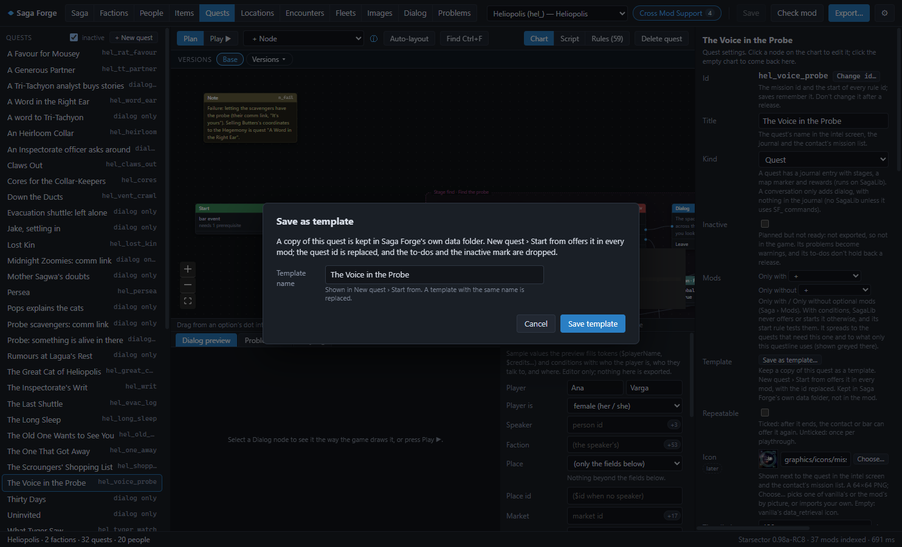

### Stages

A quest's stages are its journal: while the player is at a stage, the intel screen shows its text and
the map marker points to its place. They are listed under **Stages (journal)** on the left; **+**
adds one and opens its form. Each stage has:

- **Id**: what saves remember. Never shown in game. Change it only with **Change id…** (see
  [Rename a stage after a release](#rename-a-stage-after-a-release)).
- **Title**: the stage's name in the intel list (when the next-step line is empty) and on the
  stage's frame on the chart.
- **Journal text**: the paragraph in the intel screen's panel for the quest at this stage.
- **Next-step line**: the short line under the quest's name in the intel list and in the "quest
  updated" notification.
- **Map marker**: where the map's quest marker points: one of your places, a vanilla market or
  entity, a person (their market) or a random target.
- **Kind**: normal (the quest goes on), or a stage that ends the quest in success or failure as soon
  as it is reached.
- **Old ids**: ids the stage had in earlier releases (filled in for you by Change id…).

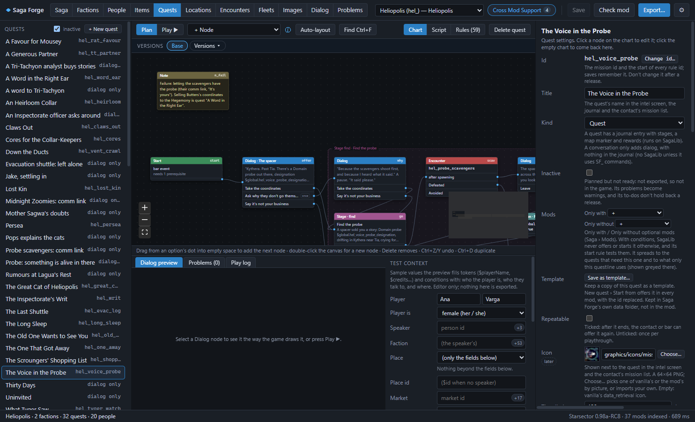

A **Stage node** on the chart moves the quest to a stage. The chart draws a coloured frame around
the nodes that belong to each stage, labelled with the stage's id and title.

### The flow chart

The chart is the quest from start to end. Each node is a step; each of a node's outputs (a dialog's
options, a branch's cases, an encounter's outcomes) has a dot on its right edge, and a line from
the dot to the next node says what happens next.

- **Add a node**: double-click the empty chart, or drag from an output's dot into empty space (the
  new node is then connected to that output). Both open the node menu. The **+ Node** list in the
  toolbar adds one in the middle of the chart.
- **Connect**: drag from an output's dot onto a node. An output leads to one node; dragging again
  replaces the line.
- **Delete**: select a node or line and press Delete. **Ctrl+D** duplicates the selected node,
  **Ctrl+Z / Ctrl+Y** undo and redo.
- **Auto-layout** tidies the chart; **Find Ctrl+F** finds a node by text, option or id.
- The zoom buttons and the minimap are in the chart's corners. A quest opens on its Start node: a
  short one fits the view, a long one shows at 70% so its nodes stay readable.

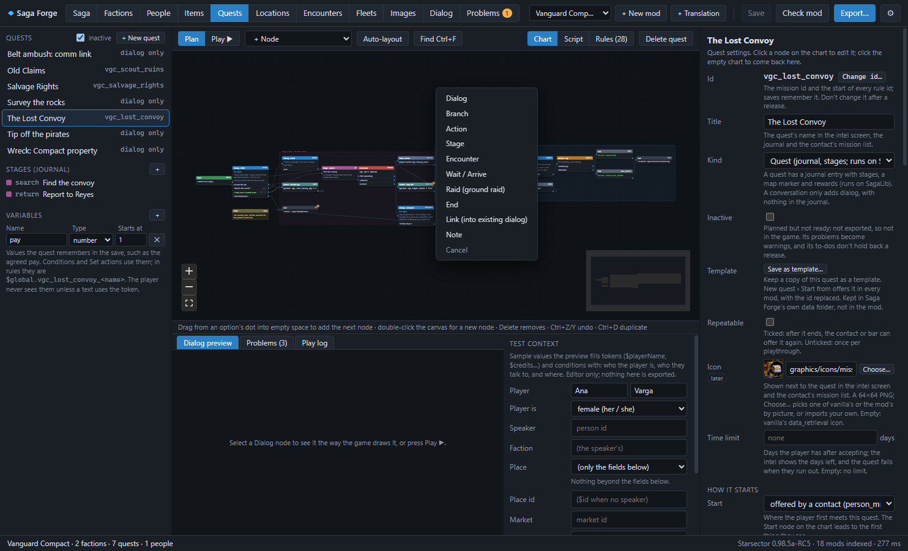

### Node types

Click a node to edit it in the inspector. Every node has a **Node id** (part of its rule ids, never
shown in game), and most inspectors end with **Exported as**: the `rules.csv` rows the node becomes.

#### Start

Where the quest begins. It has no settings of its own: how the player gets here is the quest's
**How it starts** (click the empty chart).

#### Dialog

A page of dialog: text on the left, a picture on the right, options under the text. This is the node
you will use most.

- **Title**: names the node on the chart (not shown in game).
- **Speaker**: who is talking, picked from the mod's and the game's people.
- **Visual**: what the right half of the dialog shows: the speaker's portrait (with up to two more
  people beside them), an illustration, a large planet, a map marker, both fleets, one ship, or
  *keep* the previous picture. An illustration can have a second picture, **Female player**, shown
  instead when the player character is female (a scene with the player's figure in it). It needs
  no SagaLib: the export writes a second rule on `$player.gender == FEMALE`.
- **Text**: what the player reads. "Speech in quotes," narration in the second person. A blank line
  starts a new paragraph; a line with only `OR` starts a random variant. **+ variation** adds
  wording that changes with the situation (see [Saga › Add a phrase](saga.md#add-a-phrase)). For
  tokens such as `$playerName`, see [Tokens](#tokens) below.
- **When you come back**: **+ repeat text** gives the node a second, shorter text for when the
  player returns to it (a question's *Back*, a loop), with the same options and displays. The text
  above is then the first-time text. **First time is** *once per visit* (the full text again the
  next time the dialog opens; nothing is saved) or *once ever* (a saved flag). The chart, the Script
  view and Play mode show both.
- **Highlights**: words or numbers drawn in the highlight colour, as vanilla marks names and sums
  (separate them with `|`).
- **Displays**: panels after the text or after a paragraph: "Gained" lines for credits, items,
  story points, XP and reputation (these also change the player's cargo, credits or reputation), an
  extra small grey paragraph, a cost panel, a faction callout, sounds and music, and more.
- **Options**: the choices under the text, numbered as in game. Each has a dot on the chart. **⋯**
  opens an option's settings: its id, a tooltip, a story-point cost (a green story option with
  vanilla's confirmation), the Esc shortcut, *show once* (per conversation or for good), *only show
  if* conditions and *disabled if* conditions. With no options, the dialog continues to the next
  node by itself.
- **Extra conditions** and **Extra script lines**: rules.csv lines for things the editor has no form
  for. Most dialogs need none.

The **Dialog preview** in the dock draws the selected Dialog node the way the game does, with the
game's font. **whole window 1:1** shows it at the game's size. On the right of the dock, the
**Test context** sets the sample values the preview uses: the player's name and gender, the speaker,
faction and place. They are for the editor only.

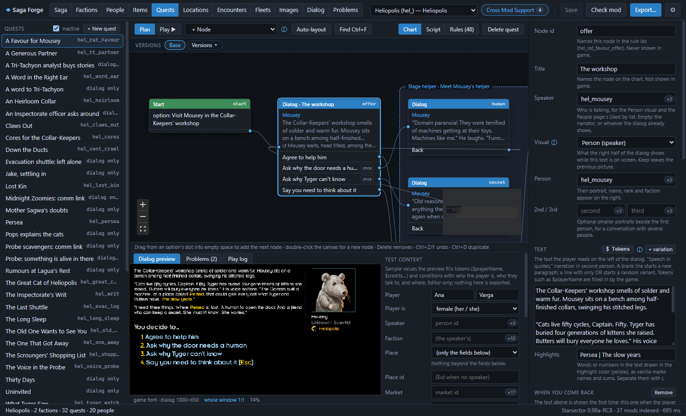
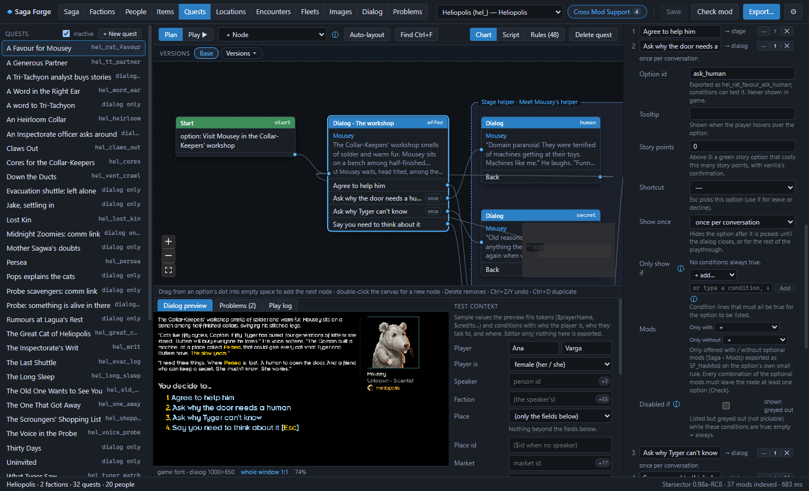

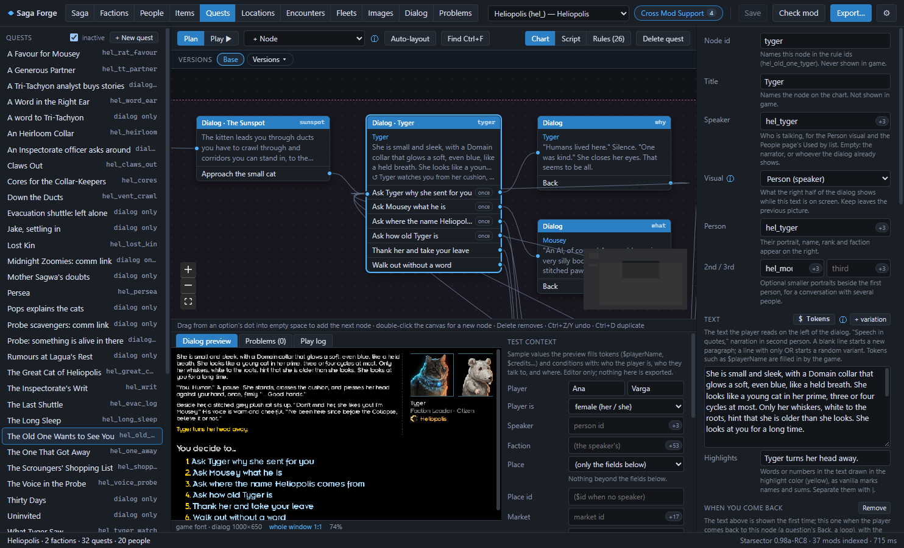
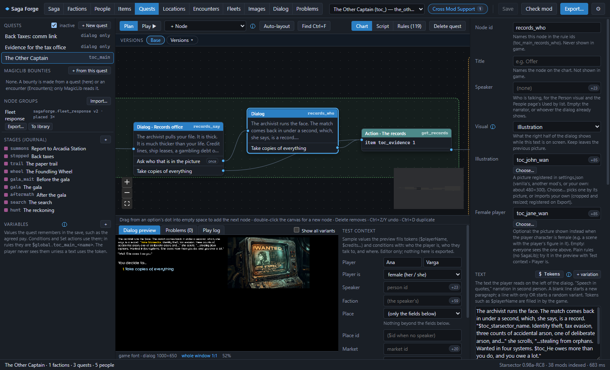

#### Tokens

A token such as `$playerName` or `$personName` is replaced in game by a name or a word. **$ Tokens**
(next to the dialog text, and next to an encounter hail's first lines) opens the token window,
which stays above the editor while you write:

- Every token, searchable (by token, meaning or value) and grouped: **this conversation**, **your
  people** (each character's `$<id>_name`, `$<id>_firstName` and `$<id>_lastName`), the player,
  the person you talk to, their faction, the market, the place, the fleet, phrases and quest
  variables. Recently used ones come first; **Aa** switches to the capitalised form
  (`$PersonName`).
- Each row shows what the token becomes **in this conversation**, with portraits and crests. The top
  of the window says who `$person…` is here: a contact's mission names the contact, a fleet's comm
  link its **Flagship by** (or "made up by the game"). Tokens that aren't filled here are greyed
  with the reason (market tokens in a comm link).
- **Insert** puts the token at the cursor of the last text field you clicked; **Copy** copies it.

Typing `$` in any text field that takes tokens (dialog text, options, repeat text, displays,
phrases, arrival and raid texts, start options, a hail's lines) suggests tokens from the same list.
Problems warns about market tokens in a comm link, `$person…` in a comm link without a Flagship by,
and a portrait that isn't the person the `$person…` tokens name.

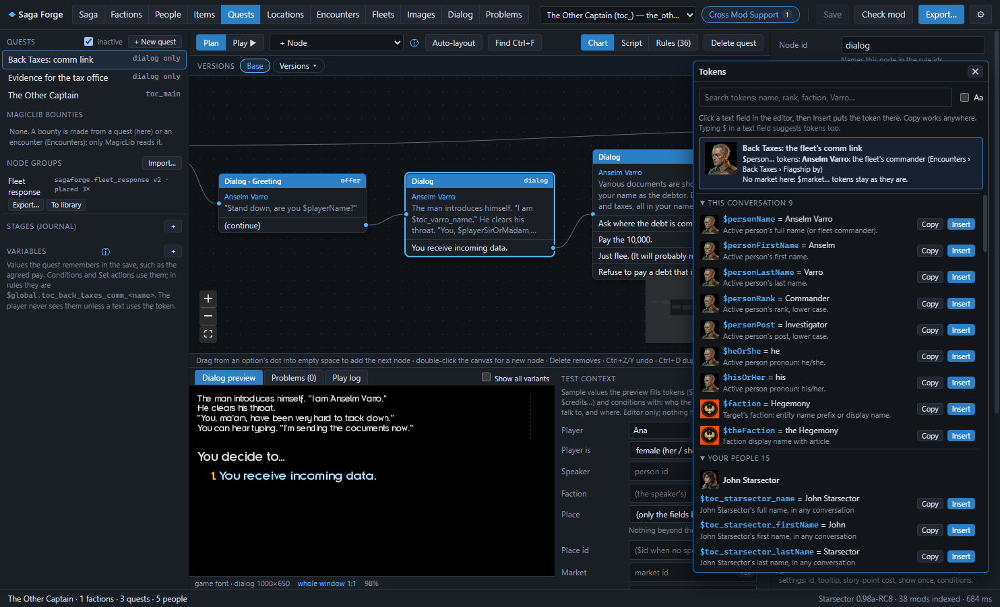
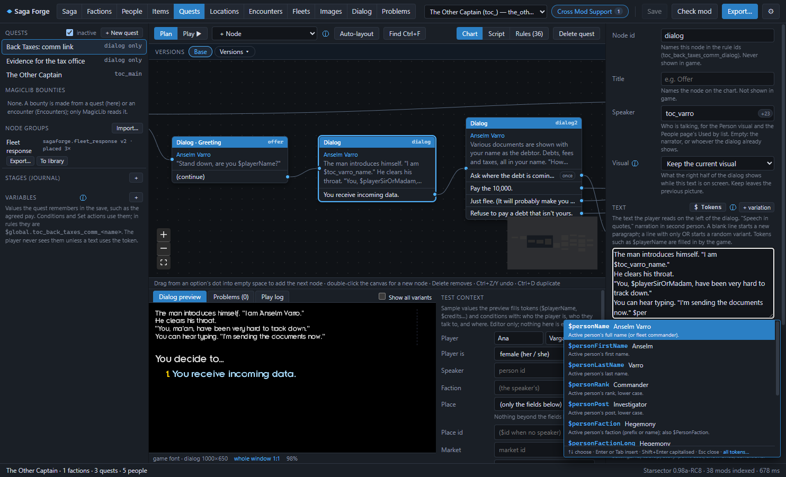

#### Branch

Picks a way on without showing anything to the player.

- **By conditions**: each case is a label (chart only) and condition lines that must all be true.
  A matching case is taken (when several match, the game takes the one with the most conditions);
  **otherwise** is taken when none match.
- **At random (by weight)**: picks one case like a dice roll. Each case has a weight, and can be
  limited (once per playthrough, once per place or person, a cooldown in days, at most N times).
  A **Nothing** weight makes *otherwise* possible. The cases can also come from a named pool (see
  [Add a random branch](#add-a-random-branch)). Random branches need SagaLib.

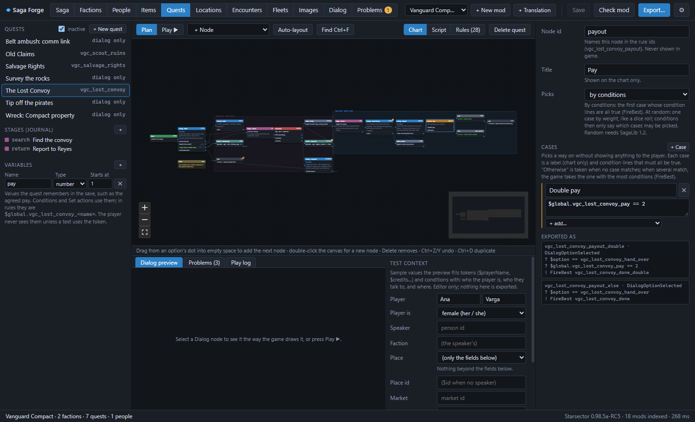

#### Action

Things that happen in order, then the quest goes on. Nothing is shown unless a step says so.
**+ add…** offers: set a variable or flag, clear a flag, give or take credits, change reputation,
give or take an item, give a reward, story points, experience, spawn an encounter, an encounter
leaves, place or remove an object, remove a person, spawn something at the random target, take or
give the target's goods and pay for them (a commodity target), start another quest, add progress
to a progress event, run a plugin (see [Plugin](#plugin)), start a MagicLib bounty, unlock a
MagicLib achievement ([Saga › Achievements](saga.md#achievements)), unlock or grant Vaults of
Knowledge research ([Saga › Research](saga.md#research)), or a raw rules.csv script line. Each step
has its help text under it. Two of them in more detail:

- **Change reputation** chooses whose: a **faction**, a **person** (one of your characters or the
  game's; exported as vanilla's `AdjustRepPerson`) or **the person you're talking to**
  (`AdjustRepActivePerson`).
- **Start another quest** picks the quest and the **stage** it starts at; it preselects the stage
  that quest's Start leads into. Problems warns when a quest with a first stage is started without
  one (unless that quest moves to it itself) and names a stage it doesn't have.

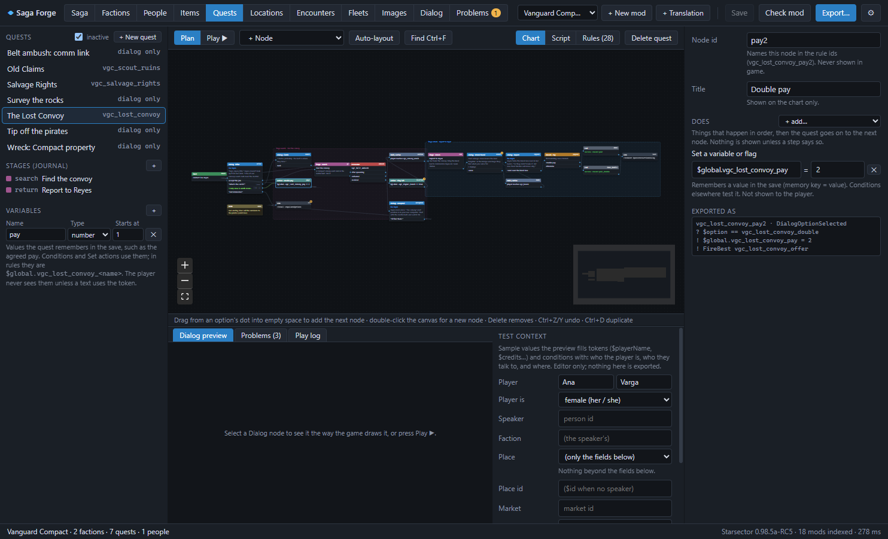

#### Stage

Moves the quest to a journal stage: the intel screen shows the stage's text, the map marker moves,
and a success or failure stage ends the quest. **+ New stage…** in its list adds a stage and opens
its form on the left.

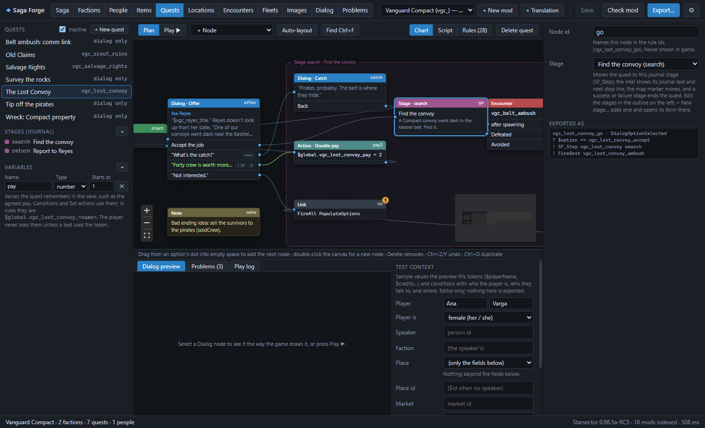

#### Encounter

Puts one of the mod's encounters (a fleet) in the sector. It has three outputs: *after spawning*
continues at once; *Defeated* and *Avoided* continue later, when SagaLib reports what happened to the
fleet. **+ New…** creates an encounter at the current stage's map marker; you then set up its fleet
on the Encounters page. If the encounter has its own outcome actions (Encounters › **When
defeated** / **When avoided**), they run first, then this node's output. See [Add a
fight](#add-a-fight).

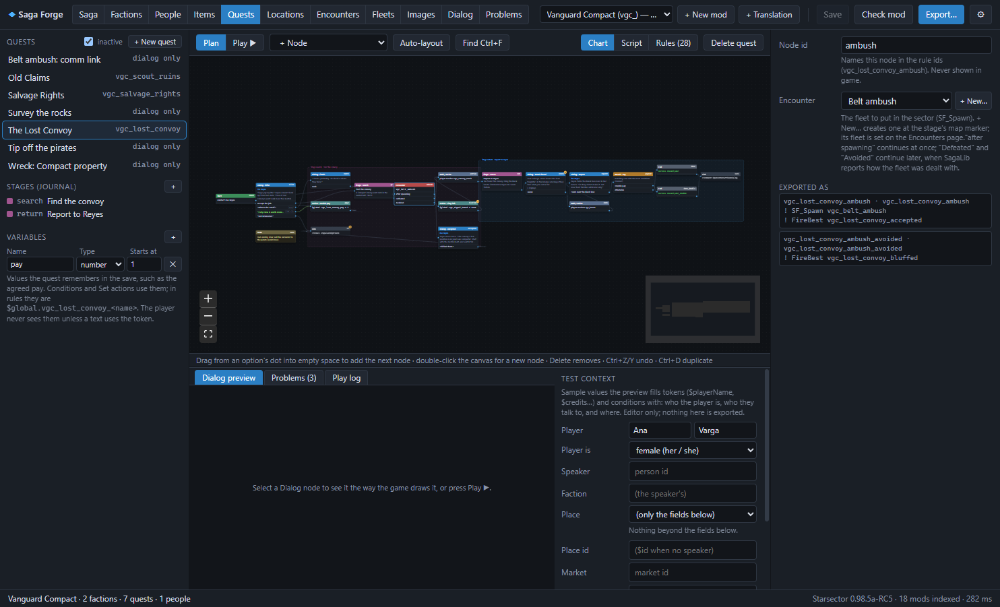

#### Fight

A battle on the spot, like the automated defences at Remnant-guarded ruins: when the dialog reaches
the node, SagaLib builds the fleet and opens vanilla's battle dialog (Engage or Leave). No fleet
flies around before or after. The fleet is set on the node itself, like an encounter's:

- **Engage option**: the text of the option that starts the battle (empty: vanilla's "Engage the
  automated defenses").
- **Ships**: from the faction's doctrine (**Faction** and **Fleet points**), exact ships, or one of
  the mod's named fleets (see [Fleets](fleets.md)); then **Quality**, **Flagship by** and **Fleet
  name**.

Its outputs are **Won** (the fleet was beaten; the dialog goes on at the place) and **Left** (the
player left or lost; leave it unconnected and the dialog closes, as vanilla's does). A fleet the
player damaged and left stays damaged for 10 days. In Play mode the green bar asks how the fight
went. Exported as `SF_Fight`; needs SagaLib 1.4.

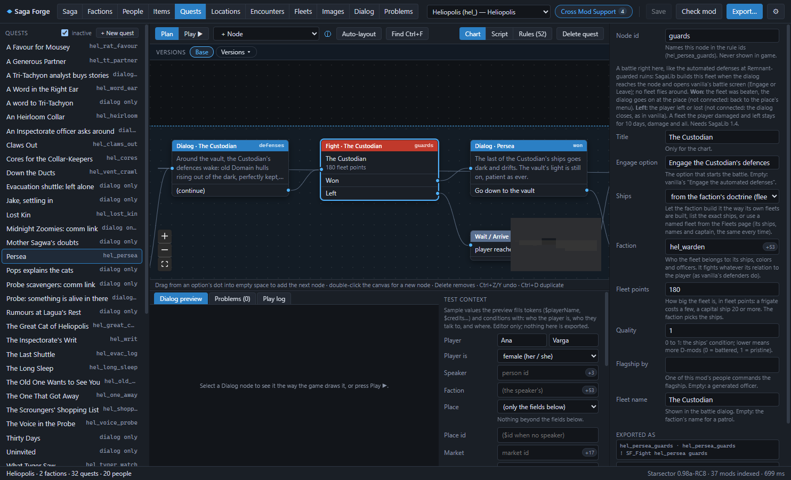

#### Wait / Arrive

Waits until the player arrives at a place, or for a number of in-game days.

- **Arrive**: **Place** is the planet, station or wreck the player must reach (usually the stage's
  map marker). **Shows as** is either *an option in the place's menu* (the place's normal dialog
  stays, with your option added) or *takes over the arrival* (your scene opens as the player
  arrives, for a hail as they dock). **Text** is the first paragraph of the scene. When a
  lock-like conversation guards the place (dialog, branch and Link nodes that only leave, as
  "Protect this wreck" makes), its Arrive nodes take over the arrival by themselves.
- **Timer**: waits the given number of days, then the next node runs. Nothing is shown.

See [Wait for the player to arrive](#wait-for-the-player-to-arrive).

#### Raid

A ground raid on the place the dialog is at, like vanilla's story raids: a briefing, then vanilla's
raid menu with one objective where the player commits marines. Its outputs are **Raid done** and
**Backed out**. You set the objective's name, danger level, the defenders' strength, the experience,
and the text shown during the raid. Use it in a dialog at a planet, station or colony. No SagaLib
needed.

#### End

Ends the quest: **success**, **failure** or **abandoned** (like the player's Abandon button), and
optionally pays one of the quest's rewards. Once the mod has MagicLib achievements
([Saga › Achievements](saga.md#achievements)), an **Achievement** field unlocks one there too; once
it lists Vaults of Knowledge, a **Research** field gives techs as researched ([Saga › Research](saga.md#research)). The
conversation can go on after it, for a last line or a Link back to the menu.

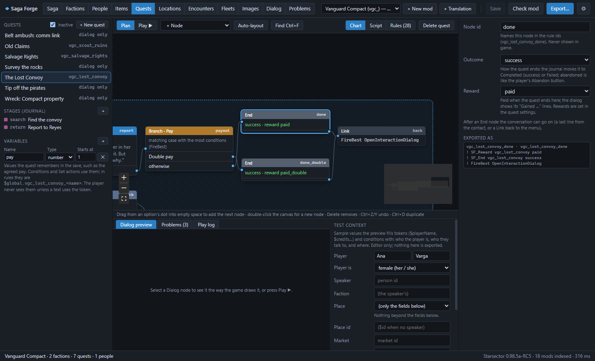

#### Link

Leads out of your quest into existing dialog without changing it:

- **back to the menu** (the safe ending): back to the market's, contact's or fleet's options, or
  closes the dialog where there is no menu (a wreck).
- **close the dialog** (vanilla's `EndConversation`): for a comm link that ends ("Cut the link"), a
  fleet that leaves, or a scene that ends the visit. In a fleet's comm-link dialog, **back to the
  fleet screen** cuts the link and returns to the fleet's Engage / Leave screen instead.
- **back to the bar**: the end of a bar scene.
- **fire a trigger**: e.g. `OpenInteractionDialog` to reopen the place's own dialog, or
  `PopulateOptions` to rebuild its menu.
- **into an existing option id**: e.g. vanilla's `defaultLeave` or `cutCommLink`.
- **to another node of this quest**.

To find vanilla triggers and option ids, see
[Dialog › Find a vanilla dialog rule](dialog.md#find-a-vanilla-dialog-rule); the ⓘ next to the
target opens the reference of every dialog option the rules of vanilla and your listed mods
answer.

When a Link fires a trigger into a node of **another** quest or conversation (one conversation
continuing another), that node gets an info line saying where it is entered from, and the nodes
after it count as reachable.

#### Plugin

Runs a piece of your mod's own Java code, for what no node can do (Heliopolis's Persea Fever shrinks
colonies across the sector). The class is in a jar your mod ships and implements SagaLib's
`lastai.sagalib.api.SagaPlugin`.

- **Class**: picked from the classes in the jars your `mod_info.json` lists under `"jars"` (read
  from the jars themselves, plugins first; no Java needed). **Rescan jars** after you rebuild one.
  Any name can be typed.
- **Arguments**: `key = value` pairs the plugin gets; a value starting with `$` is read from memory
  when it runs.
- **Results**: the results the plugin may return, one output each, plus **otherwise** (no result,
  another one, or a failure: SagaLib writes it to the log and the game goes on). The result is also
  kept in `$global.<quest>_<node>_result` for later Branches.

The action **Run a plugin** (in Action nodes, world events and progress stages) runs one without
branching. Play mode can't run Java: it shows a button per result and "No result, or the plugin
fails". Problems checks the class, the jar and the results. Exported as `SF_RunPlugin`; needs
SagaLib 1.4. How to build a plugin jar is in
[FORMATS.md, "Plugins"](https://github.com/LastAi/Starsector-SagaForge/blob/main/docs/FORMATS.md).

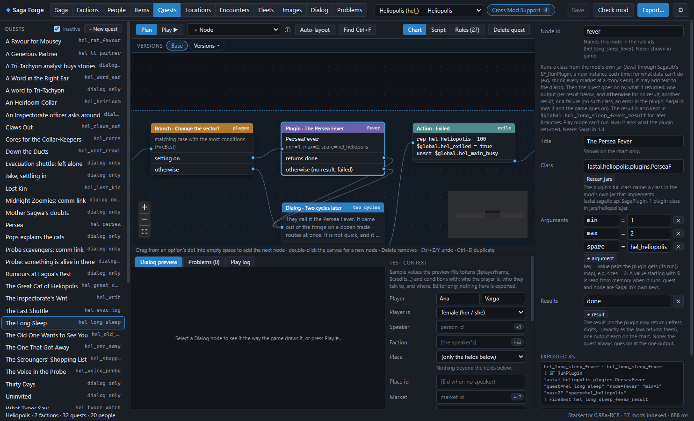

#### Node groups

A node group is a set of normal nodes that shows as **one node** with a few fields of its own, for
steps you repeat. **+ Node › Node groups** places one; the export, Play mode, the Script view and
Problems see the nodes it stands for. The first one is built in:

- **Fleet response** ends a fleet's comm-link dialog the vanilla way (as the Knights of Ludd's
  stop): **let them go** (the fleet leaves; its encounter counts as avoided), **fight** (the fleet
  turns hostile and the player can't leave), or **player flees** (the fleet chases; a later hail
  can test "The player fled from this fleet"). Each one cuts the comm link back to the fleet
  screen. Use it in an encounter's comm-link dialog with a hail (see [Encounters › Make a fleet stop
  the player](encounters.md#make-a-fleet-stop-the-player)).

The mod keeps its own copy of every group it uses (`sagaforge/nodegroups/<id>.group.json`), so it
never depends on files outside it. In the quest list on the left, **Node groups** lists them, how
often each is placed, **Export…** (a file to share) and **To library** (your library folder, for
your other mods; see [Settings](settings.md#settings)); **Import…** adds a shared one. A group has
an id and a version number: when a newer one exists (built in or in your library), the node offers
**Replace…**, which keeps the values by field and lists what would be lost first. **Expand into
nodes** turns a placed group into its normal nodes, to change them by hand (one way). The file
format is in [FORMATS.md, "Node groups"](https://github.com/LastAi/Starsector-SagaForge/blob/main/docs/FORMATS.md).

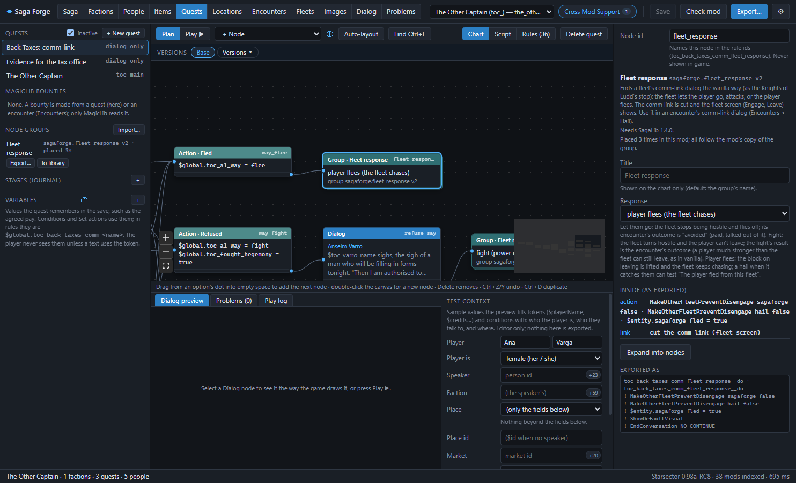

#### Note

A sticky note on the chart for ideas and reminders. Never exported.

### Conditions

Every list of conditions (a dialog's or an option's conditions, Branch cases, phrase cases, a
quest's start, and on the Saga tab pool entries, world events and progress events) uses the same
editor. One line is one condition in `rules.csv` form, and all lines must hold:

- Each line is read back in plain words above it ("Game flag hel_path is rat", "Quest "The Other
  Captain" is at stage summons"), and the raw line stays editable under it.
- A mark says whether it holds for the [Test context](#play-mode) (✓, ✗, or ? when the editor can't
  tell). Click a plain flag's line to switch the flag in the Test context.
- **+ add…** offers ready-made conditions that work there (a flag, a quest's state or stage, a
  setting, reputation, a mod, the player's gender, how an encounter's fleet ended …).
- The type-in row suggests the keys your mod sets or reads; hover a flag to see where it is set and
  read.
- Outside a dialog (a world event, a progress event) only `$global` and `$player` keys exist. A line
  about `$person`, `$market`, `$entity` or `$faction` there is marked, and Problems lists it: it
  could never be true.

The ⓘ opens the reference: **Rules › Conditions** (what a condition is and its forms, with examples)
and **Condition scopes** (whose memory each key is in, and where it exists).

### Play mode

**Play ▶** runs the quest the way the game would: the same rules Export writes, together with the
game's own rules, so your dialog continues into vanilla's menus as it would in game. You click the
options in the preview; the chart lights up the path taken.

- The green bar over the preview has buttons for what can't be clicked in a dialog: an encounter's
  **Defeated** / **Avoided**, a Fight node's **Won** / **Left**, a Plugin node's results, **Arrive
  at …** for each Arrive node, **Wait N days** for timers. It also shows the day, credits and story
  points.
- **Meeting the start.** When the quest's start doesn't match the Test context (it starts at a
  Hegemony market, say), the preview says why and offers up to five ways to meet it: markets that
  fit (your mod's first, then by size: "Dock at Chicomoztoc (Hegemony, size 8)"), or "Start here,
  with its conditions met".
- **Docking as in game.** An Arrive, a start choice and the Test context's **Market** dock the way
  the game does: the market, its owner (`$faction.id`), its menu and its names
  are set, so one Arrive reaches your option. Checks of the game and other mods that Play can't
  work out are taken as false (the usual case) unless the Test context says otherwise; your mod's
  own stay true.
- **Out in space.** When the dialog closes (Leave, a Link that closes it), the preview shows what
  the quest waits for now, at most six choices: **Travel to <place>** for each open Arrive, **Wait N
  days** for a timer at the current stage, a spawned fleet's outcomes ("Fight … and win", "Get away
  from …"), **Let <fleet> catch you (it hails you)** for a fleet with a hail or a comm-link dialog,
  then **Restart the quest** and **Step back**. A fleet that lets the player go (Fleet response ›
  let them go) counts as avoided once the dialog closes, as in game. Play doesn't run progress
  events yet, and only lists this quest's own fleets and Arrives.
- The dock's right side lists the **Variables** set so far and the **Path**. **Copy to a test
  profile** saves the current state as a test profile.
- **Restart**, **Step back** and **Play from selected** (start at the selected node) are in the
  toolbar. The list next to them applies a test profile when Play starts.
- **Play log** explains every step (which rule fired and why).
- In a random branch, **Next pick** in the branch's inspector forces what the next roll picks, so
  you can try each case.
- With optional mods in [Saga › Mods](saga.md#mods), the toolbar has a switch for each: Play
  as if that mod was enabled when the game started (switching restarts). Options, cases and
  phrases with **Only with / Only without** follow them, as in game, and so do versions. The Test
  context's **Player is** picks the versions for a male or female player and the "Player is
  female" conditions; settings marked for versions play the version of the Test context's values.
- For people with a [Presence](people.md) rule, the green bar has a "<name> is away" switch. A
  quest whose contact is away isn't offered (as in game), and dialog that tests
  `$global.sagaforge_away_<id>` follows the switch.

See [Test a quest in Play mode](#test-a-quest-in-play-mode).

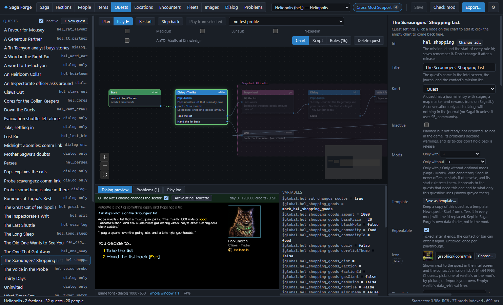

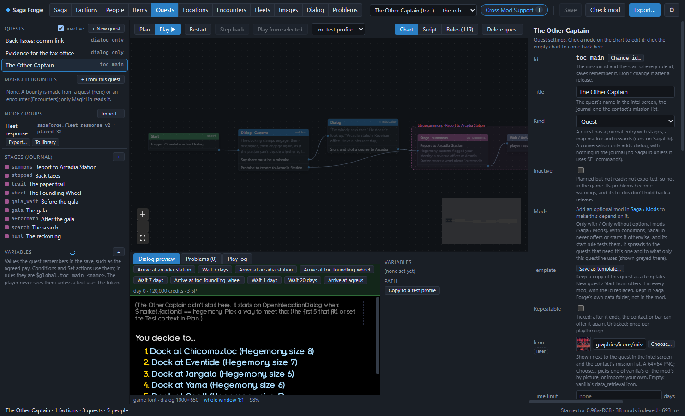
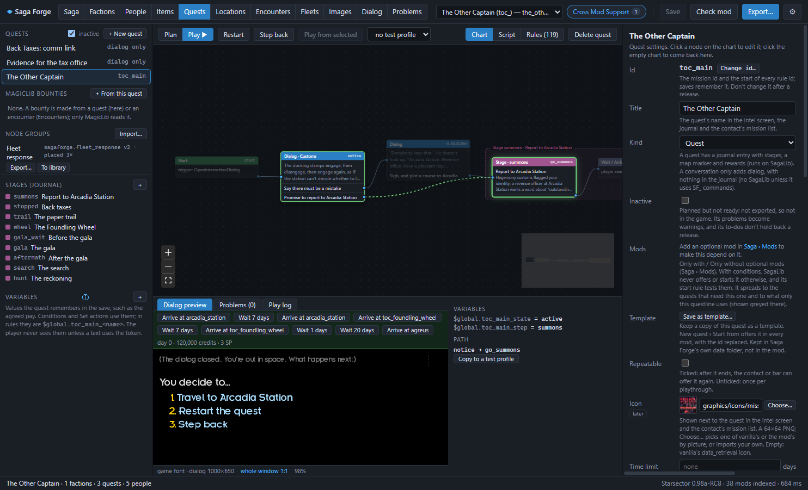

### The script and rules views

The **Chart / Script / Rules** buttons switch the middle of the page:

- **Script** shows the whole quest as a screenplay in the order the player meets it: speakers,
  lines, choices and where they lead, journal stages and fleets as notes. Click a line to select
  its node. **Copy as Markdown** copies it, for proofreading or sharing.
- **Rules** lists every `rules.csv` row the quest exports (id, trigger, conditions, script, text,
  options), and which node each row comes from. Click a row to select its node.

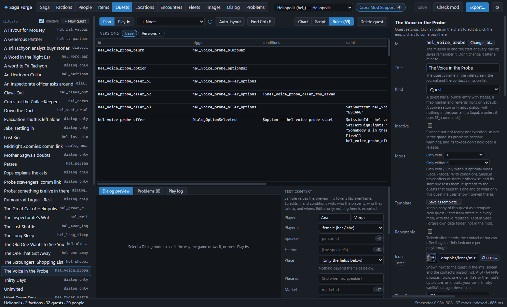

The **Problems** tab in the dock lists this quest's problems; click one to select its node. See
[Problems › Fix a problem](problems.md#fix-a-problem).

## How to set up the basics

### Make a contact quest with stages

A quest a character offers through their mission list, with journal stages. Example: Pop Chicken's
*The Scroungers' Shopping List* in Heliopolis.

1. **+ New quest**. Type the **Title**; the **Id** is made from it with your prefix. **Start from**
   *an empty quest* (or a template: Delivery, Bounty, Investigate a place, Rescue, Talk to
   someone, or one you saved). Kind **Quest**. **Create**.
2. The new quest has a Start node, an **Offer** dialog with *Accept the job* and *Not interested*,
   and one stage. Click the empty chart to open the quest settings.
3. **How it starts › Start**: *offered by a contact*. **Contact**: pick the person (see
   [People › Make a character a contact](people.md#make-a-character-a-contact)). Fill in **Blurb**
   (the line in their mission list) and **Option** (what the player picks to hear the offer). Set
   **Min. rep** and **Frequency** if you want.
4. Under **Stages (journal)** on the left, open the stage (or **+** for more) and fill in **Title**,
   **Journal text**, **Next-step line** and **Map marker** (a place, see
   [Locations › Add a derelict or wreck](locations.md#add-a-derelict-or-wreck)).
5. Click the Offer node and write its **Text**; set **Speaker** and **Visual: Person (speaker)**.
6. Drag from *Accept the job*'s dot into empty space and pick **Stage**: it takes the first stage
   no Stage node uses yet. Drag on from the Stage node to the next step (a Dialog, an Arrive …).
7. Drag from *Not interested* and pick **Link** (*back to the menu*).
8. End every path with an **End** node (success or failure) followed by a **Link**.

In game, the quest appears in the contact's mission list. Once accepted it is in the intel screen
with the stage's journal text, and the map marker points to the stage's place.

To offer a quest only after another one, use **Prerequisites** in the quest settings (see also
[Saga › Make one quest wait for another](saga.md#make-one-quest-wait-for-another)).

### Write a conversation

Dialog without a journal entry, for a scene at a place, a greeting, or a lock on a wreck. Example:
*Probe: something is alive in there*, a short dialog that opens when the player visits Jake's
cryo-probe before the quest sends them there.

1. **+ New quest**, **Kind: Conversation only**, **Create**.
2. In the settings, choose **How it starts**: *an option added to a menu* (see
   [Start a quest from a dialog option](#start-a-quest-from-a-dialog-option)) or *a dialog that
   opens on a trigger*. For a dialog at a place: **Trigger** `OpenInteractionDialog` and
   **Conditions** `$id == <the place's id>`. Add `score:N` (e.g. `score:500`) to the first
   condition line to win over vanilla's own rule for that place.
3. Write the Offer node's text and options.
4. End each path with a **Link**: *back to the menu* for an option, *close the dialog* to end it,
   or *into an existing option id* `defaultLeave` to leave a place the vanilla way.

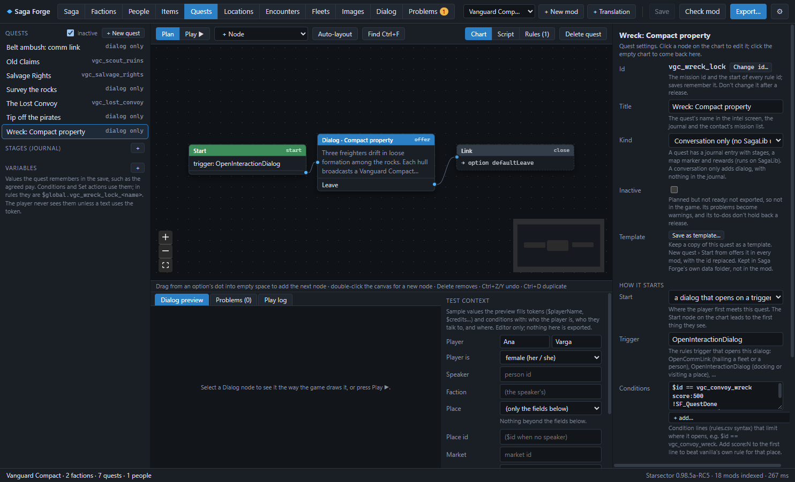

A greeting for a fleet you hail is the same with the trigger `OpenCommLink` and a condition on the
fleet. For an encounter's own fleet, the Encounters page makes this conversation for you (see
[Encounters › Give a fleet a comm dialog](encounters.md#give-a-fleet-a-comm-dialog)).

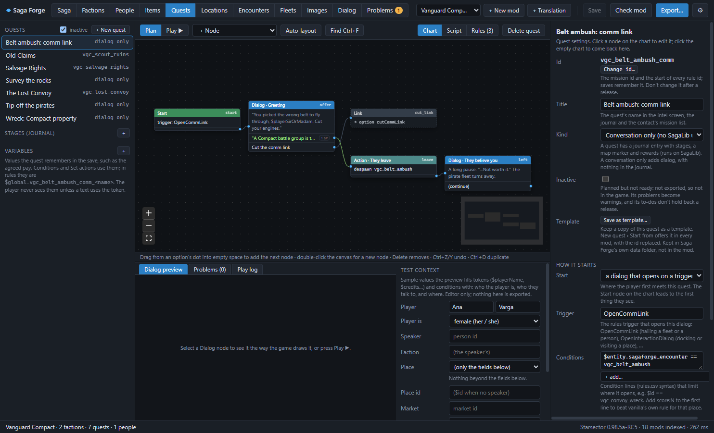

### Start a quest from a dialog option

Adds your option to an existing menu (a market, a person, a planet) without replacing its own
options. Example: *The One That Got Away*, an option in Butters's menu once he has told his story.

1. In the quest settings, **How it starts › Start**: *an option added to a menu*.
2. **Option text**: what the player sees in the menu.
3. **Menu trigger**: leave `PopulateOptions` (markets, people, fleets, planets).
4. **Shown when**: condition lines for where it appears, e.g. `$id == hel_butters` for one person, or
   `$isPerson` for any person. **+ add…** offers ready-made condition lines.
5. The Start node now leads to the first thing the player sees after picking the option.

In game, the option is in that place's menu; the menu's own options stay.

### Add a random branch

A branch that rolls the dice. Example: *Lost Kin*, where each cryo-probe the player opens holds
kittens, a Gamma pilot, a Beta engineer, an uncollared cat or something odd.

1. Add a **Branch** node and set **Picks: at random (by weight)**.
2. Either use the branch's own cases: **+ Case** for each, with a **weight** (3 against 1 is three
   times as likely), limits if needed, and **Nothing** for the chance that nothing happens.
3. Or pick a named pool in **Pool**: its entries become the cases (see
   [Saga › Make a random pool](saga.md#make-a-random-pool)). A pool can be shared by several
   branches; the inspector shows each case's chance.
4. **Rolled for**: *the place or person in the dialog* (the same place gives the same result after
   a reload, and "once per place" counts per place) or *the world* (one seed for the whole
   playthrough).
5. Connect each case's dot and **otherwise** to what happens next.
6. In Play mode, **Next pick** forces the next roll, so you can test each case.

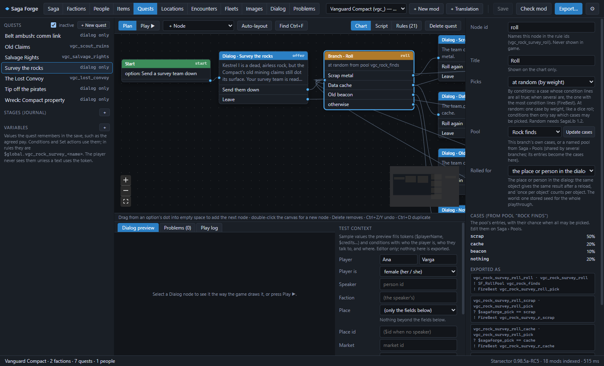
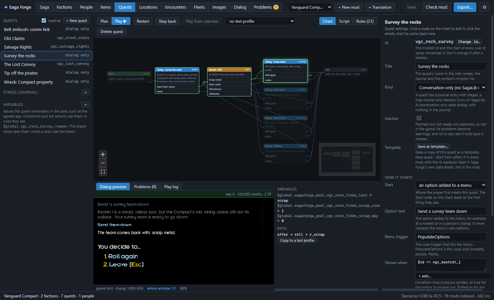

Random branches need SagaLib.

### Add a fight

There are two ways, depending on where the fight happens.

**A battle right here, in the dialog** (defences that wake up, guards at a door): a **Fight** node.
Example: the Custodian's defences in *Persea*.

1. Add a **Fight** node where the battle starts, after the Dialog that sets the scene.
2. Set **Engage option** (the option that starts it), then **Ships**: the faction and fleet points,
   exact ships, or a named fleet; and **Fleet name**.
3. Connect **Won** to what happens after the battle (here the way into the vault). Leave **Left**
   unconnected: the dialog closes, as vanilla's does, and the player can come back (an Arrive on
   the place, as Persea's "retry" does).

In Play mode the green bar asks whether the player won or left. Needs SagaLib 1.4.

**A fleet out in the sector** that the player meets, beats or avoids: an **Encounter** node.
Example: the scavengers at the probe in *The Voice in the Probe*.

1. Add an **Encounter** node after the Stage node where the fight belongs.
2. Pick the encounter in **Encounter**, or **+ New…** to create one at the stage's map marker. Set
   up its fleet on the Encounters page (see
   [Encounters › Add a fleet for a quest](encounters.md#add-a-fleet-for-a-quest)).
3. Connect *after spawning* to what happens right away, **Defeated** to what happens when the
   player wins, **Avoided** to what happens when the fleet leaves or the player gets past it.

To let the player talk their way out, give the fleet a comm dialog that ends with the **Fleet
response** group's *let them go* (see [Node groups](#node-groups)), or an Action with *Encounter
leaves*; the outcome then counts as Avoided. For a fleet that stops the player and talks first, see
[Encounters › Make a fleet stop the player](encounters.md#make-a-fleet-stop-the-player).

### Wait for the player to arrive

Continues the quest when the player reaches a place.

1. Add a **Wait / Arrive** node after the Stage node. When you add it by dragging from a node, its
   **Place** is already the stage's map marker.
2. **Shows as**: *an option in the place's menu* (type the **Option** text, e.g. "Ask the bartender
   about the Gutter Saint"), or *takes over the arrival* for a scene that must interrupt.
3. **Text**: the first paragraph of the scene. Connect the node to the Dialog that follows.

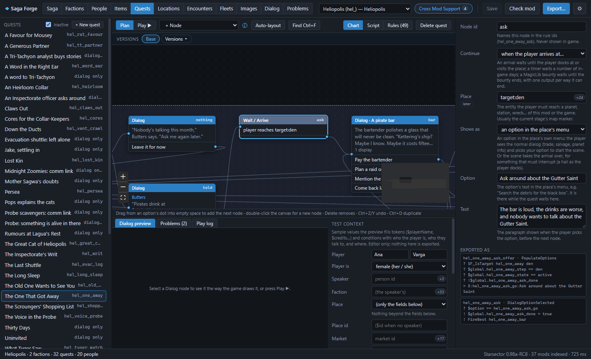

An Arrive at a place guarded by a lock conversation (one that only lets the player leave, such as
the probe's in Heliopolis) can only take over: the lock owns its arrival.

Problems warns about an Arrive straight after an Encounter's outcome with no Stage node between
them: the arrival could happen before the fight is decided.

In Play mode, the green bar has an **Arrive at …** button for each Arrive node. To wait for time
instead, set **Continue: after a number of days**.

### Send the player to a random place

Lets SagaLib pick the quest's place, so it's different in every game. Example: *The One That Got
Away*, where Butters sends the player to a pirate den to ask about the Gutter Saint.

1. Under **Variables**, **+** a variable (e.g. `den`) and set its type to **random target**. Its
   search opens.
2. **Pick**: what to look for (e.g. *a market*).
3. **Must**: criteria that must all hold, e.g. *Faction is* pirates. **+ Avoid dangerous systems**
   adds the usual safety criteria. Each criterion has its help text, and the ⓘ opens the reference
   of every criterion.
4. **Prefer**: criteria tried in order, each dropped when nothing would be left (e.g. *Not hidden*,
   then a size).
5. **Facts and mock**: SagaLib stores the place's name, system and distance in variables such as
   `$global.hel_one_away_den_name`, which your texts can use. Play mode can't see a generated
   sector, so it uses the mock values you type here.
6. Set the stage's **Map marker** to `target:den` and add an **Arrive** at `target:den` (see
   [Wait for the player to arrive](#wait-for-the-player-to-arrive)).

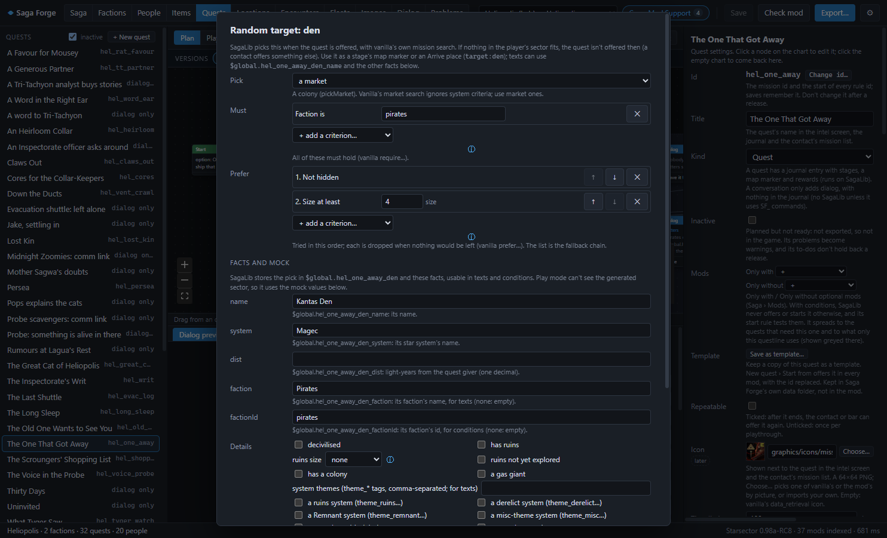
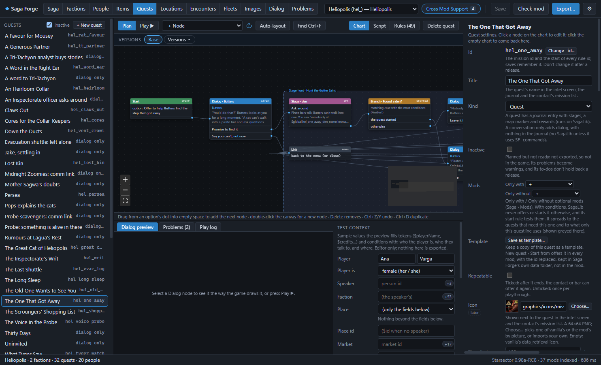

**When the place is picked** depends on how the quest starts. A contact or bar event picks it when
it offers the quest, so the offer can name it. With any other start (an option, a trigger, …)
SagaLib picks it when the quest starts, at its first Stage node: name the place only in texts
after that. Problems warns about a text that names it too early, and Play mode shows the token
unfilled there, as the game does.

If nothing in the player's sector fits, a contact or bar event doesn't offer the quest then (the
contact offers something else); with any other start the quest doesn't start (a Branch on its
state after the Stage node can tell the player). Random targets need SagaLib 1.2.

**A commodity at a market.** Set **Pick** to *a commodity at a market* for a delivery job: SagaLib
picks a market and one of its goods (vanilla's `pickCommodity`). Example: *The Scroungers' Shopping
List*, where Pop Chicken asks for something legal that a Heliopolis market needs, preferably one it is short of.

- The market criteria work as above; the commodity's own are: not crew or marines, legal or
  illegal there, tags, base price, "produces it", "is short of it", "has a surplus", and at least
  N in stock.
- **Which commodities**: vanilla's 18 trade goods (the default), any economy commodity, or a list.
- **Amount**: in economy units (times the commodity's unit size, optionally times the market's size)
  or a fixed number of cargo units. The form shows what that comes to for a few vanilla goods.
- Texts can use `$global.<quest>_<var>_commodity`, `_amount`, `_basePrice` and `_value`, plus the
  market's tokens. The action **The target's goods: take / give** moves the cargo, **Credits for the
  target's goods** pays for it, the condition **has its goods** checks the hold, and a reward can
  add **+ for goods** (a multiple of base price × amount). Problems warns about a delivery without a
  cargo check.
- Play mode uses the mock's commodity (or one of the allowed ones at random) and market size.

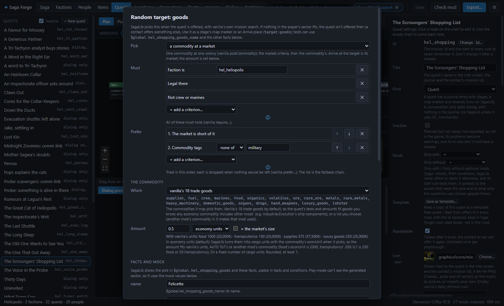

Commodity targets need SagaLib 1.4.

### Give a reward

1. Click the empty chart. Under **Rewards**, **+ Reward**: give it an id (e.g. `paid`) and fill in
   credits, XP, story points, reputation (**+ faction**), items (**+ item**, see
   [Items › Add a quest item](items.md#add-a-quest-item)) or **+ random items** from a drop group
   (see [Saga › Make a loot table](saga.md#make-a-loot-table)).
2. Pick the reward in an **End** node's **Reward**, or pay it mid-quest with an **Action** node's
   *Give a reward*.

The dialog then shows a "Gained …" line for each part, as vanilla does. A quest can have several
rewards; The One That Got Away pays `justice` or `bounty`, depending on what the player does with
the Gutter Saint. Reputation can go to a faction or to a person (**+ person**).

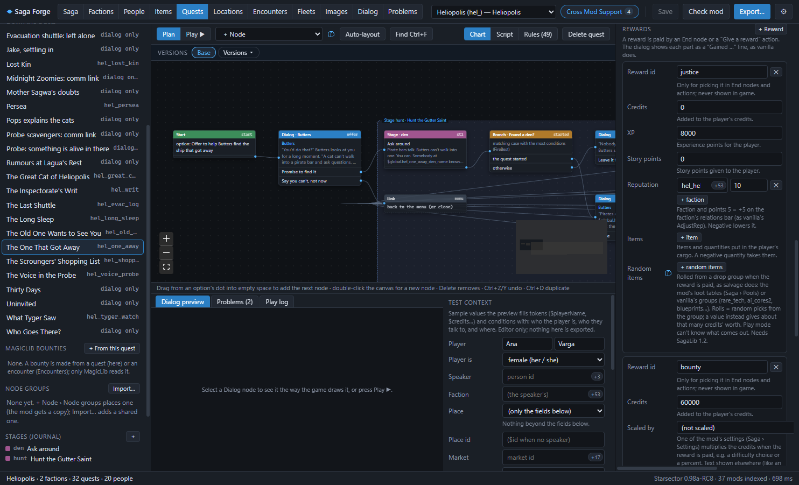

### Change progress from a dialog

Adds points to one of the mod's progress events (see
[Saga › Add a progress event](saga.md#add-a-progress-event)). Example: reporting the cats to the
Hegemony in *A Word in the Right Ear* adds to "Hegemony suspicion".

1. After the option, add an **Action** node.
2. **+ add… › Add progress**. Pick the event, type the points (negative lowers it) and the text
   shown in the event's list of one-time factors.

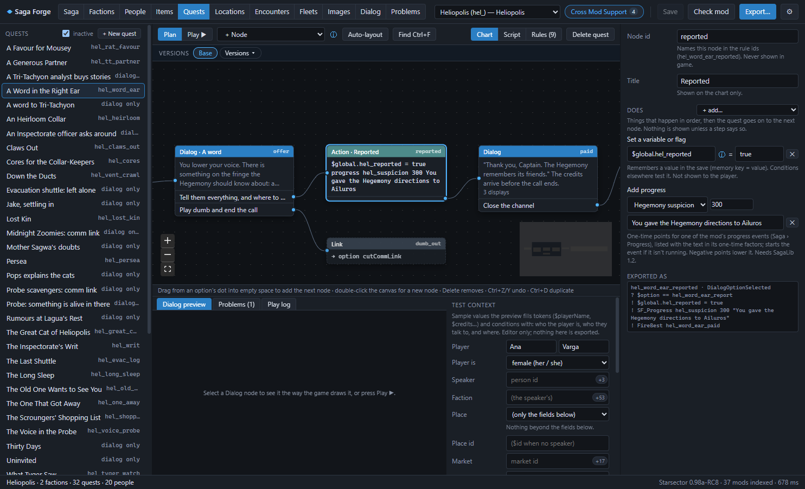

In game, the points show in the progress event's bar in the intel screen. If the event isn't
running yet, this starts it. Needs SagaLib 1.2.

### Test a quest in Play mode

1. Open the quest and press **Play ▶**. A contact quest starts with the contact's menu: pick the
   quest's option to hear the offer. A quest whose start doesn't match the Test context offers
   ways to meet it: pick one.
2. Click options in the preview. Use the green bar for encounter outcomes, fights and arrivals.
   When the dialog closes, pick what happens next from the out-in-space choices (travel, wait, a
   fleet).
3. Pick a test profile in the list next to **Play from selected** to start with flags, credits or
   other quests already set (see [Saga › Add a test profile](saga.md#add-a-test-profile)), then
   **Restart**.
4. **Step back** undoes one step; **Play from selected** starts at the node you selected.
5. Read the **Play log** when something doesn't show up as you expected.
6. **Plan** goes back to editing.

Play mode can't fight battles, run plugins or roll a drop group's items; it asks you or tells you
so in the log.
To try the quest in the real game, start it with a test profile (see
[Saga › Start the game with a test profile](saga.md#start-the-game-with-a-test-profile)).

### Rename a stage after a release

Saves remember the player's stage by its id, so changing an id after a release needs care.

1. Under **Stages (journal)**, open the stage and press **Change id…**.
2. If the stage isn't in a release yet, just type the **New id**: no saves are affected.
3. If it is in the last release, choose:
   - **Keep the old id as an alias** (recommended): players at the old id move to the new one when
     they load. The old id is added to the stage's **Old ids**.
   - Change it without an alias: players at this stage lose their place.
   - Only change the display name: edit the stage's **Title** instead.

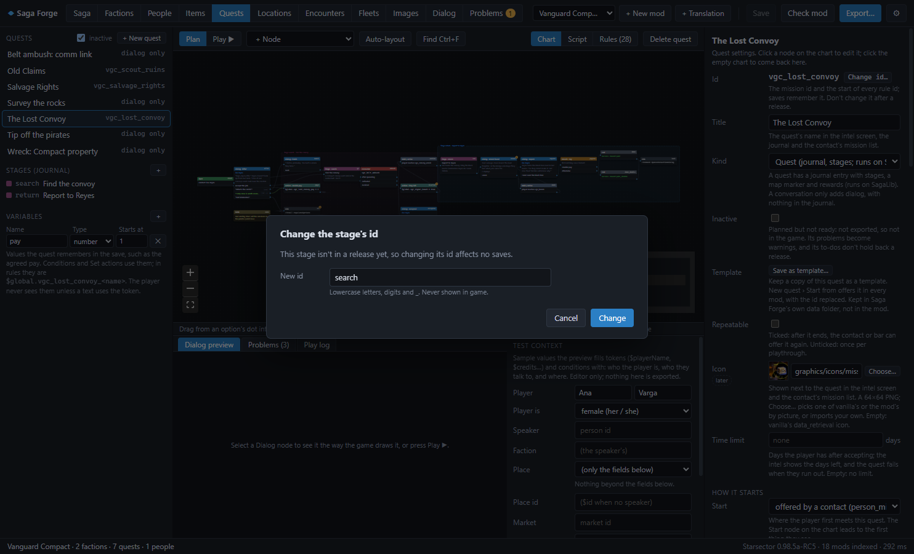

The quest's own id is the same story but stricter: **Change id…** in the quest settings changes it
everywhere in the mod, but players in the middle of the quest lose it after a release. Problems
warns you. To release an update safely, see [Export › Release an update](export.md#release-an-update).

