# Quests

The Quests tab is where you write quests and conversations: a flow chart of what the player sees and
does, with an in-game-style preview of every dialog and a Play mode that runs the quest the way the
game will.

## How it works

The page has four parts: the **quest list** with the quest's stages and variables on the left, the
**flow chart** in the middle, the **dock** under the chart (dialog preview, problems, play log), and
the **inspector** on the right. The inspector shows the quest's settings when nothing is selected,
and the selected node's settings when you click a node.

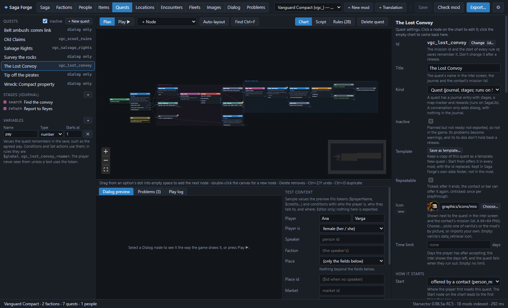

There are two kinds of quest:

- **Quest** (journal stages, SagaLib): the player accepts it, it gets an entry in the intel screen
  with a journal text per stage and a map marker, and it ends in success or failure with a
  reward. Quests run on SagaLib, so your mod needs SagaLib (Export offers to add it to your
  `mod_info.json` dependencies).
- **Conversation only**: just dialog, such as an option at a market, a greeting when the player
  hails a fleet, or a scene at a wreck. Nothing appears in the journal. A conversation doesn't need
  SagaLib unless it uses one of SagaLib's commands (a random branch, progress, spawning a fleet …).

What a quest writes into the mod when you [export](export.md#export-the-mod):

| File | What |
|---|---|
| `sagaforge/quests/<id>.quest.json` | The plan you edit here (chart, stages, settings). Saga Forge's own file, the game doesn't read it. |
| `data/campaign/rules.csv` | The dialog: one block of rows per quest, between `# sagaforge:begin quest=<id>` and `# sagaforge:end` marker rows. Saga Forge rewrites only its own blocks, so rows you or other tools add outside them stay. |
| `data/campaign/person_missions.csv` / `bar_events.csv` | A row per quest offered by a contact or at a bar, in an owned block. |
| `data/sagaforge/quests/<id>.json` | The quest's stages, rewards and variables, read by SagaLib. |
| `data/sagaforge/text.json` | The dialog texts, so a [translation mod](translation.md) can replace them. |

### The quest list

The left column lists the mod's quests and conversations. Conversations say *dialog only*; quests
show their id. **+ New quest** makes a new one; the **inactive** box shows or hides quests you
marked inactive (planned, not exported).

Under the list are the open quest's **Stages (journal)** and **Variables**:

- **Stages** are the journal steps of a quest, see [Stages](#stages).
- **Variables** are values the quest remembers in the save, such as the agreed pay. Each has a name,
  a type (number, string, bool, entity, person, or *random target*) and a starting value. In
  conditions and Set actions they are `$global.<quest id>_<name>`, e.g.
  `$global.vgc_lost_convoy_pay`. The player never sees them unless a text uses the token.
- A **random target** variable is a place SagaLib picks when the quest is offered (for example "an
  uncolonised planet within 15 light-years of the quest giver"). Its button in the Starts at column
  opens its search. Stage map markers, Arrive nodes and the *Spawn at the random target* action can
  then use it as `target:<name>`. See
  [Send the player to a random place](#send-the-player-to-a-random-place).

### Quest settings

Click the empty chart to see the quest's settings in the inspector:

- **Id**: the mission id and the start of every rule id. Saves remember it, so don't change it after
  a release. **Change id…** changes it everywhere in the mod (conditions and test profiles follow).
- **Title**: the name in the intel screen, the journal and the contact's mission list.
- **Kind**: quest or conversation only (see above).
- **Inactive**: planned but not ready. It isn't exported, its problems become warnings, and its
  to-dos don't hold back a release.
- **Template**: **Save as template…** keeps a copy for New quest › Start from (in Saga Forge's own
  data folder, for every mod).
- **Repeatable**, **Icon** (64×64, **Choose…** picks one by picture, see
  [Images › Pick an image for a field](images.md#pick-an-image-for-a-field)) and **Time limit** (days
  after accepting; the quest fails when they run out).
- **How it starts**: where the player first meets the quest, see the table below.
- **Prerequisites**: other quests that must have ended (succeeded, failed or either), or flags that
  must be set, before the quest is offered or starts.
- **Rewards**: named rewards (credits, XP, story points, reputation, items, random items from a drop
  group) that an End node or a *Give a reward* action pays. See
  [Give a reward](#give-a-reward).
- **Notes**: for you only, never exported.

| Start | Where the player meets it | Written to |
|---|---|---|
| offered by a contact | The contact's mission list ("Do you have any work?" on the comm link) | `person_missions.csv` |
| a bar event | A patron at a colony's bar | `bar_events.csv` |
| an option added to a menu | An option in a market's, person's or fleet's menu; the menu's own options stay | `rules.csv` |
| a dialog that opens on a trigger | A dialog that opens by itself, e.g. when hailing a fleet (`OpenCommLink`) or visiting a place (`OpenInteractionDialog`) | `rules.csv` |
| started by another quest | Another quest's *Start another quest* action | (SagaLib) |
| an interjection before an existing option | Your scene plays first when the player picks an existing option, e.g. vanilla's Explore at a derelict | `rules.csv` |
| a bar scene (no mission) | A story scene at a bar, like vanilla's own | `rules.csv` |

Every start kind shows its own fields with help under each one (the contact or contact tags, how
often it is offered, the blurb, the option text, conditions …).

### Stages

A quest's stages are its journal: while the player is at a stage, the intel screen shows its text and
the map marker points to its place. They are listed under **Stages (journal)** on the left; **+**
adds one and opens its form. Each stage has:

- **Id**: what saves remember. Never shown in game. Change it only with **Change id…** (see
  [Rename a stage after a release](#rename-a-stage-after-a-release)).
- **Title**: the stage's name in the intel list (when the next-step line is empty) and on the
  stage's frame on the chart.
- **Journal text**: the paragraph in the intel screen's panel for the quest at this stage.
- **Next-step line**: the short line under the quest's name in the intel list and in the "quest
  updated" notification.
- **Map marker**: where the map's quest marker points: one of your places, a vanilla market or
  entity, a person (their market) or a random target.
- **Kind**: normal (the quest goes on), or a stage that ends the quest in success or failure as soon
  as it is reached.
- **Old ids**: ids the stage had in earlier releases (filled in for you by Change id…).

A **Stage node** on the chart moves the quest to a stage. The chart draws a coloured frame around
the nodes that belong to each stage, labelled with the stage's id and title.

### The flow chart

The chart is the quest from start to end. Each node is a step; each of a node's outputs (a dialog's
options, a branch's cases, an encounter's outcomes) has a dot on its right edge, and a line from
the dot to the next node says what happens next.

- **Add a node**: double-click the empty chart, or drag from an output's dot into empty space (the
  new node is then connected to that output). Both open the node menu. The **+ Node** list in the
  toolbar adds one in the middle of the chart.
- **Connect**: drag from an output's dot onto a node. An output leads to one node; dragging again
  replaces the line.
- **Delete**: select a node or line and press Delete. **Ctrl+D** duplicates the selected node,
  **Ctrl+Z / Ctrl+Y** undo and redo.
- **Auto-layout** tidies the chart; **Find Ctrl+F** finds a node by text, option or id.
- The zoom buttons and the minimap are in the chart's corners.

### Node types

Click a node to edit it in the inspector. Every node has a **Node id** (part of its rule ids, never
shown in game), and most inspectors end with **Exported as**: the `rules.csv` rows the node becomes.

#### Start

Where the quest begins. It has no settings of its own: how the player gets here is the quest's
**How it starts** (click the empty chart).

#### Dialog

A page of dialog: text on the left, a picture on the right, options under the text. This is the node
you will use most.

- **Title**: names the node on the chart (not shown in game).
- **Speaker**: who is talking, picked from the mod's and the game's people.
- **Visual**: what the right half of the dialog shows: the speaker's portrait (with up to two more
  people beside them), an illustration, a large planet, a map marker, both fleets, one ship, or
  *keep* the previous picture.
- **Text**: what the player reads. "Speech in quotes," narration in the second person. A blank line
  starts a new paragraph; a line with only `OR` starts a random variant. **+ token…** inserts a
  token such as `$playerName` or a phrase; **+ variation** adds wording that changes with the
  situation (see [Saga › Add a phrase](saga.md#add-a-phrase)).
- **Highlights**: words or numbers drawn in the highlight colour, as vanilla marks names and sums
  (separate them with `|`).
- **Displays**: panels after the text or after a paragraph: "Gained" lines for credits, items,
  story points, XP and reputation (these also change the player's cargo, credits or reputation), an
  extra small grey paragraph, a cost panel, a faction callout, sounds and music, and more.
- **Options**: the choices under the text, numbered as in game. Each has a dot on the chart. **⋯**
  opens an option's settings: its id, a tooltip, a story-point cost (a green story option with
  vanilla's confirmation), the Esc shortcut, *show once* (per conversation or for good), *only show
  if* conditions and *disabled if* conditions. With no options, the dialog continues to the next
  node by itself.
- **Extra conditions** and **Extra script lines**: rules.csv lines for things the editor has no form
  for. Most dialogs need none.

The **Dialog preview** in the dock draws the selected Dialog node the way the game does, with the
game's font. **whole window 1:1** shows it at the game's size. On the right of the dock, the
**Test context** sets the sample values the preview uses: the player's name and gender, the speaker,
faction and place. They are for the editor only.

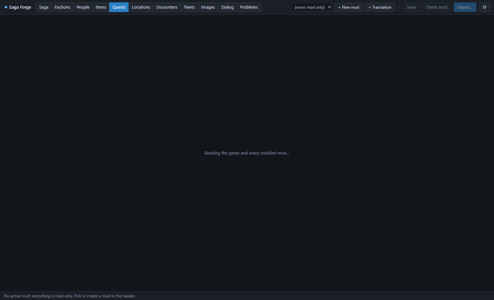

#### Branch

Picks a way on without showing anything to the player.

- **By conditions**: each case is a label (chart only) and condition lines that must all be true.
  A matching case is taken (when several match, the game takes the one with the most conditions);
  **otherwise** is taken when none match.
- **At random (by weight)**: picks one case like a dice roll. Each case has a weight, and can be
  limited (once per playthrough, once per place or person, a cooldown in days, at most N times).
  A **Nothing** weight makes *otherwise* possible. The cases can also come from a named pool (see
  [Add a random branch](#add-a-random-branch)). Random branches need SagaLib.

#### Action

Things that happen in order, then the quest goes on. Nothing is shown unless a step says so.
**+ add…** offers: set a variable or flag, clear a flag, give or take credits, change reputation,
give or take an item, give a reward, story points, experience, spawn an encounter, an encounter
leaves, place or remove an object, remove a person, spawn something at the random target, start
another quest, add progress to a progress event, or a raw rules.csv script line. Each step has its
help text under it.

#### Stage

Moves the quest to a journal stage: the intel screen shows the stage's text, the map marker moves,
and a success or failure stage ends the quest. **+ New stage…** in its list adds a stage and opens
its form on the left.

#### Encounter

Puts one of the mod's encounters (a fleet) in the sector. It has three outputs: *after spawning*
continues at once; *Defeated* and *Avoided* continue later, when SagaLib reports what happened to the
fleet. **+ New…** creates an encounter at the current stage's map marker; you then set up its fleet
on the Encounters page. See [Add a fight](#add-a-fight).

#### Wait / Arrive

Waits until the player arrives at a place, or for a number of in-game days.

- **Arrive**: **Place** is the planet, station or wreck the player must reach (usually the stage's
  map marker). **Shows as** is either *an option in the place's menu* (the place's normal dialog
  stays, with your option added) or *takes over the arrival* (your scene opens as the player
  arrives, for a hail as they dock). **Text** is the first paragraph of the scene.
- **Timer**: waits the given number of days, then the next node runs. Nothing is shown.

See [Wait for the player to arrive](#wait-for-the-player-to-arrive).

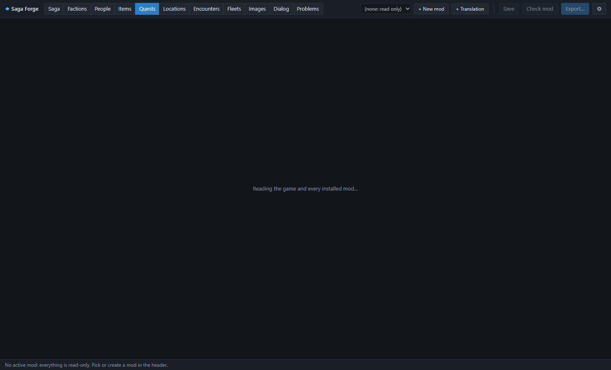

#### Raid

A ground raid on the place the dialog is at, like vanilla's story raids: a briefing, then vanilla's
raid menu with one objective where the player commits marines. Its outputs are **Raid done** and
**Backed out**. You set the objective's name, danger level, the defenders' strength, the experience,
and the text shown during the raid. Use it in a dialog at a planet, station or colony. No SagaLib
needed.

#### End

Ends the quest: **success**, **failure** or **abandoned** (like the player's Abandon button), and
optionally pays one of the quest's rewards. The conversation can go on after it, for a last line or
a Link back to the menu.

#### Link

Leads out of your quest into existing dialog without changing it:

- **back to the menu** (the safe ending): back to the market's, contact's or fleet's options, or
  closes the dialog where there is no menu (a wreck).
- **back to the bar**: the end of a bar scene.
- **fire a trigger**: e.g. `OpenInteractionDialog` to reopen the place's own dialog, or
  `PopulateOptions` to rebuild its menu.
- **into an existing option id**: e.g. vanilla's `defaultLeave` or `cutCommLink`.
- **to another node of this quest**.

To find vanilla triggers and option ids, see
[Dialog › Find a vanilla dialog rule](dialog.md#find-a-vanilla-dialog-rule).

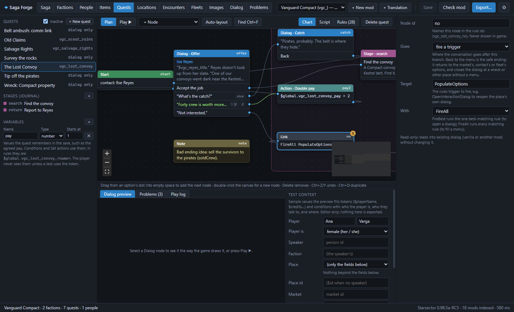

#### Note

A sticky note on the chart for ideas and reminders. Never exported.

### Play mode

**Play ▶** runs the quest the way the game would: the same rules Export writes, together with the
game's own rules, so your dialog continues into vanilla's menus as it would in game. You click the
options in the preview; the chart lights up the path taken.

- The green bar over the preview has buttons for what can't be clicked in a dialog: an encounter's
  **Defeated** / **Avoided**, **Arrive at …** for each Arrive node, **Wait N days** for timers. It
  also shows the day, credits and story points.
- The dock's right side lists the **Variables** set so far and the **Path**. **Copy to a test
  profile** saves the current state as a test profile.
- **Restart**, **Step back** and **Play from selected** (start at the selected node) are in the
  toolbar. The list next to them applies a test profile when Play starts.
- **Play log** explains every step (which rule fired and why).
- In a random branch, **Next pick** in the branch's inspector forces what the next roll picks, so
  you can try each case.

See [Test a quest in Play mode](#test-a-quest-in-play-mode).

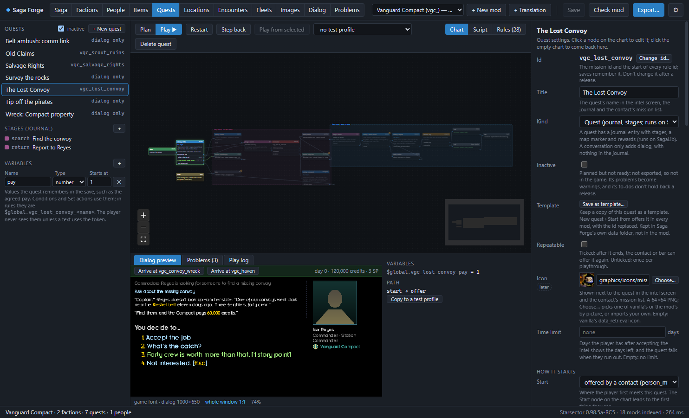

### The script and rules views

The **Chart / Script / Rules** buttons switch the middle of the page:

- **Script** shows the whole quest as a screenplay in the order the player meets it: speakers,
  lines, choices and where they lead, journal stages and fleets as notes. Click a line to select
  its node. **Copy as Markdown** copies it, for proofreading or sharing.
- **Rules** lists every `rules.csv` row the quest exports (id, trigger, conditions, script, text,
  options), and which node each row comes from. Click a row to select its node.

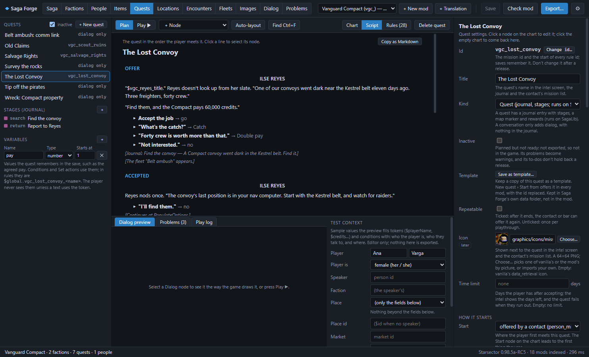

The **Problems** tab in the dock lists this quest's problems; click one to select its node. See
[Problems › Fix a problem](problems.md#fix-a-problem).

## How to set up the basics

### Make a contact quest with stages

A quest a character offers through their mission list, with journal stages. Example: Commodore
Reyes's *Salvage Rights*.

1. **+ New quest**. Type the **Title**; the **Id** is made from it with your prefix. **Start from**
   *an empty quest* (or a template: Delivery, Bounty, Investigate a place, Rescue, Talk to
   someone). Kind **Quest**. **Create**.
2. The new quest has a Start node, an **Offer** dialog with *Accept the job* and *Not interested*,
   and one stage. Click the empty chart to open the quest settings.
3. **How it starts › Start**: *offered by a contact*. **Contact**: pick the person (see
   [People › Make a character a contact](people.md#make-a-character-a-contact)). Fill in **Blurb**
   (the line in their mission list) and **Option** (what the player picks to hear the offer). Set
   **Min. rep** and **Frequency** if you want.
4. Under **Stages (journal)** on the left, open the stage (or **+** for more) and fill in **Title**,
   **Journal text**, **Next-step line** and **Map marker** (a place, see
   [Locations › Add a derelict or wreck](locations.md#add-a-derelict-or-wreck)).
5. Click the Offer node and write its **Text**; set **Speaker** and **Visual: Person (speaker)**.
6. Drag from *Accept the job*'s dot into empty space and pick **Stage**: it takes the first stage
   no Stage node uses yet. Drag on from the Stage node to the next step (a Dialog, an Arrive …).
7. Drag from *Not interested* and pick **Link** (*back to the menu*).
8. End every path with an **End** node (success or failure) followed by a **Link**.

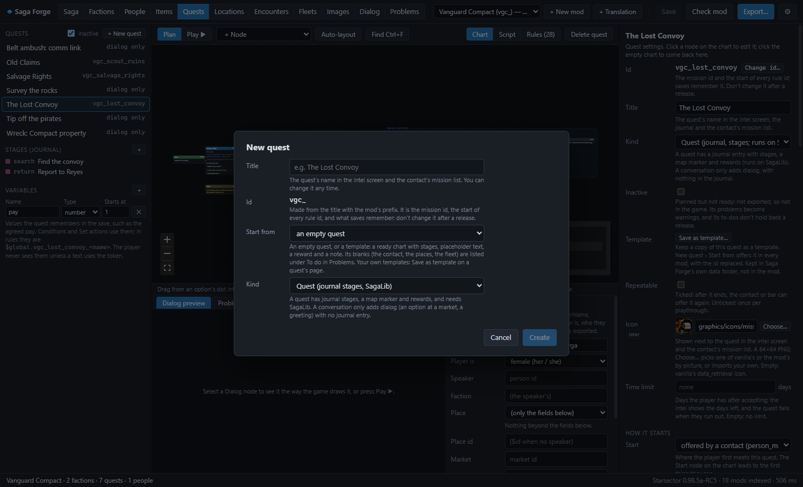

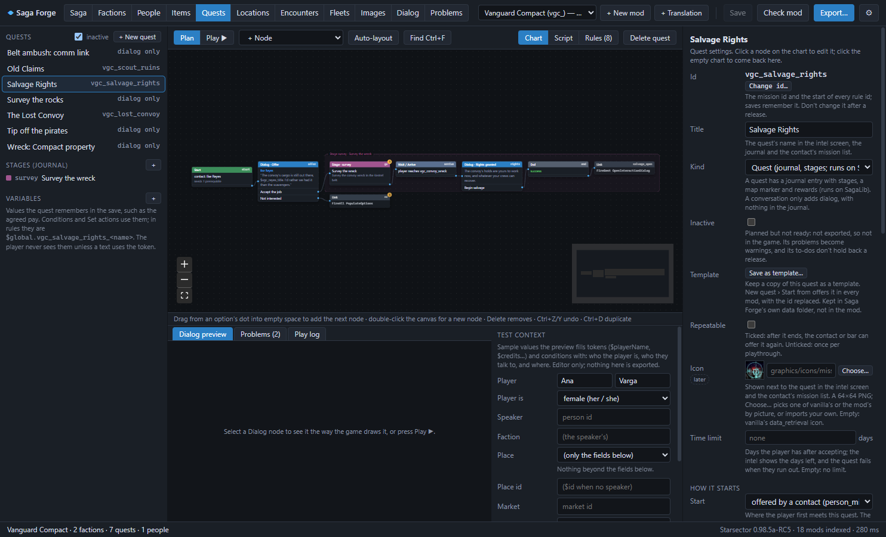
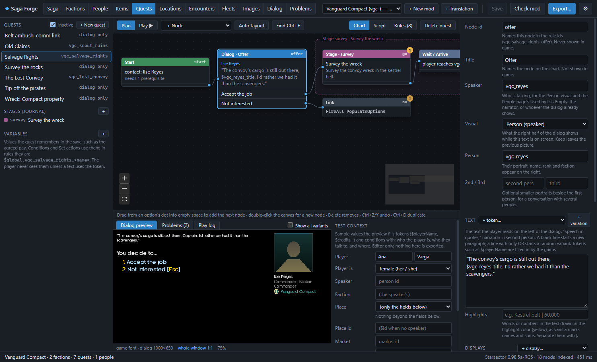

In game, the quest appears in the contact's mission list. Once accepted it is in the intel screen
with the stage's journal text, and the map marker points to the stage's place.

To offer a quest only after another one, use **Prerequisites** in the quest settings (see also
[Saga › Make one quest wait for another](saga.md#make-one-quest-wait-for-another)).

### Write a conversation

Dialog without a journal entry, for a scene at a place, a greeting, or a lock on a wreck. Example:
*Wreck: Compact property*, a short dialog that opens when the player visits the convoy wreck.

1. **+ New quest**, **Kind: Conversation only**, **Create**.
2. In the settings, choose **How it starts**: *an option added to a menu* (see
   [Start a quest from a dialog option](#start-a-quest-from-a-dialog-option)) or *a dialog that
   opens on a trigger*. For a dialog at a place: **Trigger** `OpenInteractionDialog` and
   **Conditions** `$id == <the place's id>`. Add `score:N` (e.g. `score:500`) to the first
   condition line to win over vanilla's own rule for that place.
3. Write the Offer node's text and options.
4. End each path with a **Link**: *back to the menu* for an option, or *into an existing option id*
   `defaultLeave` to close a place's dialog the vanilla way.

A greeting for a fleet you hail is the same with the trigger `OpenCommLink` and a condition on the
fleet. For an encounter's own fleet, the Encounters page makes this conversation for you (see
[Encounters › Give a fleet a comm dialog](encounters.md#give-a-fleet-a-comm-dialog)).

### Start a quest from a dialog option

Adds your option to an existing menu (a market, a person, a planet) without replacing its own
options. Example: *Tip off the pirates* at Haven Station.

1. In the quest settings, **How it starts › Start**: *an option added to a menu*.
2. **Option text**: what the player sees in the menu.
3. **Menu trigger**: leave `PopulateOptions` (markets, people, fleets, planets).
4. **Shown when**: condition lines for where it appears, e.g. `$id == vgc_haven` for one place, or
   `$isPerson` for any person. **+ add…** offers ready-made condition lines.
5. The Start node now leads to the first thing the player sees after picking the option.

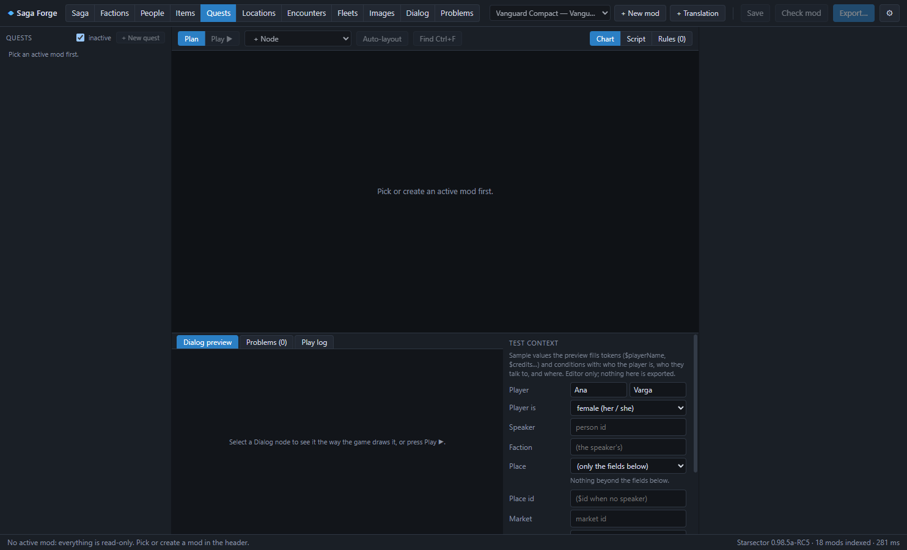

In game, the option is in that place's menu; the menu's own options stay.

### Add a random branch

A branch that rolls the dice. Example: *Survey the rocks*, where the survey team finds scrap, a data
cache, an old beacon or nothing.

1. Add a **Branch** node and set **Picks: at random (by weight)**.
2. Either use the branch's own cases: **+ Case** for each, with a **weight** (3 against 1 is three
   times as likely), limits if needed, and **Nothing** for the chance that nothing happens.
3. Or pick a named pool in **Pool**: its entries become the cases (see
   [Saga › Make a random pool](saga.md#make-a-random-pool)). A pool can be shared by several
   branches; the inspector shows each case's chance.
4. **Rolled for**: *the place or person in the dialog* (the same place gives the same result after
   a reload, and "once per place" counts per place) or *the world* (one seed for the whole
   playthrough).
5. Connect each case's dot and **otherwise** to what happens next.
6. In Play mode, **Next pick** forces the next roll, so you can test each case.

Random branches need SagaLib.

### Add a fight

Puts a fleet in the player's way and continues when it is defeated or avoided. Example: the *Belt
ambush* in The Lost Convoy.

1. Add an **Encounter** node after the Stage node where the fight belongs.
2. Pick the encounter in **Encounter**, or **+ New…** to create one at the stage's map marker. Set
   up its fleet on the Encounters page (see
   [Encounters › Add a fleet for a quest](encounters.md#add-a-fleet-for-a-quest)).
3. Connect *after spawning* to what happens right away (e.g. Reyes's last words), **Defeated** to
   what happens when the player wins, **Avoided** to what happens when the fleet leaves or the
   player gets past it.

To let the player talk their way out, give the fleet a comm dialog with an option that makes it
leave (an Action with *Encounter leaves*); the outcome then counts as Avoided.

### Wait for the player to arrive

Continues the quest when the player reaches a place.

1. Add a **Wait / Arrive** node after the Stage node. When you add it by dragging from a node, its
   **Place** is already the stage's map marker.
2. **Shows as**: *an option in the place's menu* (type the **Option** text, e.g. "Search the debris
   for the black box"), or *takes over the arrival* for a scene that must interrupt.
3. **Text**: the first paragraph of the scene. Connect the node to the Dialog that follows.

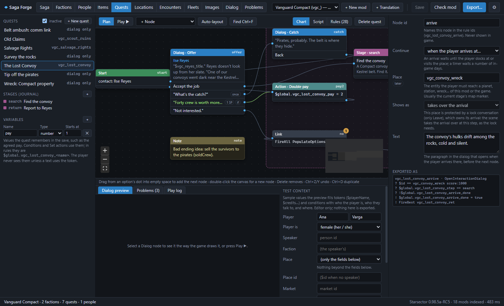

The convoy wreck's Arrive can only take over: the wreck is guarded by a lock conversation (only
Leave), and the lock owns its arrival.

In Play mode, the green bar has an **Arrive at …** button for each Arrive node. To wait for time
instead, set **Continue: after a number of days**.

### Send the player to a random place

Lets SagaLib pick the quest's place when the quest is offered, so it's different in every game.
Example: *Old Claims*, where Reyes sends the player to an old Compact claim on an uncolonised
planet near her.

1. Under **Variables**, **+** a variable (e.g. `ruin`) and set its type to **random target**. Its
   search opens.
2. **Pick**: what to look for (e.g. *a planet*).
3. **Must**: criteria that must all hold, e.g. *Uncolonised* and *Within N light-years* (15) *of
   the quest giver*. **+ Avoid dangerous systems** adds the usual safety criteria.
4. **Prefer**: criteria tried in order, each dropped when nothing would be left (e.g. *Ruins not
   yet explored*, then *Has ruins*).
5. **Facts and mock**: SagaLib stores the place's name, system and distance in variables such as
   `$global.vgc_scout_ruins_ruin_name`, which your texts can use. Play mode can't see a generated
   sector, so it uses the mock values you type here (e.g. "Corvus IV").
6. Set the stage's **Map marker** to `target:ruin` and add an **Arrive** at `target:ruin` (see
   [Wait for the player to arrive](#wait-for-the-player-to-arrive)).

If nothing in the player's sector fits, the quest isn't offered then, and the contact offers
something else. Random targets need SagaLib 1.2.

### Give a reward

1. Click the empty chart. Under **Rewards**, **+ Reward**: give it an id (e.g. `paid`) and fill in
   credits, XP, story points, reputation (**+ faction**), items (**+ item**, see
   [Items › Add a quest item](items.md#add-a-quest-item)) or **+ random items** from a drop group
   (see [Saga › Make a loot table](saga.md#make-a-loot-table)).
2. Pick the reward in an **End** node's **Reward**, or pay it mid-quest with an **Action** node's
   *Give a reward*.

The dialog then shows a "Gained …" line for each part, as vanilla does. A quest can have several
rewards; The Lost Convoy pays `paid` or `paid_double` depending on a branch.

### Change progress from a dialog

Adds points to one of the mod's progress events (see
[Saga › Add a progress event](saga.md#add-a-progress-event)). Example: selling the patrol schedule
in *Tip off the pirates* adds 150 points to "Pirate pressure on Kestrel".

1. After the option, add an **Action** node.
2. **+ add… › Add progress**. Pick the event, type the points (negative lowers it) and the text
   shown in the event's list of one-time factors.

In game, the points show in the progress event's bar in the intel screen. If the event isn't
running yet, this starts it. Needs SagaLib 1.2.

### Test a quest in Play mode

1. Open the quest and press **Play ▶**. A contact quest starts with the contact's menu: pick the
   quest's option to hear the offer.
2. Click options in the preview. Use the green bar for encounter outcomes and arrivals.
3. Pick a test profile in the list next to **Play from selected** to start with flags, credits or
   other quests already set (see [Saga › Add a test profile](saga.md#add-a-test-profile)), then
   **Restart**.
4. **Step back** undoes one step; **Play from selected** starts at the node you selected.
5. Read the **Play log** when something doesn't show up as you expected.
6. **Plan** goes back to editing.

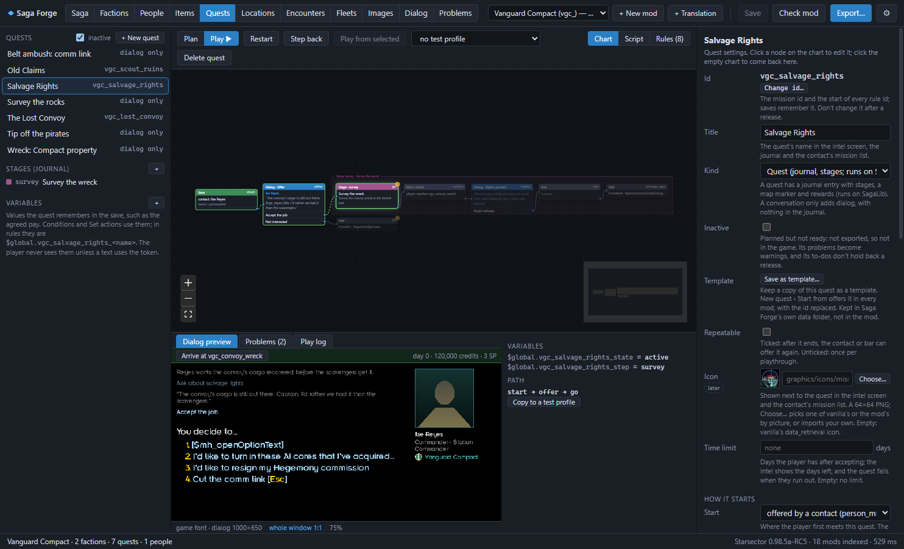

Play mode can't fight battles or roll a drop group's items; it asks you or tells you so in the log.
To try the quest in the real game, start it with a test profile (see
[Saga › Start the game with a test profile](saga.md#start-the-game-with-a-test-profile)).

### Rename a stage after a release

Saves remember the player's stage by its id, so changing an id after a release needs care.

1. Under **Stages (journal)**, open the stage and press **Change id…**.
2. If the stage isn't in a release yet, just type the **New id**: no saves are affected.
3. If it is in the last release, choose:
   - **Keep the old id as an alias** (recommended): players at the old id move to the new one when
     they load. The old id is added to the stage's **Old ids**.
   - Change it without an alias: players at this stage lose their place.
   - Only change the display name: edit the stage's **Title** instead.

The quest's own id is the same story but stricter: **Change id…** in the quest settings changes it
everywhere in the mod, but players in the middle of the quest lose it after a release. Problems
warns you. To release an update safely, see [Export › Release an update](export.md#release-an-update).

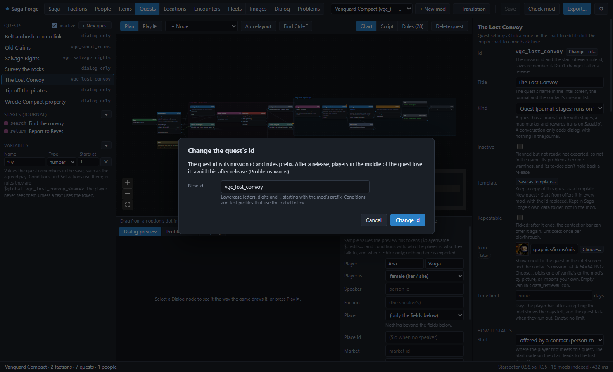
