# Saga

The Saga tab looks at the mod as a whole: how its quests hang together, which flags they share,
saved test situations, the things that belong to no single quest (mod-wide phrases, random
pools, objects scattered over the sector, world events and progress bars), the other mods
your mod works with, and the settings page players see in LunaLib's menu.

## How it works

The Saga tab has eleven sub-tabs in the bar under the header: **Board**, **Timeline**, **Flags
registry**, **Test profiles**, **Mod-wide phrases**, **Pools**, **Scatter**, **Events**,
**Progress**, **Mods** and **Settings**, and more for other mods once your mod lists them in
[Mods](#mods): **Achievements** (MagicLib), **Quest skip** (Nexerelin) and **Research** (AoTD Vaults
of Knowledge). The number after a name
is how many the mod has (Flags registry also shows an orange count when some flags look wrong).

Board, Timeline and Flags registry only show what the mod already has: they write nothing into the
mod. The other sub-tabs are plans of their own, saved in the mod's `sagaforge` folder
(`test-profiles.json`, `phrases.json`, `pools.json`, `scatter.json`, `events.json`,
`progress.json`) and turned into game files when you export (see [Export and Release › Export the
mod](export.md#export-the-mod)). In game, everything here except loot tables is run by the SagaLib
mod; pools, scatter, events and progress need SagaLib 1.2 or newer.

Wherever a sub-tab asks for conditions (a pool entry, a world event, a progress event's **Starts
when** and its monthly factors), it uses the same condition editor as the Quests tab: each line
read back in plain words, **+ add…** for the common ones, and suggestions of your mod's own keys as
you type (see [Quests › Conditions](quests.md#conditions)). Outside a dialog only `$global` and
`$player` keys exist, so a line about `$person`, `$market` or `$faction` there is marked and listed
in Problems: it could never be true.

### Board

The quests and conversations of the mod as **storylines**: one lane per questline, its quests left
to right in the order they become available, and a last lane for the quests that link to no other.
Each card shows its title, how it starts ("contact: Pop Chicken", "option: Visit Mousey in the
Collar-Keepers' workshop", "on OpenInteractionDialog"), its stages and how it ends, the people who
speak in it, and its id. A red number in the title is the count of errors in it; a conversation
(no journal) has a dashed border, and an inactive quest is faded. A lane is named after its main
quest (Heliopolis has two: *The Voice in the Probe* and *A Favour for Mousey*).

Only story links are drawn:

- **blue**: a prerequisite (one quest can only start after another);
- **green**: one quest **starts** another, or **goes on in** it (an Action that starts it, a Link
  into its nodes);
- **gold**: a flag one quest sets that another one's start needs (tests such as "not busy" don't
  count).

**Click a card** to select it: the flags it shares with other quests show as dashed lines, and a
panel on the right lists what it **comes after**, what it **leads to** and every **flag shared with
other quests** (set here or read here, and by which quest; click one to open it). **Double-click**
opens the quest on the Quests tab. The board opens at its top left at 70%; the buttons at the bottom
left zoom and fit everything into view.

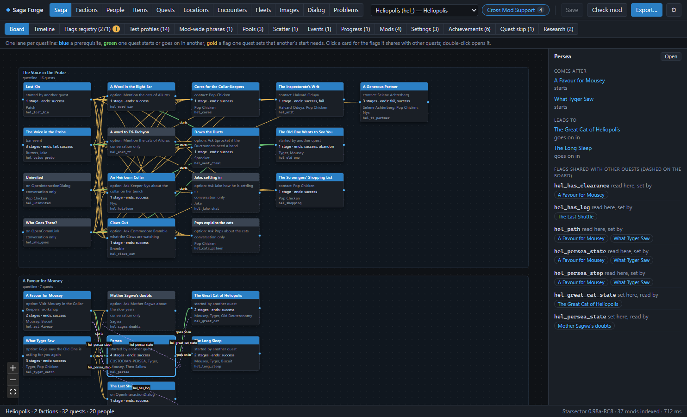

The lanes come from the quests themselves, so the cards can't be dragged. Prerequisites are set in
the quest (see [Make one quest wait for another](#make-one-quest-wait-for-another)), flags by the
nodes that set and read them.

### Timeline

The quests in the order a player can reach them: first those **available from the start**, then
those that open **after 1 step** (one prerequisite done), after 2 steps, and so on. Click a quest
to open it. If prerequisites go round in a circle (A needs B, B needs A), the quests in it are
listed in red: they can never start.

### Flags

**Flags registry** lists every memory key the mod uses: the ones its quests, nodes, events and
progress bars set and read, plus keys in rows you wrote into `rules.csv` by hand. Keys that vanilla
or another mod sets are marked with where they come from, and keys Saga Forge makes up itself (an
option that is shown once, for example) carry a **generated** badge.

| Column | What it shows |
|---|---|
| Key | The memory key, e.g. `$global.hel_persea_state` |
| Set by / Read by | Where it is set and where it is checked: quest and node. Click one to open that node |
| Type | What kind of value it holds: bool, number or string |
| Status | **ok**; **set, never read** (grey, often fine: a stage a later quest might use); **read, never set** (orange: usually a typo); **mixed types** (orange: set to a number in one place and text in another) |

Type in **Filter keys…** to find one. Nothing here is written into the mod.

### Test profiles

A test profile is a saved game situation: where each quest stands (not started, active at a stage,
succeeded or failed), flags with their values, and the player's credits, story points, commission,
reputation, cargo and the place their fleet starts at.

Profiles are used in two places:

- In Saga Forge's **Play mode**, to try a quest from the middle (see [Quests › Test a quest in Play
  mode](quests.md#test-a-quest-in-play-mode)).
- In the game, with **dev mode** on: SagaLib offers them at a new game and in its dev menu
  (**Ctrl+F9**), and applies the one you pick to the running game. See [Start the game with a test
  profile](#start-the-game-with-a-test-profile).

The export writes them to `data/sagaforge/dev/test_profiles.json`. SagaLib only reads that file in
dev mode, and release zips leave it out, so players never see your profiles.

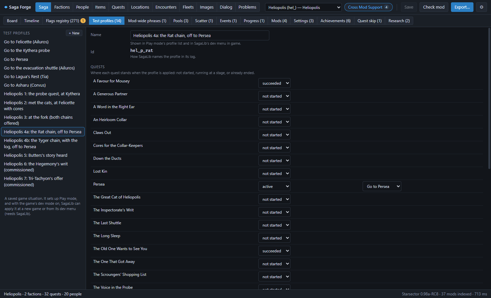

### Phrases

A phrase is a token like `$toc_he` that you type into any text of the mod. In game, SagaLib
fills in a text for it each time:

- **first case that matches**: each case has "if" lines (conditions as in `rules.csv`); the first
  case whose lines are all true gives the text, else the **otherwise** text.
- **random**: one of the texts at random (the cases and the **or** line).

**Mod-wide phrases** are the ones any text of the mod can use. The Other Captain has a set of them
for John Starsector, who is Jane for a female player (a version by the player's gender, see
[Versions by the player's gender](#versions-by-the-players-gender)): `$toc_he` says "he" or "she",
`$toc_his` "his" or "her", and so on, so one text fits both. A character's own phrases (how Tyger
addresses you, say) are on the People tab (see [People › Give a character
phrases](people.md#give-a-character-phrases)), and one-off variations go inside a Dialog node. The
export writes the mod-wide phrases into `data/sagaforge/people/<mod id>_people.json`.

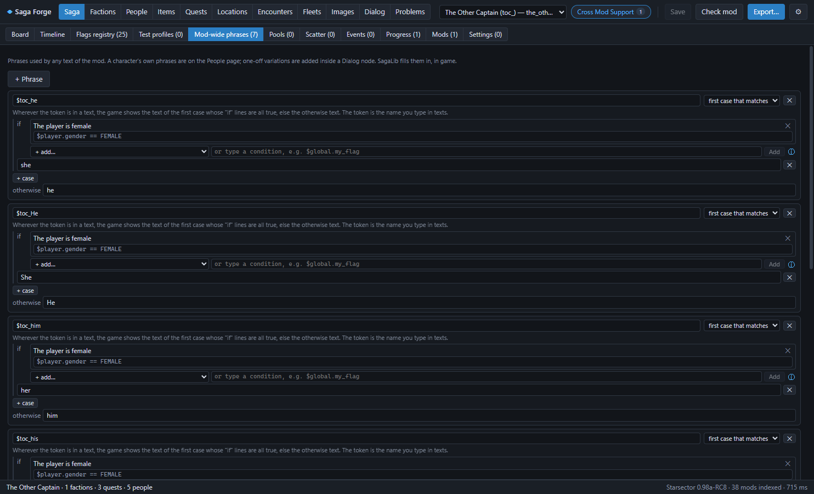

### Pools

A pool is a named list of things that can happen, each with a **weight**, like a loot table or a
deck of story cards: one entry is picked by weight (5 against 1 is five times as likely), or
nothing. The percentage next to each entry is its chance when every entry may be picked. **Used
for** says what kind of pool it is:

| Used for | What it does | Written to |
|---|---|---|
| **Random branches (story picks)** | A quest's Random branch rolls it, so several conversations can share one list with the same limits | `data/sagaforge/pools/<id>.json` (SagaLib 1.2) |
| **a loot table (drop group)** | A drop group, as vanilla's salvage uses: caches, wrecks, scatter and quest rewards roll it | rows in `data/campaign/procgen/drop_groups.csv` (vanilla's file, no SagaLib) |
| **random encounters** | Fleets that may lie in wait at vanilla's encounter points in hyperspace | `data/sagaforge/pools/<id>.json` (SagaLib 1.2) |

Story picks have **limits** per entry: once per playthrough, once per place or person, a cooldown
in days, or at most a number of times, and optional conditions ("may be picked only if…"). At the
bottom, **Used by** lists the branches, places and scatters that roll the pool; a pool that is in
use can't change its kind or be deleted.

Heliopolis has one of each: **Who is in the pod** (story picks: which cat sleeps in each cryo-probe
of the quest Lost Kin), **Cryo-probe salvage loot** (what the scattered probes give) and **Cats in
the dark** (random encounters: the Midnight Zoomies, a friendly smuggler convoy).

### Scatter

Copies of one object (a supply cache, a probe, a research station…) that SagaLib places at the
start of a new game, each in a different star system, the way vanilla scatters its derelicts and
caches. Saga Forge doesn't pick the places: you describe them (**Where**: an uninhabited planet, not in a
dangerous system, preferably one nobody has explored, say), and in game vanilla's own mission
search picks them. Each copy can have salvage loot and a fleet guarding it.

It happens once per game (with **Existing saves** ticked, also once in a game started before the
mod was added, on its next load). The export writes `data/sagaforge/scatter/<id>.json`; in game the
objects are named `<id>_1`, `<id>_2` …, and `$global.sagaforge_scatter_<id>_done` holds how many
were placed.

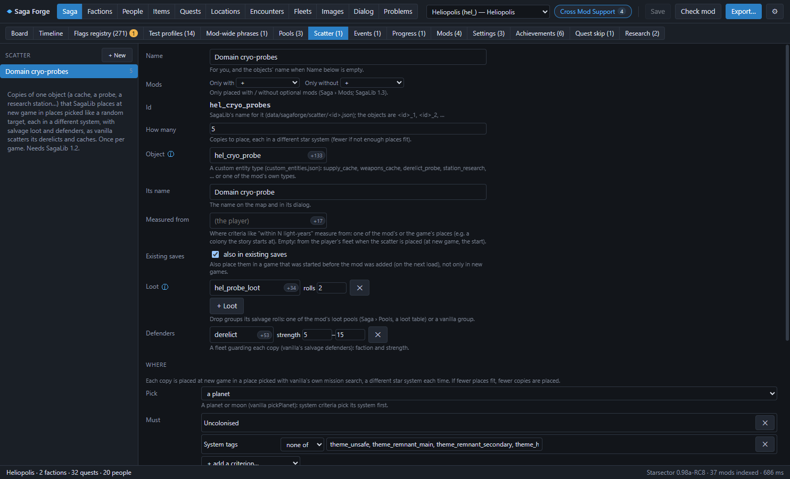

### Events

World events are things that happen in the sector without the player starting them, like
vanilla's bounties and hostilities. An **event scheduler** keeps between a least and a most of its
events running, and every few days picks a new one by weight (with conditions, once, cooldown and
"at most" limits as in a pool). Each event:

- runs for some days, and `$global.<event id>_active` is true meanwhile (use it in conditions and
  dialog);
- can post a **news item** in the intel screen (title, text, the intel tab, a place on the map);
- runs actions when it starts and when it ends (set a flag, give credits, spawn or remove an
  encounter's fleet, start a quest, add progress…).

The schedulers themselves are never shown in game. The export writes
`data/sagaforge/events/<id>.json`, with the start and end actions in it: SagaLib (1.4) runs them
itself, without opening a dialog, and what they give shows as campaign messages ("Gained …"). Only
an action that needs a dialog (a raw rules line, "the person you're talking to") stays a rule in
`data/campaign/rules.csv` (on the triggers `SF_event_<event id>_start` and `_end`), which SagaLib
fires in a dialog of its own. In Heliopolis, **The Persea Fever** runs at most one of three events
(an outbreak, a quarantine, a strange sighting) every 40 days or so, once the player has helped the
Rat.

### Progress

A progress event is a bar in the intel screen (under Major events), like vanilla's colony crises
and Hyperspace Topography. It fills up from:

- **monthly factors**: points every month while their conditions hold (negative points lower it);
- **one-time points**: an "Add progress" action in a quest, a dialog or a world event (listed in
  the event with its text).

Each **stage** sits at a value on the bar. When the bar reaches it, the game shows an update with
the stage's title and its actions run, or, with **Outcomes**, one outcome is picked by weight and
only its actions run. After the last stage the event ends, or starts over from a lower value. A
event can have up to 20 stages.

The export writes `data/sagaforge/progress/<id>.json` with the stage actions in it (SagaLib 1.4
runs them without a dialog, as for world events; a raw rules line stays a rule in
`data/campaign/rules.csv`); `$global.<event id>_stage` holds the last stage reached.

The two example mods have one each. Heliopolis's **Hegemony suspicion** grows while the player deals
with the cats and ends in a writ of purge. The Other Captain's **Hegemony Warrant** is the story's
crisis bar: it fills over time, faster when the player fights the Hegemony, drains with evidence
brought to the tax office, and its stages send a patrol, then bounty hunters, then a Hegemony
manhunt. The fleets it sends set the "fought the Hegemony" flag when beaten, through the
encounters' own outcomes (see [Encounters](encounters.md)).

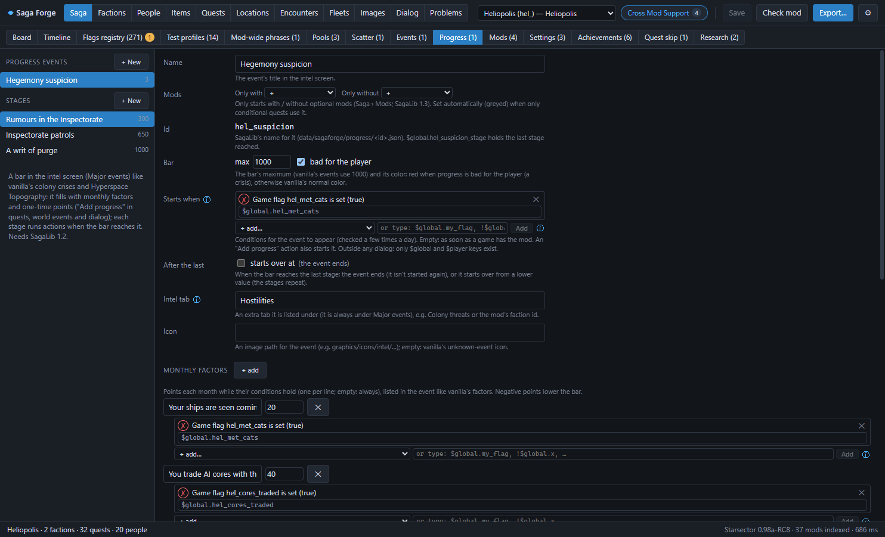

### Mods

**Mods** is the list of other mods your mod has content for, and how it uses each one. The game
itself only knows "required" (a dependency in `mod_info.json`), so Saga Forge keeps the rest the
way installed mods do it: data only that mod reads, plus checks in game. The table offers every
installed mod, enabled or not, except your own mod, SagaLib, translation mods and the libraries
the listed mods need (**Show libraries** lists those). Its columns:

| Column | What it shows |
|---|---|
| **Mod** | name, id and version; "off in your game" when it isn't enabled in your launcher (you can still write for it) |
| **Use** | **Required**, **Optional**, **Incompatible** or **Not used** |
| **Min version** | the lowest version of that mod yours needs (a required mod's dependency gets it) |
| **Never with** | mods no player runs together with this one (**+ never with…**). Some pairs are built in and shown greyed as *known*: AoTD's Theory of Toolbox and the modules that need it (Vaults of Knowledge, Seats of Power) never run with Industrial.Evolution |
| **Used by** | what in your mod refers to it: a character of its faction, a relation, a market of it, a patch of its faction, its framework files |
| **Unlocks** | what appears in your mod when it is listed: its content in lists and pickers, "Only with / Only without" conditions and a Play mode switch for optional mods, and tools made for that mod |
| **Reason** | for an incompatible mod: why (players see it) |

What each choice does:

- **Required**: the export asks to add it to `mod_info.json` dependencies, so the launcher won't
  enable your mod without it. Your content may use it freely.
- **Optional**: never added to the dependencies. Your mod must load and play without it, so
  everything that uses it is conditional (**Only with** / **Only without**, below). Play mode and
  the Test context get a switch for it. The release notes list it under "Works with".
- **Incompatible**: the game can't stop players from enabling both. SagaLib writes a warning in
  the log on every load and tells the player once per game, with your reason. Referring to its
  content is an error. The release notes list it under "Known conflicts".
- **Not used**: nothing. If your content refers to it anyway, Problems says so, with **Add as
  required** and **Add as optional**.

**Never with** only changes the editor: the versions strip gets no cell for such a pair, the
combination checks skip it, and Play mode's and the Test context's switches turn the other mod off
when you turn one on. "Only with A and B" for such a pair, or a version for it, is a warning. The
export and the game are not affected.

**The editor follows the list.** For a game with your mod, what exists is vanilla, your mod and the
mods it lists here, so that is what Saga Forge shows, offers and checks:

- **Pickers** (factions, people, items, ships, conditions, industries, submarkets, hullmods, drop
  groups, research, quests …) list only those mods' entries. **Show all installed mods** (on the
  lists) or the **+N** button (in a picker) shows the rest, and picking one of them offers **Add as
  optional** or **Add as required** right there.
- **Values** that several installed mods change (a market's owner, a replaced CSV row, a planet
  type, a faction's name, colour, logo or crest) show as those mods leave them, not as the last
  installed mod does. Your own planet and star types start from that value too.
- **Locations** lists the existing star systems as read-only, like People's existing characters;
  the map, the markets and the type chooser follow the list.
- **Play mode and the dialog preview** run only those mods' rules, and images, fonts and dialog
  colours come from them.
- **Problems** warns when your mod uses a condition, industry, submarket, hullmod or drop group of
  an installed mod that isn't listed, as it does for factions and items.

**Only with / Only without.** Every quest, conversation, character, star system and object,
encounter, world event, event scheduler, progress event, pool, scatter, starting relation and
scripted faction change, and every dialog option, Branch case and phrase case, has a **Mods**
field: **Only with** these mods and **Only without** these mods (only the optional mods are
offered). Everything listed must hold; **any of** makes the "with" list "at least one of them".
The setting shows as a chip ("only with Hazard Mining Incorporated") on the item and in lists.

Some conditions are set for you and show greyed, with where they come from:

- an item that refers to an optional mod's content (a character of its faction, a relation with
  its faction, an object orbiting its planet) gets "Only with" that mod (*uses …*);
- a quest that needs a conditional quest, and a quest whose contact is conditional, get its
  condition (*from: …*);
- characters, places, encounters and progress events that only conditional content uses get the
  conditions all their users share. Things also used by content without conditions keep none;
  Problems says which.

How it is exported: SagaLib content gets `modsWith` / `modsWithout` (SagaLib skips it otherwise
and writes one line to the log); dialog gets the rule conditions `SF_HasMod` / `!SF_HasMod`
(**any of**: `SF_HasAnyMod`), and an option with conditions becomes a small rule of its own. The
export also writes `data/sagaforge/mods.json` for SagaLib, and the mod then needs SagaLib 1.3.

**A save keeps the mods it started with.** The first time SagaLib sees your mod in a save, it
records which of its optional and incompatible mods are enabled. Every condition uses that record:
a mod counts only if it was enabled when the game started and still is. A mod added to a running
game changes nothing (and the player is told once); a removed small mod (a utility, a few rules)
stops what depends on it. A mod with its own factions, items or markets usually can't be removed
from a save at all: the game itself refuses to load it. So players should add or remove optional
mods only before a new game; the release notes say so.

Some things can't be conditional, because the game loads them every time: a new faction's known
ships, weapons or portraits from an optional mod, an item using its icon. Problems marks them as
errors: make the mod required, or leave them out. Dialog can't use an optional mod's own rule
commands either (the game stops loading without them); Check mod finds those too.

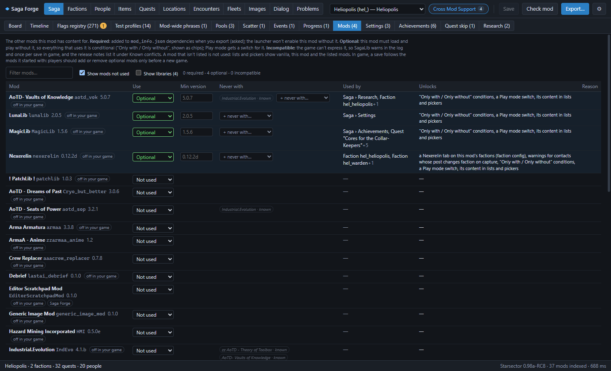

**Versions by installed mods.** "Only with / Only without" makes an item exist or not. A
**version** keeps one item (one id) and changes some of its fields when optional mods are
installed: a character who lives at another mod's market when that mod is there, a different
last name and portrait with a second mod, and swapped dialog when both are there. With optional
mods in the list, these editors get a **Versions** strip at the top: characters, quests and
conversations (their settings, places, texts, rewards, time limits and every node), encounters,
your own star systems and their markets, event schedulers, pools, starting relations and scripted
faction changes, items (name, description, icon and base price) and descriptions.

The strip is one row: **Base** (the item without any optional mod), a button for each version that
sets something (its short name and how many fields it sets), and a menu, **Mod versions ▾**
(**Versions ▾** when settings or the player's gender can have versions too), that lists every
version: **With one mod**, **With a setting or the player** and **Combinations** (two mods: Mod1,
Mod2 and Mod1 + Mod2), each with "n fields set" or "inherits", and **!** where two versions
disagree. Mods marked **Never with** each other get no combination.

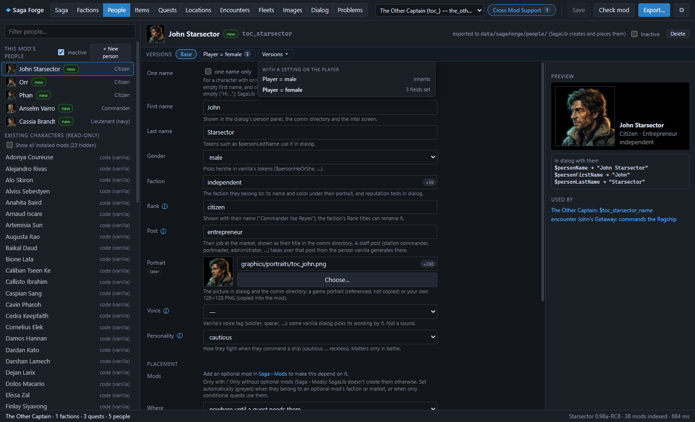

- Pick a version to see the item as it will be in that combination. A field you change there is
  stored for that version only; every other field is inherited, field by field: the most specific
  version wins (Mod1 + Mod2, then Mod1 or Mod2, then Base). Under the strip, the open version
  lists its own fields, each with **Revert** (it inherits again).
- If Mod1 and Mod2 change the same field differently, the combination asks which value to use
  (or change the field there). Problems shows it as an error until you decide.
- In game, SagaLib picks each item's version **once per save**, from the mods the game started
  with, and keeps it: adding or removing a mod later never switches a character mid-story. Items
  and descriptions are the exception: the game loads them before any save, so they follow the
  mods installed now.
- A quest's place that several parts use (its start, stage markers, Arrive nodes, pictures) can be
  a **named place** (the quest's **Places** list): use "named place …" in the pickers, or
  `place:<id>` in a condition (`$id == place:home`). Change it once, also in a version.
- Write a character's name in dialog with their name tokens, `$<id>_name`, `$<id>_firstName` and
  `$<id>_lastName`, so each version's name shows. Problems warns when a text spells out a name
  that differs between versions.
- On export, SagaLib's files get a `versions` list, and each dialog node a version changes gets one
  more rule that tests the version picked for the save. The mod then needs SagaLib 1.3.
- Play mode and the Test context show the version of the optional mods' switches.

**Versions by a setting.** An on/off or choice setting of your [Settings](#settings) page marked
**Versions may depend on it** adds its values to the menu (**With a setting or the player**: one
entry per value, and each value with each optional mod under **Combinations**). SagaLib records the
setting's value when a game starts and keeps that version for the save: changing the setting later
in LunaLib's menu doesn't change it. Play mode plays the version of the Test context's values.
Problems warns about a version for a setting that is missing, isn't marked, or takes no such value.
Items and descriptions can't have versions by a setting (the game loads them before any save).

#### Versions by the player's gender

The menu also offers **Player = male** and **Player = female**, alone and with each optional mod.
Base is for any player; a version for one gender changes what you set for that player only. In The
Other Captain, John Starsector is Jane for a female player: her version sets the first name, the
gender and the portrait. SagaLib records the player's gender when the game starts, and the version
never changes after. Play mode and the dialog preview use the Test context's **Player is**. Items
and descriptions can't have such versions (the game loads them before any save), and a picture in a
dialog can show another picture for a female player without a version (see [Images](images.md)).

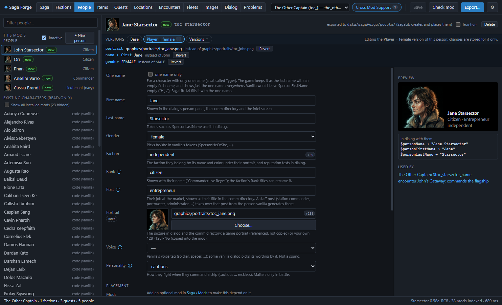

Some things can't have versions, because the game loads them at startup with no way to change them
later: a faction or item that exists only with a mod, a faction's main color, ranks and music,
items' tags, stack size and cargo space. Other mods' own characters and factions stay read-only;
dialog around them can have versions.

**Other mods' content.** To offer another mod's market or character, Saga Forge has to know them:

- **Mods made with Saga Forge**: their star systems, markets, places, characters, quests,
  encounters and pools are read from their files (the ones their `content.csv` lists). Their
  quests can be prerequisites (**after Mod1's quest X**, in a quest's Prerequisites), which makes
  the quest "Only with" that mod by itself. Their dialog shows with its real texts.
- **Mods that build their sector in Java code**: their systems, markets and people aren't in any
  file Saga Forge reads, so their ids show as "not checked". Take a **sector snapshot**: start a
  game with the mod (dev mode on), open SagaLib's dev menu (Ctrl+F9) and pick **Write sector
  snapshot**; then in **Saga › Mods**, under **Seen in game**, click **Import from the game**. What
  the snapshot saw becomes pickable and checked, tied to the mod it belongs to (by its faction or
  its id prefix). Things it can't tie to a mod, such as vanilla's random systems, are left out.

### Settings

**Settings** is your mod's own page in **LunaLib**'s settings menu: options the player changes,
such as "Enable the pirate questline" or a difficulty. Many installed mods ship such a page
without needing LunaLib; players without it simply get the defaults. The list on the left is the
page from top to bottom (**▲ ▼** move a row); **+ Add…** adds a row after the selected one. Each
row has:

| Field | What it is |
|---|---|
| **Type** | **On/off**, **Whole number** or **Number** (a slider), **Choice** (a few words, such as Easy, Normal, Hard), **Text value**, or, for layout only, a **Header** or a **Text line** |
| **Label** | what the player sees (a Header's heading, a Text line's text) |
| **Id** | starts with your prefix and follows the label until something uses it; the value is in memory as `$global.<id>`. Don't change it after a release: LunaLib keeps the player's values by id |
| **Description** | printed by LunaLib under the label |
| **Choices** | for a Choice: the words, separated by commas |
| **Default** | the value until the player changes it, and always without LunaLib |
| **Range** | for numbers: the slider's minimum and maximum |
| **Tab** | a tab of your page (empty: the main tab) |
| **Versions** | for on/off and choice settings: **Versions may depend on it**, so quests, people, systems, encounters, pools and events can have a version per value (see [Versions by a setting](#mods)). Its value is then fixed when a game starts |

The panel also shows whether LunaLib is **optional** (the default: it is never added to
`mod_info.json`) or **required** (list it as Required in [Mods](#mods)), the mod's **icon** in
LunaLib's menu (**Choose…**; square, 40×40 shows unscaled), what reads each setting (**Read by**),
and a rough preview of the page.

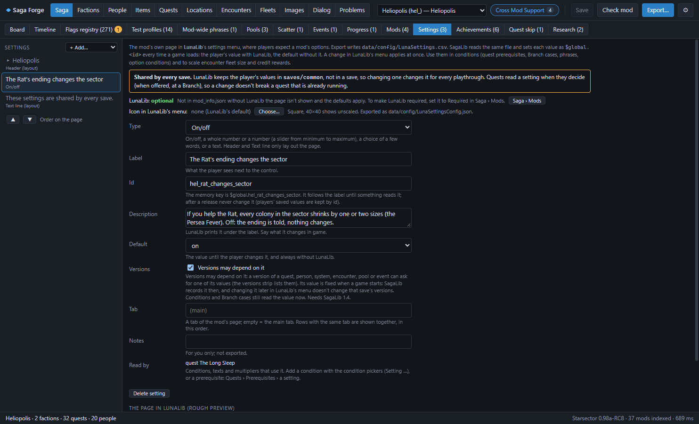

How it works in game: the export writes `data/config/LunaSettings.csv` (and
`data/config/LunaSettingsConfig.json` for the icon). LunaLib reads it and shows the page. SagaLib
reads the same file itself, so it needs no LunaLib, and sets every value as `$global.<id>` each
time a game loads: the player's value when LunaLib is there, the default when it isn't. When the
player changes a setting in LunaLib's menu during a game, SagaLib applies it at once.

**Settings are shared by every save.** LunaLib keeps the player's values outside the saves
(`saves/common`), so a change counts for every playthrough. Quests read a setting when they decide
(when a quest is offered, at a Branch), so changing one doesn't break a quest that is already
running.

Where you can use a setting:

- **Conditions** everywhere: the condition pickers of Branch cases, phrases, option conditions
  and start conditions list each setting ("Setting Difficulty is Hard", "Setting Enable the
  courier job is on").
- **A switch for a quest and the quests after it**: a quest's **Prerequisites › A setting** (see
  [Switch a questline on or off](#switch-a-questline-on-or-off)).
- **Multipliers**: a reward's credits (**Scaled by**, in the quest's Rewards) and an encounter's
  fleet points (**Size scaled by**). A whole-number setting is a percent (100 = as made), a number
  is times (1 = as made), and an on/off or a choice gets a factor for each value.
- **In text**, `$global.<id>` shows the value, but the game prints a whole number with a decimal
  ("100.0"), so Problems warns. Say it in words, or use a Branch or phrase on the value.

The flags registry marks each setting's key with a green **setting** badge. Play mode's toolbar
and the Test context have a control for each setting. A mod that reads its settings needs
SagaLib 1.3.

### Achievements

**Achievements** are your mod's entries in **MagicLib**'s achievement list (Intel › Achievements):
a reward for reaching a quest's ending. The tab is there once the mod lists MagicLib in
[Mods](#mods) (optional is enough). The list on the left has your achievements (**+ Add**); each one
has:

| Field | What it is |
|---|---|
| **Name** | shown in the list and in MagicLib's notice when unlocked |
| **Id** | starts with your prefix and follows the name until a quest unlocks it. MagicLib keeps every mod's achievements in one list by id; never change it after a release (players lose what they unlocked) |
| **Description** | under the name; MagicLib asks for the past tense, "Named a cat Jake instead of telling him what his collar said." |
| **Tooltip** | optional, a longer text on hover |
| **Shown** | **visible**, **listed, details hidden** (a spoiler: for endings players reach anyway) or **hidden until unlocked** (for rare endings) |
| **Rarity** | common to legendary: the frame and the default image |
| **Image** | shown once unlocked (48×48); empty uses MagicLib's image for the rarity |

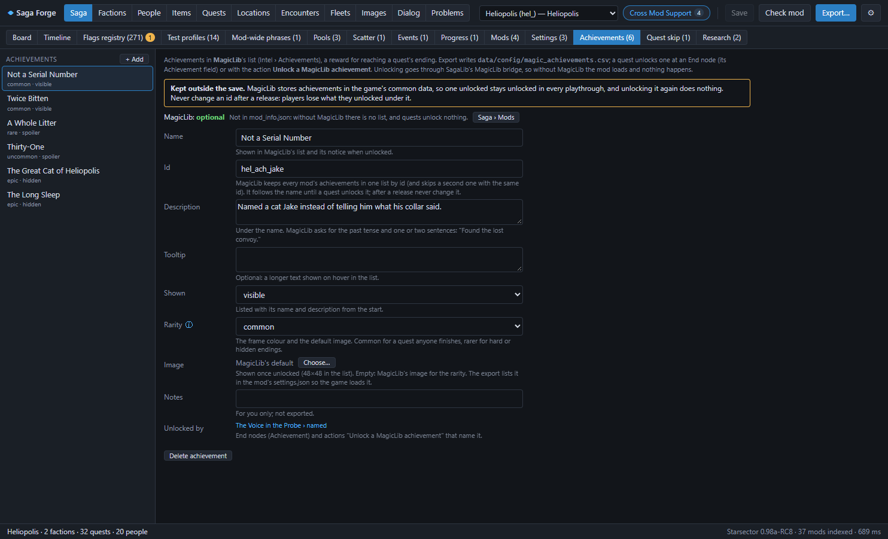

**Unlocked by** lists the quests that unlock it. A quest unlocks one at an **End node** (its
**Achievement** field) or anywhere with the action **Unlock a MagicLib achievement** (see
[Quests](quests.md)).

How it works in game: the export writes `data/config/magic_achievements.csv`, which MagicLib reads,
and lists the images in the mod's `data/config/settings.json` so the game loads them. When a quest
reaches the ending, SagaLib unlocks the achievement through MagicLib, and MagicLib's notice shows in
the dialog. Without MagicLib your mod loads and nothing happens. **Achievements are kept outside the
saves** (`saves/common`): one unlocked stays unlocked in every playthrough. Needs SagaLib 1.3.

### Quest skip

**Quest skip** puts your questlines on **Nexerelin**'s new-game **Skip story** screen ("Set
completed quests"), where a player who already played a story can start after it. The tab is there
once the mod lists Nexerelin in [Mods](#mods). On the left are your **quest chains** (**+ Add**): a
chain is one row on that screen, usually one questline, with a **Name**, an **Image** (Nexerelin
needs one; a mission icon fits), a **Sort key** (Nexerelin's own rows start with `AAAA_`, so a key
from B on puts yours after them) and a **Tooltip**.

Under the chain are its quests, one button each, in the order they are played. **+ Add a quest…**
also adds the quests it needs first. Click a button to set that quest:

| Field | What it is |
|---|---|
| **On the button** | a short name (Nexerelin's buttons fit about 18 characters); empty uses the quest's title |
| **Tooltip** | what the player is taken to have done ("The player met the cats and brought them their cores.") |
| **A skip means** | the ending the player is taken to have reached: one of the quest's End nodes, or a Stage node of a success or fail stage |
| **Rewards** | give the rewards on the way to that ending when the game starts (on by default) |

Below, the panel shows what that ending leaves in memory, worked out along the shortest path from
the Start node: the quest's state and last stage, the game's "completed" key, its variables and
every **Set** on the way. Untick a key to leave it out; **More keys** adds keys the path doesn't set
(`$global.` or `$player.`). **What a skip gives** lists the rewards; **People to show** puts people
in their market's comm directory; **What a skip doesn't do** lists what is left out (another quest
started, an encounter, an achievement, keys only the dialog has). Checking a button on Nexerelin's
screen also checks the quests of the chain it needs, and unchecking it unchecks the ones that need
it; Saga Forge works that out from the prerequisites.

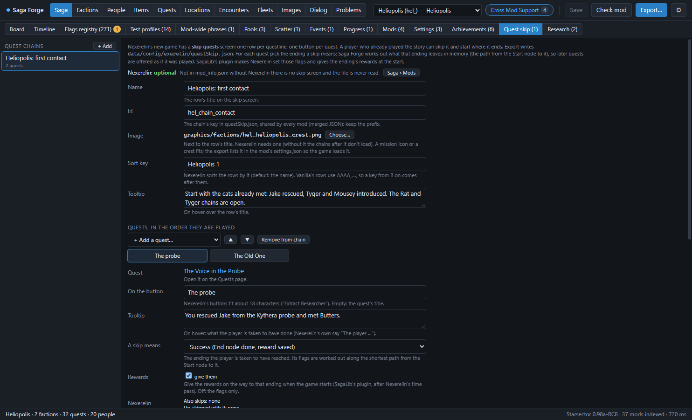

How it works in game: the export writes `data/config/exerelin/questSkip.json`, which only Nexerelin
reads. Each chain names SagaLib's plugin: Nexerelin sets a skip's keys only through one, and the
plugin also gives the rewards at the start. Later quests then see the skipped quest as finished,
the same as if it was played (their prerequisites hold, its offer is gone). Without Nexerelin the
file does nothing. Needs SagaLib 1.3.

### Research

**Research** is your mod's own techs for **AoTD Vaults of Knowledge** (VoK). VoK's research screen
shows them as a tree of their own, named after your mod. The tab is there once the mod lists Vaults
of Knowledge in [Mods](#mods) (optional is enough). The list on the left has your techs by tier
(**+ Add**); each one has:

| Field | What it is |
|---|---|
| **Name** and **Id** | the id starts with your prefix and follows the name until a quest names it. VoK keeps a save's research by id; never change it after a release |
| **Tier** and **Days** | VoK's tier (0 to 5, 5 is experimental) and the days to research it |
| **Place** and **Tree** | the column and row in that tier of your tree; click a free cell of the grid to move it there |
| **Icon** | an image of your mod (**Choose image…**), or the id of an icon there already, such as VoK's `basic` or `farming1`. VoK needs one |
| **Needs first** | techs researched before it: VoK's own, another mod's or your own |
| **Costs** | paid when research starts: research databanks (VoK's `research_databank`) or other items |
| **Unlocks** | industries, ships, weapons, hullmods, abilities, or a **modifier** (only a line of text; its effect would need Java) |
| **From the start** | already researched in a new game |
| **By a quest** | it can only be researched after a quest's **Unlock research**; the text is what VoK shows until then |

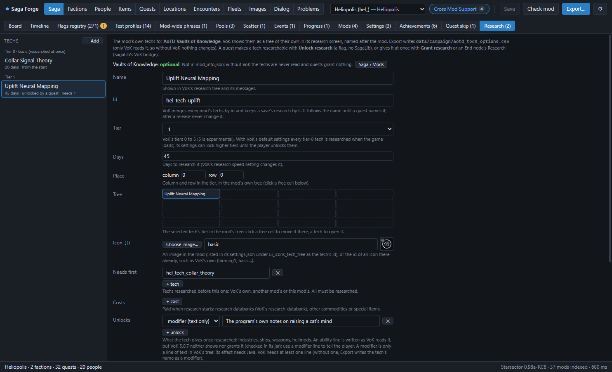

**Written by hand** lists rows of your `aotd_tech_options.csv` that Saga Forge didn't write. They
stay as they are; **Edit in Saga Forge** takes one over (the next export moves it into Saga Forge's
part of the file).

Quests use research with three steps (see [Quests](quests.md)): the action **Unlock research**
(for a tech "unlocked by a quest"), the action **Grant research** or an End node's **Research** (the
player's faction gets a tech as researched at once, VoK's own techs too), and the condition **Has
researched** (`SF_HasResearch <tech> [faction]`).

How it works in game: the export writes `data/campaign/aotd_tech_options.csv` and lists your icons
in the mod's `data/config/settings.json`; only VoK reads them. Unlocking is a flag VoK checks, so it
works without SagaLib. Granting and "has researched" go through SagaLib 1.4; without VoK, granting
does nothing and "has researched" is false, so your mod still plays. Your factions' attitude to
research is on their [Research tab](factions.md).

## How to set up the basics

### Arrange quests on the board

The board arranges itself: you don't place the cards. A quest joins a lane when something links it
to another quest of that lane, and moves right with each step it has to wait for.

1. Open **Saga › Board**. Find the quest; if it sits in the last lane, nothing links it yet.
2. Link it the way the story does: a prerequisite (see the next recipe), an Action that starts it
   (**Start another quest**, see [Quests › Start a quest from a dialog
   option](quests.md#start-a-quest-from-a-dialog-option)), or a flag its start needs that another
   quest sets.
3. Back on the board it is in that quest's lane, after it. Click it to check what it comes after,
   what it leads to, and the flags it shares.

### Make one quest wait for another

1. Open the later quest on the **Quests** tab (in Heliopolis: Cores for the Collar-Keepers) and
   click an empty spot of the chart, so its settings show on the right.
2. Under **Prerequisites**, pick **+ add…** and **"The Voice in the Probe" ended** (with
   **succeeded**, **failed** or just **ended**), or **a flag is set** and the memory key (here
   `$global.hel_met_cats`, which the probe quest sets when the player meets the cats).
3. Back on **Saga › Board** the two cards are joined (blue for a quest, gold for a flag) in one lane,
   and on **Timeline** the later quest moves one step down.

All prerequisites must be true before the quest is offered or starts. In game, Pop Chicken doesn't
offer the cores job until the player has met the cats.

### Find where a flag is used

1. Open **Saga › Flags registry**.
2. Type part of the key in **Filter keys…**, e.g. `pay`.
3. Read **Set by** and **Read by**; click an entry to open that quest with the node selected.
4. If the status says **read, never set**, the key is probably misspelt somewhere. When Saga Forge
   finds a similar key that is set, it offers **Use `<that key>`**: click it to rename the
   misspelt key everywhere in the mod.

### Add a test profile

1. Open **Saga › Test profiles** and press **+ New**.
2. Give it a **Name** that says what situation it is ("The Rat chain, off to Persea"). The id
   follows the name.
3. Under **Quests**, set each quest that matters: **active** with the stage it should be at,
   **succeeded** or **failed**. Quests you leave at **not started** are left alone.
4. Under **Flags**, add any memory keys the situation needs (pick or type the key, press
   **+ flag**, then type the value).
5. Under **Player**, fill in only what should change: credits, story points, a commission,
   reputation (from -1 to 1), cargo, and **Start at**, the id of a place (e.g. `hel_felicette`).
   Empty fields leave the game as it is.
6. Save.

To try the profile in the editor, pick it in Play mode (see [Quests › Test a quest in Play
mode](quests.md#test-a-quest-in-play-mode)). For the game, see the next recipe.

### Start the game with a test profile

1. Export the mod (see [Export and Release › Export the mod](export.md#export-the-mod)); the
   profiles go into `data/sagaforge/dev/test_profiles.json`.
2. Turn on the game's dev mode: set `"devMode": true` in `starsector-core/data/config/settings.json`
   of your Starsector install.
3. Enable your mod and SagaLib, and start the game.
4. **At a new game**, after the sector is made, SagaLib shows a list of your profiles (and
   "none"); pick one.
5. **In a running game**, press **Ctrl+F9** for SagaLib's dev menu: it can apply a profile, jump a
   quest to a step, and reload the mod's quests, people, phrases and profiles after you export
   again. Applying a profile changes the running save, so use a throwaway one.

The profile sets the quests, flags, credits, story points, commission, reputation and cargo, and
moves your fleet to **Start at** (from the dev menu this needs SagaLib 1.2).

### Add a phrase

1. Open **Saga › Mod-wide phrases** and press **+ Phrase**.
2. Name the token in the first field. It always starts with `$` and the mod's prefix
   (`$toc_he`); Saga Forge adds them if you leave them out.
3. Pick **random** for a different text each time, or **first case that matches** for texts that
   depend on the situation.
4. Type the texts. For **first case that matches**, give each case its **if** lines (one condition
   per line; the **+ add…** list under the box offers common ones), and fill in **otherwise**.
5. Type the token into any dialog text of the mod: `"Nobody knows where $toc_he went."`

In game, SagaLib swaps the token for one of its texts each time the line is shown. A phrase text
can itself contain tokens such as `$playerName`.

### Make a random pool

A pool for story picks, shared by several conversations: what a survey team finds on a planet,
which rumour a barkeeper tells.

1. Open **Saga › Pools** and press **+ New**. Give it a **Name** ("Who is in the pod"); until a branch
   uses the pool, its id follows the name.
2. Leave **Used for** at **Random branches (story picks)**.
3. Set **Nothing**: the weight of "nothing happens" (0 means an entry is always picked).
4. Press **+ Entry** for each possible result: a label, a **weight**, and if needed a limit (once
   per playthrough, once per place or person, a cooldown, at most N times) and conditions.
5. In a quest, add a Branch node, set **Picks** to **at random (by weight)** and choose the pool
   (see [Quests › Add a random branch](quests.md#add-a-random-branch)). Its cases become the pool's
   entries plus **otherwise** for nothing.

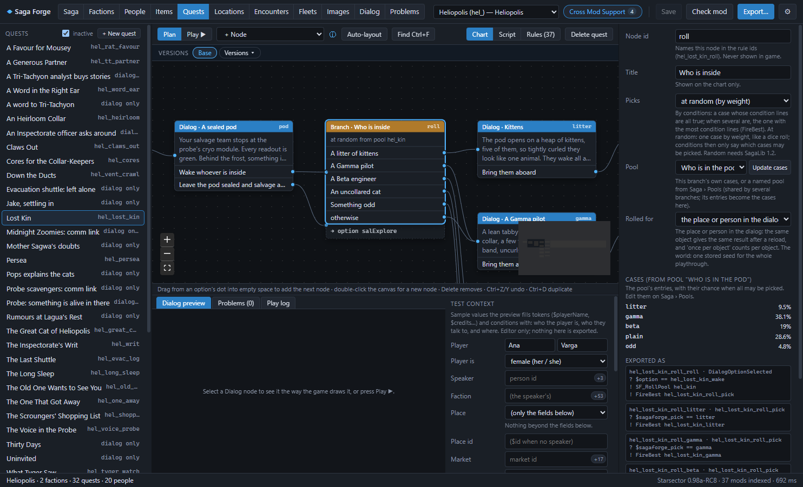

**Rolled for** on the branch decides whose luck it is: the place or person in the dialog (the same
rock gives the same results after a reload, and "once per place" counts per rock) or the world.
To test a pick in game, give a test profile the flag `$global.sagaforge_pool_<pool id>_force` with
an entry's id as the value (dev mode): the next roll of that pool picks it.

### Make a loot table

A drop group of the mod's own, for what salvagers find in a cache or wreck.

1. Open **Saga › Pools**, press **+ New** and name it ("Cryo-probe salvage loot").
2. Set **Used for** to **a loot table (drop group)**. Leave **Adds to** empty.
3. Press **+ Entry** for each thing it can drop, and pick or type its id: a commodity (`supplies`,
   `fuel`), a special item (`item_<id>`), a weapon (`wpn_<id>`) or a fighter wing (`ftr_<id>`).
   Give each a **weight**.
4. Set **Nothing**: the weight of a roll that drops nothing.
5. Let something roll it:
   - a cache or wreck in a system (see [Locations › Add a cache with loot and
     defenders](locations.md#add-a-cache-with-loot-and-defenders)),
   - the copies of a scatter (see [Scatter objects across the sector](#scatter-objects-across-the-sector)),
   - a quest reward (see [Quests › Give a reward](quests.md#give-a-reward)).

The export writes the table into the mod's `data/campaign/procgen/drop_groups.csv` (between
`# sagaforge:begin loot` and `# sagaforge:end loot` lines; rows you add outside them are kept). Its
group id is the pool's id. In game, when the player salvages, vanilla rolls the group as many
times as the place says.

### Add to a vanilla drop group

To make vanilla's own salvage drop your items too (an alpha core more often, your mod's special
item in the rare tech finds):

1. Make a loot table as in [Make a loot table](#make-a-loot-table), steps 1 to 3.
2. In **Adds to** (the field under **Used for**, empty in the loot table picture there), pick the
   existing group: vanilla's `rare_tech`, `blueprints`, `ai_cores2`… or another mod's.
3. The entries are added to that group; its own entries stay, and so do other mods' additions.

Then the pool is no longer a group of its own: places and rewards roll the group you add to, so
your entries turn up wherever vanilla rolls it.

If vanilla or another installed mod already adds the same item to that group, Problems warns:
the two rows don't add up, only one weight counts (which one depends on the load order). The same
goes for rows you wrote by hand in the mod's `drop_groups.csv`. Use another item, or a group of
your own.

### Add random encounters

Fleets that may lie in wait at vanilla's encounter points: in slipstreams in hyperspace, and just
outside star systems.

1. Make the fleets first, as encounters on the Encounters tab (see [Encounters](encounters.md)).
   Their own spawn settings don't matter here.
2. Open **Saga › Pools**, press **+ New**, name it ("Cats in the dark") and set **Used for** to
   **random encounters**.
3. Tick **Where**: **in slipstreams**, **outside star systems**, or both.
4. Set **Frequency**: how often your pool is chosen against vanilla's own encounter makers
   (pirates, scavengers…), which use about 10. 3 makes yours about a third as common as one of
   theirs.
5. Press **+ Entry** and pick an encounter for each entry, with a weight, and limits or
   conditions if needed.

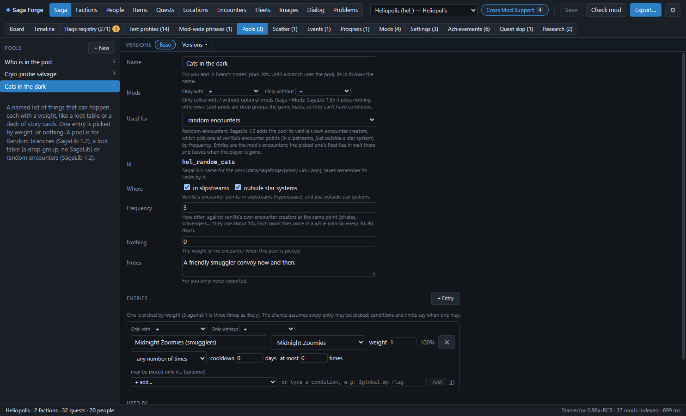

In game (SagaLib 1.2), when vanilla picks your pool at an encounter point, one entry's fleet waits
near it and leaves after the player is gone. Its comm dialog works as usual.

### Scatter objects across the sector

1. Open **Saga › Scatter** and press **+ New**. It starts as three "Hidden caches" on uncolonised,
   unexplored planets.
2. Set the **Name**, **How many** copies, the **Object** (a custom entity type: `supply_cache`,
   `weapons_cache`, `derelict_probe`, `station_research`… or one of the mod's own types) and
   **Its name** on the map.
3. Under **Where**, choose what to **Pick** (a planet, an entity, a star system or a market) and the
   criteria it **Must** meet (**+ add a criterion…**), and under **Prefer** those it should rather
   meet, tried in order. **+ Avoid dangerous systems** keeps it out of systems with dangerous fleets or active Remnants.
4. If a criterion measures distance ("within N light-years"), set **Measured from** to a place
   (e.g. `hel_felicette`); empty means from the player's fleet at the start.
5. Add **Loot** (**+ Loot**, a drop group and how many rolls; see [Make a loot
   table](#make-a-loot-table)) and **Defenders** (faction and strength) if you want them.
6. Tick **Existing saves** if games started before your mod should get them too.

In game (SagaLib 1.2), each copy orbits a different pick, in a different system. If fewer places
fit, fewer copies are placed.

### Add a world event

1. Open **Saga › Events** and press **+ New** next to **Event schedulers**. Give it a name (only
   for you) and set **Running** (at least / at most at the same time), **Check every** (days) and
   **First check** (days after the game starts, so a new game settles first).
2. Press **+ New** next to **Events**. Set its **Name**, **Weight**, **Runs for** (days), and if
   needed **How often** (once, a cooldown, at most N times) and **Conditions**.
3. Keep **post a news item** ticked and write its **Title** and **Text**. Choose the **Intel tab**
   it is listed under, a place **On the map**, and how many days it is **Shown for**.
4. Under **When it starts**, use **+ add…** for what happens: set a flag, give credits, **Spawn an
   encounter** (its fleet appears at its own place; see [Encounters](encounters.md)) …
5. Under **When it ends**, undo what needs undoing, e.g. **Despawn an encounter**.
6. To see it in game without waiting, give a test profile the flag shown in the scheduler's
   **Test** line (`$global.sagaforge_ev_<scheduler id>_force`) with the event's id as the value.
   Play mode can't run world events: they are tested in game.

In game (SagaLib 1.2), the news item shows in the intel screen under its tab and points at its
place on the map; its actions run in the background (with SagaLib 1.4 without a dialog, and what
they give shows as campaign messages).

### Add a progress event

1. Open **Saga › Progress** and press **+ New**. The **Name** is the bar's title in the intel
   screen.
2. Set the **Bar**: its maximum (vanilla's use 1000), and tick **bad for the player** for a red,
   crisis-style bar.
3. **Starts when**: conditions for the bar to appear, one per line; empty means as soon as a game
   has the mod.
4. **After the last**: tick **starts over at** and a value for a bar that repeats, or leave it
   unticked to end the event after its last stage.
5. Under **Monthly factors**, press **+ add** for each steady push: a text, points per month, and
   conditions (empty: always).
6. Press **+ New** next to **Stages** for each stage. Give it a **Title**, the value it is reached
   **At**, a **Text** (its tooltip), and what happens: actions under **When reached**, or tick
   **picks one outcome at random** and give each outcome a weight and its actions.
7. To push the bar from a story, add an **Add progress** action with points and a text to a quest
   (see [Quests › Change progress from a dialog](quests.md#change-progress-from-a-dialog)) or to a
   world event.

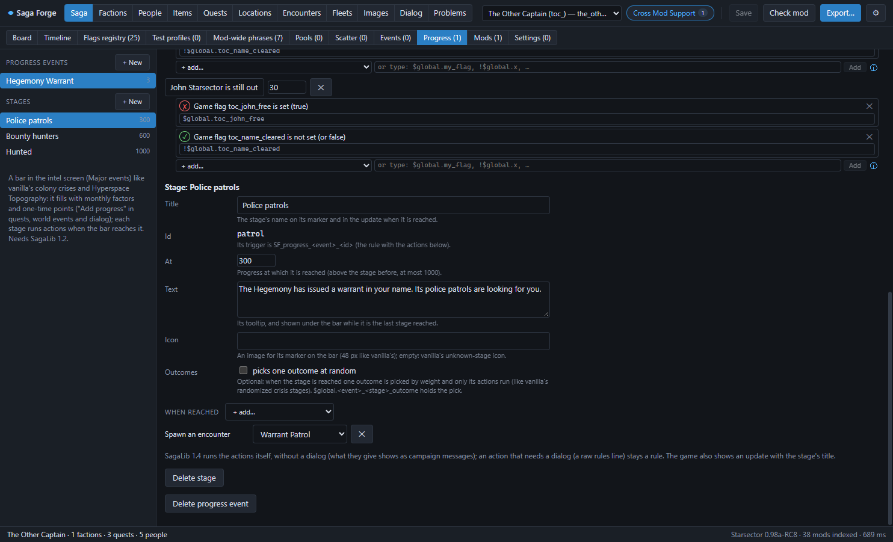
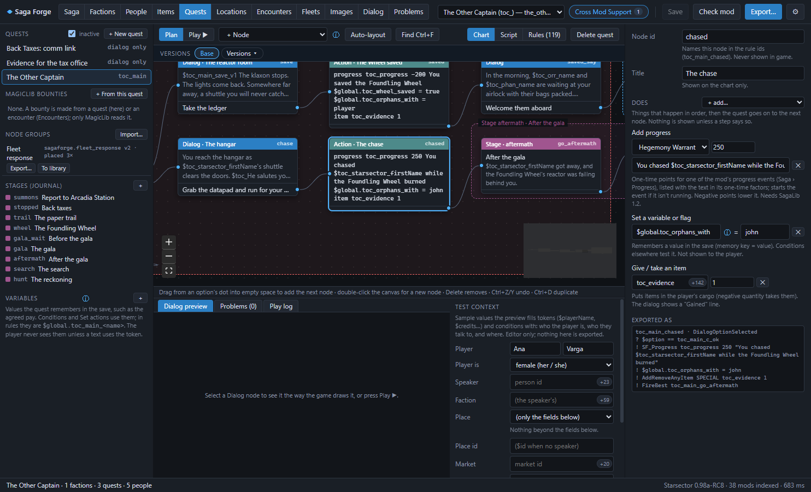

In game (SagaLib 1.2), the bar appears in the intel screen under Major events (and the extra
**Intel tab**, if you set one), with a marker per stage and the factors listed under it.

### Work with another mod

1. Click the **Cross Mod Support** pill in the header (or open **Saga › Mods**).
2. Find the mod (type in **Filter mods…**) and set its **Use**:
   - **Optional** when your mod should also run without it (most mods, and frameworks used only
     through their own files, such as a LunaLib settings page);
   - **Required** when your story can't do without it; set a **Min version** if you need one;
   - **Incompatible** when the two shouldn't run together; write the **Reason** players will see.
3. If no player runs it together with another mod, pick that one under **Never with**.
4. **Save**. Lists and pickers now also show that mod's factions, characters, places, ships and
   images, and the pill counts it.
5. When you export, tick **Add the required mods to mod_info.json dependencies** if it is listed.

If you pick something from a mod that isn't in the list (with a list's **Show all installed mods**
switch, or the **+N** button in a picker), Saga Forge asks right there: **Add as optional** or
**Add as required**. Removing a mod that your content uses, or marking it incompatible, asks
first and lists what uses it.

### Make content only with or without a mod

1. Make the mod **Optional** (see [Work with another mod](#work-with-another-mod)).
2. Open the item and find its **Mods** field: a quest's settings, a character's or an object's
   form, an encounter, an event; for a dialog option, its **⋯** settings; for a Branch case or a
   phrase case, the line above its conditions.
3. Pick the mod under **Only with** (or **Only without**). For a scene in two versions, give one
   option **Only with** and the other **Only without** the same mod.
4. Test both: in Play mode, the toolbar has a switch per optional mod (see
   [Quests › Test a quest in Play mode](quests.md#test-a-quest-in-play-mode)). Problems reports a
   node that would be left without options, or a Branch without a case, in any combination of the
   optional mods.

For a whole questline, set it once on the first quest: the quests that need it and what only they
use follow, greyed. A new faction that only matters with the mod can't be left out (the game
always loads it), so on its **Relations** tab set **Hidden from the intel tab** to
**Only without** that mod.

### Give a character a version for another mod

1. Make the other mod **Optional** (see [Work with another mod](#work-with-another-mod)). If it
   builds its sector in Java code, import a sector snapshot first (see "Other mods' content" above),
   so its markets can be picked.
2. Open the character on the **People** tab. In the **Versions** strip, open **Mod versions ▾** and
   pick that mod.
3. Change what differs with it, for example **Market** (pick the other mod's market). Only that
   field is stored for the version; the cell lists it, with **Revert**.
4. With two optional mods, pick the combination in the menu to check what it inherits, and change what only
   that combination needs (for example a node's text in the conversation's own strip on the
   **Quests** tab). If it says two versions disagree, pick one value there.
5. In Play mode, switch the optional mods in the toolbar to see each version.

In game, the character's version is picked once, when a game starts, from the mods installed then.

### Give a character a version for a female player

1. Open the character on the **People** tab (in The Other Captain: John Starsector).
2. In the **Versions** strip, open **Versions ▾** and pick **Player = female**.
3. Change what differs: **First name** (Jane), **Gender** and **Portrait**. Each field is stored for
   that version only; the button **Player = female** now shows how many fields it sets.
4. Write the person's name in dialog with their name tokens (`$toc_starsector_name`) and use
   phrases for "he" and "she" (see [Add a phrase](#add-a-phrase)), so one text fits both.
5. In Play mode, set the Test context's **Player is** to female and play the quest.

In game, SagaLib records the player's gender when the game starts; the version never changes after.

### Add a settings page

1. Open **Saga › Settings** and pick **+ Add… › Header (layout)**. Type the heading, for example
   your mod's name.
2. Add the options: **+ Add… › On/off**, **Choice** or **Whole number**. Give each a **Label**, a
   **Description** and a **Default**; for a choice, type the **Choices** ("Easy, Normal, Hard").
3. Optional: **Choose…** an icon for LunaLib's menu.
4. Use the settings (the next two recipes), then export.

In game with LunaLib, the page is in LunaLib's settings menu under your mod's name. Without
LunaLib your mod loads as usual and the defaults apply.

### Switch a questline on or off

1. Add an **On/off** setting, for example "Enable the pirate questline", default on (see
   [Add a settings page](#add-a-settings-page)).
2. Open the first quest of the line on the **Quests** tab. Under **Prerequisites**, pick
   **+ add… › "Enable the pirate questline" is on**.
3. The quests that need this one won't start either while it's off. For a single option in a
   conversation, put the line from the condition picker (**Setting … is on**) in the option's
   conditions instead.
4. Test it: in Play mode, untick the setting in the toolbar and press **Restart**.

In game, turning it off in LunaLib's menu takes the quest's offer away at once; a quest already
running goes on.

### Add an achievement for a quest ending

1. List MagicLib in **Saga › Mods** as optional (or **Add as optional** in Problems).
2. Open **Saga › Achievements**, click **+ Add**, and give it a **Name** and a **Description** in the
   past tense. Pick **Shown** and **Rarity**; optional: **Choose…** an image.
3. Open the quest on the **Quests** tab, select its success **End node**, and pick the achievement
   in **Achievement**. (Elsewhere in a quest: an Action with **Unlock a MagicLib achievement**.)
4. Test it in Play mode: reaching the end shows "(MagicLib) Achievement unlocked: …".

### Let players skip your quests (Nexerelin)

1. List Nexerelin in **Saga › Mods** as optional.
2. Open **Saga › Quest skip**, click **+ Add**, and name the chain after the questline. Check its
   **Image**.
3. **+ Add a quest…**: pick the last quest of the line; the quests it needs are added before it.
4. For each quest, give it a short name **On the button** and a **Tooltip**, and pick the ending
   **A skip means** (usually the success). Read **What a skip sets**: if a later quest reads a key
   the path doesn't set, add it under **More keys**.
5. Export. In game with Nexerelin: New game › **Skip story** shows your row.

### Scale fleets and rewards with a difficulty setting

1. Add a **Choice** setting "Difficulty" with the choices Easy, Normal, Hard and the default
   Normal (or a **Whole number** setting in percent, default 100).
2. On the **Encounters** tab, open an encounter whose fleet comes from the faction's doctrine
   (fleet points). In **Size scaled by**, pick Difficulty and set a factor per choice, for example
   Easy 0.5, Normal 1, Hard 2.
3. In the quest's **Rewards**, pick the setting the same way in a reward's **Scaled by**.
4. Test it: in Play mode, change the setting in the toolbar; the log shows the fleet points and
   the credits after the scale.

A text that names the amount ("I'll pay 10,000 credits") isn't changed; say "good pay" instead,
or use a Branch on the setting.

