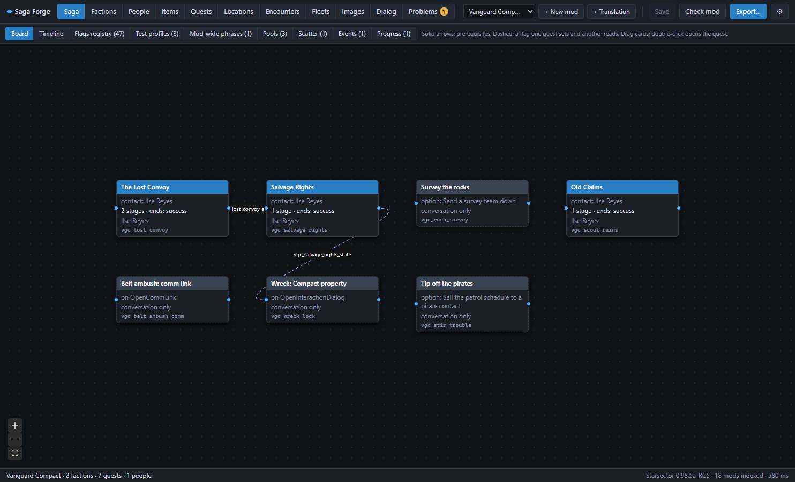
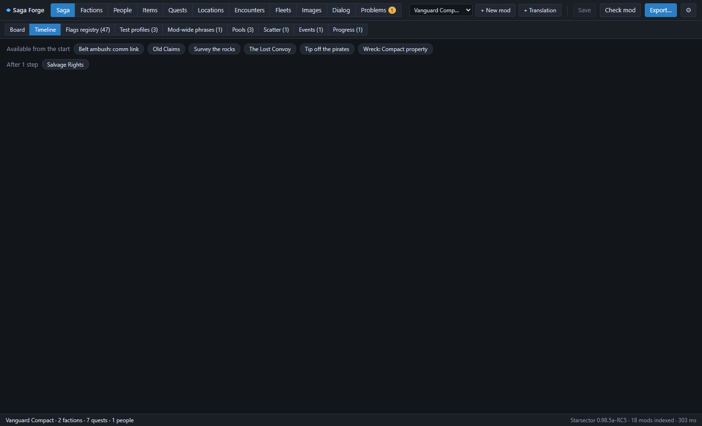
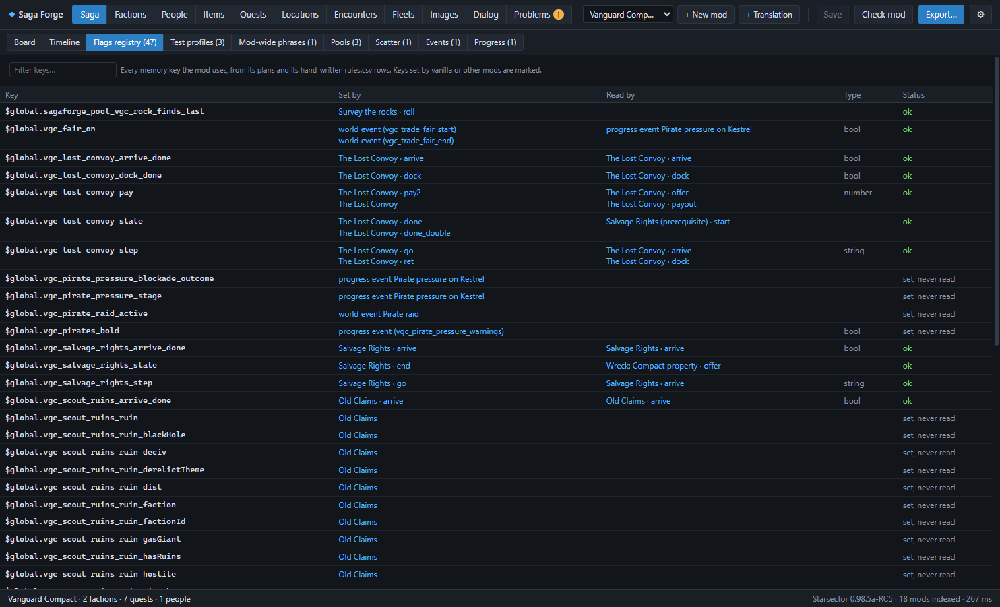
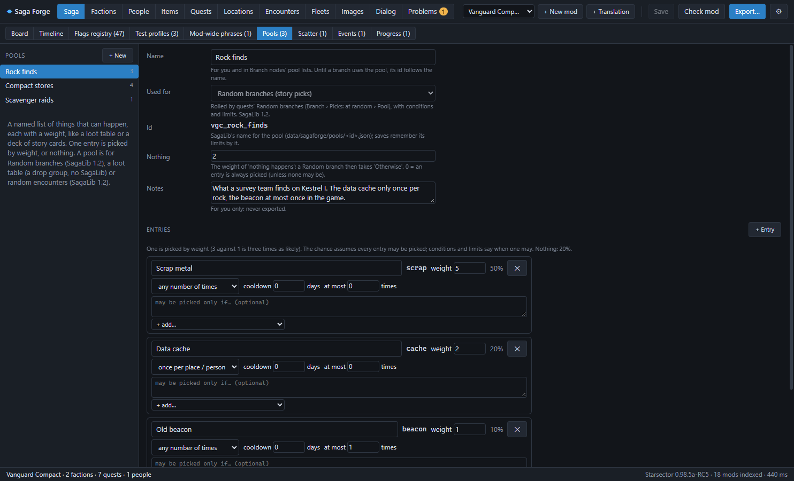
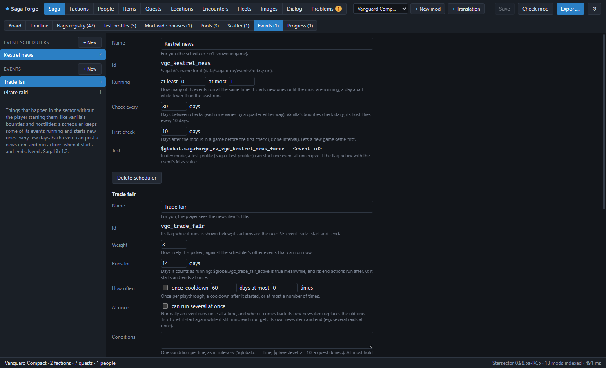
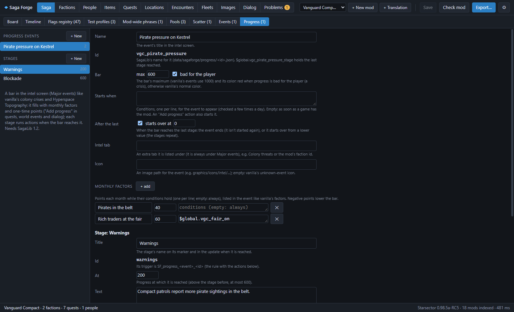
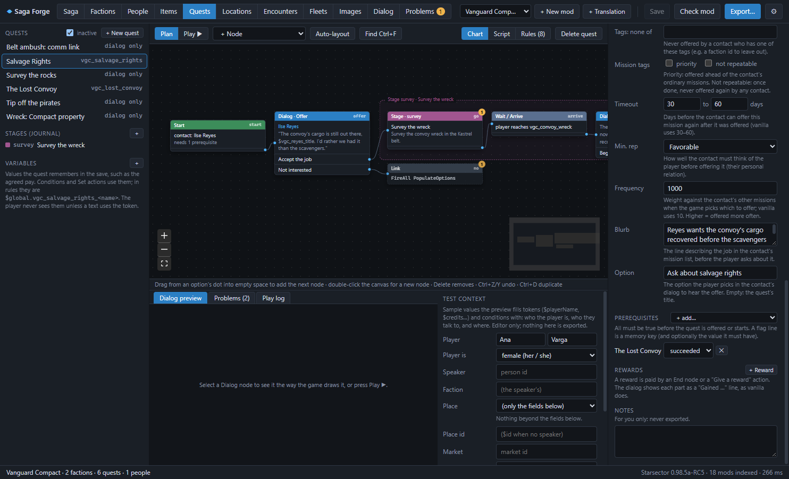
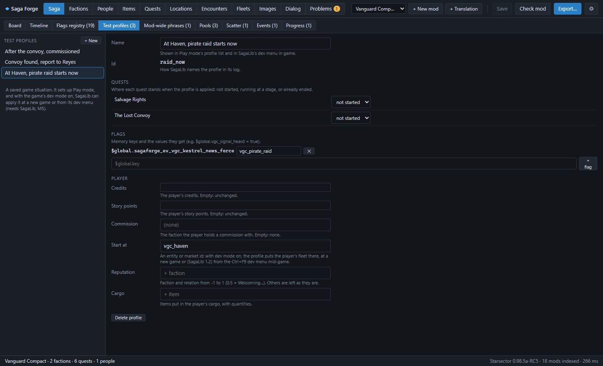
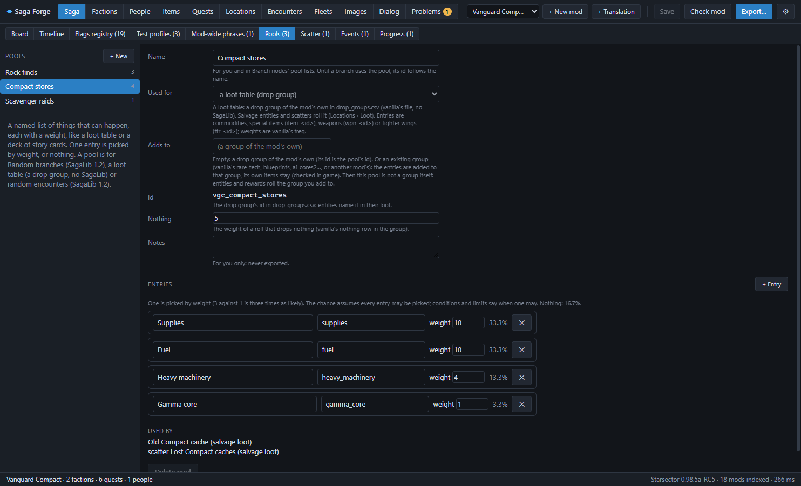
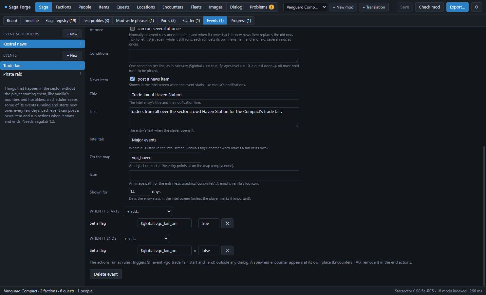

# Saga

The Saga tab looks at the mod as a whole: how its quests hang together, which flags they share,
saved test situations, and the things that belong to no single quest (mod-wide phrases, random
pools, objects scattered over the sector, world events and progress bars).

## How it works

The Saga tab has nine sub-tabs in the bar under the header: **Board**, **Timeline**, **Flags
registry**, **Test profiles**, **Mod-wide phrases**, **Pools**, **Scatter**, **Events** and
**Progress**. The number after a name is how many the mod has (Flags registry also shows an orange
count when some flags look wrong).

Board, Timeline and Flags registry only show what the mod already has: they write nothing into the
mod except where you placed the cards on the board (kept in `sagaforge/project.json`). The other
sub-tabs are plans of their own, saved in the mod's `sagaforge` folder (`test-profiles.json`,
`phrases.json`, `pools.json`, `scatter.json`, `events.json`, `progress.json`) and turned into game
files when you export (see [Export and Release › Export the mod](export.md#export-the-mod)).
In game, everything here except loot tables is run by the SagaLib mod; pools, scatter, events and
progress need SagaLib 1.2 or newer.

### Board

Every quest and conversation of the mod as a card: its title, how it starts ("contact: Ilse
Reyes", "option: Send a survey team down", "on OpenInteractionDialog"), its stages and how it ends,
the people who speak in it, and its id. A red number in the title is the count of errors in it; a
conversation (no journal) has a dashed border, and an inactive quest is faded.

- **Solid blue arrows** are prerequisites: Salvage Rights can only start after The Lost Convoy
  succeeded.
- **Dashed purple arrows** are flags: one quest sets a memory key that another one reads (here
  Salvage Rights sets `vgc_salvage_rights_state`, and the wreck's conversation checks it).
- Drag the cards to arrange them; **double-click** a card to open the quest on the Quests tab. The
  buttons at the bottom left zoom and fit everything into view.

You can't draw arrows on the board: prerequisites are set in the quest itself (see [Make one quest
wait for another](#make-one-quest-wait-for-another)), flags by the nodes that set and read them.

### Timeline

The quests in the order a player can reach them: first those **available from the start**, then
those that open **after 1 step** (one prerequisite done), after 2 steps, and so on. Click a quest
to open it. If prerequisites go round in a circle (A needs B, B needs A), the quests in it are
listed in red: they can never start.

### Flags

**Flags registry** lists every memory key the mod uses: the ones its quests, nodes, events and
progress bars set and read, plus keys in rows you wrote into `rules.csv` by hand. Keys that vanilla
or another mod sets are marked with where they come from, and keys Saga Forge makes up itself (an
option that is shown once, for example) carry a **generated** badge.

| Column | What it shows |
|---|---|
| Key | The memory key, e.g. `$global.vgc_lost_convoy_pay` |
| Set by / Read by | Where it is set and where it is checked: quest and node. Click one to open that node |
| Type | What kind of value it holds: bool, number or string |
| Status | **ok**; **set, never read** (grey, often fine: a stage a later quest might use); **read, never set** (orange: usually a typo); **mixed types** (orange: set to a number in one place and text in another) |

Type in **Filter keys…** to find one. Nothing here is written into the mod.

### Test profiles

A test profile is a saved game situation: where each quest stands (not started, active at a stage,
succeeded or failed), flags with their values, and the player's credits, story points, commission,
reputation, cargo and the place their fleet starts at.

Profiles are used in two places:

- In Saga Forge's **Play mode**, to try a quest from the middle (see [Quests › Test a quest in Play
  mode](quests.md#test-a-quest-in-play-mode)).
- In the game, with **dev mode** on: SagaLib offers them at a new game and in its dev menu
  (**Ctrl+F9**), and applies the one you pick to the running game. See [Start the game with a test
  profile](#start-the-game-with-a-test-profile).

The export writes them to `data/sagaforge/dev/test_profiles.json`. SagaLib only reads that file in
dev mode, and release zips leave it out, so players never see your profiles.

### Phrases

A phrase is a token like `$vgc_farewell` that you type into any text of the mod. In game, SagaLib
fills in a text for it each time:

- **first case that matches**: each case has "if" lines (conditions as in `rules.csv`); the first
  case whose lines are all true gives the text, else the **otherwise** text.
- **random**: one of the texts at random (the cases and the **or** line).

**Mod-wide phrases** are the ones any text of the mod can use. A character's own phrases (how
Reyes addresses you, say) are on the People tab (see [People › Give a character
phrases](people.md#give-a-character-phrases)), and one-off variations go inside a Dialog node. The
export writes the mod-wide phrases into `data/sagaforge/people/<mod id>_people.json`.

### Pools

A pool is a named list of things that can happen, each with a **weight**, like a loot table or a
deck of story cards: one entry is picked by weight (5 against 1 is five times as likely), or
nothing. The percentage next to each entry is its chance when every entry may be picked. **Used
for** says what kind of pool it is:

| Used for | What it does | Written to |
|---|---|---|
| **Random branches (story picks)** | A quest's Random branch rolls it, so several conversations can share one list with the same limits | `data/sagaforge/pools/<id>.json` (SagaLib 1.2) |
| **a loot table (drop group)** | A drop group, as vanilla's salvage uses: caches, wrecks, scatter and quest rewards roll it | rows in `data/campaign/procgen/drop_groups.csv` (vanilla's file, no SagaLib) |
| **random encounters** | Fleets that may lie in wait at vanilla's encounter points in hyperspace | `data/sagaforge/pools/<id>.json` (SagaLib 1.2) |

Story picks have **limits** per entry: once per playthrough, once per place or person, a cooldown
in days, or at most a number of times, and optional conditions ("may be picked only if…"). At the
bottom, **Used by** lists the branches, places and scatters that roll the pool; a pool that is in
use can't change its kind or be deleted.

The example has one of each: **Rock finds** (story picks for the survey on Kestrel I), **Compact
stores** (the loot of the old cache and the scattered caches) and **Scavenger raids** (random
encounters).

### Scatter

Copies of one object (a supply cache, a probe, a research station…) that SagaLib places at the
start of a new game, each in a different star system, the way vanilla scatters its derelicts and
caches. Saga Forge doesn't pick the places: you describe them (**Where**: a planet that is
uncolonised and within 12 light-years of Haven Station, say), and in game vanilla's own mission
search picks them. Each copy can have salvage loot and a fleet guarding it.

It happens once per game (with **Existing saves** ticked, also once in a game started before the
mod was added, on its next load). The export writes `data/sagaforge/scatter/<id>.json`; in game the
objects are named `<id>_1`, `<id>_2` …, and `$global.sagaforge_scatter_<id>_done` holds how many
were placed.

### Events

World events are things that happen in the sector without the player starting them, like
vanilla's bounties and hostilities. An **event scheduler** keeps between a least and a most of its
events running, and every few days picks a new one by weight (with conditions, once, cooldown and
"at most" limits as in a pool). Each event:

- runs for some days, and `$global.<event id>_active` is true meanwhile (use it in conditions and
  dialog);
- can post a **news item** in the intel screen (title, text, the intel tab, a place on the map);
- runs actions when it starts and when it ends (set a flag, give credits, spawn or remove an
  encounter's fleet, start a quest, add progress…).

The schedulers themselves are never shown in game. The export writes
`data/sagaforge/events/<id>.json` and the actions as rules in `data/campaign/rules.csv` (on the
triggers `SF_event_<event id>_start` and `_end`). In the example, **Kestrel news** runs a trade
fair or a pirate raid about once a month.

### Progress

A progress event is a bar in the intel screen (under Major events), like vanilla's colony crises
and Hyperspace Topography. It fills up from:

- **monthly factors**: points every month while their conditions hold (negative points lower it);
- **one-time points**: an "Add progress" action in a quest, a dialog or a world event (listed in
  the event with its text).

Each **stage** sits at a value on the bar. When the bar reaches it, the game shows an update with
the stage's title and its actions run, or, with **Outcomes**, one outcome is picked by weight and
only its actions run. After the last stage the event ends, or starts over from a lower value. A
event can have up to 20 stages.

The export writes `data/sagaforge/progress/<id>.json` and the stage actions as rules in
`data/campaign/rules.csv`; `$global.<event id>_stage` holds the last stage reached. In the
example, **Pirate pressure on Kestrel** grows every month (faster during the trade fair) and ends
in a blockade.

## How to set up the basics

### Arrange quests on the board

1. Open **Saga › Board**.
2. Drag each card where you want it, for example a quest line from left to right, with side
   conversations below.
3. Press **Save** (or Ctrl+S). The places are kept in the mod's `sagaforge/project.json` and are
   for you only.

New quests that you haven't placed yet line up in rows of four. Use the fit button at the bottom
left to see them all again.

### Make one quest wait for another

1. Open the later quest on the **Quests** tab (for example Salvage Rights) and click an empty spot
   of the chart, so its settings show on the right.
2. Under **Prerequisites**, pick **+ add… › "The Lost Convoy" ended**.
3. Choose whether it must have **succeeded**, **failed** or just **ended**. Or pick **a flag is
   set** instead and type the memory key (and, if you like, the value it must have).
4. Back on **Saga › Board** a solid arrow now joins the two cards, and on **Timeline** the later
   quest moves one step down.

All prerequisites must be true before the quest is offered or starts. In game, Reyes doesn't offer
Salvage Rights until The Lost Convoy is done.

### Find where a flag is used

1. Open **Saga › Flags registry**.
2. Type part of the key in **Filter keys…**, e.g. `pay`.
3. Read **Set by** and **Read by**; click an entry to open that quest with the node selected.
4. If the status says **read, never set**, the key is probably misspelt somewhere. When Saga Forge
   finds a similar key that is set, it offers **Use `<that key>`**: click it to rename the
   misspelt key everywhere in the mod.

### Add a test profile

1. Open **Saga › Test profiles** and press **+ New**.
2. Give it a **Name** that says what situation it is ("Convoy found, report to Reyes"). The id
   follows the name.
3. Under **Quests**, set each quest that matters: **active** with the stage it should be at,
   **succeeded** or **failed**. Quests you leave at **not started** are left alone.
4. Under **Flags**, add any memory keys the situation needs (pick or type the key, press
   **+ flag**, then type the value).
5. Under **Player**, fill in only what should change: credits, story points, a commission,
   reputation (from -1 to 1), cargo, and **Start at**, the id of a place (e.g. `vgc_haven`).
   Empty fields leave the game as it is.
6. Save.

To try the profile in the editor, pick it in Play mode (see [Quests › Test a quest in Play
mode](quests.md#test-a-quest-in-play-mode)). For the game, see the next recipe.

### Start the game with a test profile

1. Export the mod (see [Export and Release › Export the mod](export.md#export-the-mod)); the
   profiles go into `data/sagaforge/dev/test_profiles.json`.
2. Turn on the game's dev mode: set `"devMode": true` in `starsector-core/data/config/settings.json`
   of your Starsector install.
3. Enable your mod and SagaLib, and start the game.
4. **At a new game**, after the sector is made, SagaLib shows a list of your profiles (and
   "none"); pick one.
5. **In a running game**, press **Ctrl+F9** for SagaLib's dev menu: it can apply a profile, jump a
   quest to a step, and reload the mod's quests, people, phrases and profiles after you export
   again. Applying a profile changes the running save, so use a throwaway one.

The profile sets the quests, flags, credits, story points, commission, reputation and cargo, and
moves your fleet to **Start at** (from the dev menu this needs SagaLib 1.2).

### Add a phrase

1. Open **Saga › Mod-wide phrases** and press **+ Phrase**.
2. Name the token in the first field. It always starts with `$` and the mod's prefix
   (`$vgc_farewell`); Saga Forge adds them if you leave them out.
3. Pick **random** for a different text each time, or **first case that matches** for texts that
   depend on the situation.
4. Type the texts. For **first case that matches**, give each case its **if** lines (one condition
   per line; the **+ add…** list under the box offers common ones), and fill in **otherwise**.
5. Type the token into any dialog text of the mod: `"Thanks for the help. $vgc_farewell"`.

In game, SagaLib swaps the token for one of its texts each time the line is shown. A phrase text
can itself contain tokens such as `$playerName`.

### Make a random pool

A pool for story picks, shared by several conversations: what a survey team finds on a planet,
which rumour a barkeeper tells.

1. Open **Saga › Pools** and press **+ New**. Give it a **Name** ("Rock finds"); until a branch
   uses the pool, its id follows the name.
2. Leave **Used for** at **Random branches (story picks)**.
3. Set **Nothing**: the weight of "nothing happens" (0 means an entry is always picked).
4. Press **+ Entry** for each possible result: a label, a **weight**, and if needed a limit (once
   per playthrough, once per place or person, a cooldown, at most N times) and conditions.
5. In a quest, add a Branch node, set **Picks** to **at random (by weight)** and choose the pool
   (see [Quests › Add a random branch](quests.md#add-a-random-branch)). Its cases become the pool's
   entries plus **otherwise** for nothing.

**Rolled for** on the branch decides whose luck it is: the place or person in the dialog (the same
rock gives the same results after a reload, and "once per place" counts per rock) or the world.
To test a pick in game, give a test profile the flag `$global.sagaforge_pool_<pool id>_force` with
an entry's id as the value (dev mode): the next roll of that pool picks it.

### Make a loot table

A drop group of the mod's own, for what salvagers find in a cache or wreck.

1. Open **Saga › Pools**, press **+ New** and name it ("Compact stores").
2. Set **Used for** to **a loot table (drop group)**. Leave **Adds to** empty.
3. Press **+ Entry** for each thing it can drop, and pick or type its id: a commodity (`supplies`,
   `fuel`), a special item (`item_<id>`), a weapon (`wpn_<id>`) or a fighter wing (`ftr_<id>`).
   Give each a **weight**.
4. Set **Nothing**: the weight of a roll that drops nothing.
5. Let something roll it:
   - a cache or wreck in a system (see [Locations › Add a cache with loot and
     defenders](locations.md#add-a-cache-with-loot-and-defenders)),
   - the copies of a scatter (see [Scatter objects across the sector](#scatter-objects-across-the-sector)),
   - a quest reward (see [Quests › Give a reward](quests.md#give-a-reward)).

The export writes the table into the mod's `data/campaign/procgen/drop_groups.csv` (between
`# sagaforge:begin loot` and `# sagaforge:end loot` lines; rows you add outside them are kept). Its
group id is the pool's id. In game, when the player salvages, vanilla rolls the group as many
times as the place says.

### Add to a vanilla drop group

To make vanilla's own salvage drop your items too (an alpha core more often, your mod's special
item in the rare tech finds):

1. Make a loot table as in [Make a loot table](#make-a-loot-table), steps 1 to 3.
2. In **Adds to** (the field under **Used for**, empty in the loot table picture there), pick the
   existing group: vanilla's `rare_tech`, `blueprints`, `ai_cores2`… or another mod's.
3. The entries are added to that group; its own entries stay, and so do other mods' additions.

Then the pool is no longer a group of its own: places and rewards roll the group you add to, so
your entries turn up wherever vanilla rolls it.

### Add random encounters

Fleets that may lie in wait at vanilla's encounter points: in slipstreams in hyperspace, and just
outside star systems.

1. Make the fleets first, as encounters on the Encounters tab (see [Encounters](encounters.md)).
   Their own spawn settings don't matter here.
2. Open **Saga › Pools**, press **+ New**, name it ("Scavenger raids") and set **Used for** to
   **random encounters**.
3. Tick **Where**: **in slipstreams**, **outside star systems**, or both.
4. Set **Frequency**: how often your pool is chosen against vanilla's own encounter makers
   (pirates, scavengers…), which use about 10. 5 makes yours about half as common as one of
   theirs.
5. Press **+ Entry** and pick an encounter for each entry, with a weight, and limits or
   conditions if needed.

In game (SagaLib 1.2), when vanilla picks your pool at an encounter point, one entry's fleet waits
near it and leaves after the player is gone. Its comm dialog works as usual.

### Scatter objects across the sector

1. Open **Saga › Scatter** and press **+ New**. It starts as three "Hidden caches" on uncolonised,
   unexplored planets.
2. Set the **Name**, **How many** copies, the **Object** (a custom entity type: `supply_cache`,
   `weapons_cache`, `derelict_probe`, `station_research`… or one of the mod's own types) and
   **Its name** on the map.
3. Under **Where**, choose what to **Pick** (a planet, an entity, a star system or a market) and the
   criteria it **Must** meet (**+ add a criterion…**), and under **Prefer** those it should rather
   meet, tried in order. **+ Avoid dangerous systems** keeps it out of systems with dangerous fleets or active Remnants.
4. If a criterion measures distance ("within N light-years"), set **Measured from** to a place
   (e.g. `vgc_haven`); empty means from the player's fleet at the start.
5. Add **Loot** (**+ Loot**, a drop group and how many rolls; see [Make a loot
   table](#make-a-loot-table)) and **Defenders** (faction and strength) if you want them.
6. Tick **Existing saves** if games started before your mod should get them too.

In game (SagaLib 1.2), each copy orbits a different pick, in a different system. If fewer places
fit, fewer copies are placed.

### Add a world event

1. Open **Saga › Events** and press **+ New** next to **Event schedulers**. Give it a name (only
   for you) and set **Running** (at least / at most at the same time), **Check every** (days) and
   **First check** (days after the game starts, so a new game settles first).
2. Press **+ New** next to **Events**. Set its **Name**, **Weight**, **Runs for** (days), and if
   needed **How often** (once, a cooldown, at most N times) and **Conditions**.
3. Keep **post a news item** ticked and write its **Title** and **Text**. Choose the **Intel tab**
   it is listed under, a place **On the map**, and how many days it is **Shown for**.
4. Under **When it starts**, use **+ add…** for what happens: set a flag, give credits, **Spawn an
   encounter** (its fleet appears at its own place; see [Encounters](encounters.md)) …
5. Under **When it ends**, undo what needs undoing, e.g. **Despawn an encounter**.
6. To see it in game without waiting, give a test profile the flag shown in the scheduler's
   **Test** line (`$global.sagaforge_ev_<scheduler id>_force`) with the event's id as the value.
   The example's profile "At Haven, pirate raid starts now" does that (see the picture in [Add a
   test profile](#add-a-test-profile)).

In game (SagaLib 1.2), the news item shows in the intel screen under its tab and points at its
place on the map; its actions run quietly in the background.

### Add a progress event

1. Open **Saga › Progress** and press **+ New**. The **Name** is the bar's title in the intel
   screen.
2. Set the **Bar**: its maximum (vanilla's use 1000), and tick **bad for the player** for a red,
   crisis-style bar.
3. **Starts when**: conditions for the bar to appear, one per line; empty means as soon as a game
   has the mod.
4. **After the last**: tick **starts over at** and a value for a bar that repeats, or leave it
   unticked to end the event after its last stage.
5. Under **Monthly factors**, press **+ add** for each steady push: a text, points per month, and
   conditions (empty: always).
6. Press **+ New** next to **Stages** for each stage. Give it a **Title**, the value it is reached
   **At**, a **Text** (its tooltip), and what happens: actions under **When reached**, or tick
   **picks one outcome at random** and give each outcome a weight and its actions.
7. To push the bar from a story, add an **Add progress** action with points and a text to a quest
   (see [Quests › Change progress from a dialog](quests.md#change-progress-from-a-dialog)) or to a
   world event.

In game (SagaLib 1.2), the bar appears in the intel screen under Major events (and the extra
**Intel tab**, if you set one), with a marker per stage and the factors listed under it.
