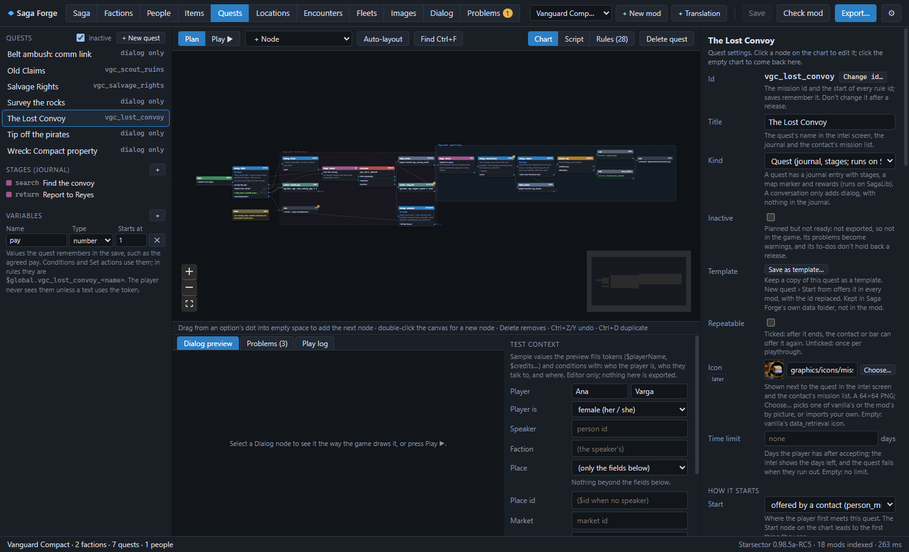
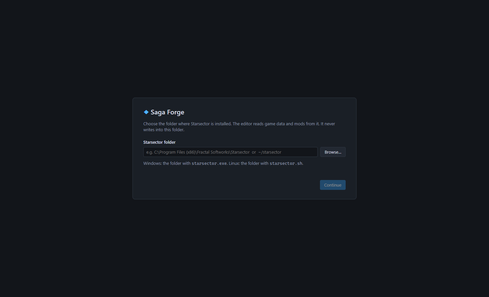
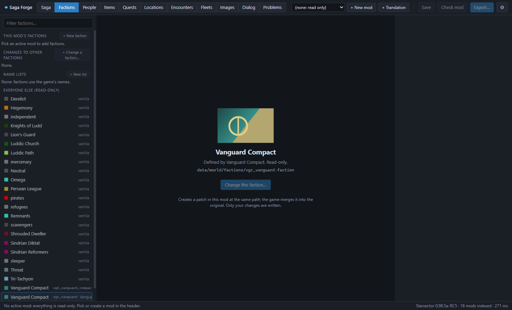
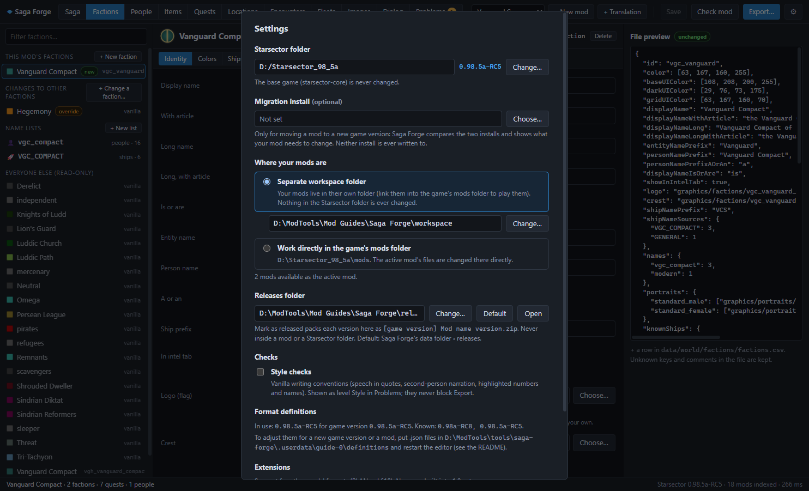
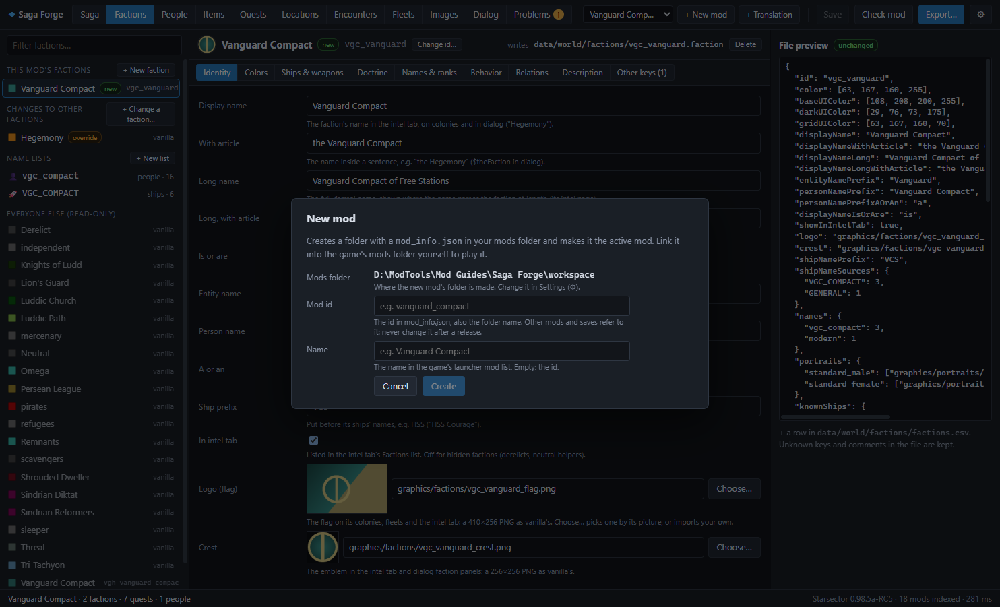
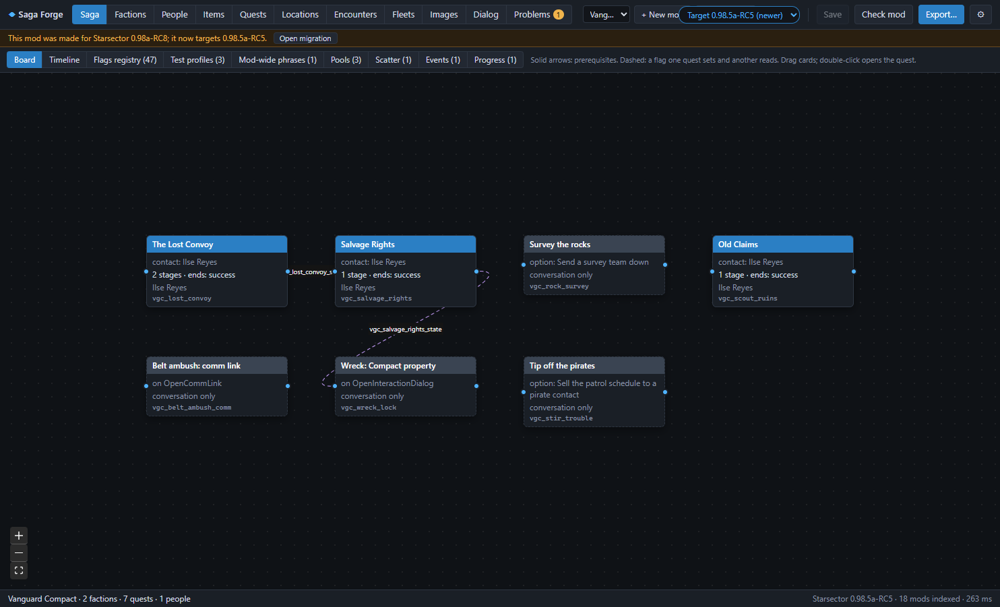
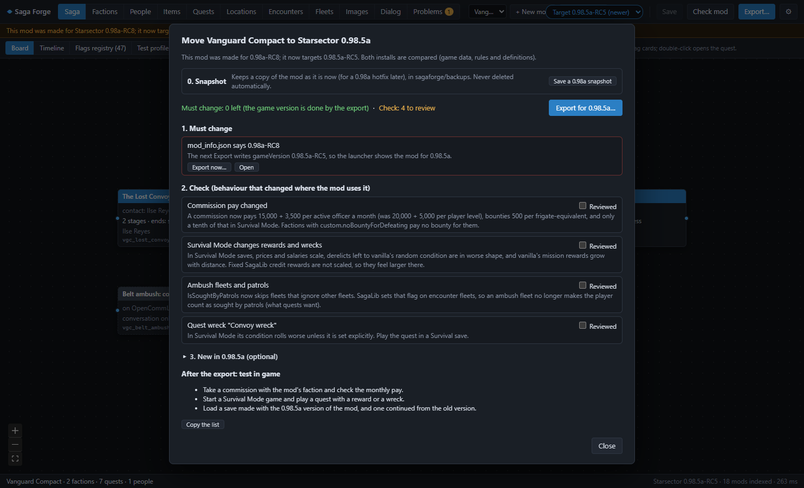

# Getting started and Settings

How Saga Forge finds the game and your mods, which mod you are editing, and how your work is saved.
Everything here is about the app itself; the tabs that build the mod have their own sections.

## How it works

Saga Forge reads the base game and every installed mod (enabled or not) to know what exists:
factions, ships, items, planets, dialog rules. It only ever **writes into one mod, the active
mod**. It never writes into the Starsector folder, into other mods or into `enabled_mods.json`,
never writes code, and never overwrites a file that was changed on disk since it was read.

### The window



- **The header**, left to right: the tabs (Saga, Factions, People, Items, Quests, Locations,
  Encounters, Fleets, Images, Dialog, Problems; Problems shows a count when something needs
  attention), the **active mod** list, **+ New mod**, **+ Translation**, then **Save**, **Check
  mod**, **Export…** and **⚙** (Settings).
- **The page** of the tab you picked. Most tabs have a list on the left, the editor in the middle
  and details or a preview on the right. The dividers between them can be dragged.
- **The footer**: the active mod's name and a count of its factions, quests and people on the
  left; on the right the game version Saga Forge read and how many mods it indexed.

Every form field has a label and a short help line under it: what the field is and where it shows
in game. Where a label has an **ⓘ** next to it, it opens Saga Forge's reference page about that
field's choices in a separate window.

### First start

On the first start Saga Forge asks for the **Starsector folder**: on Windows the folder with
`starsector.exe`, on Linux the one with `starsector.sh`. It reads the game data and the installed
mods from there and never writes into it.



After that it reads the game and every installed mod once (a few seconds), and opens on the
Factions tab with no active mod: everything is read-only until you pick or create one.



### Settings

**⚙** (top right) opens Settings:



- **Starsector folder**, with the game version Saga Forge found. **Change…** goes back to the
  first-start screen.
- **Migration install** (optional): a second Starsector install, only used when you move a mod to
  a new game version (see [Move a mod to a new game version](#move-a-mod-to-a-new-game-version)).
  With one set, Settings also shows which version the active mod targets and **Finish
  migration…**.
- **Where your mods are**: either a **separate workspace folder** (your mods live in a folder of
  your own and you link them into the game's mods folder to play them; nothing in the Starsector
  folder is ever changed) or **work directly in the game's mods folder** (the active mod's files
  are changed there). Below it: how many mods are available as the active mod.
- **Releases folder**: where **Mark as released** puts the release zips (see
  [Export and Release › Make a release zip](export.md#make-a-release-zip)). Never inside a mod or
  a Starsector folder. **Change…** picks another folder, **Default** (once you chose one) goes back
  to Saga Forge's own data folder › `releases`, and **Open** shows it.
- **Checks › Style checks**: vanilla's writing conventions (speech in quotes, second-person
  narration, highlighted numbers and names). Off by default. When on, they show as level *Style*
  in [Problems](problems.md) and never block Export.
- **Format definitions**: which game version's rules Saga Forge uses for this install, and the
  folder where you could put adjusted definition files (only needed for a game version Saga Forge
  doesn't know yet).
- **Extensions**: support for other mods' formats (none built in yet), and **App data**: where
  Saga Forge keeps its own settings. When you run the ready-made Windows build, that is a `data`
  folder next to `Saga Forge.exe`, so the whole app lives in one folder.

### The active mod

The list in the header picks the mod you are editing. It lists the mods in your mods folder
(Settings › Where your mods are), by name and folder, with the mod's id prefix after the one that
is open. **(none: read only)** closes the mod.

Every id Saga Forge creates in a mod starts with the mod's **id prefix** (`vgc_` for Vanguard
Compact: faction `vgc_vanguard`, quest `vgc_lost_convoy`). It is asked for once, when a mod is
opened in Saga Forge for the first time, and should never change after the mod is released. The
prefix and the rest of your plans live in the mod's `sagaforge/` folder, which the game ignores
and which stays out of release zips.

A **translation mod** opens differently: it has only one tab, Translation (see
[Translation mods](translation.md)).

### Saving, undo and backups

- **Save** (or **Ctrl+S**) writes your plans (`sagaforge/` in the mod) and the mod's faction
  files. Images you picked or imported from outside the mod are copied in at the same time. The
  button shows **● Save** while there are unsaved changes, and closing the window with unsaved
  changes asks first.
- **Undo** with **Ctrl+Z**, redo with **Ctrl+Y** (or Ctrl+Shift+Z). The history covers the whole
  mod, not only the tab you are on, and it survives a save.
- The game files the mod needs (`rules.csv`, CSV rows, SagaLib's JSON) are written by
  **Export…**, not by Save (see [Export and Release](export.md)). So Save often, and export when
  you want to try the mod in game.
- Every save and export first copies the files it replaces into
  `sagaforge/backups/<date and time>/`. The last 10 are kept; named snapshots (see
  [Move a mod to a new game version](#move-a-mod-to-a-new-game-version)) are never deleted.
- If a file was changed outside Saga Forge since it was opened (by a text editor, or another
  program), nothing is saved and Saga Forge tells you which files: reload the mod, or copy your
  changes somewhere first.

## How to set up the basics

### Point Saga Forge at the game

1. Start Saga Forge. On the first start it shows **Starsector folder**.
2. Type the folder or press **Browse…** and pick it: the folder with `starsector.exe` (Windows) or
   `starsector.sh` (Linux), e.g. `C:\Program Files (x86)\Fractal Softworks\Starsector`.
3. Press **Continue**. Saga Forge reads the game and every installed mod.


To switch to another install later: **⚙** › Starsector folder › **Change…**. The footer always
shows which game version is in use.

### Choose your mods folder

Decide where your own mods live. A separate folder is the safest: Saga Forge never touches the
game folder, and you can keep the folder in git or a backup.

1. **⚙** › **Where your mods are**.
2. Either pick **Separate workspace folder** and **Choose…** (or **Change…**) a folder of your
   own, e.g. `D:\MyMods`; or pick **Work directly in the game's mods folder**. That one asks for
   confirmation: the active mod's files are then changed in the game's `mods` folder, and any mod
   there, including other people's, could be picked as the active mod.
3. **Done**.


With a separate folder, the game doesn't see your mod until you link it into the game's mods
folder. On Windows a folder link (junction) does it without copying, for example in a command
prompt:

```
mklink /J "C:\Program Files (x86)\Fractal Softworks\Starsector\mods\vanguard_compact" "D:\MyMods\vanguard_compact"
```

Then enable the mod in the game's launcher as usual. A mod made with Saga Forge also needs
**SagaLib** installed and enabled for its quests, people, systems and encounters.

### Create a new mod

1. Header › **+ New mod**.
2. **Mods folder** shows where the new mod's folder goes. If none is chosen yet, choose one here
   (**Choose a folder…** or **Use the game's mods folder**).
3. **Mod id**: the id in `mod_info.json` and the folder's name, e.g. `vanguard_compact`. Other
   mods and saves refer to it: never change it after a release.
4. **Name**: the name in the game's launcher, e.g. `Vanguard Compact`. Empty: the id.
5. **Create**. The mod becomes the active mod.



6. Saga Forge asks for the **id prefix**. It suggests one from the mod id; change it if you like
   (2 to 8 lowercase letters or digits, starting with a letter, then `_`, e.g. `vgc_`) and press
   **Use this prefix**. This creates `sagaforge/project.json` in the mod.

You now have an empty mod with a `mod_info.json`. Add content on the other tabs, then
[export it](export.md#export-the-mod) to get the game files.

### Open an existing mod

1. Make sure the mod's folder is in your mods folder (see
   [Choose your mods folder](#choose-your-mods-folder)).
2. Pick it in the header's active mod list. If you have unsaved changes in the open mod, Saga
   Forge asks first.
3. A mod made with Saga Forge opens as you left it. A mod that wasn't made with it asks for an id
   prefix once (it creates `sagaforge/project.json`); from then on Saga Forge adds its own files
   and its own marked blocks in shared files such as `rules.csv`, and leaves your hand-written
   files and rows as they are.

To bring a mod's hand-written quests and dialog into Saga Forge's plans (so you can edit them on
the tabs), there is a separate guide for doing that with an AI assistant:
[AI-CONVERSION.md](https://github.com/LastAi/Starsector-SagaForge/blob/main/docs/AI-CONVERSION.md).

Saga Forge's example mod, Vanguard Compact, is on the Saga Forge release page
(`VanguardCompact-<version>.zip`, and `example/VanguardCompact` in the source): unzip it into
your mods folder and open it to see the tabs filled in. Its `sagaforge/` folder is the editor
project.

### Move a mod to a new game version

When a new Starsector version comes out (for example 0.98a to 0.98.5a), keep the old install and
install the new one in a folder of its own. Then:

1. **⚙** › **Migration install** › **Choose…** and pick the other install. Saga Forge reads both;
   neither is ever written to.
2. A pill appears in the header: **Target 0.98.5a (newer)** or **Target 0.98a (older)**. Pick the
   version the active mod should target. It is remembered per mod; the game data, the other mods
   and Export all follow it. Id fields mark what only one of the versions has, and
   [Problems](problems.md) blocks an export that uses something the target lacks.
3. A mod made for an older version than the one it targets shows a bar under the header:
   *This mod was made for Starsector …; it now targets …* › **Open migration**.



4. In the migration dialog:
   - **0. Snapshot**: **Save a … snapshot** keeps a copy of the mod as it is now in
     `sagaforge/backups` (for a hotfix of the old version later). It is never deleted
     automatically.
   - **1. Must change**: what the target version lacks or changed, each with a fix button or
     **Open**. **Apply all safe fixes** does the safe ones in one step (one Ctrl+Z undoes them all).
   - **2. Check**: behaviour that changed where the mod uses it. Tick **Reviewed** as you go.
   - **3. New in …** (optional): what the new version adds.
   - **Export for …** opens the export with the new game version in `mod_info.json`.
   - **After the export: test in game**: a list of things to try; **Copy the list** copies it.
5. When you no longer need the old version: **⚙** › **Finish migration…** makes the new install
   the main one and empties the migration slot.



Here the only thing that must change is the game version in `mod_info.json`, which the next export
writes (**Export now…**), so **Export for 0.98.5a…** is ready. The four Check items are 0.98.5a
changes that touch what Vanguard Compact uses (commission pay, Survival Mode, ambush fleets, the
quest wreck); the test list below them says what to try in game.

Without a migration install, the dialog still works, but it can only compare Saga Forge's built-in
knowledge of both versions, not the two games' actual files.
