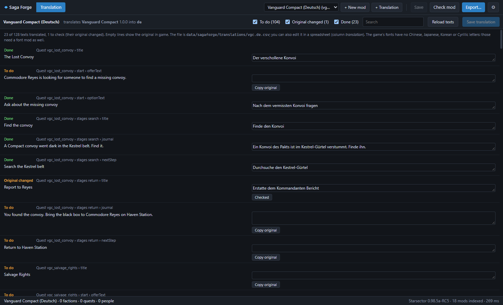
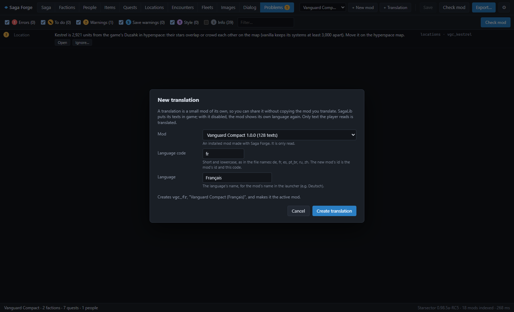

# Translation mods

Anyone can translate a mod made with Saga Forge into another language, without copying it: the
translation is a small mod of its own, and SagaLib puts its texts in place in game.

## How it works

A **translation mod** holds one CSV file with every text of the original mod and its translation.
The original mod is only read, never copied or changed, so the translation can be shared on its
own (with the original author's blessing, as for any mod that builds on another).

### What a translation mod contains

**+ Translation** (in the header) creates the mod `<mod id>_<language>`, for example `vgc_de` for
Vanguard Compact in German, named *Vanguard Compact (Deutsch)*:

- `mod_info.json` (version 0.1.0 to start with), which needs the translated mod and SagaLib;
- `data/config/sagaforge/content.csv`, one row that tells SagaLib "this is a translation of
  `vgc` into `de`";
- `data/sagaforge/translations/<mod id>.<language>.csv`, with the columns `key`, `context`,
  `original`, `translation` and `source`. You can also fill in the *translation* column in a
  spreadsheet.

### What gets translated

Only text the player reads: dialog text, options and their tooltips, journal titles and texts,
the next-step lines, the offer and option texts that start a quest, names of people, places,
systems, markets and fleets, item names and descriptions, descriptions of places and factions,
faction names, phrases, the news of world events, and progress events with their stages. Ids,
file names and anything the player never sees stay as they are.

For the dialog to be translatable, the original mod must be exported with **Translatable texts**
on (the default) for SagaLib 1.2 or later. An older export can still have its names, journal texts
and phrases translated, but not its dialog, until its author exports it again (see
[Export and Release](export.md)).

### In game

With the translation mod enabled next to the original (and SagaLib), the game shows the
translated texts. Disabling it brings the original language back, names in the save included
(except places the player renamed themselves). A text with no translation, or whose original has
changed since it was translated, shows the original. Only one translation per mod is used: with two
enabled, the first one listed wins.

The game's fonts have no Chinese, Japanese, Korean or Cyrillic letters: those languages also need a
font mod.

### The Translation page

When the active mod is a translation mod, Saga Forge shows only one tab, **Translation**:

- the top bar: which mod it translates, which version, into which language; filters for each
  state with their counts; **Search**; **Reload texts** (read the original mod again after it was
  updated); **Save translation**;
- a summary line: how many texts are translated, how many need checking, and the file's path;
- one row per text: its state, where it shows (*Quest vgc_lost_convoy › stages search › journal*),
  the original on the left and your translation on the right.

The states:

| State | Means |
|---|---|
| **To do** | Not translated yet. In game the original shows. **Copy original** starts from it (handy for names that stay the same). |
| **Done** | Translated. |
| **Original changed** | The original was changed after you translated it. The row shows what it **Was**. Fix the translation if needed and press **Checked**. Until then the game shows the original. |
| **Gone from the mod** | The original mod no longer has this text. Kept in case it comes back; not used. |

Under a translation, warnings point out what would break in game, for example a token like
`$playerName` in the original that is missing from the translation.

## How to set up the basics

### Start a translation mod

1. Install the mod you want to translate in your mods folder or the game's mods folder, so Saga
   Forge can read it.
2. Header › **+ Translation**.
3. **Mod**: pick the mod (each shows its version and how many texts it has). Only mods made with
   Saga Forge are listed.
4. **Language code**: short and lowercase, as in file names: `de`, `fr`, `es`, `pt_br`, `ru`, `zh`.
5. **Language**: its name, for the launcher (`Deutsch`, `Français`).
6. The dialog shows the mod it will create (for French: `vgc_fr`, "Vanguard Compact
   (Français)"). **Create translation**. It becomes the active mod and the Translation page opens.

If the dialog warns that the mod was exported before translatable dialog, only its names, journal
texts and phrases can be translated for now.

### Translate the texts

1. With the translation mod active, work down the list, or untick **Done** to see only what is
   left. **Search** finds a word in the context, the original or the translation.
2. Type the translation into the box on the right. Keep tokens such as `$playerName` or
   `$vgc_reyes_title` exactly as they are: the game fills them in. A warning under the box says
   when one is missing.
3. For a name that stays the same, **Copy original**.
4. **Save translation** (the button shows ● while there are unsaved changes). Lines you leave empty
   show the original in game.

5. Enable the translation mod next to the original and SagaLib in the launcher to see it in game.
   Share the translation mod's folder (zip it) with players.

### Update a translation

When the original mod gets an update:

1. Install the new version of the original mod.
2. Open the translation mod and press **Reload texts**.
3. New texts show as **To do**; texts whose original changed show as **Original changed** (when
   Saga Forge knows the old original, it shows under **Was**). Untick **Done** to see only these.
4. For each changed one: adjust the translation if needed, then press **Checked**.

5. Texts the original no longer has show as **Gone from the mod**; you can leave them.
6. **Save translation** and share the translation mod again.
